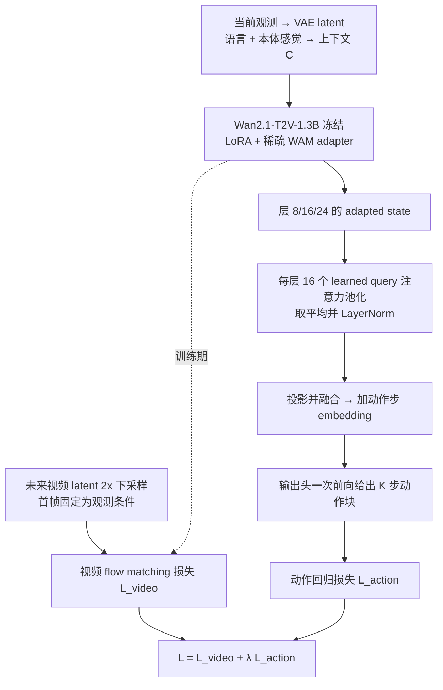

# Light-WAM

**Light-WAM: Efficient World Action Models with State-Fusion Action Decoding**（[arXiv:2606.08242](https://arxiv.org/abs/2606.08242)，武汉大学与上海创智学院等）收录于 [Awesome World-Action Models (RCL)](https://github.com/rcl-robotics/Awesome-World-Action-Models) 第 419/564 篇（分组 WAMs）。本页依据论文全文通读写成，归档见 [来源归档](../../sources/papers/light-wam_arxiv_2606_08242.md)。

## 一句话定义

Light-WAM 是一个轻量 World Action Model：冻结 Wan2.1-T2V-1.3B 作视频骨干，训练时在下采样 latent 空间做未来视频监督，推理时不生成未来视频，由 StateFusionActionExpert 把多层 adapted state 经 learned-query 池化后一次前向直接输出动作块（摘要、§3）。总参数 1.99B，可训练 0.44B（§4.1、Table 6）。

## 英文缩写速查

| 缩写 | 英文全称 | 简要说明 |
|------|----------|----------|
| WAM | World Action Model | 训练时把未来视频预测作为附加目标的机器人策略（§1） |
| VLA | Vision-Language-Action | 视觉-语言-动作策略，仅靠动作监督训练 |
| LoRA | Low-Rank Adaptation | 对冻结骨干的投影层做低秩更新（附录 A） |
| EPT | Embodied Pre-Training | 具身数据预训练；Table 1/2 以 w/ 与 w/o 区分 |
| MHA / LN | Multi-Head Attention / Layer Normalization | learned-query 池化中的注意力与归一化（式 9） |
| VAE | Variational Autoencoder | Wan2.1 的视频编码器，训练时用缓存 latent（附录 B） |

## 为什么重要

- 作者自述：现有 WAM 的训练开销与推理延迟高，难部署为闭环策略；Light-WAM 把可训练参数从 Fast-WAM 的 6.02B 降到 0.44B，训练吞吐提升 4.25x，推理 72.03ms、峰值显存 4.1GiB（§1、§4.4，Table 3-4）。
- 在 LIBERO 上平均 97.2%，无具身预训练的对比方法中第一（§4.2，Table 1）。
- 与 [Fast-WAM](paper-fast-wam.md) 同属「测试时不做视频想象」路线，论文的新增点是把视频监督压到下采样 latent，并用直接动作头替换生成式动作专家（§2、§3）。

## 核心原理与流程总览

图依据：§3 与 Fig.1、Algorithm 1/2。

- **骨干适配（§3.2、附录 A）：** 冻结 Wan，LoRA 加在所有 block 的自注意力、交叉注意力与 FFN 投影；在层 {8,16,24} 加残差瓶颈 adapter（瓶颈 256 维）；本体感觉投影后接在文本 token 之后作为交叉注意力上下文。
- **视频协同训练（§3.3）：** 视频分支在 2x 空间下采样的 latent 上做 flow matching，首帧固定为观测条件；动作分支用原分辨率的当前观测 latent。
- **动作解码（§3.4、附录 A）：** 每层 Nq=16 个 query、8 头注意力，池化后每层投影到 4608 维，三层拼接投影到 6144 维，一个残差 MLP 块，加步位置 embedding，输出 MLP 逐步预测；RoboTwin 2.0 动作块为 24x14。
- **推理（Algorithm 2）：** 单帧 latent 加上下文，一次骨干前向，一次专家前向，无未来视频 rollout、无迭代动作去噪。

## 工程实践

- 训练：AdamW，学习率 1e-4，权重衰减 1e-2，cosine 调度，1,000 步 warmup；4×H100；全局 batch LIBERO 64、RoboTwin 128；训练用缓存的 Wan2.1 VAE latent，评测用在线 VAE（附录 B）。
- 检查点：LIBERO 按套件选（Spatial/Goal 60K、Object 12.5K、Long 80K 步），RoboTwin 2.0 为 460K 步（附录 B）。逐套件选检查点是论文写明的做法，复现时需对齐。
- RoboTwin 2.0 协议：单策略训 50 任务，2,500 条 clean + 25,000 条 randomized 演示（§4.1）。
- 效率数字口径：推理延迟在单卡 RTX 4090 48GB 上测，每次动作查询含 VAE 编码与策略前向，不含仿真与 I/O（Table 4）；训练吞吐的 Light-WAM 变体对照里，部分行为避免 OOM 用 batch 8/卡加梯度累积 2（Table 3 脚注）。
- 代码：[L1ziang/Light-WAM](https://github.com/L1ziang/Light-WAM)（论文摘要给出；本页未读代码）。

### 主要结果（均来自论文）

| 设置 | Light-WAM | 对照 | 出处 |
|------|-----------|------|------|
| LIBERO 平均 | 97.2（98.2/99.6/97.8/93.0） | Fast-WAM 97.0、LingBot-VA 98.5、Motus 97.7、π0.5 96.9 | Table 1 |
| RoboTwin 2.0 平均（clean/rand） | 76.4（76.4/76.3） | Fast-WAM 91.9、LingBot-VA(w/o EPT) 80.6、Motus(w/o EPT) 74.9、π0.5 79.8、X-VLA 72.9、π0 62.2 | Table 2 |
| 推理延迟 / 峰值显存 | 72.03ms / 4.1GiB | Fast-WAM 404.62ms / 12.7GiB，π0.5 76ms（引自他文）| Table 4 |
| 训练吞吐 | 2.08 steps/s | Fast-WAM 0.49 | Table 3 |
| 真机 T1/T2/T3 | 67 / 87 / 53 | π0.5 80 / 93 / 60 | Fig.4 |
| 消融（LIBERO-Spatial） | 默认 98.2 | 不下采样 99.0、5 个 adapter 层 98.0、8 个 query 95.4 | Table 5 |

## 与清单说法的核对

清单（Glen Berseth 的 CoRL 2026 阅读清单，作者说明摘要由 LLM 据摘要起草；排序是作者兴趣模型打分，不是质量评价）对该论文的一句话摘要为：「Lightweight world action model with latent future-video supervision and a state-fusion action expert for efficient closed-loop control.」逐项核对：

| 清单说法 | 论文情况 |
|----------|----------|
| lightweight | 成立但需限定：可训练 0.44B，总加载 1.99B（Table 6），相对 Fast-WAM 的 6.02B / 6.73B 轻；Table 1 里写作 2B（§4.1）。 |
| latent future-video supervision | 成立：future-video flow matching 在 2x 下采样 latent 上做，首帧作条件（§3.3）。 |
| state-fusion action expert | 成立：StateFusionActionExpert，多层 adapted state 经 learned-query 池化融合（§3.4）。 |
| efficient closed-loop control | 部分成立：延迟 72.03ms、4.1GiB 是在 RTX 4090 上测的单次动作查询，不含仿真与 I/O（Table 4），且与 π0.5 的 76ms 只相差约 5%（π0.5 数字引自他文）；论文的闭环成功率证据来自 LIBERO、RoboTwin 2.0（仿真）与 3 个真机任务，其中真机三项均低于 π0.5（Fig.4），RoboTwin 2.0 也低于 Fast-WAM（Table 2）。「高效」主要是相对 WAM 基线成立。 |

清单摘要没有提到：性能结论依赖基准（LIBERO 强，RoboTwin 2.0 作者自称「usable」）；真机只有 3 个任务且落后于 π0.5。

## 局限

- **论文自己承认（§5）：** 更难的多任务设定下，更大的 WAM 与具身预训练策略成功率更高；未在 LIBERO-Plus 等泛化与鲁棒性基准上训练或测试。
- **我看到的未验证之处（判断，非作者自述）：**
  - 真机只有 3 个任务、每任务 50 条演示，论文未给每任务试验次数与置信区间，Fig.4 的差距（6-13 个百分点）难以判断显著性。
  - 消融只在 LIBERO-Spatial 一个套件上做（Table 5），且该套件默认设置已达 98.2，对 RoboTwin 2.0 与长时程任务是否同样成立未验证。
  - LIBERO 各套件分别选检查点（附录 B），Table 1 的平均值因此带有按套件挑选的成分；论文未说明选择依据。
  - 延迟对照中 π0.5 的 76ms 引自他文，未在同一流程下自测（Table 4 脚注）；Fast-WAM 在该表中标为 Action-only 且延迟 404.62ms，与 Light-WAM 的差别包含了动作专家类型的差别，无法单独归因于「下采样视频监督」。
  - 论文称视频分支「学到有用时序信息」的依据是 Fig.3 的定性图，没有去掉视频监督（L_video）的消融，故视频监督本身对成功率的贡献在本文中未单独量化（推测：可参考 Fast-WAM 的相关实验，本页未核）。

## 关联页面

- [World Action Models（WAM）](../concepts/world-action-models.md)
- [Fast-WAM](paper-fast-wam.md)：本文最直接的对照与出发点
- [Motus](paper-sa-2512-13030-motus-a-unified-latent-action-world-model.md)、[LingBot-VA](paper-sa-2601-21998-lingbot-va-causal-video-action-world-model-for-g.md)：Table 1/2 中的 WAM 对照
- [LIBERO 基准](libero-benchmark.md)、[RoboTwin](robotwin.md)：评测基准
- [LIBERO-Plus](paper-rcl-2510-13626-libero-plus-in-depth-robustness-analysis-of-visi.md)：论文自述未测试的鲁棒性基准
- [LoRA](../concepts/lora.md)、[Flow Matching 具身策略](../concepts/flow-matching-embodied-policy.md)、[Action Chunking](../methods/action-chunking.md)
- [生成式世界模型](../methods/generative-world-models.md)、[VLA](../methods/vla.md)、[Manipulation](../tasks/manipulation.md)
- 清单：[Awesome World-Action Models（RCL）](paper-rcl-wam-robot-learning-control-survey.md)、[RCL Awesome WAM 技术地图](../overview/rcl-awesome-wam-technology-map.md)

## 参考来源

- [`sources/papers/light-wam_arxiv_2606_08242.md`](../../sources/papers/light-wam_arxiv_2606_08242.md) — 论文通读归档
- [`sources/papers/rcl_awesome_wam_2606_08242_light-wam-efficient-world-action-models.md`](../../sources/papers/rcl_awesome_wam_2606_08242_light-wam-efficient-world-action-models.md) — 清单策展摘录
- [`sources/papers/rcl_awesome_wam_catalog.md`](../../sources/papers/rcl_awesome_wam_catalog.md) — 列表总表
- [`sources/repos/awesome-world-action-models-rcl.md`](../../sources/repos/awesome-world-action-models-rcl.md)
- 论文：<https://arxiv.org/abs/2606.08242>（[PDF](https://arxiv.org/pdf/2606.08242)）

## 继续阅读

- [原文 arXiv:2606.08242](https://arxiv.org/abs/2606.08242)
- [Light-WAM 代码仓库](https://github.com/L1ziang/Light-WAM)
- [Awesome World-Action Models (RCL)](https://github.com/rcl-robotics/Awesome-World-Action-Models)
