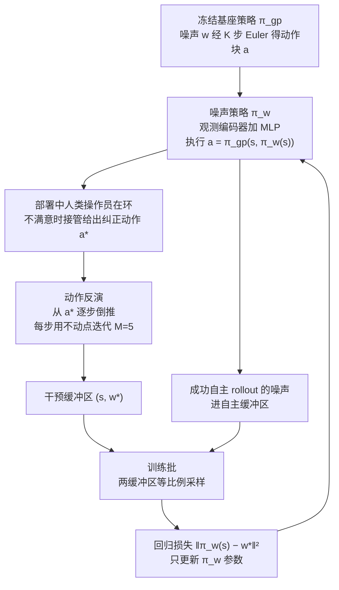

# FlowDAgger（arXiv:2607.08877）

**FlowDAgger**（*FlowDAgger: Human-in-the-Loop Adaptation of Generative Robot Policies in Latent Space*，[arXiv:2607.08877](https://arxiv.org/abs/2607.08877)，Microsoft Research 等）也收录于 [Awesome World-Action Models（RCL）](https://github.com/rcl-robotics/Awesome-World-Action-Models) 第 355/564 篇（分组 WAMs）。本页依据论文全文（[来源归档](../../sources/papers/flowdagger_arxiv_2607_08877.md)）改写；以下数字均来自论文，括号内为章节或表号。

## 一句话定义

冻结预训练的流匹配 / 扩散策略（含世界动作模型），把人类干预给出的纠正动作经“动作反演”还原成基座策略的噪声向量 w*，再用监督回归训练一个只改噪声输入的小策略 π_w，使基座权重不变而行为被人类纠正拉向期望（摘要、§4）。

## 英文缩写速查

| 缩写 | 英文全称 | 简要说明 |
|------|----------|----------|
| DAgger | Dataset Aggregation | 在策略自己访问的状态上收集专家纠正并聚合训练（§3 引 Ross 等） |
| VLA | Vision-Language-Action | 视觉–语言–动作模型，本文用 π0.5 与 Gr00t N1.7 作动作头 VLA 基座 |
| WAM | World Action Model | 世界预测与动作联合生成的模型，本文用 Cosmos-Policy 作基座 |
| ODE | Ordinary Differential Equation | 噪声到动作的生成过程是对速度场积分（式 1） |
| DSRL | Diffusion Steering via RL | 在冻结扩散策略的噪声空间用 RL 学控制器的基线（§2） |
| SFT | Supervised Fine-Tuning | 对离线演示做全权重行为克隆的基线 |
| EDM | Elucidating Diffusion Models 式调度 | Cosmos-Policy 的扩散噪声调度（附录 A.1） |
| FP | Fixed-Point | 不动点迭代，用于逐步求解反演的隐式方程（式 3） |

## 为什么重要

- 它把“人类在线纠正”与“只动噪声输入的潜空间适配”接起来：DSRL 类方法需要奖励与自主探索，而人类给的是动作而不是噪声，反演就是两者之间缺的一环（§1）。
- 基座权重不动，所以论文报告它在留出任务上保留先验更好（§5.4，Table 3），训练可放进部署 π0.5 所需的约 8 GB 显存（§5.2）。
- 同一套流程在动作头 VLA 与没有独立动作头的 WAM 上都能用（§5.3，Table 2），对“怎么给大模型打补丁”给出一条不碰权重的路线。

## 核心原理与流程总览

基座策略对固定观测 s 是从噪声 w 到动作块 a 的确定映射，K 步 Euler 积分得 a（式 1、2）。FlowDAgger 把标准的 w ~ N(0, I) 换成 π_w(s)，执行 `a = π_gp(s, π_w(s))`（式 4）。训练信号来自两路：人类接管时的纠正动作经反演得 (s, w*)，进干预缓冲区；成功自主 rollout 中各转移的噪声进自主缓冲区；每批两缓冲区等比例采样，最小化 `‖π_w(s) − w*‖²`（式 5，§4.3）。

图依据：§4.1 至 §4.3、式 1 至 5。

**动作反演（§4.1）。** 每个前向步 `x_{k+1} = x_k + Δt·v_θ(x_k, t_k, s)` 改写成隐式方程 `x_k = x_{k+1} − Δt·v_θ(x_k, t_k, s)`，用不动点迭代求解，从 `x_K = a*` 一路回到 `x_0 = w*`。论文给出 `Δt·L < 1` 时为压缩映射，故几步即收敛，取 M=5。单次显式反推在 K=10、Δt=0.1 的少步动作头上有 O(Δt) 误差，而机器人动作本身量级小，这个误差占比大（作者的论述）。

**世界动作模型（§4.2）。** Cosmos-Policy 的动作、未来状态与价值是同一联合潜张量（16×9×28×28）的不同帧，没有单独的动作过程，所以反演整个联合过程：以基座预测的干净潜变量为底，只在动作帧加上专家减基座的动作差，其余帧保持基座输出，再反推联合噪声（附录 A.1 处理 EDM 调度的非零终端噪声，附录 A.3 用 64 个 PCA 系数参数化噪声策略的输出）。

## 工程实践

- **训练与部署开销：** 只训小噪声策略，显存与部署 π0.5 相当（约 8 GB），可在单张消费级 GPU 上训练（§5.2）；每条纠正的反演需要 K·M 次速度场评估，不需对基座反向传播（§4.1）。WAM 的终端去噪那一步例外，需要一次 Adam 求解并反传一次去噪器（附录 A.1）。
- **反演精度很关键（附录 B.1，Table 5）：** 在 π0.5 的 assembly 上，逐步不动点（M=5）动作 MSE 0.00168，Euler 反推 0.0329，轨迹级不动点 0.0228，Adam 优化 0.0275；下游 Assembly 成功率 0.87 对 0.59/0.77/0.79。论文称误差大于约 0.03 MSE 的目标会损坏策略。M 从 5 升到 10 只把 MSE 降到 0.00147 而耗时增 1.3 倍（附录 B.2，Table 6）。
- **缓冲区混合：** 只拿稀疏的纠正回归会过拟合少数干预状态，所以与自主成功转移的噪声等比例混合，用来把 π_w 锚在基座已会的行为上（§4.3）。
- **实验协议：** 仿真每法 N=50 条额外 rollout，3 种子，每点 25 次 rollout（§5.1）；真机每格 30 次 rollout，只用 5 到 20 条干预 episode（§5.5，Table 4）。
- **复现入口：** 代码仓库见 <https://github.com/microsoft/FlowDAgger>（本次整理未读仓库，运行方式未核实）。

## 实验结果摘要

| 实验 | 论文数字 | 出处 |
|------|----------|------|
| MetaWorld 12 任务 π0.5 平均成功率 | Base 0.53，SFT 0.71，LoRA-DAgger 0.68，Residual-DAgger 0.64，DSRL 0.55，FlowDAgger 0.78 | §5.2，Table 1 |
| 跨基座 7 个共享任务均值 | π0.5 0.53→0.79，Cosmos-Policy 0.53→0.74 | §5.3，Table 2 |
| 留出任务均值（Hammer 上适配） | 基座 0.96，FlowDAgger 0.88，Residual-DAgger 0.69，LoRA-DAgger 0.30，SFT 0.02 | §5.4，Table 3 |
| 真机 8 任务（30 次 rollout） | Toolbox Packing 0.13→0.80（10 条），Glassware Stacking 0.26→0.76（5 条），Plug Insertion 0.60→0.72（20 条） | §5.5，Table 4 |
| Gr00t N1.7，LIBERO-90 task 57 | 基座 60%，FlowDAgger 约 20 episode 近 100%，DSRL 平台约 70%（单种子） | 附录 B.3，Fig. 5 |
| 扩散策略，robomimic LIFT | 基座约 48%，FlowDAgger 约 97%，DSRL 约 80%（单种子） | 附录 B.4，Fig. 6 |

## 与清单说法的对比核对

清单（Glen Berseth 的 CoRL 2026 阅读清单，P2 档，序号 088/101，Spotlight）对该文的一句话摘要是：“Adapts frozen flow and diffusion policies from human interventions by inverting expert actions to latent noise.” 该摘要由 LLM 据摘要起草，排序也是作者按自己研究兴趣打分，不是质量评价。

| 清单用语 | 论文情况 | 判断 |
|----------|----------|------|
| 适配冻结的流 / 扩散策略 | 基座权重全程冻结，只训 π_w（§4.3）；基座含流匹配 π0.5、Gr00t N1.7、DDPM 扩散策略与 EDM 式的 Cosmos-Policy（§5.1，附录 B） | 对；清单没提世界动作模型也在范围内（§4.2） |
| 来自人类干预 | 方法设定是人类接管给纠正动作（§3、§4.3），真机用人类干预（§5.5） | 对真机成立；仿真里的干预者论文正文没说清，附录 B.1 与 B.3 明说用脚本专家（scripted-expert），MetaWorld 主实验的干预来源未核实 |
| 把专家动作反演为潜在噪声 | 即逐步不动点反演（§4.1，式 3） | 对；“潜在噪声”指基座的初始噪声而非学到的潜表示 |
| （清单未提）对比基线 | 超过 SFT、LoRA-DAgger、Residual-DAgger、DSRL（Table 1），但并非每个任务都赢：Door Lock 上 Residual-DAgger 更高，真机 Jenga Stacking 上 SFT 更高 | 清单省略这些例外 |

## 结论

FlowDAgger 以干预动作反演噪声目标实现轻量适配，但能力受到基座动作流形和纠正数据覆盖的限制。

- 先检查不动点反演误差，再训练噪声策略，流形外行为需考虑权重适配。
- 对照 SFT 或潜空间 RL 时区分人类动作监督与任务奖励的预算差异。
- 同时测试适配任务与保留任务，不能由单项成功推断先验能力完全保留。

## 局限

**论文自述（§6）：**
- 适配能力受基座动作流形限制，目标行为在流形外时反演只能得到最近的可表达行为，可能还需要更多数据或权重空间适配。
- 依赖人类干预的质量与覆盖，只能改进有纠正监督的状态区域，系统性偏差会反映到策略上。
- 高度多模态的动作分布或病态生成动力学下，反演精度可能下降。

**阅读时看到的、论文未充分验证之处（我的判断）：**
- 真机表 Table 4 没写基座策略是 π0.5 还是 Cosmos-Policy，也没有多种子或置信区间；每格 30 次 rollout 的差距（如 Block Pick 0.80 对 0.90）统计意义未讨论。
- 真机上没有与 Residual-DAgger、DSRL、LoRA-DAgger 的对比，只有基座与 SFT（Table 4）。
- 附录 B.3 与 B.4 为单种子、每点 15 次 rollout，且 FlowDAgger 用脚本专家而 DSRL 只用任务奖励，监督信号强度本来不对等（附录 B.3 自述）。
- 保持先验的实验只在 Hammer 一个适配任务上做（§5.4，Table 3），且 FlowDAgger 在留出的 Push 上也从 0.96 掉到 0.56。
- Table 1 的“12 个任务中胜 8 个”是论文自述；表中 SFT 在 Box Close 等任务上更高，只能说平均最高而非处处最优。
- 逐步反演的压缩性条件 `Δt·L < 1` 是论文的理论论述，本次未复核 L 的实际量级（推测：对真实 VLA 动作头不一定可验证）。

## 关联页面

- 同类人在环 / 干预：[MoE-DAgger](./paper-moe-dagger.md)（只管“何时触发干预”，与本文管“怎么用干预数据”互补）、[SimPT 基于干预的 VLA 后训练](./paper-simpt-intervention-based-vla-post-training.md)、[人类引导的自适应残差纠正](./paper-human-guided-adaptive-residual-correction.md)
- 方法页：[DAgger](../methods/dagger.md)、[模仿学习](../methods/imitation-learning.md)、[扩散策略](../methods/diffusion-policy.md)、[残差策略学习](../methods/residual-policy-learning.md)、[VLA](../methods/vla.md)
- 概念页：[流匹配具身策略](../concepts/flow-matching-embodied-policy.md)、[世界动作模型](../concepts/world-action-models.md)、[扩散模型](../concepts/diffusion-model.md)
- 基座策略：[π0.5](./paper-pi05-open-world-vla.md)、[Cosmos Policy](./paper-shenlan-wm-11-cosmos-policy.md)
- 清单入口：[Awesome World-Action Models（RCL）](./paper-rcl-wam-robot-learning-control-survey.md)

## 参考来源

- [`sources/papers/flowdagger_arxiv_2607_08877.md`](../../sources/papers/flowdagger_arxiv_2607_08877.md) — 全文通读归档
- [`sources/papers/rcl_awesome_wam_2607_08877_flowdagger-human-in-the-loop-adaptation.md`](../../sources/papers/rcl_awesome_wam_2607_08877_flowdagger-human-in-the-loop-adaptation.md) — RCL 清单策展摘录
- [`sources/papers/rcl_awesome_wam_catalog.md`](../../sources/papers/rcl_awesome_wam_catalog.md) — 列表总表
- [`sources/repos/awesome-world-action-models-rcl.md`](../../sources/repos/awesome-world-action-models-rcl.md)
- 论文：<https://arxiv.org/abs/2607.08877>；项目页：<https://microsoft.github.io/FlowDAgger>

## 继续阅读

- [原文 PDF](https://arxiv.org/pdf/2607.08877)，重点读 §4.1 与附录 B.1 的反演对比
- DSRL（Wagenmaker 等，arXiv:2506.15799）：本文最近的方法邻居，对比“监督来源”的差别（§2）
- [Awesome World-Action Models（RCL）仓库](https://github.com/rcl-robotics/Awesome-World-Action-Models)
