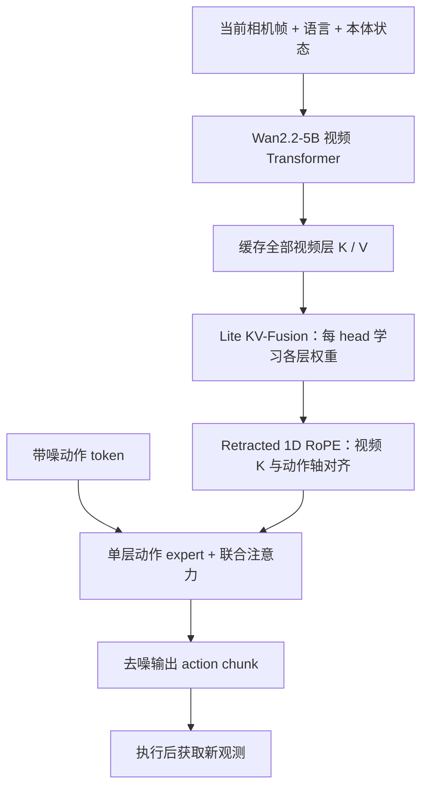
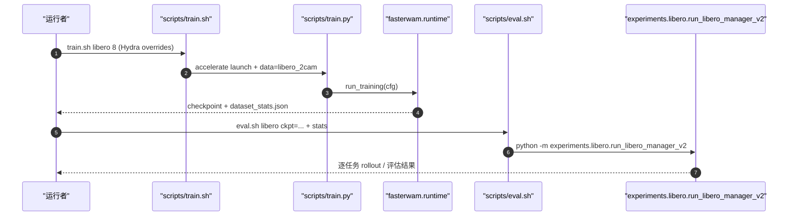

# Faster-WAM｜世界模型为中心的轻量动作模块

[English: Faster-WAM: Do World Action Models Need Deep Action Modules?](https://arxiv.org/abs/2608.02365) · [项目页](https://teamfasterwam.github.io/Faster-WAM/) · [官方源码](https://github.com/TeamFasterwam/FasterWAM)

## 一句话定义

Faster-WAM 不依赖深层动作网络，而用**单层动作 DiT + 跨视频层 Lite KV-Fusion**复用预训练 Wan2.2 视频世界模型的多层表征，以更低推理延迟生成动作块。

## 英文缩写速查

| 缩写 | 英文全称 | 简要说明 |
|---|---|---|
| WAM | World Action Model | 从视频世界模型衍生动作控制 |
| DoT | Dock of Transformers | 视频主干向轻量动作输出头开放多层特征的接口 |
| KV | Key–Value | Transformer 各视频层可复用的注意力缓存 |
| RoPE | Rotary Position Embedding | 视频/动作 token 使用的位置信息 |
| OOD | Out-of-Distribution | LIBERO-Plus 等分布偏移测试 |

## 为什么重要

此前 Fast-WAM 的动作侧保留深模块，即使不再生成未来视频，动作去噪仍占用延迟。本文验证**主干世界表征深，动作读出不一定也要深**，把算力移向视频模型而不是重复计算动作网络。

## 核心原理与流程总览

- **DoT：** 每个动作层、attention head 对视频层的原生 KV 做 softmax 加权，避免手动挑某一特征层（原文 §2.1）。
- **World-model-only conditioning：** 文本和本体状态只进入视频主干；动作头不额外接收同一条件的 cross-attention（§2.2）。
- **Retracted 1D-RoPE：** 已带 3D 视频位置旋转的 key 去旋后映射回动作 1D 时间轴，防止空间/时间位置基不一致（§2.3）。
- **训练 / 推理：** 当前观测预填视频 KV；跨多个动作去噪步骤重复使用融合后固定上下文（§2.4）。

## 源码运行时序图

图依据仓库 README、`scripts/train.sh`、`scripts/train.py` 与 `scripts/eval.sh` 的实际入口；RoboTwin 则映射至 `experiments.robotwin.run_robotwin_manager`。

## 工程实践

| 模块 | 实际信息 |
|---|---|
| 代码 | [TeamFasterwam/FasterWAM](https://github.com/TeamFasterwam/FasterWAM)，含 LIBERO / LIBERO-Plus / RoboTwin 2.0 训练评估 |
| 运行环境 | Linux + CUDA 12.8，PyTorch 2.7.1，BF16；官方 8 GPU 完整训练配方 |
| checkpoint | 训练输出 `checkpoints/weights/step_NNNNNN.pt`，评估须配同一次的 `dataset_stats.json` |
| 模型资产 | Wan2.2 视频主干依赖数十 GB；官网发布自训练权重仍标记 Coming soon |
| 许可证 | PolyForm Noncommercial 1.0.0，**非通用商业使用许可** |

## 实验与评测

| 原文 v2 设定 | Faster-WAM | 对照 |
|---|---:|---|
| LIBERO 平均成功率 | **98.3 ± 0.1%** | 四个套件、三次评估（Table 1） |
| RoboTwin 2.0 clean / randomized | 90.4% / 90.6% | Fast-WAM 91.9% / 91.8%；三次评估均值 |
| LIBERO-Plus 整体成功率 | **78.3%** | Fast-WAM 51.5%，提升 26.8 pp |
| RoboTwin 单 chunk 延迟 | **53.2 ms** | Fast-WAM 196.8 ms（受测量口径约束）；LIBERO 为 52.0 vs 196.0 ms |
| Franka 四任务平均成功率 | **81.3%** | Fast-WAM 80.0% |
| Franka 部署 workstation 单 chunk 延迟 | **129 ms** | Fast-WAM 502 ms |

原文 v2 Table 1–4：相同 chunk 为 **32 个动作、10 步去噪**；LIBERO-Plus 是同一个 LIBERO checkpoint 在七类扰动上的测试。真实机器人为 Franka Panda，四任务各 100 条示范并评估各 20 次。论文对比表的非同硬件、非同配置延迟不要直接并列为一个 speedup；完整任务耗时还包括机器人运动和等待。

## 结论

**单层动作 expert 访问多层视频特征，可以在维持竞争性成功率的同时显著减少 action-side 计算；不代表一层在所有机器人上都最优。**

1. 优先对齐相同硬件、chunk 长度和去噪步数再比较延迟。
2. 检查视频层 KV 融合权重与注意力缓存复用是否正确，避免减少深度却丢失多尺度信息。
3. 实时部署关注单 chunk 时延与总任务节拍，不要混为一谈。
4. LIBERO-Plus 的泛化提升是无额外具身预训练条件下的结果，不能默认泛化到新本体。
5. 完整 benchmark 复现需要多 GPU、模型数据及 checkpoint，且受非商用许可证约束。

## 与其他工作对比

- [Fast-WAM](./paper-fast-wam.md)：减少未来视频生成，动作头仍较深；Faster-WAM 进一步简化 action expert。
- [另一篇同名 Faster-WAM（2608.04404）](./paper-rcl-2608-04404-faster-wam-efficient-inference-time-future-condi.md)：强调稀疏视频–动作交互与未来条件融合，不是本篇的一层动作头设计。
- [World Action Models](../concepts/world-action-models.md)：理解 WAM 与 VLA 的结构差异。

## 局限与风险

- 只验证 Wan2.2 和 LTX-Video 等有限主干；没有穷尽 action depth 的最优搜索。
- 真机为一平台、四任务；未证明跨本体、接触复杂任务均适用。
- **代码已开放，权重仍标记待发布**；大体量依赖与非商用协议均影响复现与转产。

## 关联页面

- [Fast-WAM](./paper-fast-wam.md)
- [另一篇 Faster-WAM](./paper-rcl-2608-04404-faster-wam-efficient-inference-time-future-condi.md)
- [WAM 概念](../concepts/world-action-models.md)
- [VLA 方法](../methods/vla.md)

## 参考来源

- [论文摘录（含 v2 通读核对）](../../sources/papers/rcl_awesome_wam_2608_02365_faster-wam-do-world-action-models-need-d.md)
- [项目主页归档](../../sources/sites/faster-wam.md)
- [源码与入口核查](../../sources/repos/fasterwam-team.md)

## 推荐继续阅读

- [arXiv HTML v2](https://arxiv.org/html/2608.02365)
- [官方训练与评估 README](https://github.com/TeamFasterwam/FasterWAM)
