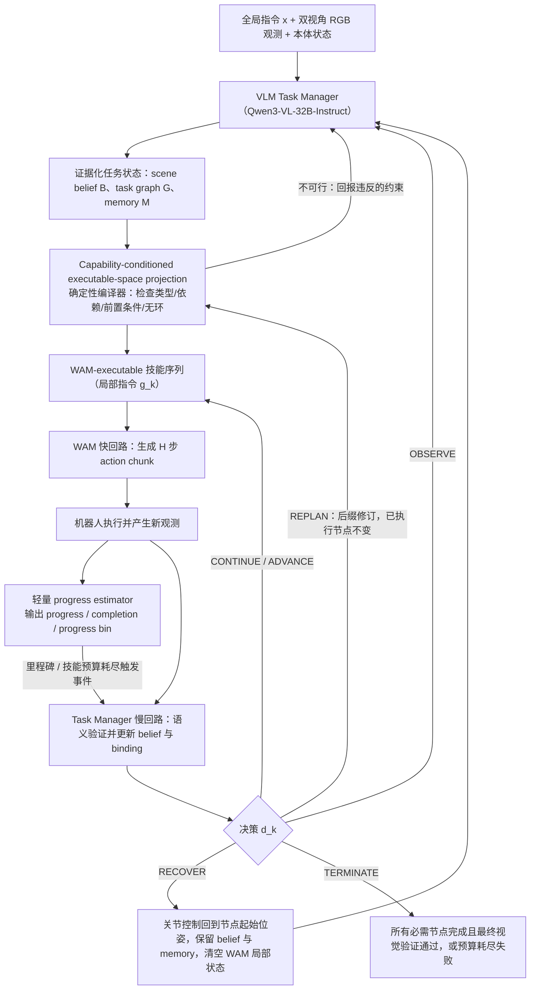

# HarnessWAM

**HarnessWAM: Bridging Prediction and Deliberation in World Action Models** 收录于 [Awesome World-Action Models (RCL)](https://github.com/rcl-robotics/Awesome-World-Action-Models) **第 382/564** 篇，分组 **WAMs**。本页是 **清单索引**：给出它在清单中的位置与原文入口，方法细节和量化结果请看原文。

## 一句话定义

HarnessWAM 是面向 WAM 的 agentic 框架，弥合有限视野预测与全局规划/验证/恢复之间的差距（依据摘要）。数字按版本区分：v1（2026-08-10）摘要称 RoboMemArena 全任务/子任务成功率 59.6% / 69.9%（底层 WAM 为 LingBot-VA），RoboCerebra Ideal SR 23.7%；v2（2026-10-10，现行）摘要改为 64.4% / 76.8%，RoboCerebra Ideal 仍为 23.7%，并新增 UR3 实机（整理 95%、记忆依赖探索箱子 90% 全任务成功率）。v2 主结果用 LingBot-VA + subtask 训练检查点，另评测 FastWAM（依据 arXiv:2608.09516 v1/v2 摘要与 §4.2 Table 1/2）。

## 英文缩写速查

| 缩写 | 英文全称 | 简要说明 |
|------|----------|----------|
| WAM | World Action Model | 世界预测与动作生成耦合 |
| VLA | Vision-Language-Action | 视觉–语言–动作策略 |
| IDM | Inverse Dynamics Model | 先预测未来再反推动作 |
| WM | World Model | 环境前向预测模型 |

## 为什么重要

- HarnessWAM 是面向 WAM 的 agentic 框架，弥合有限视野预测与全局规划/验证/恢复之间的差距（依据摘要）。数字按版本区分：v1（2026-08-10）摘要称 RoboMemArena 全任务/子任务成功率 59.6% / 69.9%（底层 WAM 为 LingBot-VA），RoboCerebra Ideal SR 23.7%；v2（2026-10-10，现行）摘要改为 64.4% / 76.8%，RoboCerebra Ideal 仍为 23.7%，并新增 UR3 实机（整理 95%、记忆依赖探索箱子 90% 全任务成功率）。v2 主结果用 LingBot-VA + subtask 训练检查点，另评测 FastWAM（依据 arXiv:2608.09516 v1/v2 摘要与 §4.2 Table 1/2）。
- 想横向对照同一分组的其他工作，可以从 [RCL Awesome WAM 技术地图](../overview/rcl-awesome-wam-technology-map.md) 逐条展开。
- 顺着列表实体 [Awesome World-Action Models](paper-rcl-wam-robot-learning-control-survey.md) 与站内 WAM / VLA 方法页，可以接回对应的学习主线。

## 流程总览

图依据：论文 §3.1–§3.5 / Fig.2。

## 核心信息

| 字段 | 内容 |
|------|------|
| 编号 | 382/564 |
| 分组 | WAMs |
| 出处 | 见清单 / 原文 |
| 论文 | <https://arxiv.org/abs/2608.09516> |
| 子类 / 象限 | 记忆与长时序 · 策略后训练与WM-RL · 四象限外 |

## 核心机制（归纳）

### 策展导读要点

HarnessWAM 是面向 WAM 的 agentic 框架，弥合有限视野预测与全局规划/验证/恢复之间的差距（依据摘要）。数字按版本区分：v1（2026-08-10）摘要称 RoboMemArena 全任务/子任务成功率 59.6% / 69.9%（底层 WAM 为 LingBot-VA），RoboCerebra Ideal SR 23.7%；v2（2026-10-10，现行）摘要改为 64.4% / 76.8%，RoboCerebra Ideal 仍为 23.7%，并新增 UR3 实机（整理 95%、记忆依赖探索箱子 90% 全任务成功率）。v2 主结果用 LingBot-VA + subtask 训练检查点，另评测 FastWAM（依据 arXiv:2608.09516 v1/v2 摘要与 §4.2 Table 1/2）。

本页不复述论文公式与完整实验表；若需工程落地，请回到原文并对照站内 [World Action Models（WAM）](../concepts/world-action-models.md) 等概念页。

## 评测与指标

- 本页 **没有搬运** 原文的量化 benchmark 与实机指标。
- 评测口径与具体数值以 [原文 / 项目页](https://arxiv.org/abs/2608.09516) 为准。
- 横向对照请回到 [技术地图](../overview/rcl-awesome-wam-technology-map.md) 同分组条目。

## 与其他工作对比

- 本页 **不做** 与具体基线的逐项数值对比；同分组的横向对照请回到 [技术地图](../overview/rcl-awesome-wam-technology-map.md) 的 **WAMs** 分组逐条展开。
- 如果站内已经有这篇的深读页（含机构、实验表与源码运行时序图），请以那一页为准；本页只保留清单要点。
- 与清单内相邻条目孰优孰劣，本页不下结论：清单 Contribution 可能滞后于论文最新版本，差异应以各自原文的问题设定与评测口径为准。

## 结论

**这一页能给你的是「HarnessWAM」在策展清单里的坐标与要点：够你判断要不要去读原文，但不能替代原文。**

- 可确证的只有清单坐标：分组 **WAMs**，以及 Contribution 点出的问题设定；本页不自行推导新结论。
- 适用边界：本页不能替代原文 PDF；开源状态以项目页实际链接为准（清单可能滞后）。
- 要深读这篇，建议直接从原文入手，再回到下方关联的方法 / 任务页对照。

## 常见误区

1. 不要把 Awesome 条目的 Contribution 当成完整方法证明——它只是策展导读。
2. 若站内已有这篇的深读页，以那一页为准——本页只是清单入口，不含实验数据。

## 关联页面

- 列表实体：[Awesome World-Action Models（RCL）](paper-rcl-wam-robot-learning-control-survey.md)
- 技术地图：[RCL Awesome WAM 技术地图](../overview/rcl-awesome-wam-technology-map.md)
- 方法/任务：[generative-world-models.md](../methods/generative-world-models.md)、[manipulation.md](../tasks/manipulation.md)

## 参考来源

- [`sources/papers/rcl_awesome_wam_2608_09516_harnesswam-bridging-prediction-and-delib.md`](../../sources/papers/rcl_awesome_wam_2608_09516_harnesswam-bridging-prediction-and-delib.md) — 本条目策展摘录
- [`sources/papers/rcl_awesome_wam_catalog.md`](../../sources/papers/rcl_awesome_wam_catalog.md) — 列表总表
- [`sources/repos/awesome-world-action-models-rcl.md`](../../sources/repos/awesome-world-action-models-rcl.md)
- [`docs/PAPERS.md`](https://github.com/RCL-Robotics/Awesome-World-Action-Models/blob/main/docs/PAPERS.md) — 上游论文目录
- 论文：<https://arxiv.org/abs/2608.09516>
- [arXiv PDF](https://arxiv.org/pdf/2608.09516)：已通读方法部分（实验与附录以略读为准）：§1 引言、§3 方法（3.1–3.5）、§4.1 实验设定
- 核对（2026-11-02）：对照 arXiv:2608.09516 v1 摘要/Table 1 与 v2 摘要/§4.2（v2 取自 arxiv.org/html/2608.09516v2），确认 59.6%/69.9% 属 v1、64.4%/76.8% 属 v2（现行），已按版本标注；v2 PDF 本机无法解析，v2 数字以其 HTML 版本为准。

## 推荐继续阅读

- [Awesome World-Action Models (RCL) 仓库](https://github.com/rcl-robotics/Awesome-World-Action-Models)
- [原文](https://arxiv.org/abs/2608.09516)
