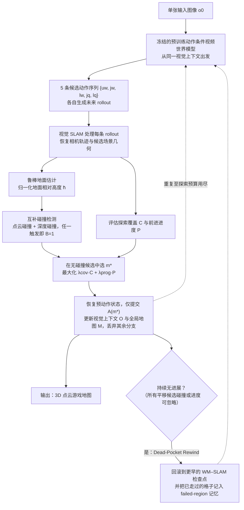

# Valerant

**Valerant: An Automatic Navigable Game Map Generator via Action-Conditioned World Model Exploration** 收录于 [Awesome World-Action Models (RCL)](https://github.com/rcl-robotics/Awesome-World-Action-Models) **第 218/564** 篇，分组 **Related resources**。本页是 **清单索引**：给出它在清单中的位置与原文入口，方法细节和量化结果请看原文。

## 一句话定义

Valerant expands one game screenshot into a persistent 3D point-cloud map by generating alternative action-conditioned videos, reconstructing each with SLAM, and committing the best admissible branch. A frozen video model supplies futures; an external exploration policy selects actions. Perceptual comparison and qua...

## 英文缩写速查

| 缩写 | 英文全称 | 简要说明 |
|------|----------|----------|
| WAM | World Action Model | 世界预测与动作生成耦合 |
| VLA | Vision-Language-Action | 视觉–语言–动作策略 |
| IDM | Inverse Dynamics Model | 先预测未来再反推动作 |
| WM | World Model | 环境前向预测模型 |

## 为什么重要

- Valerant expands one game screenshot into a persistent 3D point-cloud map by generating alternative action-conditioned videos, reconstructing each with SLAM, and committing the best admissible branch. A frozen video model supplies futures; an external exploration policy selects actions. Perceptual comparison and qua...
- 想横向对照同一分组的其他工作，可以从 [RCL Awesome WAM 技术地图](../overview/rcl-awesome-wam-technology-map.md) 逐条展开。
- 顺着列表实体 [Awesome World-Action Models](paper-rcl-wam-robot-learning-control-survey.md) 与站内 WAM / VLA 方法页，可以接回对应的学习主线。

## 流程总览

图依据：论文 §3.2 概览、§3.3.1–3.3.3、Fig.2（式 5–11）

## 核心信息

| 字段 | 内容 |
|------|------|
| 编号 | 218/564 |
| 分组 | Related resources |
| 出处 | 2026 |
| 论文 | <https://arxiv.org/abs/2609.09418> |
| 子类 / 象限 | Generative-world applications · 不适用 |

## 核心机制（归纳）

### 策展导读要点

Valerant expands one game screenshot into a persistent 3D point-cloud map by generating alternative action-conditioned videos, reconstructing each with SLAM, and committing the best admissible branch. A frozen video model supplies futures; an external exploration policy selects actions. Perceptual comparison and qua...

本页不复述论文公式与完整实验表；若需工程落地，请回到原文并对照站内 [World Action Models（WAM）](../concepts/world-action-models.md) 等概念页。

## 评测与指标

- 本页 **没有搬运** 原文的量化 benchmark 与实机指标。
- 评测口径与具体数值以 [原文 / 项目页](https://arxiv.org/abs/2609.09418) 为准。
- 横向对照请回到 [技术地图](../overview/rcl-awesome-wam-technology-map.md) 同分组条目。

## 与其他工作对比

- 本页 **不做** 与具体基线的逐项数值对比；同分组的横向对照请回到 [技术地图](../overview/rcl-awesome-wam-technology-map.md) 的 **Related resources** 分组逐条展开。
- 如果站内已经有这篇的深读页（含机构、实验表与源码运行时序图），请以那一页为准；本页只保留清单要点。
- 与清单内相邻条目孰优孰劣，本页不下结论：清单 Contribution 可能滞后于论文最新版本，差异应以各自原文的问题设定与评测口径为准。

## 结论

**这一页能给你的是「Valerant」在策展清单里的坐标与要点：够你判断要不要去读原文，但不能替代原文。**

- 可确证的只有清单坐标：分组 **Related resources**，以及 Contribution 点出的问题设定；本页不自行推导新结论。
- 适用边界：本页不能替代原文 PDF；开源状态以项目页实际链接为准（清单可能滞后）。
- 要深读这篇，建议直接从原文入手，再回到下方关联的方法 / 任务页对照。

## 常见误区

1. 不要把 Awesome 条目的 Contribution 当成完整方法证明——它只是策展导读。
2. 若站内已有这篇的深读页，以那一页为准——本页只是清单入口，不含实验数据。

## 关联页面

- 列表实体：[Awesome World-Action Models（RCL）](paper-rcl-wam-robot-learning-control-survey.md)
- 技术地图：[RCL Awesome WAM 技术地图](../overview/rcl-awesome-wam-technology-map.md)
- 方法/任务：[generative-world-models.md](../methods/generative-world-models.md)、[manipulation.md](../tasks/manipulation.md)

## 参考来源

- [`sources/papers/rcl_awesome_wam_2609_09418_valerant-an-automatic-navigable-game-map.md`](../../sources/papers/rcl_awesome_wam_2609_09418_valerant-an-automatic-navigable-game-map.md) — 本条目策展摘录
- [`sources/papers/rcl_awesome_wam_catalog.md`](../../sources/papers/rcl_awesome_wam_catalog.md) — 列表总表
- [`sources/repos/awesome-world-action-models-rcl.md`](../../sources/repos/awesome-world-action-models-rcl.md)
- [`docs/PAPERS.md`](https://github.com/RCL-Robotics/Awesome-World-Action-Models/blob/main/docs/PAPERS.md) — 上游论文目录
- 论文：<https://arxiv.org/abs/2609.09418>
- [arXiv PDF](https://arxiv.org/pdf/2609.09418)：已通读方法部分（实验与附录以略读为准）：摘要、§1、§3.1–3.3；§4 实验略读

## 推荐继续阅读

- [Awesome World-Action Models (RCL) 仓库](https://github.com/rcl-robotics/Awesome-World-Action-Models)
- [原文](https://arxiv.org/abs/2609.09418)
