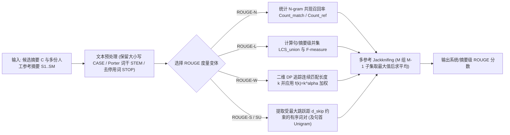

# ROUGE

**ROUGE: A Package for Automatic Evaluation of Summaries** 收录于 [Awesome World-Action Models (RCL)](https://github.com/rcl-robotics/Awesome-World-Action-Models) **第 144/564** 篇，分组 **Evaluation metrics**。本页是 **清单索引**：给出它在清单中的位置与原文入口，方法细节和量化结果请看原文。

## 一句话定义

**ROUGE**（Recall-Oriented Understudy for Gisting Evaluation）是一套面向自动文本摘要的**以召回率为导向**的自动评测指标包，通过统计候选摘要与人工参考摘要在 n-gram、最长公共子序列（LCS）和跳跃二元组（skip-bigram）上的重合度来衡量内容覆盖质量。

## 英文缩写速查

| 缩写 | 英文全称 | 简要说明 |
|------|----------|----------|
| ROUGE | Recall-Oriented Understudy for Gisting Evaluation | 本文提出的一组面向召回率的摘要自动评测指标族 |
| LCS | Longest Common Subsequence | 最长公共子序列，ROUGE-L 的核心匹配单元 |
| WLCS | Weighted Longest Common Subsequence | 加权最长公共子序列，ROUGE-W 用于奖励连续匹配 |
| DUC | Document Understanding Conference | NIST 主办的大规模文本摘要评测会议（2001–2004） |
| SEE | Summary Evaluation Environment | USC/ISI 开发的摘要人工内容覆盖率标注工具 |

## 为什么重要

- **打破人工评测瓶颈**：如 DUC 这类大规模人工摘要评测往往需要超过 **3,000 小时** 人力成本且难以高频复现，ROUGE 提供了可快速迭代的自动化替代指标。
- **与精确率指标互补**：机器翻译指标 BLEU 以 n-gram 精确率（precision）为核心，而摘要任务更关注关键信息是否被充分覆盖，ROUGE 系统确立了以**召回率（recall）**为核心的文本生成评测范式（在 VLA / 多模态规划与世界模型文本描述任务中亦常作为语言生成评估基线）。
- 想横向对照同一分组的其他工作，可以从 [RCL Awesome WAM 技术地图](../overview/rcl-awesome-wam-technology-map.md) 逐条展开，或顺着列表实体 [Awesome World-Action Models](paper-rcl-wam-robot-learning-control-survey.md) 接回学习主线。

## 核心信息

| 字段 | 内容 |
|------|------|
| 编号 | 144/564 |
| 分组 | Evaluation metrics |
| 出处 | ACL Workshop: Text Summarization Branches Out, 2004 |
| 作者 / 机构 | Chin-Yew Lin（USC Information Sciences Institute） |
| 论文 | <https://aclanthology.org/W04-1013/> |
| 子类 / 象限 | 语言生成指标 · 评估指标与协议 · 不适用 |

## 核心机制（归纳）

> 注：以下机制与评测指标基于通读原文全文（ACL Workshop 2004，评测包版本 v1.2.1）核对补充。

ROUGE 包定义了四种核心自动评测度量（ROUGE-N、ROUGE-L、ROUGE-W、ROUGE-S）及扩展版 ROUGE-SU，并采用**留一交叉验证（Jackknifing）**处理多参考摘要：

1. **ROUGE-N（N-gram 共现召回率）**：
   - 计算候选摘要与参考摘要集合之间的 n-gram 召回率：
     $$\text{ROUGE-N} = \frac{\sum_{S \in \{\text{ReferenceSummaries}\}} \sum_{\text{gram}_n \in S} \text{Count}_{\text{match}}(\text{gram}_n)}{\sum_{S \in \{\text{ReferenceSummaries}\}} \sum_{\text{gram}_n \in S} \text{Count}(\text{gram}_n)}$$
   - 分子在所有参考摘要上求和，从而天然给予**在多份参考摘要中共同出现（共识度高）**的 n-gram 更高权重。
   - **多参考与 Jackknifing**：设有 $M$ 份参考摘要，包内对全部 $M$ 个大小为 $M-1$ 的参考子集分别取候选摘要与各参考摘要成对分数的最大值并求平均，以便在同等参考数量口径下与人工参考摘要之间互相估计人类基线水平。
2. **ROUGE-L（基于最长公共子序列 LCS 的 F-measure）**：
   - **句子级**：设参考句 $X$ 长 $m$、候选句 $Y$ 长 $n$，则 $R_{\text{lcs}} = \frac{\text{LCS}(X,Y)}{m}$，$P_{\text{lcs}} = \frac{\text{LCS}(X,Y)}{n}$，调和度量 $F_{\text{lcs}} = \frac{(1+\beta^2) R_{\text{lcs}} P_{\text{lcs}}}{R_{\text{lcs}} + \beta^2 P_{\text{lcs}}}$（在 DUC 中将 $\beta$ 设为极大值如 $\beta \to \infty$，退化为只考察 $R_{\text{lcs}}$）。优势在于不要求连续匹配，只需**顺序一致**且无需预设 $n$。
   - **摘要级**：对参考摘要的每个句子 $r_i$ 与候选摘要全部句子 $C$ 取**并集最长公共子序列（Union LCS）** $\text{LCS}_\cup(r_i, C)$ 后累加求 $R_{\text{lcs}} = \frac{\sum_{i=1}^u \text{LCS}_\cup(r_i, C)}{m}$ 与 $P_{\text{lcs}} = \frac{\sum_{i=1}^u \text{LCS}_\cup(r_i, C)}{n}$。
3. **ROUGE-W（加权最长公共子序列 WLCS）**：
   - 标准 LCS 无法区分连续匹配（如 `[A B C D H I K]`）与分散匹配（如 `[A H B K C I D]`）。ROUGE-W 在动态规划中额外维护以 $(i,j)$ 结尾的连续匹配长度表 $w(i,j)=k$，当 $x_i = y_j$ 时按满足超可加性 $f(x+y) > f(x)+f(y)$ 的权函数更新得分表 $c(i,j) = c(i-1,j-1) + f(k+1) - f(k)$（常用多项式 $f(k)=k^\alpha, \alpha>1$，包内实验取 $\alpha=1.2$），并用其反函数 $f^{-1}$ 归一化计算 $R_{\text{wlcs}} = f^{-1}\left(\frac{\text{WLCS}(X,Y)}{f(m)}\right)$、$P_{\text{wlcs}} = f^{-1}\left(\frac{\text{WLCS}(X,Y)}{f(n)}\right)$ 及 $F_{\text{wlcs}}$。
4. **ROUGE-S 与 ROUGE-SU（跳跃二元组共现统计）**：
   - **ROUGE-S**：统计句子中保持词序但允许任意间隔的所有词对（skip-bigram，长 $m$ 句共 $C(m,2)$ 个），计算 $\text{SKIP2}(X,Y)$ 对应的召回 $R_{\text{skip2}} = \frac{\text{SKIP2}(X,Y)}{C(m,2)}$、精确率 $P_{\text{skip2}} = \frac{\text{SKIP2}(X,Y)}{C(n,2)}$ 与 $F_{\text{skip2}}$。为抑制 `"the the"` 等伪匹配，可限制最大跳跃距离 $d_{\text{skip}}$（如 $d_{\text{skip}}=4$ 或 $9$；$d_{\text{skip}}=0$ 时退化为 bigram 重合 F-measure）。
   - **ROUGE-SU**：当候选句完全倒序而无任何有序词对匹配时（ROUGE-S 得 0），在句子开头加入句首标记（等价于并入 unigram 统计）即可区分“含有效词汇但词序颠倒”与“完全无词重叠”的摘要。

### 方法流程图

关于生成式世界模型与多模态语言评价指标的联系，可对照站内 [World Action Models（WAM）](../concepts/world-action-models.md) 与 [generative-world-models.md](../methods/generative-world-models.md)。

## 评测与指标

- **评测数据与人工基准**：使用 DUC 2001、2002、2003 人工评测集（人工评审员通过 SEE 工具逐单元给出内容覆盖率得分），检验 17 种 ROUGE 变体（R-1..9、R-L、R-W-1.2、R-S*/S4/S9、R-SU*/SU4/SU9）在原始文本（CASE）、Porter 词干化（STEM）与去停用词（STOP）及单/多参考下的 **Pearson 相关系数 $r$**（95% 置信区间由 bootstrap 重采样估计）：
- **单文档 100 词摘要（Table 1）**：
  - **DUC 2001**（12 系统、149 篇/系统）：单参考下 **R-W-1.2 达 0.85**、R-2（CASE/STEM）与 R-S4/S9/SU4/SU9 达 **0.84–0.85**、R-L 达 **0.83**；3 参考下 R-2（0.87）、R-W-1.2（0.87）、R-S4/S9（**0.87–0.88**）与 R-SU4/SU9（0.87）整体更优。
  - **DUC 2002**（14 系统、295 篇/系统，样本量翻倍）：几乎所有指标与人工判断的相关系数均达到 **0.97–0.99**（R-2、R-L、R-S4、R-SU4、R-W-1.2 均达 **0.99**）。
- **单文档极短摘要 ~10 词标题类（DUC 2003，14 系统、624 篇/系统，Table 2）**：
  - **R-1（0.95–0.96）、R-L（0.96–0.97）、R-W-1.2（0.96）、R-SU4（0.94–0.98）、R-SU9（0.95–0.97）** 表现优异；而高阶 $n$-gram（$N>1$）因短句稀疏显著退化（R-2 仅 0.75–0.77，R-5 为 0.60–0.64，R-9 降至 0.00–0.51）。
- **多文档摘要（Table 3，DUC 2001/2002/2003，29–59 篇/系统）**：
  - 100 词多文档任务因样本量较小（约 30–59 篇）相关性整体低于单文档，但**去除停用词（STOP）与增加多参考**带来显著增益：例如 DUC 2001 100 词 3 参考下 R-1 从 0.53（CASE）升至 **0.87**（STOP），R-SU4 从 0.55 升至 **0.83**；DUC 2003 100 词 4 参考下 R-2（STOP）达 **0.81**、R-S4（STOP）达 **0.78**。
  - 200–400 词长摘要相关性回升至较高水平：DUC 2002 200 词多参考下 R-2 达 **0.93–0.94**、R-S4/SU4 达 **0.93**；DUC 2001 400 词下 R-1（STOP）达 **0.90**、R-SU4（STOP）达 **0.88**。

## 与其他工作对比

- **ROUGE vs. BLEU**：BLEU 面向机器翻译、以**精确率（precision）**与简短惩罚为核心；ROUGE 面向摘要、以**召回率（recall）**为核心，对信息覆盖度更敏感。
- **ROUGE-L vs. MEAD 归一化成对 LCS**：MEAD 的归一化成对 LCS 等价于 $\beta=1$ 的句子级 F-measure，但在摘要级对每句取参考集中**最大** LCS 匹配；ROUGE-L 在摘要级采用**并集 LCS（$\text{LCS}_\cup$）**，并在 DUC 标准评测中取 $\beta \to \infty$ 侧重召回。
- **ROUGE-W / ROUGE-S vs. ROUGE-L**：ROUGE-L 仅计入一条最长公共子序列，既无法奖励连续块（由 ROUGE-W 的超可加权函数 $f(k)=k^\alpha$ 解决），也忽略了其他次优有序子序列（由 ROUGE-S/SU 统计全部带最大跨距 $d_{\text{skip}}$ 的有序词对解决）。
- 同分组其他评测指标的横向对照，请回到 [技术地图](../overview/rcl-awesome-wam-technology-map.md) 的 **Evaluation metrics** 分组展开。

## 结论

**ROUGE 通过将 n-gram 召回、并集/加权 LCS 与带跨距限制的 skip-bigram 纳入统一多参考 Jackknifing 框架，奠定了文本摘要自动评测的基础协议。**

1. **按任务长度选型**：100 词单文档常规摘要优先使用 **ROUGE-2、ROUGE-L、ROUGE-W 或 ROUGE-S4/SU4**（DUC 2001/2002 相关性达 0.84–0.99）；~10 词极短标题摘要应使用 **ROUGE-1、ROUGE-L、ROUGE-W 或 ROUGE-SU4/SU9**，避免使用 $N \ge 2$ 的高阶 ROUGE-N。
2. **多文档必开停用词过滤与多参考**：多文档摘要下保留停用词会稀释关键词匹配信号，去除停用词（STOP）并引入多份人工参考摘要能稳定将相关性提升至 0.70–0.87+。
3. **无约束 skip-bigram 需限距**：使用 ROUGE-S/SU 时应设定 $d_{\text{skip}}$（如 4 或 9），防止跨句伪匹配（如 `"the the"`）污染评分。
4. **指标定位边界**：ROUGE 仅衡量表层词汇与有序共现覆盖率，不能替代人工对连贯性、语法流畅性与事实一致性的审校。

## 常见误区

1. **误把 ROUGE 当作语义或事实等价度量**：ROUGE 依赖字面或 Porter 词干匹配，同义改写、抽象概括与事实幻觉无法被其直接识别。
2. **在极短文本上盲信 ROUGE-2 / ROUGE-4**：DUC 2003 10 词摘要实验表明，$N>1$ 的高阶 n-gram 重合极为稀疏，相关系数会从 0.96 骤降至 0.75 甚至 0.00。
3. **忽略预处理与参数口径差异**：大小写、词干化（STEM）、停用词表（STOP）、$\beta$ 取值（如 $\beta \to \infty$ vs. $\beta=1$）及是否启用 Jackknifing 会显著改变绝对分值，跨论文对比必须统一 `ROUGE` 配置。
4. **忽视小样本多文档统计不稳定性**：当每个系统仅有约 30 篇多文档样本（如 DUC 2001/2003）时，系统级相关性波动较大，不宜仅凭微小 ROUGE 差距下强结论。

## 关联页面

- 列表实体：[Awesome World-Action Models（RCL）](paper-rcl-wam-robot-learning-control-survey.md)
- 技术地图：[RCL Awesome WAM 技术地图](../overview/rcl-awesome-wam-technology-map.md)
- 方法/任务：[generative-world-models.md](../methods/generative-world-models.md)、[manipulation.md](../tasks/manipulation.md)

## 参考来源

- [`sources/papers/rcl_awesome_wam_ref_00a732613bb51f4fb578_rouge-a-package-for-automatic-evaluation.md`](../../sources/papers/rcl_awesome_wam_ref_00a732613bb51f4fb578_rouge-a-package-for-automatic-evaluation.md) — 本条目策展摘录
- [`sources/papers/rcl_awesome_wam_catalog.md`](../../sources/papers/rcl_awesome_wam_catalog.md) — 列表总表
- [`sources/repos/awesome-world-action-models-rcl.md`](../../sources/repos/awesome-world-action-models-rcl.md)
- [`docs/PAPERS.md`](https://github.com/RCL-Robotics/Awesome-World-Action-Models/blob/main/docs/PAPERS.md) — 上游论文目录
- 论文：<https://aclanthology.org/W04-1013/>

## 推荐继续阅读

- [Awesome World-Action Models (RCL) 仓库](https://github.com/rcl-robotics/Awesome-World-Action-Models)
- [原文](https://aclanthology.org/W04-1013/)
