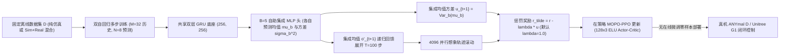

# Uncertainty-Aware Robotic World Model Makes Offline Model-Based Reinforcement Learning Work on Real Robots

**Uncertainty-Aware Robotic World Model Makes Offline Model-Based Reinforcement Learning Work on Real Robots**（ETH Zurich：Chenhao Li, Andreas Krause, Marco Hutter，arXiv:2504.16680v3）收录于 [Awesome World-Action Models (RCL)](https://github.com/rcl-robotics/Awesome-World-Action-Models) **第 501/564** 篇，分组 **WAMs**。本页基于论文全文完成机制与实机实验拆解，补全 RWM-U 与 MOPO-PPO 的全离线真机强化学习方法栈。

## 一句话定义

RWM-U + MOPO-PPO 是一套面向真实腿足与人形机器人的全离线基于模型强化学习（Offline MBRL）管线：通过共享 GRU 骨干加 5-头自助集成头估计长程自回归滚动中的认识不确定性，并以不确定性惩罚奖励驱动高稳定性在策略 PPO 想象训练。

## 英文缩写速查

| 缩写 | 英文全称 | 简要说明 |
|------|----------|----------|
| RWM-U | Uncertainty-Aware Robotic World Model | 在 RWM 基础上增加集成不确定性估计的自回归机器人世界模型 |
| MOPO-PPO | Model-Based Offline Policy Optimization with PPO | 将 MOPO 不确定性惩罚回报适配至在策略 PPO 的离线优化框架 |
| MBRL | Model-Based Reinforcement Learning | 通过学习环境动力学模型生成想象轨迹来优化策略的强化学习范式 |
| GRU | Gated Recurrent Unit | RWM-U 用于聚合 $M=32$ 步历史观测-动作上下文的双层（256, 256）循环骨干 |
| WAM | World Action Model | 世界预测与动作生成耦合的策展分类（所属 RCL WAMs 分组） |
| VLA | Vision-Language-Action | 视觉–语言–动作策略（站内关联对比主线） |
| IDM | Inverse Dynamics Model | 逆动力学模型（先预测未来状态再反推动作） |

## 为什么重要

- 传统离线 RL（如 CQL、IQL、MOPO-SAC）大多基于异策略值函数（SAC/Q-learning）和单步前馈动力学，在仿真标准基准有效，但在高维、强时序关联、部分可观测的真实足式机器人运动控制上极易因值函数过拟合或分布外幻觉导致碰撞摔倒。
- 现代足式机器人最稳定的在策略（On-Policy）算法是 PPO，而原始 RWM 缺乏不确定性度量，只能在在线交互中修正模型误差。
- 本文首次将认识不确定性估计稳健传播至 **100 步**自回归想象轨迹并与 PPO 结合，在 **ANYmal D** 四足与 **Unitree G1** 人形真机上完全基于离线日志训练出可部署策略，且适度融合真机日志后反超纯仿真在线 PPO。
- 可顺着 [RCL Awesome WAM 技术地图](../overview/rcl-awesome-wam-technology-map.md)、[Awesome World-Action Models](paper-rcl-wam-robot-learning-control-survey.md) 与 [ETH RSL RWM 仓库页](robotic-world-model-eth-rsl.md) 横向追踪同一主线。

## 核心信息

| 字段 | 内容 |
|------|------|
| 编号 / 分组 | 501/564 · WAMs |
| 作者与机构 | Chenhao Li, Andreas Krause, Marco Hutter（ETH Zurich） |
| 出处 / 版本 | ICLR 2026 Workshop on World Models · arXiv:2504.16680v3（2026-01-08） |
| 论文链接 | <https://openreview.net/pdf/4c7bf7d1b35f9e402b680031bb65e7738103a9bb.pdf> / <https://arxiv.org/abs/2504.16680> |
| 代码 / 项目页 | <https://github.com/leggedrobotics/robotic_world_model> · <https://sites.google.com/view/uncertainty-aware-rwm> |
| 子类 / 象限 | 策略后训练与WM-RL · 四象限外 |

## 核心机制

1. **双自回归不确定性感知世界模型（RWM-U）**：
   - 继承 RWM 无领域先验的双自回归多步预测损失：$L = \frac{1}{N}\sum_{k=1}^{N} \alpha^k L_o(o'_{t+k}, o_{t+k})$，工作频率 50 Hz（$\Delta t = 0.02\text{ s}$），历史窗长 $M=32$、训练预测窗长 $N=8$（衰减 $\alpha=1.0$，6M 转移样本在单张 RTX 4090 上训练约 1 小时）。
   - 网络结构（Table S7）：共享双层 GRU 底座（256, 256）+ **$B=5$ 个独立自助集成 MLP 预测头**（128 维，ReLU），同时带特权信息（接触力、足端高度/速度）辅助监督头。每个集成成员 $b$ 输出下一观测高斯分布 $\mathcal{N}(\mu_{o_{t+k}}^b, \sigma_{o_{t+k}}^{2,b})$。
   - **不确定性解耦（Eq. 4）**：以集成均值 $o'_{t+1} = \mathbb{E}_b[\mu_{o_{t+1}}^b]$ 递归回馈进行长程想象（$T=100$ 步）；各成员预测标准差均值刻画**偶然不确定性（Aleatoric）**，而集成均值间方差 $u_{t+1} = \text{Var}_b[\mu_{o_{t+1}}^b]$ 刻画由离线数据覆盖不足引起的**认识不确定性（Epistemic）**。
2. **观测与动作空间设计（Appendix A.1.1）**：
   - **ANYmal D**：世界模型观测 45 维（基座线/角速度、重力投影、12 关节位置/速度/力矩）+ 8 维特权接触（膝 4 + 足 4）；策略观测 48 维（含速度指令与上一步动作，不含力矩）；动作 12 维关节目标位置。
   - **Unitree G1**：世界模型观测 96 维（含 29 关节位置/速度/力矩）+ 30 维特权（26 身体接触 + 2 足高 + 2 足速）；策略观测 99 维；动作 29 维关节目标位置。
3. **不确定性惩罚的想象优化（MOPO-PPO, Eq. 5 & Algorithm 1）**：
   - 在完全不交互真实环境的 4096 个并行想象环境中，从离线数据集采样初始历史片段，用当前策略与 RWM-U 自回归展开 $T=100$ 步；
   - 使用认识不确定性对每步奖励做惩罚：$\tilde{r}(o_t, a_t) = r_t(o_t, a_t) - \lambda u_{p_\phi}(o_{t-M+1:t}, a_{t-M+k:t})$（默认校准权重 $\lambda = 1.0$），再用 3 层 128 维 ELU MLP 组成的 PPO Actor-Critic 更新策略。

### 方法流程图

## 实验与评测

1. **长程自回归不确定性对齐验证（Section 5.1, Fig. 3）**：
   - 在 ANYmal D 上先喂入 32 步真实历史，从 $t=32$ 起完全自回归预测至 $t=200$：随着步数增加，模型累积预测误差上升，RWM-U 的**认识不确定性**曲线与真实预测误差高度同步，而**偶然不确定性**始终保持低位，验证了其作为长程可信度度量的可靠性。
2. **不确定性惩罚系数 $\lambda$ 校准（Section 5.2 & 5.4, Fig. 4 & 7）**：
   - 惩罚过小（$\lambda \le 0.5$，真机测试 $\lambda=0.2$）：策略在想象中获得虚高回报，实为利用模型幻觉误差，真机部署出现步态失稳、频繁碰撞或无法行走；
   - 惩罚过大（$\lambda \ge 2.0$，如 $5.0, 10.0$）：策略被迫退缩到低不确定性区，真机表现为原地站立或极微小无效动作；
   - 校准值 **$\lambda = 1.0$** 在想象收益与认识不确定性间取得平衡，在 ANYmal D 与 Unitree G1 上实现稳定速度跟踪。
3. **跨任务仿真离线基准对比（Section 5.3, Fig. 5）**：
   - 在 `Reach-Franka`（操作）、`Velocity-ANYmal-D`（四足）、`Velocity-Unitree-G1`（人形）三项任务及 `Random`、`Medium`、`Expert`、`Mixed` 四种数据集质量下对比 **CQL**、**MBPO**、**MBPO-PPO** 与 **MOPO**。
   - 结果显示：无不确定性的 MBPO/MBPO-PPO 在高维运动控制上因过拟合模型误差而频繁跌倒；基于值函数的 CQL 与 SAC 类方法（MBPO/MOPO）在两类运动任务上明显落后于 PPO 路线；`Mixed` 数据集因覆盖更广而优于单一 `Expert` 数据集，**MOPO-PPO** 在所有任务与数据分布上均取得最高稳健性。
4. **真机 ANYmal D 仿真+真实数据混合实验（Section 5.4, Table 1, 5 种子）**：
   - 作者搭建自主真机采集管线（融合腿足里程计与 LiDAR 构筑安全矩形边界框，约 1 小时采集 **200K** 真实转移样本）。

| 训练数据配比（Sim / Real） | 归一化真机表现（mean ± std） | 说明 |
|--------------------------|-----------------------------|------|
| 数据采集原策略（参考基线） | 0.79 ± 0.02 | 用于采集真机日志的策略基线 |
| 纯仿真在线无模型 PPO | 0.88 ± 0.01 | 精细调参的在线 Sim2Real 强基线 |
| 1M Sim + 0 Real（纯离线仿真） | 0.82 ± 0.02 | 仅用离线仿真日志即反超原采集策略 |
| **800K Sim + 200K Real（最优配比）** | **0.91 ± 0.03** | **超越纯仿真在线无模型 PPO** |
| 600K Sim + 400K Real | 0.78 ± 0.02 | 真机占比过高导致覆盖多样性和失稳恢复样本不足 |
| 400K Sim + 600K Real | 0.59 ± 0.04 | 过度依赖安全真机数据，泛化与鲁棒性明显下降 |

## 与其他工作对比

| 方法 | 动力学建模 | 不确定性估计 | 策略优化器 | 长程真机足式/人形离线部署表现 |
|------|-----------|-------------|-----------|-----------------------------|
| **RWM-U + MOPO-PPO (Ours)** | 双自回归 GRU + 5-头集成 ($N=8, T=100$) | 集成均值方差（认识）+ 预测方差（偶然） | 在策略 PPO | 稳定部署 ANYmal D & Unitree G1，800K+200K 达 **0.91** |
| **MBPO-PPO** | 原始 RWM（无集成） | 无 | 在策略 PPO | 高维运动任务易利用模型误差而过拟合崩溃 |
| **MOPO** | 集成动力学 | 集成不确定性惩罚 | 异策略 SAC | 面向短程与仿真基准，SAC 难在高维运动上稳定收敛 |
| **CQL** | 无模型（Model-Free） | 保守 Q 值约束 | 异策略 Q-learning | 操作任务可用，但运动任务表现显著弱于基于模型的 PPO |

## 结论

**RWM-U + MOPO-PPO 证明了全离线 MBRL 可以在真实四足与人形机器人上稳定工作：关键在于把 5-头集成认识不确定性沿自回归长程滚动传递，并用对高维运动友好的在策略 PPO（而非 SAC/CQL）执行惩罚优化，同时保留高多样性的仿真日志补充真机缺失的边界样本。**

1. **真机高维运动优先选 PPO 而非异策略 Critic** — 附录 A.5 与 §5.3 表明，高度时序相关的运动轨迹极易让 SAC/CQL 值网络过拟合局部状态分布，PPO 的信任域更新在千级并行想象环境中稳健得多。
2. **$\lambda=1.0$ 的不确定性惩罚是防幻觉关键** — 缺少惩罚（$\lambda \le 0.5$）必致真机崩溃，过强（$\lambda \ge 2.0$）则寸步难行，需结合想象回报与集成方差共同观测调参。
3. **真机数据并非越多越好，混合配比最优** — 安全采集的真机日志缺乏跌倒/边缘恢复等高风险转移，800K Sim + 200K Real（0.91）优于 400K Sim + 600K Real（0.59），仿真仍是不可或缺的危险样本来源。
4. **注意站内互参关系** — 若需查看官方代码仓模块结构与旧版标题 `RWM-O` 勘误说明，可对照 [ETH RSL Robotic World Model 实体页](robotic-world-model-eth-rsl.md) 与 [RWM-O/RWM-U 笔记页](paper-sa-2504-16680-rwm-o-offline-robotic-world-model-learning-robot.md)。

## 常见误区或局限

1. **离线能力上限仍受数据集覆盖约束**：作者指出，不确定性惩罚能大幅缓解但不能完全消除分布外与长程累积误差，若离线数据缺乏特定动作区域覆盖，策略质量仍受限。
2. **真机安全数据存在多样性缺失陷阱**：真机采集受安全边界限制几乎不含失稳与极限恢复样本，纯靠或过度偏向真机数据（如 60% 真机比例）反而会显著拉低最终真机得分（降至 0.59）。
3. **当前感知输入聚焦本体状态**：RWM-U 的世界模型与策略观测均为本体运动学/力矩状态（ANYmal D 45/48 维、Unitree G1 96/99 维），尚未直接处理高维视觉感知预测。
4. **开源与版本说明**：仓库 [robotic_world_model](https://github.com/leggedrobotics/robotic_world_model) 已挂载于项目名下，论文文本中同时注明项目页 <https://sites.google.com/view/uncertainty-aware-rwm> 用于补充视频与代码发布追踪。

## 关联页面

- 列表实体：[Awesome World-Action Models（RCL）](paper-rcl-wam-robot-learning-control-survey.md)
- 技术地图：[RCL Awesome WAM 技术地图](../overview/rcl-awesome-wam-technology-map.md)
- 方法/任务：[generative-world-models.md](../methods/generative-world-models.md)、[manipulation.md](../tasks/manipulation.md)
- 站内同项目/同编号页：[ETH RSL Robotic World Model](robotic-world-model-eth-rsl.md) · [arXiv:2504.16680 同源实体页](paper-sa-2504-16680-rwm-o-offline-robotic-world-model-learning-robot.md)

## 参考来源

- [`sources/papers/rcl_awesome_wam_ref_024007cef3657e49b45b_uncertainty-aware-robotic-world-model-ma.md`](../../sources/papers/rcl_awesome_wam_ref_024007cef3657e49b45b_uncertainty-aware-robotic-world-model-ma.md) — 本条目策展摘录
- [`sources/papers/rcl_awesome_wam_catalog.md`](../../sources/papers/rcl_awesome_wam_catalog.md) — 列表总表
- [`sources/repos/awesome-world-action-models-rcl.md`](../../sources/repos/awesome-world-action-models-rcl.md)
- [`docs/PAPERS.md`](https://github.com/RCL-Robotics/Awesome-World-Action-Models/blob/main/docs/PAPERS.md) — 上游论文目录
- 论文：<https://openreview.net/pdf/4c7bf7d1b35f9e402b680031bb65e7738103a9bb.pdf>

## 推荐继续阅读

- [Awesome World-Action Models (RCL) 仓库](https://github.com/rcl-robotics/Awesome-World-Action-Models)
- [原文](https://openreview.net/pdf/4c7bf7d1b35f9e402b680031bb65e7738103a9bb.pdf)
- [RWM-U 项目主页](https://sites.google.com/view/uncertainty-aware-rwm)
