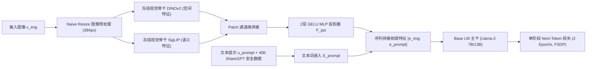

# Prismatic VLMs

**Prismatic VLMs: Investigating the Design Space of Visually-Conditioned Language Models** 收录于 [Awesome World-Action Models (RCL)](https://github.com/rcl-robotics/Awesome-World-Action-Models) **第 084/564** 篇，分组 **Components of WAMs**。本页是 **清单索引**：给出它在清单中的位置与原文入口，方法细节和量化结果请看原文。

## 一句话定义

RCL Awesome WAM 清单收录（Components of WAMs）；细节以原文 PDF / 项目页为准。

## 英文缩写速查

| 缩写 | 英文全称 | 简要说明 |
|------|----------|----------|
| WAM | World Action Model | 世界预测与动作生成耦合 |
| VLA | Vision-Language-Action | 视觉–语言–动作策略 |
| IDM | Inverse Dynamics Model | 先预测未来再反推动作 |
| WM | World Model | 环境前向预测模型 |

## 为什么重要

- RCL Awesome WAM 清单收录（Components of WAMs）；细节以原文 PDF / 项目页为准。
- 想横向对照同一分组的其他工作，可以从 [RCL Awesome WAM 技术地图](../overview/rcl-awesome-wam-technology-map.md) 逐条展开。
- 顺着列表实体 [Awesome World-Action Models](paper-rcl-wam-robot-learning-control-survey.md) 与站内 WAM / VLA 方法页，可以接回对应的学习主线。

## 核心信息

| 字段 | 内容 |
|------|------|
| 编号 | 084/564 |
| 分组 | Components of WAMs |
| 出处 | ICML 2024 |
| 论文 | <https://proceedings.mlr.press/v235/karamcheti24a.html> |
| 子类 / 象限 | Language & vision-language backbones · 语言与VLM Backbone · 不适用 |

## 核心机制（归纳）

> 注：以下机制与评测指标基于通读开放获取原文全文核对补充。

Prismatic VLMs 系统拆解了“patch-as-token”范式视觉–语言模型（VLM）的四大设计轴，并在此基础上构建了开源模块化训练框架（PyTorch FSDP + BF16 混合精度，AWS 8×A100 节点单步比 LLaVa v1.5 快 20%）与 **PRISM**（7B/13B）系列模型：

1. **三段式核心架构与输入输出**：
   - **输入**：图像 $x_{\text{img}} \in \mathbb{R}^{H \times W}$ 与文本提示序列 $u_{\text{prompt}}$。
   - **视觉表征骨干 $V_\omega$**：提取 ViT 倒数第二层 patch 特征 $p_{\text{img}} = V_\omega(x_{\text{img}}) \in \mathbb{R}^{L \times h_{\text{vision}}}$；对比 CLIP、SigLIP、DINOv2 与 ImageNet-21K/1K ViT 后发现，将 **DINOv2（空间几何细节）与 SigLIP（语义–语言对齐）特征按通道拼接**效果最优，而图像预处理采用保留全图视野的 **Naive Resize** 优于会裁剪丢信息的 Resize & Crop。
   - **视觉–语言投影器 $F_\psi$**：使用 2 层 GELU MLP 将每个 patch 特征独立映射到语言模型嵌入空间 $e_{\text{img}} = F_\psi(p_{\text{img}}) \in \mathbb{R}^{L \times h_{\text{text}}}$（融合双骨干时仅将 $F_\psi$ 输入维度翻倍）。
   - **语言模型 $\text{LM}_\theta$**：将视觉前缀嵌入 $e_{\text{img}}$ 与文本嵌入 $e_{\text{prompt}}$ 序列拼接为 $[e_{\text{img}}; e_{\text{prompt}}]$，采用标准自回归 Next-Token Prediction 损失 $-\log p(\hat{u}_{\text{gen}} \mid x_{\text{img}}, u_{\text{prompt}})$ 联合优化 $F_\psi$ 与 $\text{LM}_\theta$。
2. **四大设计轴关键实证规律**：
   - **优化流程**：取消传统两阶段中的第 1 阶段（558K 图文对齐预训练），直接**单阶段训练**即可显著提升综合表现（$p = 0.00558$）并节省 20%–25% 算力；训练全程保持 $V_\omega$ 冻结，端到端微调 $V_\omega$ 会导致显著退化（$p = 0.00381$）。
   - **语言模型选择**：基础模型（Base LM，如 Llama-2）在量化指标上不逊于指令微调模型（Vicuna v1.5，$p = 0.34854$）且幻觉更少、回答更精炼；保留 40K ShareGPT 纯语言协同数据对精度影响很小（$p = 0.13655$），却是维持 Base LM 安全拒答护栏的关键。
   - **训练尺度与数据多样性**：仅训 1 epoch 存在严重欠拟合，训练至 **2 epochs** 显著提升（$p = 0.00496$）后趋于稳定；叠加 LVIS-Instruct-4V 与强调图像多样性的 LRV-Instruct 可进一步增益（$p = 0.01459$）。

### 方法流程图

若需进一步对照世界模型与动作策略分支，可参见站内 [World Action Models（WAM）](../concepts/world-action-models.md) 与 [VLA 方法页](../methods/vla.md)。

## 评测与指标

- **评测套件与口径**：作者构建并开源了包含 **12 项客观指标基准**（`vlm-evaluation`）的评测集，统一采用贪心解码并计算跨任务归一化 Z-score 与单侧 Fisher T 检验（$p < 0.01$）：
  - **开放式 VQA**（官方准确率）：VQAv2、GQA（test-dev）、VizWiz、TextVQA（主实验无 OCR 输入，附录另报告 +OCR）。
  - **指代定位**（IoU 阈值准确率）：RefCOCO / RefCOCO+ / RefCOCOg（IoU 0.5）、机器人杂乱场景数据集 OCID-Ref（IoU 0.25）。
  - **闭集挑战集**（多选准确率）：VSR（空间关系 True/False，zero-shot test）、POPE（物体幻觉 Yes/No）、TallyQA（计数 0–15）、AI2D（图表问答）。
- **核心量化对比（PRISM vs. 开源基线）**：
  - **VQA 表现（VQAv2 / GQA / VizWiz / TextVQA 无 OCR）**：`LLaVa v1.5 7B` 官方版为 76.54 / 61.58 / 54.24 / 46.13；同数据与预算的 `Prism-DINOSigLIP 7B (Controlled)` 达到 **79.05 / 64.16 / 59.82 / 51.78**；扩展训练至 `Prism-DINOSigLIP 7B` 达 **80.97 / 65.27 / 52.82 / 55.64**，`13B` 版进一步达 **81.66 / 66.13 / 58.01 / 57.08**（超越 `LLaVa v1.5 13B` 的 78.13 / 63.17 / 56.66 / 48.99）。
  - **定位与机器人场景表现（RefCOCO / RefCOCO+ / RefCOCOg / OCID-Ref）**：`Prism-DINOSigLIP 7B (Controlled)` 取得 **73.62 / 67.85 / 66.34 / 50.56**，全面超越 `LLaVa v1.5 7B`（55.12 / 49.47 / 50.92 / 35.07）；`Prism-DINOSigLIP 7B` 达到 **77.78 / 73.08 / 71.04 / 54.12**，`13B` 版达 **79.39 / 75.55 / 72.73 / 54.62**。
  - **挑战集表现（VSR / POPE / TallyQA / AI2D）**：`Prism-DINOSigLIP 7B` 达到 **59.57 / 88.12 / 66.70 / 55.65**（Controlled 版 VSR 达 **66.28**、POPE **88.28**），`13B` 版达 **72.18 / 88.07 / 70.41 / 57.96**（`LLaVa v1.5 13B` 为 69.07 / 87.10 / 64.83 / 57.13）。
  - **训练效率**：基于 FSDP 的 `Prism 7B (Controlled)` 在 8×A100 上完整训练耗时**不足 9 小时**。

## 与其他工作对比

- 本页 **不做** 与具体基线的逐项数值对比；同分组的横向对照请回到 [技术地图](../overview/rcl-awesome-wam-technology-map.md) 的 **Components of WAMs** 分组逐条展开。
- 如果站内已经有这篇的深读页（含机构、实验表与源码运行时序图），请以那一页为准；本页只保留清单要点。
- 与清单内相邻条目孰优孰劣，本页不下结论：清单 Contribution 可能滞后于论文最新版本，差异应以各自原文的问题设定与评测口径为准。

## 结论

**Prismatic VLMs 证明了无需复杂多阶段对齐预训练，通过“单阶段联合微调 + 冻结 DINOv2/SigLIP 拼接表征 + Base LM + 2 Epochs 训练”，即可在同等算力与数据预算下全面超越 LLaVa v1.5 与 InstructBLIP。**

- **工程选型建议**：优先采用单阶段训练（省 20%–25% 算力）、冻结视觉骨干、使用 Naive Resize 预处理并将高分辨率（384px）SigLIP 与 DINOv2 特征按通道拼接，能显著强化空间定位与机器人场景（OCID-Ref）表现。
- **训练与安全配比**：至少训练 2 个 epoch 以避免欠拟合；采用 Base LM（如 Llama-2）可减少啰嗦与幻觉，但需保留纯语言对话数据（如 ShareGPT）以维持基础安全拒答护栏。
- **适用边界**：本文实验集中于 7B/13B 规模与“逐 patch 投影”架构，未涵盖 Perceiver 重采样交叉注意力（如 Flamingo/IDEFICS）或 70B+ 超大规模模型，亦未包含多轮长对话的主观评测。

## 常见误区

1. 不要把 Awesome 条目的 Contribution 当成完整方法证明——它只是策展导读。
2. 若站内已有这篇的深读页，以那一页为准——本页只是清单入口，不含实验数据。

## 关联页面

- 列表实体：[Awesome World-Action Models（RCL）](paper-rcl-wam-robot-learning-control-survey.md)
- 技术地图：[RCL Awesome WAM 技术地图](../overview/rcl-awesome-wam-technology-map.md)
- 方法/任务：[generative-world-models.md](../methods/generative-world-models.md)、[manipulation.md](../tasks/manipulation.md)

## 参考来源

- [`sources/papers/rcl_awesome_wam_ref_02a3d941412699a67ab3_prismatic-vlms-investigating-the-design.md`](../../sources/papers/rcl_awesome_wam_ref_02a3d941412699a67ab3_prismatic-vlms-investigating-the-design.md) — 本条目策展摘录
- [`sources/papers/rcl_awesome_wam_catalog.md`](../../sources/papers/rcl_awesome_wam_catalog.md) — 列表总表
- [`sources/repos/awesome-world-action-models-rcl.md`](../../sources/repos/awesome-world-action-models-rcl.md)
- [`docs/PAPERS.md`](https://github.com/RCL-Robotics/Awesome-World-Action-Models/blob/main/docs/PAPERS.md) — 上游论文目录
- 论文：<https://proceedings.mlr.press/v235/karamcheti24a.html>

## 推荐继续阅读

- [Awesome World-Action Models (RCL) 仓库](https://github.com/rcl-robotics/Awesome-World-Action-Models)
- [原文](https://proceedings.mlr.press/v235/karamcheti24a.html)
