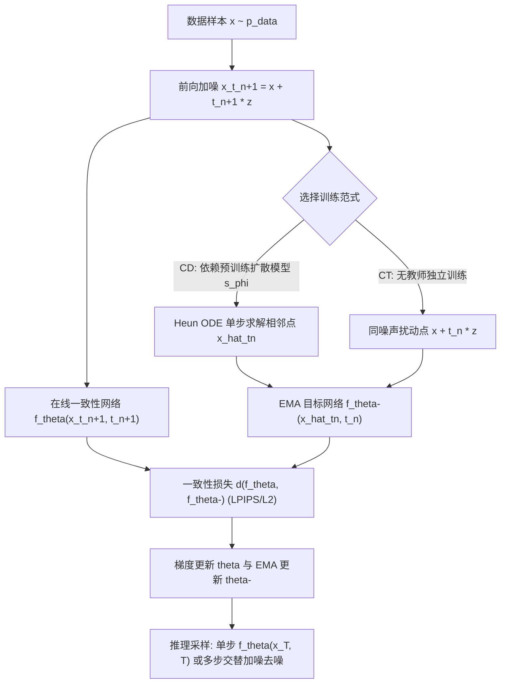

# Consistency Models

**Consistency Models** 收录于 [Awesome World-Action Models (RCL)](https://github.com/rcl-robotics/Awesome-World-Action-Models) **第 148/564** 篇，分组 **Foundational work**。本页是 **清单索引**：给出它在清单中的位置与原文入口，方法细节和量化结果请看原文。

## 一句话定义

RCL Awesome WAM 清单收录（Foundational work）；细节以原文 PDF / 项目页为准。

## 英文缩写速查

| 缩写 | 英文全称 | 简要说明 |
|------|----------|----------|
| WAM | World Action Model | 世界预测与动作生成耦合 |
| VLA | Vision-Language-Action | 视觉–语言–动作策略 |
| IDM | Inverse Dynamics Model | 先预测未来再反推动作 |
| WM | World Model | 环境前向预测模型 |

## 为什么重要

- RCL Awesome WAM 清单收录（Foundational work）；细节以原文 PDF / 项目页为准。
- 想横向对照同一分组的其他工作，可以从 [RCL Awesome WAM 技术地图](../overview/rcl-awesome-wam-technology-map.md) 逐条展开。
- 顺着列表实体 [Awesome World-Action Models](paper-rcl-wam-robot-learning-control-survey.md) 与站内 WAM / VLA 方法页，可以接回对应的学习主线。

## 核心信息

| 字段 | 内容 |
|------|------|
| 编号 | 148/564 |
| 分组 | Foundational work |
| 出处 | ICML 2023 |
| 论文 | <https://proceedings.mlr.press/v202/song23a.html> |
| 子类 / 象限 | 扩散与流匹配基础 · 训练优化与蒸馏 · 不适用 |

## 核心机制（归纳）

> 注：以下机制与评测指标基于通读开放获取原文全文核对补充。

Consistency Models（一致性模型）提出直接学习概率流常微分方程（PF ODE）轨迹上的映射，实现**原生单步生成**、**多步以算力换质量**以及**零样本图像编辑**：

1. **数学定义与边界参数化**：
   - 在 EDM 扩散框架（$\mu(x,t)=0, \sigma(t)=\sqrt{2t}$，$t \in [\epsilon, T]$，$\epsilon=0.002, T=80$）下，PF ODE 为 $\frac{dx_t}{dt} = -t s_\phi(x_t, t)$。一致性函数 $f: (x_t, t) \mapsto x_\epsilon$ 将同一 ODE 轨迹上的任意状态映射到轨迹起点 $x_\epsilon$，满足**自一致性**（$f(x_t, t) = f(x_{t'}, t')$）与**边界条件**（$f(x_\epsilon, \epsilon) = x_\epsilon$）。
   - 为在连续时间与离散时间下均严格满足边界条件，模型采用可微跳跃连接参数化：$f_\theta(x, t) = c_{\text{skip}}(t)x + c_{\text{out}}(t)F_\theta(x, t)$，其中 $c_{\text{skip}}(t) = \frac{\sigma_{\text{data}}^2}{(t-\epsilon)^2 + \sigma_{\text{data}}^2}$、$c_{\text{out}}(t) = \frac{\sigma_{\text{data}}(t-\epsilon)}{\sqrt{\sigma_{\text{data}}^2 + t^2}}$（$\sigma_{\text{data}}=0.5$），确保 $c_{\text{skip}}(\epsilon)=1, c_{\text{out}}(\epsilon)=0$。
2. **两种训练模式（均维护在线网络 $\theta$ 与 EMA 目标网络 $\theta^-$）**：
   - **Consistency Distillation（CD，蒸馏模式）**：借助预训练分数模型 $s_\phi(x, t)$，将 $[\epsilon, T]$ 划分为 $N-1$ 个子区间 $t_i = (\epsilon^{1/\rho} + \frac{i-1}{N-1}(T^{1/\rho}-\epsilon^{1/\rho}))^\rho$（$\rho=7$）。由真实样本 $x$ 加噪得 $x_{t_{n+1}} \sim \mathcal{N}(x, t_{n+1}^2 I)$，通过单步 ODE 求解器 $\Phi$ 计算相邻点 $\hat{x}_{t_n}^\phi = x_{t_{n+1}} + (t_n - t_{n+1})\Phi(x_{t_{n+1}}, t_{n+1}; \phi)$，最小化 $\mathcal{L}_{\text{CD}}^N = \mathbb{E}[\lambda(t_n) d(f_\theta(x_{t_{n+1}}, t_{n+1}), f_{\theta^-}(\hat{x}_{t_n}^\phi, t_n))]$ 并以 EMA 更新 $\theta^-$。消融证实 **LPIPS 度量 + Heun 二阶求解器 + $N=18$**（CIFAR-10）为最优组合。
   - **Consistency Training（CT，独立训练模式）**：完全脱离预训练扩散教师。利用分数函数无偏估计 $\nabla \log p_t(x_t) = -\mathbb{E}[\frac{x_t - x}{t^2} \mid x_t]$，使用同一高斯噪声 $z \sim \mathcal{N}(0, I)$ 构造扰动对 $(x+t_{n+1}z, x+t_n z)$ 并最小化 $\mathcal{L}_{\text{CT}}^N = \mathbb{E}[\lambda(t_n) d(f_\theta(x+t_{n+1}z, t_{n+1}), f_{\theta^-}(x+t_n z, t_n))]$；采用随迭代步递增的离散步数调度 $N(k)$ 与衰减率调度 $\mu(k)$ 平衡收敛速度与估计偏差。
3. **推理与零样本编辑（Algorithm 1 & 4）**：
   - **单步采样**：采样 $\hat{x}_T \sim \mathcal{N}(0, T^2 I)$，直接计算 $x = f_\theta(\hat{x}_T, T)$（NFE=1）。
   - **多步采样与零样本编辑**：在时间序列 $\tau_1 > \dots > \tau_{N-1}$ 上交替执行高斯加噪与 $f_\theta$ 去噪投影；结合参考图 $y$、掩码 $\Omega$ 与可逆线性变换 $A$，可在零样本下完成修复、上色、超分、SDEdit 笔画生成、单步去噪与球面线性插值。

### 方法流程图

关于生成式世界模型与策略动作扩散的进一步结合，可参考站内 [World Action Models（WAM）](../concepts/world-action-models.md) 与 [generative-world-models.md](../methods/generative-world-models.md)。

## 评测与指标

- **评测基准与指标**：在 CIFAR-10（32×32）、ImageNet（64×64）、LSUN Bedroom（256×256）与 LSUN Cat（256×256）上评估，指标包括网络评估次数 NFE（↓）、FID（↓）、Inception Score（IS↑）、Precision（↑）和 Recall（↑）。
- **核心量化结果（CD 蒸馏与 CT 独立训练）**：
  - **CIFAR-10**：CD 在 NFE=1 时达到 FID **3.55**（IS 9.48），NFE=2 时达 **2.93**（IS 9.75），明显优于 Progressive Distillation（PD：1 步 8.34、2 步 5.58）、DFNO（1 步 4.12）与 Rectified Flow+distill（1 步 4.85–6.18）；CT 独立训练在 NFE=1/2 时分别达到 FID **8.70 / 5.83**（IS 8.49 / 8.85），优于同期 VAE（DC-VAE 17.9）和归一化流模型（Glow 48.9、DenseFlow 34.9）。教师 EDM（NFE=35）为 FID 2.04。
  - **ImageNet 64×64**：CD 在 NFE=1 时 FID **6.20**（Prec. 0.68, Rec. 0.63），NFE=2 时达 **4.70**（Prec. 0.69, Rec. 0.64），超越 PD（15.39 / 8.95）和 DFNO（8.35）；CT 在 NFE=1/2 时分别达 FID **13.0 / 11.1**。教师 EDM（NFE=79）为 FID 2.44。
  - **LSUN Bedroom 256×256**：CD 在 NFE=1/2 时 FID 分别为 **7.80 / 5.22**（PD 为 16.92 / 8.47，EDM 为 3.57）；CT 在 NFE=1/2 时为 **16.0 / 7.85**。
  - **LSUN Cat 256×256**：CD 在 NFE=1/2 时 FID 分别为 **11.0 / 8.84**（PD 为 29.6 / 15.5，EDM 为 6.69）；CT 在 NFE=1/2 时为 **20.7 / 11.7**。
- **零样本图像编辑验证**：在 LSUN Bedroom 256×256 上训练的 CD 模型无需微调即可执行灰度上色、32×32 → 256×256 超分辨率、局部修复、去噪、潜空间插值与 SDEdit 笔画引导生成。

## 与其他工作对比

- 本页 **不做** 与具体基线的逐项数值对比；同分组的横向对照请回到 [技术地图](../overview/rcl-awesome-wam-technology-map.md) 的 **Foundational work** 分组逐条展开。
- 如果站内已经有这篇的深读页（含机构、实验表与源码运行时序图），请以那一页为准；本页只保留清单要点。
- 与清单内相邻条目孰优孰劣，本页不下结论：清单 Contribution 可能滞后于论文最新版本，差异应以各自原文的问题设定与评测口径为准。

## 结论

**Consistency Models 通过强制 PF ODE 轨迹自一致性与边界条件参数化，建立了既可蒸馏加速现有扩散模型（CD）、又可作为独立生成模型训练（CT）的统一单步/少步生成框架。**

- **蒸馏性能优势**：在不预先生成合成噪声–图像配对数据集的前提下，CD 配合 Heun ODE 求解器与 LPIPS 度量在 1–2 步内大幅超越 Progressive Distillation（如 ImageNet 64×64 单步 FID 6.20 vs. 15.39）。
- **独立训练与调度要点**：CT 利用无偏分数估计摆脱对预训练扩散模型的依赖，但收敛对离散步数 $N(k)$ 与 EMA 衰减率 $\mu(k)$ 的渐进调度高度敏感；连续时间损失虽可消除离散偏差但需前向自动微分（JVP）支持。
- **工程落地价值**：支持 1–2 步高速推理与零样本编辑，为机器人世界模型与扩散动作策略（Diffusion Policy / VLA Action Head）的低延迟推理提供了核心理论基础。

## 常见误区

1. 不要把 Awesome 条目的 Contribution 当成完整方法证明——它只是策展导读。
2. 若站内已有这篇的深读页，以那一页为准——本页只是清单入口，不含实验数据。

## 关联页面

- 列表实体：[Awesome World-Action Models（RCL）](paper-rcl-wam-robot-learning-control-survey.md)
- 技术地图：[RCL Awesome WAM 技术地图](../overview/rcl-awesome-wam-technology-map.md)
- 方法/任务：[generative-world-models.md](../methods/generative-world-models.md)、[manipulation.md](../tasks/manipulation.md)

## 参考来源

- [`sources/papers/rcl_awesome_wam_ref_041a05059886890708fc_consistency-models.md`](../../sources/papers/rcl_awesome_wam_ref_041a05059886890708fc_consistency-models.md) — 本条目策展摘录
- [`sources/papers/rcl_awesome_wam_catalog.md`](../../sources/papers/rcl_awesome_wam_catalog.md) — 列表总表
- [`sources/repos/awesome-world-action-models-rcl.md`](../../sources/repos/awesome-world-action-models-rcl.md)
- [`docs/PAPERS.md`](https://github.com/RCL-Robotics/Awesome-World-Action-Models/blob/main/docs/PAPERS.md) — 上游论文目录
- 论文：<https://proceedings.mlr.press/v202/song23a.html>

## 推荐继续阅读

- [Awesome World-Action Models (RCL) 仓库](https://github.com/rcl-robotics/Awesome-World-Action-Models)
- [原文](https://proceedings.mlr.press/v202/song23a.html)
