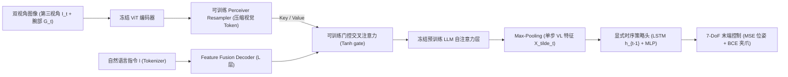

# Vision-Language Foundation Models as Effective Robot Imitators

**Vision-Language Foundation Models as Effective Robot Imitators**（RoboFlamingo；Xinghang Li, Minghuan Liu, Hanbo Zhang 等，清华大学 / ByteDance Research / 上海交大 / NUS，ICLR 2024）收录于 [Awesome World-Action Models (RCL)](https://github.com/rcl-robotics/Awesome-World-Action-Models) **第 261/564** 篇，分组 **VLA**。本文提出了低成本将开源静态图文预训练 VLM（OpenFlamingo）适配为长程语言条件机器人操作策略的通用框架。

## 一句话定义

通过将 **OpenFlamingo 主干的「单步视觉–语言理解」** 与 **显式时序策略头（LSTM + MLP）** 解耦，并仅微调 Resampler、门控交叉注意力与策略头（约 1B 可训练参数），即可用少量机器人模仿演示微调出高泛化的 VLA 操作策略。

## 英文缩写速查

| 缩写 | 英文全称 | 简要说明 |
|------|----------|----------|
| WAM | World Action Model | 世界预测与动作生成耦合 |
| VLA | Vision-Language-Action | 视觉–语言–动作策略 |
| IDM | Inverse Dynamics Model | 先预测未来再反推动作 |
| WM | World Model | 环境前向预测模型 |
| VLM | Vision-Language Model | 静态图文预训练多模态基础模型（本文采用开源 OpenFlamingo） |
| IFT | Instruction Fine-Tuning | 对 LLM 底座进行指令微调以增强自然语言理解能力 |
| GC-POMDP | Goal-Conditioned Partially Observable MDP | 语言条件机器人操作问题的部分可观测目标马尔可夫决策建模 |

## 为什么重要

- 早期将大模型用于机器人控制的方案要么只做高层文本规划（SayCan、PaLM-E，依赖预定义底层技能），要么像 RT-2 一样依托闭源大模型与海量网页图文–动作联合微调（Co-Fine-Tuning），算力与数据门槛极高。
- RoboFlamingo 验证了**仅依托开源 VLM（OpenFlamingo 3B/4B/9B）与纯机器人语言标注模仿数据**，在单台 GPU 服务器（8× A100）上微调即可大幅超越既有 SOTA（CALVIN ABCD→D 平均完成长度 **4.09** vs. HULC **3.06**、RT-1 **2.45**），同时揭示了「冻结 LLM/ViT、显式时序头、指令微调底座、模型尺度与小样本正相关」等可复用规律。
- 从全站知识地图视角，可通过 [RCL Awesome WAM 技术地图](../overview/rcl-awesome-wam-technology-map.md) 与 [Awesome World-Action Models](paper-rcl-wam-robot-learning-control-survey.md) 对照同一 VLA 分组下的后续工作。

## 核心信息

| 字段 | 内容 |
|------|------|
| 论文简称与作者 | **RoboFlamingo**（Xinghang Li, Minghuan Liu, Hanbo Zhang, Cunjun Yu, Jie Xu, Hongtao Wu, Chilam Cheang, Ya Jing, Weinan Zhang, Huaping Liu, Hang Li, Tao Kong） |
| 编号 / 分组 | 261/564 · VLA（子类：分层与双系统VLA） |
| 出处 / 论文 | ICLR 2024 · <https://openreview.net/forum?id=lFYj0oibGR> |
| 底座与输入输出 | 开源 OpenFlamingo（MPT-3B / GPT-Neox-4B / LLaMA-9B / MPT-9B）；输入双视角图像（第三视角 $I_t$ + 腕部相机 $G_t$）+ 自由文本指令 $l$；输出 7-DoF 相对末端位姿 + 夹爪开闭 |
| 评测基准 | CALVIN（34 种任务、1000 条 5 连串指令链、Splits A/B/C/D） |

## 核心机制（归纳）

1. **视觉编码与 Perceiver Resampler 压缩**：每步将双视角图像 $(I_t, G_t)$ 送入冻结的 ViT 得到视觉 token 序列 $\hat{X}_t^v$，再经可训练的 Perceiver Resampler（可学习查询 $Q_R \in \mathbb{R}^{N_r\times d}$）通过注意力机制压缩为定长视觉 token $X_t^v$。
2. **特征融合解码器（Feature Fusion Decoder）**：复用 OpenFlamingo 的 $L$ 层解码器——其中预训练 LLM 自注意力层**全程冻结**，每层前端的门控交叉注意力层（以语言 token 为 Query、压缩视觉 token 为 Key/Value，并带门控 $\tanh(\alpha)$）**参与微调**，在每步独立生成视觉–语言联合表征 $X_t^L$。
3. **显式时序策略头与参数高效微调（PEFT）**：由于静态图文 VLM 主干不擅长直接跨帧建模视频序列，本文对 $X_t^L$ 做词元维 Max-Pooling 得到 $\tilde{X}_t$，再输入 **LSTM**（默认，维护隐状态 $h_t$）或 GPT 头，经 MLP 预测 7-DoF 末端动作（相对位姿用 MSE 损失，夹爪状态用 $\lambda_{\text{gripper}}$ 加权的 BCE 损失）。训练仅更新 Resampler、门控交叉注意力层与策略头（约 **1B** 可训练参数），冻结其余全部参数。
4. **可选开环动作序列部署**：由于感知重计算集中在 VLM 主干、策略头极轻量，可一次推理输出堆叠多步动作（stacked actions）以降低测试时延（配合跳步数据重训以缓解开环性能下滑）。

### 方法流程图

## 评测与指标

### 1. CALVIN 主实验与零样本泛化对比（Table 1）

| 方法 | 训练数据 | 测试 Split | 任务 1 | 任务 2 | 任务 3 | 任务 4 | 任务 5 | 平均长度 (Avg Len) |
|------|---------|-----------|--------|--------|--------|--------|--------|------------------|
| MCIL | ABCD (Full) | D | 0.373 | 0.027 | 0.002 | 0.000 | 0.000 | 0.40 |
| HULC | ABCD (Full) | D | 0.889 | 0.733 | 0.587 | 0.475 | 0.383 | 3.06 |
| HULC | ABCD (Lang) | D | 0.892 | 0.701 | 0.548 | 0.420 | 0.335 | 2.90 |
| RT-1 | ABCD (Lang) | D | 0.844 | 0.617 | 0.438 | 0.323 | 0.227 | 2.45 |
| **RoboFlamingo (M-3B-IFT)** | **ABCD (Lang)** | **D** | **0.964** | **0.896** | **0.824** | **0.740** | **0.66** | **4.09** |
| HULC | ABC (Full) | D（未见视觉） | 0.418 | 0.165 | 0.057 | 0.019 | 0.011 | 0.67 |
| RT-1 | ABC (Lang) | D（未见视觉） | 0.533 | 0.222 | 0.094 | 0.038 | 0.013 | 0.90 |
| **RoboFlamingo (M-3B-IFT)** | **ABC (Lang)** | **D（未见视觉）** | **0.824** | **0.619** | **0.466** | **0.331** | **0.235** | **2.48** |
| HULC | ABCD (Full) | D (GPT-4 同义改写) | 0.715 | 0.470 | 0.308 | 0.199 | 0.130 | 1.82 |
| **RoboFlamingo (freeze-emb)** | **ABCD (Lang)** | **D (GPT-4 同义改写)** | **0.737** | **0.530** | **0.385** | **0.275** | **0.192** | **2.12** |

### 2. 关键消融、尺度效应与代表性表征对比（Table 2–8）

- **VLM 底座与 IFT 效应（Table 2）**：同为 3B/4B 时，经指令微调的底座一致更优——`M-3B-IFT` Avg Len **4.09** > `M-3B` **3.94**；`G-4B-IFT` **3.79** > `G-4B` **3.67**；`M-9B` **3.97**；`L-9B` **2.79**（与其预训练 VL 能力 44.0 VQAv2 较弱一致）。
- **低数据比例下的尺度优势（10% 语言标注 = 总数据 0.1%，Table 3）**：全量数据下 3B 与 9B 接近，但极少样本下大模型显著胜出——`M-3B` 仅 **0.05**、`M-3B-IFT` **0.13**、`G-4B` **0.48**、`G-4B-IFT` **0.55**，而 `M-9B` 达到 **0.83**。
- **策略头对比与预训练必要性（Fig. 3）**：`LSTM` ≈ `GPT` >> `MLP w/ hist` > `MLP w/o hist`（直接把多帧塞进交叉注意力会因 VLM 只见过静态图文而显著退化）；去掉 VL 预训练（`No VL Pre-train`）或冻结 VLM 只训策略头（`No VL Finetune`）均大幅掉点；**全参数微调 3B 模型（Table 8）** Avg Len 从 **4.09 暴跌至 0.50**。
- **对比机器人视觉表征模型（Table 7）**：`R3M (Frozen)` Avg Len **0.10**，`Voltron (Frozen)` **0.11**，`Voltron (Fine-tuned)` **2.08**，均明显低于 `RoboFlamingo`（**4.09**）。
- **VL 能力保持与联合训练（Table 5–6）**：仅在 CALVIN 上微调会使 COCO CIDEr 从 77.3 跌至 4.09（4-shot 3.87）；加入 COCO/VQA 等比联合训练（Co-Train）可将 VQAv2 维持在 **40.92%**、COCO CIDEr 维持在 **82.0**，代价是 ABCD→D 平均长度略降至 **3.76**。
- **算力消耗（Appendix A.3）**：8× Nvidia A100 单机训练，M-3B 约 **13 小时/epoch**（第 3 epoch 达最优），M-9B 约 **26 小时/epoch**（第 4 epoch 达最优）。

## 与其他工作对比

- **相比 RT-2（Co-Fine-Tuning 闭源大模型）**：RT-2 需同步使用私有网络图文与真机动作数据共同微调数十亿级闭源模型；RoboFlamingo 基于完全开源的 OpenFlamingo，仅用 1% 带语言标注的 CALVIN 演示即可在单台 8 卡服务器复现。
- **相比 HULC / MCIL / RT-1（专用小模型/从零对齐）**：借助预训练 VLM 的泛化表征，在跨视觉环境（ABC→D：**2.48** vs. RT-1 **0.90**、HULC **0.67**）与复杂 5 步链式操作（第 5 步成功率 **66%** vs. HULC **38.3%**）上体现出压倒性优势。
- 更广泛的 VLA 演化脉络可对照站内 [vla.md](../methods/vla.md) 与 [generative-world-models.md](../methods/generative-world-models.md)。

## 常见误区或局限

1. **尚未进行真机物理部署**：论文明确指出由于缺乏大规模真机机器人数据，全部定量实验均在 CALVIN 仿真环境完成（未在真机验证实时延迟与物理扰动鲁棒性）。
2. **微调易导致语言过拟合与遗忘**：相比冻结句子编码器的 HULC，RoboFlamingo 在同义改写指令（Enriched）上掉点更明显，且纯机器人数据微调会破坏原有 VQA/Caption 能力；必须配合冻结词嵌入层（`freeze-emb`）或图文联合训练缓解。
3. **绝对不能全参数解冻微调，也不要把历史帧塞进静态 VLM**：实验直接证明 3B 全量微调会崩溃（Avg Len 4.09→0.50），且将历史帧直接送入 OpenFlamingo 交叉注意力效果远不如外挂轻量化 LSTM/GPT 时序头。
4. **开环提速需要跳步重训**：直接以开环方式一次吐出多步动作会导致闭环精度大幅下滑，须以跳步演示（jump-step）重新训练策略头。

## 结论

**RoboFlamingo 给出了一条低门槛改造静态图文 VLM 为操作策略的清晰范式：「冻结 ViT 与 LLM 主干 + 只微调跨模态适配层 + 外挂显式时序策略头（LSTM）」。**

1. **时序建模与 VL 理解必须解耦**：静态预训练的 VLM 只做单步帧–指令对齐，把时序记忆交给 LSTM/GPT 头，避免破坏 VLM 预训练特征结构。
2. **部分参数微调远胜全量微调与纯冻结头**：只微调 Resampler + 门控交叉注意力 + 策略头（~1B 参数）在 CALVIN ABCD→D 拿到 4.09；全量微调掉至 0.50，纯冻结 VLM 只训策略头亦严重欠拟合。
3. **小样本场景优先选更大、且经过 IFT 的 VLM 底座**：全量数据下 3B 与 9B 接近，但 0.1% 数据下 9B 领先 3B 超 6 倍（0.83 vs. 0.13），且 IFT 版本全面优于基础版本。
4. **防指令过拟合的实用开关**：若需应对多样化自然语言同义表达，优先冻结解码器词嵌入层（`freeze-emb`，2.12 vs. 1.85）；若还要保留通用 VQA/描述能力，则需引入图文 Co-Training。

## 关联页面

- 列表实体：[Awesome World-Action Models（RCL）](paper-rcl-wam-robot-learning-control-survey.md)
- 技术地图：[RCL Awesome WAM 技术地图](../overview/rcl-awesome-wam-technology-map.md)
- 方法/任务：[generative-world-models.md](../methods/generative-world-models.md)、[manipulation.md](../tasks/manipulation.md)

## 参考来源

- [`sources/papers/rcl_awesome_wam_ref_06ccc4edca82d6457b34_vision-language-foundation-models-as-eff.md`](../../sources/papers/rcl_awesome_wam_ref_06ccc4edca82d6457b34_vision-language-foundation-models-as-eff.md) — 本条目策展摘录
- [`sources/papers/rcl_awesome_wam_catalog.md`](../../sources/papers/rcl_awesome_wam_catalog.md) — 列表总表
- [`sources/repos/awesome-world-action-models-rcl.md`](../../sources/repos/awesome-world-action-models-rcl.md)
- [`docs/PAPERS.md`](https://github.com/RCL-Robotics/Awesome-World-Action-Models/blob/main/docs/PAPERS.md) — 上游论文目录
- 论文：<https://openreview.net/forum?id=lFYj0oibGR>

## 推荐继续阅读

- [Awesome World-Action Models (RCL) 仓库](https://github.com/rcl-robotics/Awesome-World-Action-Models)
- [原文](https://openreview.net/forum?id=lFYj0oibGR)
