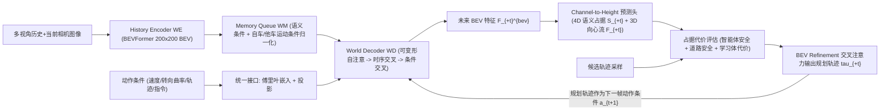

# Driving in the Occupancy World

**Driving in the Occupancy World: Vision-Centric 4D Occupancy Forecasting and Planning via World Models for Autonomous Driving**（浙江大学 & 华为技术：Yu Yang*, Jianbiao Mei*, Yukai Ma, Siliang Du†, Wenqing Chen, Yijie Qian, Yuxiang Feng, Yong Liu†，发表于 **AAAI 2025**，arXiv:2408.14197v3）收录于 [Awesome World-Action Models (RCL)](https://github.com/rcl-robotics/Awesome-World-Action-Models) **第 327/564** 篇，分组 **WAMs**。本页基于论文全文完成机制、实验与局限升级。

## 一句话定义

Drive-OccWorld 是一种纯视觉（Vision-Centric）4D 语义占据与 3D 运动流自回归世界模型，通过语义/运动条件归一化增强历史 BEV 记忆、支持多模态自车动作可控未来推演，并与基于占据代价函数的端到端规划器联合实现连续预测与安全轨迹规划。

## 英文缩写速查

| 缩写 | 英文全称 | 简要说明 |
|------|----------|----------|
| BEV | Bird's-Eye View | 鸟瞰图特征空间，本文由多视角图像经 BEVFormer 编码器映射至 $200\times 200$ 网格 |
| GMO / GSO | General Movable Objects / General Static Objects | 通用可移动物体（车辆、行人等）与通用静态场景物体（道路、建筑等）占据类别 |
| VPQ | Video Panoptic Quality | 用于评估未来 3D 向心流预测与跨帧实例关联质量的指标（$\text{VPQ}_f$ / $\text{VPQ}_f^*$） |
| WAM | World Action Model | 世界预测与动作生成耦合（所属 RCL WAMs 分组） |
| VLA | Vision-Language-Action | 视觉–语言–动作策略（站内关联对比主线） |
| IDM | Inverse Dynamics Model | 先预测未来再反推动作的范式 |
| WM | World Model | 环境前向预测模型 |

## 为什么重要

- 早期自动驾驶世界模型（如 GAIA-1、DriveDreamer、Vista）多聚焦 2D 视频生成或视觉预训练，难以直接提供几何精确的 3D 障碍物碰撞约束；而传统端到端规划模型（UniAD、VAD）缺少按不同动作假设连续推演未来 4D 场景的能力。
- Drive-OccWorld 把**可控 4D 语义占据/向心流预测**与**基于占据栅格的端到端规划器**打通成闭环自回归推演系统，在不使用激光雷达输入且不泄露真值自车轨迹的条件下，同时刷新了 4D 占据预测与 nuScenes 开环规划精度/安全率纪录。
- 可顺着 [RCL Awesome WAM 技术地图](../overview/rcl-awesome-wam-technology-map.md) 与 [Awesome World-Action Models](paper-rcl-wam-robot-learning-control-survey.md) 对照同组三维世界模型条目。

## 核心信息

| 字段 | 内容 |
|------|------|
| 编号 / 分组 | 327/564 · WAMs |
| 作者与机构 | Yu Yang*, Jianbiao Mei*, Yukai Ma, Siliang Du†, Wenqing Chen, Yijie Qian, Yuxiang Feng, Yong Liu†（浙江大学 & 华为） |
| 出处 / 编号 | AAAI 2025 · arXiv:2408.14197v3（2025-01-17） |
| 论文链接 | <https://ojs.aaai.org/index.php/AAAI/article/view/33010> / <https://arxiv.org/abs/2408.14197> |
| 项目主页 | <https://drive-occworld.github.io/> |
| 子类 / 象限 | 自动驾驶 · 三维多视角建模 · 四象限外 |

## 核心机制

1. **历史编码器与条件归一化记忆队列（$W_E$ & $W_M$）**：
   - **History Encoder ($W_E$)**：基于 BEVFormer（图像骨干 + FPN + 6 层 Transformer 编码器）将多视角历史图像（2 历史帧 + 1 当前帧，每步 0.5 s）映射到 $200\times 200$ BEV 空间（体素范围 $[-51.2\text{ m}, 51.2\text{ m}]^2 \times [-5\text{ m}, 3\text{ m}]$，体素分辨率 $0.2\text{ m}$ 对应 $512\times 512\times 40$ 评测体，输出头通道 $d=16$ 经 Channel-to-Height 得 $200\times 200\times 16$ 占据栅格）。
   - **语义条件归一化（Semantic-Conditional Normalization）**：针对 2D-to-3D 反投影产生的「射线状伪影」（同条射线像素特征混同），先由轻量语义头预测体素语义 $S$ 并独热卷积生成仿射参数 $(\gamma^s, \beta^s)$ 对 $\text{LayerNorm}(F^{\text{bev}})$ 调制，突出车辆/行人/骑行者响应。
   - **运动条件归一化（Motion-Conditional Normalization）**：分别将自车位姿变换矩阵 $E_{-t}^{+t} = [R_{-t}^{+t}, T_{-t}^{+t}]$（MLP 编码为 $\gamma^e, \beta^e$）与 3D 反向向心流 $F \in \mathbb{R}^{h\times w\times d\times 3}$（指向体素在 $t-1$ 帧所属 3D 实例中心，编码为 $\gamma^f, \beta^f$）注入归一化层，同时补偿自车与他车运动。
2. **世界解码器与统一动作可控接口（$W_D$）**：
   - 3 层（256 通道）自回归 Transformer：可学习 BEV 查询先做可变形自注意力，再与自车坐标对齐的历史记忆做可变形时序交叉注意力，随后在**条件交叉注意力层**注入动作嵌入，最后经 FFN + Channel-to-Height 头预测未来语义占据 $S_{+t}$ 与 3D 向心流 $F_{+t}$。
   - **多模态动作条件接口**：支持速度 $(v_x, v_y)$、转向角（曲率 $\text{m}^{-1}$）、轨迹 $(\Delta x, \Delta y)$ 与高层指令（直行/左转/右转），经傅里叶嵌入（Fourier Embedding）与线性投影统一编码；可控生成模式下关闭规划器 $P$ 以防自车真值泄露。
3. **基于占据的端到端规划与连续推演（Planner $P$）**：
   - 依据高阶指令采样候选轨迹集 $\tau_{+t}^* \in \mathbb{R}^{N_\tau\times 2}$，按三项占据代价排序选优：**智能体安全代价**（避开动态占据格与过近横纵向距离）、**道路安全代价**（约束在可行驶区域内）及 **学习体代价**（从 $F_{+t}^{\text{bev}}$ 预测的 2D 代价图）。
   - **BEV 精细化（BEV Refinement）**：将最优候选轨迹编码与指令嵌入拼成自车查询，与 $F_{+t}^{\text{bev}}$ 做交叉注意力后由 MLP 回归最终轨迹 $\tau_{+t}$，并将其回填为下一步动作条件 $a_{t+1}$ 驱动连续自回归推演（训练损失 $L = L_{\text{norm}} + L_{\text{fcst}} + L_{\text{plan}}$，在 8× A100 GPU 上训练）。

### 方法流程图

## 实验与评测

1. **膨胀 GMO 与 3D 向心流预测（Table 1, nuScenes 2 s & Lyft-Level5 0.8 s）**：
   - **nuScenes**：`Drive-OccWorld^P` 取得 $\text{mIoU}_c = 39.8$、$\text{mIoU}_f = 36.3$、$\widetilde{\text{mIoU}}_f = 37.4$、$\text{VPQ}_f = 25.1$（`Drive-OccWorld^A` 为 `39.7 / 36.3 / 37.3 / 23.7`），全面超越 Cam4DOcc（`31.3 / 26.8 / 28.0 / 18.6`），在 $\text{mIoU}_f$ 上领先 **+9.5 个百分点**（36.3 vs 26.8），$\text{VPQ}_f$ 上（`A` 版本即领先 **+5.1**、`P` 版本领先 **+6.5**）。
   - **Lyft-Level5**：`Drive-OccWorld^P` 达 `40.9 / 39.7 / 40.6 / 33.4`，超越 Cam4DOcc（`36.4 / 33.6 / 34.6 / 28.2`），$\text{mIoU}_f$ 提升 **+6.1**、$\text{VPQ}_f$ 提升 **+5.2**。
2. **细粒度体素占据预测（nuScenes-Occupancy, Table 1 & Table 2）**：
   - **Fine-Grained GMO（Table 1）**：`Drive-OccWorld^P` 达 $\text{mIoU}_c = 13.6$、$\text{mIoU}_f = 12.0$、$\widetilde{\text{mIoU}}_f = 12.4$（Cam4DOcc 为 `11.5 / 9.7 / 10.1`）。
   - **Fine-Grained GMO + GSO（Table 2）**：`Drive-OccWorld^P` 均值达当前 `18.5`（GMO `16.9` / GSO `20.2`）、未来 `17.8`（GMO `14.3` / GSO `21.2`）、$\widetilde{\text{mIoU}}_f = 14.9$（Cam4DOcc 为 `14.4` / `13.5` / `9.7`），GMO 当前与未来分别提升 **+5.9** 与 **+5.1** 个百分点。
3. **可控性与条件注入消融（Table 3 & Table 7）**：
   - 底层连续动作（轨迹、速度）对未来预测 $\widetilde{\text{mIoU}}_f$ 提升最明显（+1.0），高层指令主要改善当前帧 $\text{mIoU}_c$（+0.5）；全条件组合把 $\text{VPQ}_f^*$ 从 33.5 提至 **35.0**，使用预测轨迹协同训练/推理（`Drive-OccWorld^P`）进一步微增至 **35.1**。
   - 条件交叉注意力 + 傅里叶嵌入优于简单相加（Table 7：$\text{VPQ}_f^*$ 35.0 vs 34.2）。
4. **nuScenes 端到端开环规划（Table 5）**：
   - **NoAvg† 协议**（`Drive-OccWorld^P†` vs `UniAD†`）：1s / 2s / 3s / Avg L2 误差为 **0.32 / 0.75 / 1.49 / 0.85 m**（UniAD 为 `0.48 / 0.96 / 1.65 / 1.03 m`，1s/2s/3s 分别降低 33%、22%、9.7%）；平均碰撞率 **0.29%**（UniAD `0.31%`，VAD-Base `0.43%`）。
   - **TemAvg‡ 协议**（`Drive-OccWorld^P‡`）：L2 Avg **0.47 m**（UniAD `0.69 m`、VAD-Base `0.72 m`、Drive-WM `0.80 m`），平均碰撞率 **0.11%**（1s 0.03% / 2s 0.08% / 3s 0.22%；UniAD `0.12%`、Drive-WM `0.26%`）。
   - **接入自车状态协议（‡\*，BEV-Planner 口径）**：平均 L2 **0.32 m**（3s 0.49 m），平均碰撞率 **0.29%**，优于 BEV-Planner（`0.35 m` / `0.34%`）与 VAD-Base（`0.37 m` / `0.33%`）。
5. **条件归一化与推理耗时（Table 6 & Table 9）**：
   - 语义 + 自车运动 + 他车运动三项归一化叠加使 $\text{mIoU}_f(1\text{s})$ 提升 **+1.8**（26.8 → 28.6）、$\text{VPQ}_f^*$ 提升 **+1.0**（33.5 → 34.5）。
   - A6000 GPU 实测延迟：单帧无历史输入时 $W_E=140\text{ ms}, W_M=10\text{ ms}, W_D=190\text{ ms}$；默认 2 历史+1 当前帧（记忆长度 2）时 $W_E=406\text{ ms}, W_M=19\text{ ms}, W_D=207\text{ ms}$（总约 632 ms/步，主要开销在稠密 BEVFormer 历史编码器）。

## 与其他工作对比

| 方法 | 输入模态 | 世界表征 | 可控动作生成 | nuScenes 膨胀 $\text{mIoU}_f$ | 规划 L2 Avg (TemAvg‡) / 碰撞率 |
|------|---------|---------|-------------|------------------------------|-------------------------------|
| **Drive-OccWorld^P (Ours)** | 多视角相机 | 4D 语义占据 + 3D 向心流 | 支持（速度/转角/轨迹/指令） | **36.3** | **0.47 m** / **0.11%** |
| Cam4DOcc | 多视角相机 | 4D 占据 + 3D 向心流 | 不支持 | 26.8 | — |
| Drive-WM | 多视角相机 | 多视角视频生成 | 支持 | — | 0.80 m / 0.26% |
| UniAD | 多视角相机 | 显式 BEV 跟踪+预测 | 不支持 | — | 0.69 m / 0.12% |
| VAD-Base | 多视角相机 | 矢量化 BEV 场景 | 不支持 | — | 0.72 m / 0.22% |

## 结论

**Drive-OccWorld 证明了在 3D 占据与运动流空间而非 2D 视频空间构建可控世界模型，既能借助语义/运动条件归一化消除纯视觉射线伪影，又能直接为端到端规划提供可微/可检验的三维碰撞几何依据。**

1. **条件归一化对纯视觉 3D 特征至关重要** — 语义归一化抑制 2D-to-3D 射线拖影，自车与向心流归一化对齐跨帧运动，是 $\text{mIoU}_f$ 相对 Cam4DOcc 跳升近 10 个百分点的关键底座。
2. **低层物理动作条件远比高层指令信息量大** — 傅里叶编码轨迹/速度并通过交叉注意力注入，对未来场景推演（$\widetilde{\text{mIoU}}_f$）贡献显著大于离散转向指令。
3. **预测轨迹自回归回馈防泄露且反哺感知** — 训练与测试均以规划器输出作为世界解码器动作条件（`Drive-OccWorld^P`），既杜绝了开环自车真值泄露，又在多项占据指标上微幅反超真值条件版本（`Drive-OccWorld^A`）。
4. **延迟瓶颈集中在稠密历史编码器** — $W_E$ 在 3 帧配置下占 406 ms（总耗时约 632 ms），若面向车端实时部署，需替换为稀疏 BEV 编码器（作者建议如 SparseBEV）。

## 常见误区或局限

1. **目前仅在开环数据集评测规划**：论文规划实验全部在 nuScenes 开环基准上按 L2 与碰撞率评估，尚未报告在 CARLA 等闭环仿真或实车上的闭环驾驶得分。
2. **稠密 BEV 编码带来较高推理耗时**：默认 2 历史帧+1 当前帧在 A6000 上单步总延迟超过 630 ms，主要受限于 BEVFormer 稠密编码器 $W_E$（406 ms），尚需稀疏化提速。
3. **开源状态以项目页为准**：原文给出项目主页 <https://drive-occworld.github.io/>，但正文中未直接提供可运行的训练/推理 GitHub 代码仓统计，工程复现前需核查项目页仓库更新情况。

## 关联页面

- 列表实体：[Awesome World-Action Models（RCL）](paper-rcl-wam-robot-learning-control-survey.md)
- 技术地图：[RCL Awesome WAM 技术地图](../overview/rcl-awesome-wam-technology-map.md)
- 方法/任务：[generative-world-models.md](../methods/generative-world-models.md)、[manipulation.md](../tasks/manipulation.md)
- 站内同编号页：[arXiv:2408.14197 同源实体页](paper-sa-2408-14197-drive-occworld-driving-in-the-occupancy-world-vi.md)

## 参考来源

- [`sources/papers/rcl_awesome_wam_ref_07d6fe5781f45177707e_driving-in-the-occupancy-world-vision-ce.md`](../../sources/papers/rcl_awesome_wam_ref_07d6fe5781f45177707e_driving-in-the-occupancy-world-vision-ce.md) — 本条目策展摘录
- [`sources/papers/rcl_awesome_wam_catalog.md`](../../sources/papers/rcl_awesome_wam_catalog.md) — 列表总表
- [`sources/repos/awesome-world-action-models-rcl.md`](../../sources/repos/awesome-world-action-models-rcl.md)
- [`docs/PAPERS.md`](https://github.com/RCL-Robotics/Awesome-World-Action-Models/blob/main/docs/PAPERS.md) — 上游论文目录
- 论文：<https://ojs.aaai.org/index.php/AAAI/article/view/33010>

## 推荐继续阅读

- [Awesome World-Action Models (RCL) 仓库](https://github.com/rcl-robotics/Awesome-World-Action-Models)
- [原文](https://ojs.aaai.org/index.php/AAAI/article/view/33010)
- [Drive-OccWorld 项目主页](https://drive-occworld.github.io/)
