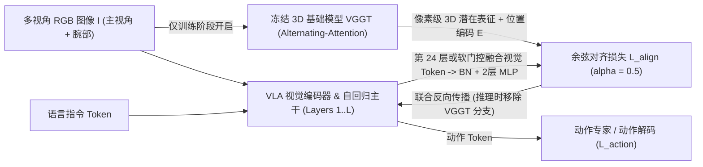

# Spatial Forcing

**Spatial Forcing: Implicit Spatial Representation Alignment for Vision-Language-Action Model**（Fuhao Li, Wenxuan Song, Han Zhao, Jingbo Wang, Pengxiang Ding, Donglin Wang, Long Zeng, Haoang Li，港科大（广州）/ 清华 / 西湖 / 浙大 / 华南理工，ICLR 2026）收录于 [Awesome World-Action Models (RCL)](https://github.com/rcl-robotics/Awesome-World-Action-Models) **第 254/564** 篇，分组 **VLA**。本文提出了无需显式 3D 传感器输入或深度估计器的隐式三维空间表征对齐策略。

## 一句话定义

在训练阶段将 2D VLA 模型中间 Transformer 层的视觉嵌入与预训练 3D 基础模型（VGGT）提取的几何表征做余弦相似度对齐，从而在不引入深度/点云输入且**推理阶段零额外结构与计算开销**的前提下，迫使 VLA 隐式获得 3D 空间感知与操作精度。

## 英文缩写速查

| 缩写 | 英文全称 | 简要说明 |
|------|----------|----------|
| WAM | World Action Model | 世界预测与动作生成耦合 |
| VLA | Vision-Language-Action | 视觉–语言–动作策略 |
| IDM | Inverse Dynamics Model | 先预测未来再反推动作 |
| WM | World Model | 环境前向预测模型 |
| SF | Spatial Forcing | 本文提出的面向 VLA 的隐式 3D 空间表征对齐训练范式 |
| VGGT | Visual Geometry Grounded Transformer | 本文用作 3D 几何监督教师的预训练前馈 3D 基础模型 |
| DPT | Dense Prediction Transformer | 本文深度探测实验用于检验冻结视觉 token 3D 信息含量的稠密预测头 |

## 为什么重要

- 主流 2D VLA 的 VLM 主干仅在 2D 图文上预训练，缺乏精确 3D 空间感知能力——本文通过轻量深度探测实验（冻结 OpenVLA-OFT 视觉特征仅训 DPT 深度头，Fig. 1(c) & Fig. 3）直接证实未对齐的视觉 token 无法重建出有意义的场景空间结构。
- 现有显式 3D VLA（输入深度图/点云或调用深度估计器）受限于传感器噪声、跨平台标定异构、大规模数据集（如 Open X-Embodiment）缺深度通道以及深度估计器误差上限。Spatial Forcing 通过**训练期表征对齐、推理期完全剥离教师分支**，同时兼得了 3D 几何精度与纯 RGB VLA 的通用扩展性。
- 在知识图谱中，可与 [RCL Awesome WAM 技术地图](../overview/rcl-awesome-wam-technology-map.md) 中的同组 VLA 工作、以及基于同一官方仓的后续持续预训练工作 [SLA](paper-sla-spatial-language-action.md) 对照阅读。

## 核心信息

| 字段 | 内容 |
|------|------|
| 作者与机构 | Fuhao Li, Wenxuan Song, Han Zhao, Jingbo Wang, Pengxiang Ding, Donglin Wang, Long Zeng, Haoang Li（HKUST-GZ / 清华 / 西湖 / 浙大 / 华南理工） |
| 编号 / 分组 | 254/564 · VLA（子类：VLA后训练与数据增强 · 空间感知增强VLA） |
| 出处 / 原文 | ICLR 2026 · <https://openreview.net/forum?id=euMVC1DO4k> |
| 项目页 | <https://spatial-forcing.github.io/> |
| 验证底座与基准 | LIBERO 底座 `OpenVLA-OFT`（Prismatic VLM + SigLIP/DINOv2，8×H100 150k iters）；RoboTwin 2.0 底座 `π0`（PaliGemma + LoRA，1×H100 30k iters）；真机双臂 AgileX PiPER |

## 核心机制（归纳）

1. **深度探测动机（Depth Probing）**：冻结 VLA 参数、仅训练轻量 DPT 头部从中间视觉 token 回归深度图，发现原始 2D VLA 嵌入几乎丢失了 3D 几何结构；而经过 SF 对齐后，视觉 token 在不丧失色彩语义（Appendix I 重建探测）的前提下涌现出清晰的三维结构与视角一致性。
2. **3D 基础模型空间目标提取**：将多视角 RGB 图像 $I$ 输入冻结的 **VGGT** $f^{3D}$（采用帧内自注意力与全局自注意力交替的 Alternating-Attention 架构），提取像素级多视角一致的 3D 潜在几何表征 $f^{3D}(I)$，并叠加位置编码 $E$ 以保留自回归序列中至关重要的 token 相对空间位置。
3. **中间层余弦对齐损失**：取 VLA 第 $l$ 层的视觉 token $\{x_i^V\}_{i=1}^N$，经批归一化 $\Gamma$ 与两层 MLP 投影到与 $f^{3D}(I)$ 相同维度，最大化逐位置余弦相似度：
   $$\mathcal{L}_{\text{align}} = -\frac{1}{N}\sum_{i=1}^N \mathcal{S}\!\left[\text{MLP}(\Gamma(x_i^V)),\ f_i^{3D}(I) + E\right]$$
   联合动作监督构成总目标 $\mathcal{L}_{\text{SF}} = \mathcal{L}_{\text{action}} + \alpha \mathcal{L}_{\text{align}}$（默认权重 $\alpha = 0.5$）。
4. **对齐层深度权衡与自适应软门控**：过浅层对齐会在后续跨模态层逐渐丢失空间信息；最深层（如 32 层中的第 32 层）模态趋向统一且失去视觉特异性。固定层中较深但非末层的第 **24 层**表现最佳；Appendix G 进一步提出基于 MoE 软门控（trainable matrix $M_g \in \mathbb{R}^{L\times D}$）自适应融合全部 32 层特征进行对齐，取得更高精度。**测试推理时 VGGT 与投影头全部移除**，与原版 2D VLA 完全一致。

### 方法流程图

## 评测与指标

### 1. LIBERO 仿真基准主对比（8× H100，每任务 500 次随机种子评估，Table 1）

| 方法 | 3D 范式 | Spatial SR (%) | Object SR (%) | Goal SR (%) | Long SR (%) | Average SR (%) |
|------|---------|----------------|---------------|-------------|-------------|----------------|
| OpenVLA (CoRL'24) | 2D VLA | 84.7 | 88.4 | 79.2 | 53.7 | 76.5 |
| $\pi_0$ (RSS'25) | 2D VLA | 96.8 | 98.8 | 95.8 | 85.2 | 94.2 |
| UniVLA (RSS'25) | 2D VLA | 96.5 | 96.8 | 95.6 | 92.0 | 95.2 |
| OpenVLA-OFT (RSS'25) | 2D VLA | 97.6 | 98.4 | 97.9 | 94.5 | 97.1 |
| SpatialVLA (RSS'25) | 显式 3D | 88.2 | 89.9 | 78.6 | 55.5 | 78.1 |
| GeoVLA (arXiv'25) | 显式 3D（点云） | 98.4 | 99.0 | 96.6 | 96.6 | 97.7 |
| 3D-CAVLA (arXiv'25) | 显式 3D（点云） | 98.2 | 99.8 | 98.2 | 96.1 | 98.1 |
| **Spatial Forcing (Ours)** | **隐式 3D（纯 RGB 推理）** | **99.4** | **99.6** | **98.8** | **96.0** | **98.5** |

### 2. 训练效率、数据效率与组件消融（1× H100，LIBERO，Table 2 & Appendix C/G）

- **3.8× 训练加速**：在 1× H100 消融中，基础 `OpenVLA-OFT`（150K 步）平均成功率 **92.7%**；加入 SF 后仅 **20K 步**即达 **93.7%**、**50K 步**达 **96.5%**、**150K 步**达 **96.9%**，达到相同精度收敛速度快 **3.8×**。
- **5.9× 数据效率**：仅用 **5%** LIBERO 数据训练，SF 平均成功率达 **75.8%**（同数据量比基线高 **+25.8%**，达到同等成功率所需数据减少 **5.9×**）；1% 数据时达 **42.3%**。
- **目标教师与位置编码消融**：VGGT（**96.9%**）> VGGT w/o PE（**94.7%**，其中 Long 从 94.2% 跌至 84.4%）> DINOv2（**94.1%**）> SigLIP（**94.0%**）> 无对齐基线（**92.7%**）。
- **对齐层深度与软门控（Table 2 & Table 4）**：固定第 1/8/16/24/32 层分别为 **94.6% / 95.7% / 93.8% / 96.9% / 94.8%**；采用 MoE 软门控自适应层选择（Appendix G）进一步提升至 **98.1%**（Long 达 **95.4%**）。
- **损失权重 $\alpha$（Table 3）**：$\alpha \in \{0, 0.02, 0.1, 0.5, 2.5, 12.5\}$ 对应平均成功率 **73.2% / 92.2% / 92.8% / 93.6% / 86.6% / 81.2%**，验证 $\alpha=0.5$ 最优，过大权重会破坏视觉表征稳定性。
- **RoboTwin 2.0（双臂仿真，easy 100 次 / hard 300 次）**：基于 $\pi_0$ + LoRA 在全部任务及域随机化 hard 设定下均显著超越基线，抑制背景/光照伪相关过拟合。

### 3. 真机实验（双臂 AgileX PiPER，仅 40 条单臂 / 20 条双臂演示，Fig. 6 & Appendix H）

- **Stack Glass Cups（光照变化，40 次评测）**：**62.5%** vs. w/o SF **15.0%**（**+47.5%**，避免透明玻璃杯受反光伪特征误导）。
- **Grasp Right-side Vegetable（未见物体尺寸/形状变化，40 次）**：**67.5%** vs. w/o SF **10.0%**。
- **Place Green Block（高度变化，40 次）**：**85.0%** vs. w/o SF **30.0%**。
- **Dual-arm Lift Pot（双臂水平平衡，20 次）**：**47.5%** vs. w/o SF **42.5%**。
- **额外高难度设置（Appendix H）**：复杂颜色/杂乱背景/多样指令达 **37.5%** vs. w/o SF **22.5%**；跨纸箱受限空间转移积木（Transfer Block from Cardboard）达 **32.5%**，优于 `OpenVLA-OFT`（**12.5%**）和显式 3D 方法 `3D-CAVLA`（**27.5%**）。

## 与其他工作对比

- **相比显式 3D VLA（PointVLA、GeoVLA、3D-CAVLA）**：不依赖深度相机或激光雷达输入，不受传感器噪声与异构标定限制，在 LIBERO 平均成功率（**98.5%**）及真机受限纸箱转移任务（**32.5%** vs. **27.5%**）上反超显式 3D 方案。
- **相比 2D 估深辅助 VLA（SpatialVLA、Evo-0）**：避免测试期运行深度估计器带来的延迟与误差传递，仅用训练期表征监督即大幅领先 SpatialVLA（**98.5%** vs. **78.1%**）。
- **相比像素重建类监督（ROSS、ReconVLA）**：不强迫重建冗余背景纹理，而是借由 VGGT 全局注意力直接约束多视角几何流形结构，同时 t-SNE（Fig. 5(c)）表明对齐后 VLA 视觉特征保持了与 VGGT 同构的流形几何却不坍缩至同一聚类中心（保留自身视觉-语言模态语义）。

## 常见误区或局限

1. **「推理零开销」不等于「训练零开销」**：测试阶段确实完全移除 VGGT，但训练阶段仍需在线前向运行冻结的 VGGT 提取 3D 目标特征，增加了训练显存与计算成本。
2. **对齐权重与层位选择敏感**：若损失权重 $\alpha$ 过大（如 2.5 或 12.5）会干扰原始动作表征导致掉点（93.6% $\to$ 81.2%）；且必须避开最深语义融合层，同时对长程任务必须保留位置编码 $E$（去掉 PE 后 LIBERO-Long 从 94.2% 跌至 84.4%）。
3. **当前真机微调仍偏单任务小样本**：真机实验按任务分别微调（20–40 条演示），在强杂乱与强空间遮挡的极限任务（如跨纸箱转移积木 32.5%）上绝对成功率仍有提升空间（后续 [SLA](paper-sla-spatial-language-action.md) 将其扩展至持续预训练阶段）。

## 结论

**Spatial Forcing 用极简的「训练期中间层余弦对齐 VGGT」取代复杂的 3D 传感器输入链路，证明了纯 RGB VLA 完全可以在零推理开销下获得超越显式 3D VLA 的三维操作能力。**

1. **表征监督选 3D 几何教师（VGGT）优于 2D 教师（DINOv2/SigLIP）**：在 LIBERO 消融中 VGGT 对齐达到 96.9%，显著高于对齐 DINOv2（94.1%）或 SigLIP（94.0%），且 VGGT 目标必须附带位置编码以支撑长程任务（+9.8% Long SR）。
2. **对齐位置要选「深层但非末层」（或使用软门控）**：第 24/32 层在保留视觉空间特征与引导浅层几何感知之间取得最佳平衡，软门控跨层聚合可进一步把 1×H100 指标推至 98.1%。
3. **最大工程红利在于收敛提速与抗伪特征**：3.8× 训练加速、5.9× 数据效率以及透明玻璃杯光照鲁棒性（62.5% vs. 15.0%）使其极适合真机少样本微调场景。
4. **控制超参红线**：实际复现时将 $\alpha$ 锚定在 $0.5$ 左右，切勿盲目放大对齐权重以免压垮动作回归梯度。

## 关联页面

- 列表实体：[Awesome World-Action Models（RCL）](paper-rcl-wam-robot-learning-control-survey.md)
- 技术地图：[RCL Awesome WAM 技术地图](../overview/rcl-awesome-wam-technology-map.md)
- 方法/任务：[generative-world-models.md](../methods/generative-world-models.md)、[manipulation.md](../tasks/manipulation.md)
- 后续工作：[SLA（空间-语言-动作模型持续预训练）](paper-sla-spatial-language-action.md) — 同一官方仓（OpenHelix-Team/Spatial-Forcing）下的 SLA 以 π0.5 为主干、用冻结 OmniVGGT 作空间教师做持续预训练对齐；其论文在 LIBERO-Plus、RoboTwin 2.0 等基准上以 Spatial Forcing 为对照（作者报告，见[SLA 论文摘录](../../sources/papers/sla_spatial_language_action_arxiv_2611_08373.md)）

## 参考来源

- [`sources/papers/rcl_awesome_wam_ref_0f2536c81a1992e3c3b8_spatial-forcing-implicit-spatial-represe.md`](../../sources/papers/rcl_awesome_wam_ref_0f2536c81a1992e3c3b8_spatial-forcing-implicit-spatial-represe.md) — 本条目策展摘录
- [`sources/papers/rcl_awesome_wam_catalog.md`](../../sources/papers/rcl_awesome_wam_catalog.md) — 列表总表
- [`sources/repos/awesome-world-action-models-rcl.md`](../../sources/repos/awesome-world-action-models-rcl.md)
- [`docs/PAPERS.md`](https://github.com/RCL-Robotics/Awesome-World-Action-Models/blob/main/docs/PAPERS.md) — 上游论文目录
- 论文：<https://openreview.net/forum?id=euMVC1DO4k>

## 推荐继续阅读

- [Awesome World-Action Models (RCL) 仓库](https://github.com/rcl-robotics/Awesome-World-Action-Models)
- [原文](https://openreview.net/forum?id=euMVC1DO4k)
- [Spatial Forcing 项目主页](https://spatial-forcing.github.io/)
