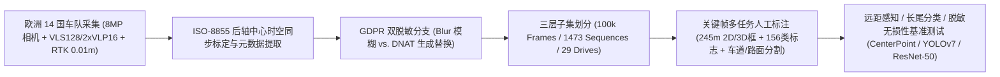

# Zenseact Open Dataset

**Zenseact Open Dataset: A large-scale and diverse multimodal dataset for autonomous driving** 收录于 [Awesome World-Action Models (RCL)](https://github.com/rcl-robotics/Awesome-World-Action-Models) **第 130/564** 篇，分组 **Datasets**。本页是 **清单索引**：给出它在清单中的位置与原文入口，方法细节和量化结果请看原文。

## 一句话定义

Zenseact 发布的大规模欧洲多模态自动驾驶数据集（ZOD, ICCV 2023）：以 **Frames（100k） / Sequences（1,473） / Drives（29）** 三层结构覆盖 14 个欧洲国家与 705 km²（75 m 半径）地理范围，提供 8MP 相机、254k 点/帧 LiDAR、RTK GNSS/IMU 与最远达 245 m 的 2D/3D 多任务标注，并首次在同量级数据集上采用商业友好的 CC BY-SA 4.0 许可。

## 英文缩写速查

| 缩写 | 英文全称 | 简要说明 |
|------|----------|----------|
| ZOD | Zenseact Open Dataset | Zenseact 开源的大规模多模态自动驾驶数据集 |
| DNAT | Deep Neural Anonymization | 基于生成模型的图像人脸/车牌脱敏方案（与高斯模糊对照） |
| CDS | Composite Detection Score | 综合检测精度与 3D 框属性估计的评测分数 |
| TSR | Traffic Sign Recognition | 交通标志识别（ZOD 含 156 类、446k 实例） |
| RTK GNSS/IMU | Real-Time Kinematic Global Navigation Satellite System / Inertial Measurement Unit | 100 Hz 高精度组合惯导（位置精度 0.01 m） |

## 为什么重要

- 针对既往多模态数据集（KITTI、nuScenes、Waymo Open、Argoverse 2）偏重局部城市连续序列、导致样本高度相关且欧洲场景缺失的问题，ZOD Frames 用非时序精选策略覆盖比 Waymo Open 大 **9×**（75 m 半径）至 **26×**（150 m 半径）的地理区域。
- 面向最高 133 km/h 高速驾驶需求，ZOD 将 3D 目标框人工标注距离推进至 **245 m**，同时提供 **446k** 交通标志实例（156 细粒度类别，实例数为 MTSD 的 2 倍以上）及道路语义/车道实例掩码，天然支撑远距离感知、长尾识别与多任务学习。
- 顺着 [Awesome World-Action Models](paper-rcl-wam-robot-learning-control-survey.md)、[RCL Awesome WAM 技术地图](../overview/rcl-awesome-wam-technology-map.md) 与站内 [World Action Models（WAM）](../concepts/world-action-models.md) 页面可横向对比数据集体系。

## 核心信息

| 字段 | 内容 |
|------|------|
| 编号 | 130/564 |
| 分组 | Datasets |
| 出处 | ICCV 2023 (pp. 20178–20188) |
| 作者与机构 | Mina Alibeigi*, William Ljungbergh*, Adam Tonderski* et al. (Zenseact) |
| 论文 | <https://openaccess.thecvf.com/content/ICCV2023/papers/Alibeigi_Zenseact_Open_Dataset_A_Large-Scale_and_Diverse_Multimodal_Dataset_for_ICCV_2023_paper.pdf> |
| 项目页与许可 | <https://zod.zenseact.com> · CC BY-SA 4.0（支持研究与商业用途） |
| 子类 / 象限 | 自动驾驶感知数据 · 运动预测与规划数据 · 多传感器与空间标注 · 长距离与多任务 |

## 核心机制（归纳）

> 注：以下内容基于通读 ICCV 2023 开放获取原文全文核对补充。

### 1. 三层互补数据架构（Frames / Sequences / Drives）

1. **Frames（100k 关键帧，等效 55.6 h）**：跨越 2 年采集自 **14 个欧洲国家**（北至瑞典雪地、南至意大利乡村），最大化天气（晴 61.2% / 多云 19.0% / 雨 15.7% / 雾 2.1% / 雪 2.0%）、时段（白天 77.3% / 夜间 19.0% / 晨昏 3.6%）与道路类型（城市 50.1% / 城市主干 23.8% / 高速 11.1% / 乡村主干 9.9% / 乡村小路 5.1%）多样性；每帧附带关键帧前后 ±1 s（10 Hz）LiDAR 与前 5 s 至后 25 s（或前向 300 m）的 100 Hz GNSS/IMU 轨迹。
2. **Sequences（1,473 段 × 20 s，总计 8.2 h）**：覆盖 6 国（26 km²），提供完整 20 s 全传感器流与车辆控制信号（100 Hz 方向盘/油门刹车/转向灯），仅中间关键帧提供完整人工标注，适合时空表示学习与自动标注研究。
3. **Drives（29 段，总计 1.5 h）**：采自 2 座城市的长时序驾驶片段（每段数分钟），包含环岛、T 形路口、匝道并线与回环（loop closures），面向视觉定位与 SLAM。

### 2. 高分辨率传感器套件与时空标定（Table 2）

- **前视相机**：1 颗 8MP（3848 × 2168）广角鱼眼转 RGB 相机（HFOV 120°、VFOV 67°、10 Hz），同时提供 JPG（推荐基准使用）与无损 PNG。
- **激光雷达组合**：1 颗车顶 Velodyne VLS128（128 线、903 nm、最远 **245 m**、360° HFOV、40° VFOV `[-25°, +15°]`）+ 2 颗侧前 VLP16（16 线、100 m），10 Hz 同步采集，单帧平均 **254k 点**（存为 6 维 `.npy`：`timestamp, x, y, z, intensity, diode_index`）。
- **高精度组合导航**：OxTS RT3000（6 轴 L1/L2 RTK，100 Hz），位置精度 **0.01 m**、俯仰/横滚 **0.03°**、航向 **0.1°**；所有传感器统一同步并标定至后轴中心 **ISO-8855** 车体坐标系（X 前、Y 左、Z 上）。

### 3. 远距多任务标注与 GDPR 双脱敏对照

- **三类人工质检标注**：（1）15 顶层类像素级语义分割与车道线实例分割（含颜色、单双线基数属性与可行驶 ego road）；（2）2D 紧致边界框与 **9-DOF 3D 框**（中心坐标、尺寸与四元数姿态；动态物体 4 父类 16 子类、静态物体 7 父类 13 子类，最远至 **245 m**；交通标志细分 6 大类 **156 小类**共 **446k** 实例）；（3）路面干湿/冰雪分类标签。
- **合规双版图像**：依据欧盟 GDPR 对人脸与车牌同时发布**模糊（blur）**与**深度神经生成替换（DNAT）**两版图像（Sequences 仅发布 blur 版），用于研究隐私脱敏对视觉感知精度的影响。

### 方法流程图

## 评测与指标

- **地理多样性对比（Table 1 & Sec 4.1）**：按 75 m 半径膨胀计算覆盖面积，ZOD Frames 达 **705 km²**（nuScenes `5 km²`、Argoverse 2 `17 km²`、Waymo Open `76 km²`）；按 150 m 半径计算达 **2,039 km²**（为 Waymo Open 的 **26×**），且自车最高行驶速度达 **133 km/h**。
- **图像脱敏影响评估（Table 3，COCO AP，不同脱敏训练 → 原始未脱敏图像评测，3 次实验均值±标准差）**：
  - `Faster R-CNN (R50-FPN)`：Original **`30.23 ± 0.09`**（`AP_veh=42.41`, `AP_ped=22.32`）、DNAT **`30.28 ± 0.03`**、Blur **`30.17 ± 0.06`**。
  - `YOLOv7`：Original **`33.62 ± 0.04`**（`AP_veh=47.79`, `AP_ped=27.56`）、DNAT **`33.74 ± 0.09`**、Blur **`33.67 ± 0.01`**。结论：DNAT 与模糊脱敏均未对 2D 目标检测造成统计显著精度损失。
- **远距离 3D 目标检测基准（Table 4，CenterPoint，指标为 mAP / CDS）**：
  - `0–150 m`：`mAP = 0.25`、`CDS = 0.46`（同等 0–150 m 范围下 CenterPoint 在 Argoverse 2 上为 `mAP = 0.18`）；
  - 分距离分段：`0–50 m`（`0.33 / 0.62`）→ `50–100 m`（`0.19 / 0.33`）→ `100–150 m`（`0.06 / 0.08`）→ `150–250 m`（`0.01 / 0.02`），暴露出百米外点云稀疏带来的巨大挑战；全距离 `0–250 m` 分数中近半数长尾类别 AP 低于 `10%`（Fig. 7）。
- **交通标志长尾分类（Table 5，ResNet-50，剔除验证集 `< 10` 样本类别）**：微平均 `F1_micro = 95.4%`，宏平均 **`F1_macro = 78.5%`**；高频前 10 类平均准确率 **`93.4%`**，低频后 10 类仅 **`65.4%`**。

## 与其他工作对比

- 相较于 **nuScenes / Waymo Open / Argoverse 2** 提供 360° 环视与全序列密集跟踪标注，ZOD 仅提供 120° 前视相机与单帧关键帧标注，但换取了 **9×–26×** 的地理与气候多样性以及商业可用的 **CC BY-SA 4.0** 协议。
- 在长距离点云密度上（254k 点/帧、245 m 标注）高于 Waymo Open（177k、80 m）与 Argoverse 2（107k、214 m），仅 PandaSet 标注范围更远（300 m）但规模仅 8k 帧。
- 在交通标志识别上，ZOD 虽类别树（156 类）少于 Mapillary MTSD（313 类），但高质量多模态关联实例数（446k）达到 MTSD（206k）的 **2 倍以上**。

## 结论

**ZOD 通过“100k 低相关高多样性关键帧 + 254k 点高密 LiDAR 远距 245 m 标注 + CC BY-SA 4.0 商用许可”，有效填补了欧洲多气候长距离感知与多任务自动驾驶数据的空白。**

1. **适用场景定位**：最适合长距离目标检测（>100 m）、极端天气（雪/雾/夜）域泛化、长尾交通标志识别及多任务共享表征；做全序列 3D 跟踪则需等待官方后续全序列标注补充或联合 nuScenes/Argoverse 2 使用。
2. **脱敏安全可用**：Faster R-CNN 与 YOLOv7 实验表明使用公开的 blur 或 DNAT 图像训练不会损伤下游 2D 检测性能（ΔAP < 0.12）。
3. **长距与长尾瓶颈**：CenterPoint 在 100–250 m 区间 `mAP` 跌破 `0.06`、近半数类别 AP 不足 `10%`，纯 LiDAR 方案在高速远距场景亟需图像-雷达前融合或时序先验。
4. **开源与开发支持**：官网（`zod.zenseact.com`）已开放完整数据、Python devkit 与教程，且 CC BY-SA 4.0 允许初创与商业团队使用。

## 常见误区

1. **误以为 ZOD 支持全时序 3D 跟踪评测**：当前人工标注仅落在关键帧（Sequences 仅中间帧有标注），尚不支持跨帧一致的 3D MOT 评估。
2. **忽略 245 m 远端标注的稀疏性**：虽然标注最远达 245 m，但作者明确指出超远距离处的 3D 召回率与质量有所衰减（部分依赖 2D 框补充），且部分 Frames 缺失交通标志与 ego-road 标签。
3. **误以为 ZOD 具备 360° 相机与高精地图**：ZOD 配备 360° LiDAR，但相机仅有前视 120° 单目，且本版发布尚未包含 HD Map。

## 关联页面

- 列表实体：[Awesome World-Action Models（RCL）](paper-rcl-wam-robot-learning-control-survey.md)
- 技术地图：[RCL Awesome WAM 技术地图](../overview/rcl-awesome-wam-technology-map.md)
- 方法/任务：[generative-world-models.md](../methods/generative-world-models.md)、[manipulation.md](../tasks/manipulation.md)

## 参考来源

- [`sources/papers/rcl_awesome_wam_ref_12b97dfcece775bcc0b8_zenseact-open-dataset-a-large-scale-and.md`](../../sources/papers/rcl_awesome_wam_ref_12b97dfcece775bcc0b8_zenseact-open-dataset-a-large-scale-and.md) — 本条目策展摘录
- [`sources/papers/rcl_awesome_wam_catalog.md`](../../sources/papers/rcl_awesome_wam_catalog.md) — 列表总表
- [`sources/repos/awesome-world-action-models-rcl.md`](../../sources/repos/awesome-world-action-models-rcl.md)
- [`docs/PAPERS.md`](https://github.com/RCL-Robotics/Awesome-World-Action-Models/blob/main/docs/PAPERS.md) — 上游论文目录
- 论文：<https://openaccess.thecvf.com/content/ICCV2023/papers/Alibeigi_Zenseact_Open_Dataset_A_Large-Scale_and_Diverse_Multimodal_Dataset_for_ICCV_2023_paper.pdf>

## 推荐继续阅读

- [Awesome World-Action Models (RCL) 仓库](https://github.com/rcl-robotics/Awesome-World-Action-Models)
- [原文](https://openaccess.thecvf.com/content/ICCV2023/papers/Alibeigi_Zenseact_Open_Dataset_A_Large-Scale_and_Diverse_Multimodal_Dataset_for_ICCV_2023_paper.pdf)
