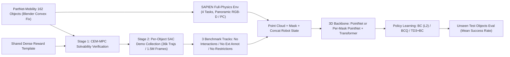

# ManiSkill

**ManiSkill: Generalizable Manipulation Skill Benchmark with Large-Scale Demonstrations** 收录于 [Awesome World-Action Models (RCL)](https://github.com/rcl-robotics/Awesome-World-Action-Models) **第 035/564** 篇，分组 **Benchmarks & simulators**。本页是 **清单索引**：给出它在清单中的位置与原文入口，方法细节和量化结果请看原文。

## 一句话定义

RCL Awesome WAM 清单收录（Benchmarks & simulators）；细节以原文 PDF / 项目页为准。

## 英文缩写速查

| 缩写 | 英文全称 | 简要说明 |
|------|----------|----------|
| WAM | World Action Model | 世界预测与动作生成耦合 |
| VLA | Vision-Language-Action | 视觉–语言–动作策略 |
| IDM | Inverse Dynamics Model | 先预测未来再反推动作 |
| WM | World Model | 环境前向预测模型 |

## 为什么重要

- RCL Awesome WAM 清单收录（Benchmarks & simulators）；细节以原文 PDF / 项目页为准。
- 想横向对照同一分组的其他工作，可以从 [RCL Awesome WAM 技术地图](../overview/rcl-awesome-wam-technology-map.md) 逐条展开。
- 顺着列表实体 [Awesome World-Action Models](paper-rcl-wam-robot-learning-control-survey.md) 与站内 WAM / VLA 方法页，可以接回对应的学习主线。

## 核心信息

| 字段 | 内容 |
|------|------|
| 编号 | 035/564 |
| 分组 | Benchmarks & simulators |
| 出处 | NeurIPS 2021 Datasets and Benchmarks Track |
| 论文 | <https://datasets-benchmarks-proceedings.neurips.cc/paper_files/paper/2021/hash/eda80a3d5b344bc40f3bc04f65b7a357-Abstract-round2.html> |
| 代码/项目 | <https://github.com/haosulab/ManiSkill> |
| 子类 / 象限 | 机器人操作基准 · 物理仿真 · 泛化评测 · 示范数据 · 不适用 |

## 核心机制（归纳）

> 注：以下机制与评测指标基于通读开放获取原文全文核对补充（[NeurIPS 2021 原文](https://datasets-benchmarks-proceedings.neurips.cc/paper_files/paper/2021/hash/eda80a3d5b344bc40f3bc04f65b7a357-Abstract-round2.html)）。

**ManiSkill**（SAPIEN Manipulation Skill Benchmark）是基于全开源物理仿真器 SAPIEN（PhysX）构建的 3D 可泛化物理操作基准，面向「同类别未见拓扑/几何物体」的跨物体泛化问题，核心设计包含资产精修、可规模化示范采集、多赛道评测协议与 3D 策略基线（与 [World Action Models（WAM）](../concepts/world-action-models.md) 等具身策略评测紧密相关）：

1. **资产筛选、重建模与可解性验证（§2.6）**：
   - 从 PartNet-Mobility 筛选 **162** 个铰接与复杂物体：剔除铰链方向等标注错误；针对自动凸分解算法（VHACD）造成的表面凹陷伪影，使用 Blender 手工重新分解碰撞网格；并要求每个资产均通过 MPC 验证确实可解。
2. **四类物理运动约束任务与传感器/控制设置（§2.2–2.3）**：
   - 机器人由可升降移动底盘、Sciurus 躯干及单/双 Franka Panda 机械臂构成（单臂 13 关节、双臂 22 关节，支持 PID 关节速度控制与操作空间控制）。
   - 观测支持 `state`、`pointcloud`、`rgbd` 三种模式；视觉模式通过机身 3 台间隔 $120^\circ$、分辨率 $400 \times 160$ 的自中心全景相机融合点云或 RGB-D，并附任务相关分割掩码。
   - 4 个任务覆盖不同自由度与协同需求：`OpenCabinetDoor`（单臂转动副 1 DoF）、`OpenCabinetDrawer`（单臂移动副 1 DoF）、`PushChair`（双臂协同推动欠驱动转椅平面运动，约 15–25 DoF）、`MoveBucket`（双臂无约束 7 DoF 协同端起带球水桶放至平台）。
3. **两阶段「MPC 验证 + 分治 RL」大规模示范采集流水线（§2.4）**：
   - **Stage 1（MPC 奖励模板验证）**：为每类任务设计跨物体共享的稠密奖励模板，用基于交叉熵方法（CEM）的 MPC 在单初始状态 20 CPU 上 15 分钟内快速验证奖励有效性与物体可解性。
   - **Stage 2（Divide-and-Conquer SAC 采集）**：针对单个训练物体环境分别训练 **SAC** 智能体，在随机初始状态下为每个训练物体生成 300 条成功轨迹，累计约 **36,000** 条轨迹（约 **1.5M** 帧，按内部状态存储并支持按需渲染）。
4. **三赛道协议与 3D 点云基线（§2.5, §3）**：
   - 划分 `No Interactions`（仅用离线示范）、`No External Annotations`（允许训练环境在线 RL 微调，禁用外部新标注）、`No Restrictions` 三赛道。
   - 基线输入降采样点云（坐标 + RGB + 分割掩码）并将机器人状态拼接到每个点特征上；比较单 `PointNet + MLP` 与分掩码 `PointNet + Transformer + Attention Pooling` 两种视觉骨干，以及 `BC`（L2 动作回归）、`BCQ`、`TD3+BC` 三种离线学习算法。

### 方法流程图

## 评测与指标

- **数据集与任务划分规模（Table 1）**：
  - `OpenCabinetDoor`：52 个柜子（82 扇门），训练 42（66 门）/ 测试 10（16 门），单臂。
  - `OpenCabinetDrawer`：35 个柜子（70 个抽屉），训练 25（49 抽屉）/ 测试 10（21 抽屉），单臂。
  - `PushChair`：36 把转椅，训练 26 / 测试 10，双臂协同。
  - `MoveBucket`：39 个水桶，训练 29 / 测试 10，双臂协同。
- **单环境示范规模缩放实验（`OpenCabinetDrawer` 单物体，100 条评测轨迹，Table 2）**：
  - 示范轨迹从 10 $\rightarrow$ 30 $\rightarrow$ 100 $\rightarrow$ 300 $\rightarrow$ 1000（梯度步 2k $\rightarrow$ 40k）：
    - `PointNet, BC`：0.13 $\rightarrow$ 0.23 $\rightarrow$ 0.37 $\rightarrow$ 0.68 $\rightarrow$ **0.76**。
    - `PointNet + Transformer, BC`：0.16 $\rightarrow$ 0.35 $\rightarrow$ 0.51 $\rightarrow$ 0.85 $\rightarrow$ **0.90**（样本效率显著优于单 PointNet）。
    - `PointNet + Transformer, BCQ`：0.02 $\rightarrow$ 0.05 $\rightarrow$ 0.23 $\rightarrow$ 0.45 $\rightarrow$ **0.55**；`TD3+BC`：0.03 $\rightarrow$ 0.13 $\rightarrow$ 0.22 $\rightarrow$ 0.31 $\rightarrow$ **0.57**。
- **跨物体泛化主评测（点云输入，每训练环境 300 条示范、150k 步、5 随机种子，测试为 10 个未见物体 $\times$ 50 条轨迹，Table 3）**：
  - **`PointNet + Transformer, BC`**（最强基线，Train / Test SR）：`OpenCabinetDoor` 0.30±0.06 / **0.11±0.02**、`OpenCabinetDrawer` 0.37±0.06 / **0.12±0.02**、`PushChair` 0.18±0.02 / **0.08±0.01**、`MoveBucket` 0.15±0.01 / **0.08±0.01**。
  - **`PointNet, BC`**（Train / Test SR）：Door 0.18 / 0.04、Drawer 0.24 / 0.11、Chair 0.11 / 0.09、Bucket 0.03 / 0.02。
  - **`PointNet + Transformer, BCQ` / `TD3+BC`**（Test SR）：Door 0.04 / 0.04、Drawer 0.11 / 0.10、Chair 0.08 / 0.08、Bucket 0.06 / 0.03。
- **关键量化结论**：多物体联合训练成功率远低于单物体训练，且未见测试物体最高平均成功率仅 8%–12%；同时在纯成功示范和高自由度机器人设定下，L2 行为克隆（BC）表现优于离线 RL 基线（BCQ、TD3+BC）。

## 与其他工作对比

- 本页 **不做** 与具体基线的逐项数值对比；同分组的横向对照请回到 [技术地图](../overview/rcl-awesome-wam-technology-map.md) 的 **Benchmarks & simulators** 分组逐条展开。
- 如果站内已经有这篇的深读页（含机构、实验表与源码运行时序图），请以那一页为准；本页只保留清单要点。
- 与清单内相邻条目孰优孰劣，本页不下结论：清单 Contribution 可能滞后于论文最新版本，差异应以各自原文的问题设定与评测口径为准。

## 结论

**ManiSkill 率先构建了全开源、全物理仿真且经过可解性验证的 3D 跨物体操作基准（162 个铰接物体、4 类单双臂任务、约 36,000 条示范轨迹），同时用基线实验揭示了现有 3D 策略在未见物体泛化上的巨大瓶颈（测试成功率仅 8%–12%）。**

- 「MPC 模板快速验证 + 单物体分治 SAC 采集」流水线使大规模高难操作示范（含双臂推转椅与端水桶）能够低人力自动生成，且全栈基于 SAPIEN 开源、不依赖商业仿真软件。
- 分掩码 `PointNet + Transformer` 在单物体上随示范数增至 1000 条可达 90% 成功率，但在多物体混合训练与未见物体测试上急剧跌至 8%–12%，证明对象级几何拓扑泛化远未解决。
- 当数据集全部由高自由度成功轨迹构成时，离线 RL 基线（BCQ、TD3+BC）未展现出对简单 BC 的优势；如何结合在线微调（No External Annotations 赛道）或失败轨迹仍是开放方向。
- 原文指出三项当前局限：资产规模仍有限（162 个）、仅涵盖 4 个短程技能、尚未开展 Sim-to-Real 真机验证；代码与基准已在 <https://github.com/haosulab/ManiSkill> 开源。

## 常见误区

1. 不要把 Awesome 条目的 Contribution 当成完整方法证明——它只是策展导读。
2. 若站内已有这篇的深读页，以那一页为准——本页只是清单入口，不含实验数据。

## 关联页面

- 列表实体：[Awesome World-Action Models（RCL）](paper-rcl-wam-robot-learning-control-survey.md)
- 技术地图：[RCL Awesome WAM 技术地图](../overview/rcl-awesome-wam-technology-map.md)
- 方法/任务：[generative-world-models.md](../methods/generative-world-models.md)、[manipulation.md](../tasks/manipulation.md)

## 参考来源

- [`sources/papers/rcl_awesome_wam_ref_18fe7d2bfb0e93f4c45e_maniskill-generalizable-manipulation-ski.md`](../../sources/papers/rcl_awesome_wam_ref_18fe7d2bfb0e93f4c45e_maniskill-generalizable-manipulation-ski.md) — 本条目策展摘录
- [`sources/papers/rcl_awesome_wam_catalog.md`](../../sources/papers/rcl_awesome_wam_catalog.md) — 列表总表
- [`sources/repos/awesome-world-action-models-rcl.md`](../../sources/repos/awesome-world-action-models-rcl.md)
- [`docs/PAPERS.md`](https://github.com/RCL-Robotics/Awesome-World-Action-Models/blob/main/docs/PAPERS.md) — 上游论文目录
- 论文：<https://datasets-benchmarks-proceedings.neurips.cc/paper_files/paper/2021/hash/eda80a3d5b344bc40f3bc04f65b7a357-Abstract-round2.html>

## 推荐继续阅读

- [Awesome World-Action Models (RCL) 仓库](https://github.com/rcl-robotics/Awesome-World-Action-Models)
- [原文](https://datasets-benchmarks-proceedings.neurips.cc/paper_files/paper/2021/hash/eda80a3d5b344bc40f3bc04f65b7a357-Abstract-round2.html)
