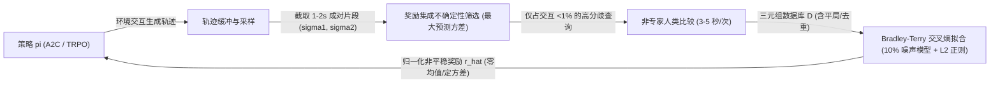

# Deep Reinforcement Learning from Human Preferences

**Deep Reinforcement Learning from Human Preferences**（Christiano 等，OpenAI & DeepMind，NeurIPS 2017）收录于 [Awesome World-Action Models (RCL)](https://github.com/rcl-robotics/Awesome-World-Action-Models) **第 153/564** 篇，分组 **Foundational work**。本文系统性验证了基于人类轨迹偏好反馈的深度强化学习（现代 RLHF 的奠基工作）如何在无需访问真实奖励函数的前提下扩展到高维视觉游戏与连续控制任务。

## 一句话定义

通过非专家人类对 1–2 秒成对轨迹片段的偏好比较拟合神经奖励估计器 $\hat{r}$，并与策略梯度算法（A2C / TRPO）异步闭环优化，从而在人类反馈仅覆盖不到 1% 交互步数的条件下求解复杂控制与新颖行为学习任务。

## 英文缩写速查

| 缩写 | 英文全称 | 简要说明 |
|------|----------|----------|
| RLHF | Reinforcement Learning from Human Feedback | 基于人类反馈的强化学习（本文确立其深度偏好比较范式） |
| A2C | Advantage Actor-Critic | 优势演员–评论家算法（本文用于 Atari 离散策略优化） |
| TRPO | Trust Region Policy Optimization | 信赖域策略优化（本文用于 MuJoCo 连续控制策略优化） |
| ALE | Arcade Learning Environment | 街机学习环境（Atari 视觉控制基准） |
| WAM | World Action Model | 世界预测与动作生成耦合 |

## 为什么重要

- **解决奖励工程与目标错配难题**：许多真实机器人任务（如清理桌面、非人类形态动作控制）难以用手工函数精确刻画，也难以由人类直接遥操作示教；成对比较比打绝对分值或提供完整轨迹示范更省力且一致性更高。
- **降低三个数量级的人类标注成本**：通过训练独立的深度奖励预测器替代人工逐帧打分，人类只需对不到 **1%** 的环境交互给出偏好（约 15 分钟至 5 小时），即可驱动数百万步乃至上千万帧的深度 RL 训练。
- **为后续机器人与大模型对齐奠基**：该工作提出的「成对片段比较 + Bradley-Terry 交叉熵拟合 + 奖励集成与在线异步查询」构成了后续机器人偏好学习与语言模型 RLHF 流水线的核心原型。

## 核心信息

| 字段 | 内容 |
|------|------|
| 编号 | 153/564 |
| 分组 | Foundational work |
| 出处 | NeurIPS 2017 |
| 作者 | Paul F. Christiano, Jan Leike, Miljan Martic, Shane Legg, Tom B. Brown, Dario Amodei（OpenAI / DeepMind / Google Brain） |
| 论文 | <https://proceedings.neurips.cc/paper/2017/hash/d5e2c0adad503c91f91df240d0cd4e49-Abstract.html> |
| 子类 / 象限 | 训练优化与蒸馏 · 偏好学习与奖励建模 |

## 核心机制（归纳）

### 三路异步闭环与 Bradley-Terry 奖励建模

算法同时维护策略网络 $\pi: O \to A$ 与奖励估计器 $\hat{r}: O \times A \to \mathbb{R}$（Atari 上以连续 4 帧观测为输入），并通过三个**异步运行**的进程协同更新：

1. **策略优化（RL 进程）**：策略 $\pi$ 与环境交互生成轨迹集合 $\{\tau^1, \dots, \tau^i\}$，用奖励预测器给出的归一化奖励 $\hat{r}(o_t, a_t)$（标准化为零均值、恒定标准差，以消除奖励平移与尺度不确定性）通过策略梯度算法优化 $\pi$。Atari 采用 **A2C**，MuJoCo 采用 **TRPO**（并将熵奖励适当调大，以防非平稳 $\hat{r}$ 导致信赖域探索不足）。
2. **偏好征集与不确定性查询（查询进程）**：从最新交互轨迹中采样长度为 $k$（对应 **1–2 秒**短视频片段）的片段对 $(\sigma^1, \sigma^2)$。利用奖励集成中各成员预测偏好的方差近似不确定性，优先挑选**分歧最大**的片段对交由人类对比；人类可选择更优片段、平局（$\mu=(0.5,0.5)$）或无法比较（丢弃）。
3. **奖励监督拟合（RM 进程）**：将收集到的三元组数据库 $D = \{(\sigma^1, \sigma^2, \mu)\}$ 通过有放回自助采样（bootstrap，各保留 $1/e$ 验证集）训练奖励网络集成。基于 Bradley-Terry / Luce-Shephard 模型，假定人类偏好概率随片段累计隐含奖励呈指数变化，并引入 **10% 均匀随机误标概率**以提升对非专家噪声的鲁棒性：

$$\hat{P}[\sigma^1 \succ \sigma^2] = \frac{\exp \sum_t \hat{r}(o_t^1, a_t^1)}{\exp \sum_t \hat{r}(o_t^1, a_t^1) + \exp \sum_t \hat{r}(o_t^2, a_t^2)}$$

并以交叉熵损失 $-\sum_{(\sigma^1,\sigma^2,\mu)\in D}[\mu(1)\log \hat{P}(\sigma^1\succ\sigma^2) + \mu(2)\log \hat{P}(\sigma^2\succ\sigma^1)]$ 更新 $\hat{r}$，辅以自适应 $L_2$ 正则化（使验证损失维持在训练损失的 **1.1–1.5 倍**）。

### 方法流程图

## 工程实践

- **非专家标注与反馈节律**：外包标注员仅阅读 1–2 句任务描述，平均每对片段耗时 **3–5 秒**；典型基准任务总计消耗 **30 分钟至 5 小时**人工时间，单次新行为实验约 **1 小时**即可收敛。
- **非平稳奖励的训练稳定技巧**：
  - 每次集成输出均做独立归一化后再求平均，避免奖励漂移破坏优势估计与价值函数尺度；
  - 针对 TRPO 增加熵正则化系数，防止策略在奖励估计器早期未成形时过早塌缩；
  - 奖励拟合与 RL 策略更新**必须在线交织**（intertwined），离线一次性收集偏好再训练 RL 极易诱发策略利用奖励模型盲区。
- **与机器人控制衔接**：对于难写代价值函数的拟人/非拟人多自由度动作（如单腿奔跑、后空翻），短片段视频对比可直接充当「隐式塑形奖励（reward shaping）」，且相比状态重置假设更贴近真实连续交互场景。

## 评测与指标

原文在 **8 个 MuJoCo 连续控制任务**与 **7 个 Atari 视觉游戏**上对比了「真实人类反馈」「合成 Oracle 偏好（由真实奖励生成）」及「直接访问真实奖励的 RL」：

| 实验域与任务 | 人类/合成查询量 | 关键量化结果与现象 |
|--------------|-----------------|--------------------|
| MuJoCo（8 项任务） | **700** 次人类查询 / **350–1,400** 次合成查询 | **700** 次人类标注即可在全部 8 项任务上接近真实奖励 RL；**1,400** 次合成标注平均表现略超真实奖励 RL；在 **Ant** 上人类反馈显著优于合成反馈（人类对「直立」的偏好起到了更优奖励塑形作用） |
| Atari（7 款游戏） | **5,500** 次人类查询 / **3,300+** 次合成查询 | **BeamRider** 与 **Pong** 仅 **3,300** 次合成查询即接近或匹配 RL；**Breakout** 达 **20** 分（足量标注可达 **50** 分）；**Enduro** 上人类反馈因奖励「靠近/超车进展」而超越 A3C（达 DQN 水平）；**Qbert** 上真实人类反馈未能通关第一关（1–2s 短片段难以判别局势） |
| 新颖行为：Hopper 后空翻 | **900** 次作者查询（**< 1 小时**） | 学会连续后空翻、直立落地并重复循环 |
| 新颖行为：Half-Cheetah 单腿前跑 | **800** 次作者查询（**< 1 小时**） | 稳定以后腿/单腿支撑并持续向前行进 |
| 新颖行为：Enduro 并排行驶 | 约 **1,300** 次查询（400 万帧） | 在大部分回合内紧跟旁车并驾齐驱（背景切换时偶发混淆） |

**消融实验关键发现（Section 3.3）**：
- **移除在线查询（`no online queries`）**：在 Pong 上出现典型「奖励黑客」行为——智能体只学会避免失分而不主动得分，导致无限来回拉锯。
- **单帧替代片段（`no segments`）**：MuJoCo 任务性能显著下降；而缩短至 1–2 秒以下并不能明显减少人工耗时，反而降低每秒人工标注的信息效率。
- **绝对分数回归（`target`，MSE 拟合总回报）**：在奖励尺度剧烈变化的连续控制任务上明显差于成对比较。
- **随机查询（`random queries`）**：在部分任务上优于基于集成方差的主动查询，说明简单集成方差只是期望信息价值（EVOI）的粗糙近似。

## 与其他工作对比

- **对比早期轨迹偏好学习（Akrour et al. 2012/2014；Wilson et al. 2012）**：早期工作往往对整条完整轨迹排序（多消耗约一个数量级人工时间）或假设可任意重置到同一初始状态；本文采用不同初始状态的 1–2 秒短片段比较，成功扩展至高维连续控制与像素输入 Atari。
- **对比 TAMER（Knox & Stone 2013）**：TAMER 依赖人类实时给出绝对标量评分且要求人在环持续观察；本文通过成对相对比较训练可离线的独立奖励神经网络，将人工参与压缩到 <1% 交互步。
- **对比逆强化学习 / 模仿学习（IRL / GAIL）**：无需人类能够亲自演示高自由度非人形态机器人的动作，仅需人类具备「评价哪段更好」的判断力。
- **站内对照**：可结合 [RCL Awesome WAM 技术地图](../overview/rcl-awesome-wam-technology-map.md) 与 [World Action Models（WAM）](../concepts/world-action-models.md) 理解偏好奖励模型如何进一步演化为生成式世界动作模型中的对齐模块。

## 结论

**这篇论文以不到 1% 交互步的非专家成对片段比较，首次将人类偏好学习稳定扩展到高维连续控制与像素 Atari 深度强化学习，确立了「轨迹片段对比 + Bradley-Terry 奖励集成 + 在线策略梯度」的现代 RLHF 基本范式。**

- **使用成对短片段比较而非绝对打分**：在连续控制与主观行为定义任务上，1–2 秒视频片段的二选一偏好一致性与学习效果显著优于回归真实片段总回报。
- **坚持在线交织查询而非离线一次性标注**：静默离线训练集会让策略利用奖励模型盲区产生极端错位行为（如 Pong 无限互推）；奖励拟合必须随策略分布同步演进。
- **必须匹配非平稳奖励的 RL 稳定措施**：对奖励集成输出做零均值定方差归一化，并在 TRPO 等信赖域算法中调大熵奖励系数以防探索早衰。
- **谨慎看待集成方差主动查询**：在部分环境上随机选对反而更稳，复杂任务可考虑更严格的信息价值准则或结合人工课程筛选。
- **警惕短片段语义模糊的领域边界**：若 1–2 秒片段不足以让人类判断行为优劣（如 Qbert），人类反馈信号会失效，需调整片段时长或提供全局上下文。

## 常见误区与局限

1. **误区：只要收集一批离线偏好数据就能一劳永逸训练 RL 策略**。论文消融实验明确证明，静态离线训练会诱发严重的「奖励模型漏洞利用」（如 Pong 不得分只防丢分），必须与策略采样在线闭环。
2. **误区：基于集成方差的主动查询在所有任务上都优于随机查询**。Section 3.3 的消融表明，在一些任务上简单的集成预测方差查询反而会损害性能。
3. **方法局限（短片段上下文受限与高方差）**：1–2 秒片段难以覆盖超长时域因果依赖（导致 Qbert 真实人类反馈失败）；此外，学习到的奖励模型训练方差通常高于真实奖励训练的 RL。
4. **方法局限（奖励无折扣与噪声模型简化）**：Eq. (1) 未显式建模人类对时间折扣的偏好，且假设恒定 10% 随机误标率，在复杂多目标真机任务中可能仍需更精细的偏好建模。

## 关联页面

- 列表实体：[Awesome World-Action Models（RCL）](paper-rcl-wam-robot-learning-control-survey.md)
- 技术地图：[RCL Awesome WAM 技术地图](../overview/rcl-awesome-wam-technology-map.md)
- 方法/任务：[generative-world-models.md](../methods/generative-world-models.md)、[vla.md](../methods/vla.md)、[manipulation.md](../tasks/manipulation.md)、[locomotion.md](../tasks/locomotion.md)

## 参考来源

- [`sources/papers/rcl_awesome_wam_ref_2062ffd7f6397312bd01_deep-reinforcement-learning-from-human-p.md`](../../sources/papers/rcl_awesome_wam_ref_2062ffd7f6397312bd01_deep-reinforcement-learning-from-human-p.md) — 本条目策展摘录
- [`sources/papers/rcl_awesome_wam_catalog.md`](../../sources/papers/rcl_awesome_wam_catalog.md) — 列表总表
- [`sources/repos/awesome-world-action-models-rcl.md`](../../sources/repos/awesome-world-action-models-rcl.md)
- [`docs/PAPERS.md`](https://github.com/RCL-Robotics/Awesome-World-Action-Models/blob/main/docs/PAPERS.md) — 上游论文目录
- 论文：<https://proceedings.neurips.cc/paper/2017/hash/d5e2c0adad503c91f91df240d0cd4e49-Abstract.html>

## 推荐继续阅读

- [Awesome World-Action Models (RCL) 仓库](https://github.com/rcl-robotics/Awesome-World-Action-Models)
- [原文（NeurIPS 2017）](https://proceedings.neurips.cc/paper/2017/hash/d5e2c0adad503c91f91df240d0cd4e49-Abstract.html)
