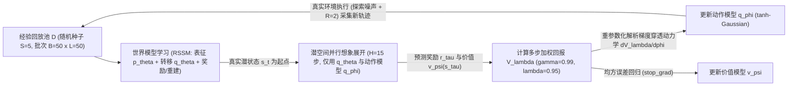

# Dream to Control

**Dream to Control: Learning Behaviors by Latent Imagination**（**Dreamer**；Danijar Hafner, Timothy Lillicrap, Jimmy Ba, Mohammad Norouzi，多伦多大学 / Google Brain / DeepMind，ICLR 2020 / arXiv:1912.01603v3）收录于 [Awesome World-Action Models (RCL)](https://github.com/rcl-robotics/Awesome-World-Action-Models) **第 157/564** 篇，分组 **Foundational work**。它是基于潜空间世界模型通过**解析价值梯度（Analytic Value Gradients）**学习长程视觉控制策略的奠基性工作。

## 一句话定义

一种完全在世界模型的紧凑潜空间中「做梦想象」来学习长程行为的强化学习智能体：将状态价值函数与可微分 RSSM 潜动力学结合，把多步 $\lambda$-回报的解析梯度直接沿想象轨迹反向传播以更新策略，从而同时获得远超无模型方法的样本效率与超越在线规划的渐近性能。

## 英文缩写速查

| 缩写 | 英文全称 | 简要说明 |
|------|----------|----------|
| WAM | World Action Model | 世界预测与动作生成耦合 |
| VLA | Vision-Language-Action | 视觉–语言–动作策略 |
| IDM | Inverse Dynamics Model | 先预测未来再反推动作 |
| WM | World Model | 环境前向预测模型 |
| RSSM | Recurrent State-Space Model | 兼具确定性循环状态与随机高斯潜变量的潜动力学世界模型 |
| VIB / ELBO | Variational Information Bottleneck / Evidence Lower Bound | 用于联合优化表征、图像重建、奖励预测与 KL 正则化的目标下界 |
| NCE | Noise-Contrastive Estimation | 本文对比评测中替代像素重建的对比学习潜表征目标 |

## 为什么重要

- 在 Dreamer 之前，基于潜动力学的视觉控制（如 PlaNet）依赖**有限视界在线规划（MPC / CEM）**，不仅每步推理耗时（无梯度随机采样搜索），而且只优化有限步内的想象奖励会导致严重的**短视行为**（在 Acrobot、Hopper 等长程信用分配任务上近乎失效）。
- Dreamer 首次系统性地用**潜空间 Actor-Critic + 穿透神经动力学的解析价值梯度（重参数化反向传播）**取代在线规划：价值模型 $v_\psi(s_\tau)$ 捕获想象视界 $H$ 之外的远期回报，动作模型 $q_\phi(a_\tau|s_\tau)$ 利用神经网络可微性高效优化多步收益，奠定了后续 DreamerV2/V3 及大量物理世界模型策略学习的算法底座。
- 顺着 [Awesome World-Action Models](paper-rcl-wam-robot-learning-control-survey.md) 与 [RCL Awesome WAM 技术地图](../overview/rcl-awesome-wam-technology-map.md)，可清晰定位其作为「经典 WM 与模型式 RL」源头的位置。

## 核心信息

| 字段 | 内容 |
|------|------|
| 作者与机构 | Danijar Hafner, Timothy Lillicrap, Jimmy Ba, Mohammad Norouzi（University of Toronto / Google Brain / DeepMind） |
| 编号 / 分组 | 157/564 · Foundational work（子类：经典WM与模型式RL） |
| 出处 / 原文 | ICLR 2020 · <https://openreview.net/forum?id=S1lOTC4tDS> / [arXiv:1912.01603](https://arxiv.org/abs/1912.01603) |
| 官方主页与代码 | <https://danijar.com/dreamer>（TensorFlow Probability 实现） |
| 评测平台与算力 | DeepMind Control Suite 20 项视觉控制任务（64×64×3 像素输入，固定动作重复 $R=2$）；单卡 Nvidia V100 + 10 CPU |

## 核心机制（归纳）

1. **三组件潜动力学世界模型（RSSM）**：从经验回放池 $\mathcal{D}$（初始 $S=5$ 条随机轨迹）抽取长度为 $L=50$、批大小 $B=50$ 的序列，学习表征模型 $p_\theta(s_t|s_{t-1},a_{t-1},o_t)$、转移模型 $q_\theta(s_t|s_{t-1},a_{t-1})$ 与奖励模型 $q_\theta(r_t|s_t)$（30 维对角高斯潜状态 + RSSM 确定性路径）。论文比较了三种表征学习目标：
   - **像素重建（默认最优）**：引入观测解码器 $q_\theta(o_t|s_t)$，联合最大化 ELBO/VIB（图像对数似然 + 奖励对数似然 − $\beta \text{KL}$ 正则，$\beta=1$ 且裁剪至 3 free nats）。
   - **对比估计（NCE）**：用状态编码器 $q_\theta(s_t|o_t)$ 替代图像重建以规避像素容量负担。
   - **纯奖励预测**：仅拟合奖励，在有限稀疏数据下表征不足。
2. **紧凑潜空间并行想象**：从经验序列真实编码状态 $s_t$ 出发，完全在潜空间中沿转移模型 $q_\theta$ 与策略 $q_\phi$ 前向展开 $H=15$ 步（离散任务 $H=10$）的想象轨迹 $\{s_\tau, a_\tau, r_\tau\}_{\tau=t}^{t+H}$，无需生成高维图像即可并行推演数千条轨迹。
3. **$\lambda$-回报与穿透动力学的解析梯度更新**：
   - **价值估计**：对想象轨迹计算指数加权多步 $\lambda$-回报 $V_\lambda(s_\tau)$（$\gamma=0.99,\ \lambda=0.95$），融合不同截断步 $k$ 与终端学习价值 $v_\psi(s_h)$ 以平衡偏差–方差，价值网络通过均方误差回归 $V_\lambda$（对目标停梯度）。
   - **重参数化动作梯度**：连续动作模型输出 $\tanh$-高斯分布 $a_\tau = \tanh(\mu_\phi(s_\tau) + \sigma_\phi(s_\tau)\epsilon)$（离散动作使用 Straight-Through 梯度），通过随机反向传播直接计算 $\nabla_\phi \mathbb{E}\left[\sum_{\tau=t}^{t+H} V_\lambda(s_\tau)\right]$，将梯度沿价值网络 $\to$ 奖励/状态转移链条反向穿透回策略参数 $\phi$（更新期间固定世界模型参数 $\theta$）。
4. **交错环境交互**：每完成 $C=100$ 次模型与行为更新步，用当前策略在环境中执行 1 个 episode（连续任务叠加 $\mathcal{N}(0, 0.3)$ 探索噪声，动作重复 $R=2$）并写回数据集 $\mathcal{D}$。

### 方法流程图

## 评测与指标

### 1. DeepMind Control Suite（20 项 64×64×3 像素控制任务，5 种子均值，Appendix G）

| 方法 | 输入模态 | 环境步数 | 20 项任务平均分 | 代表性单项表现对比 |
|------|---------|---------|----------------|-------------------|
| A3C | 本体状态 (proprio) | $10^8$ | 243.70 | Hopper Hop 0.50, Acrobot Swingup 41.90 |
| D4PG | 像素 (pixels) | $10^8$ | 786.32 | Cheetah Run 523.80, Cartpole Swingup Sparse 482.00, Acrobot 91.70 |
| PlaNet（$R=2$ 统一复跑） | 像素 (pixels) | $5\times 10^6$ | 332.97 | Acrobot 3.21, Hopper Hop 0.37, Pendulum 3.27 |
| **Dreamer（本文）** | **像素 (pixels)** | **$5\times 10^6$** | **823.39** | **Cheetah Run 894.56, Cartpole Swingup Sparse 812.22, Acrobot 365.26, Pendulum 833.00, Walker Walk 961.67, Quadruped Walk 931.61** |

### 2. 训练速度与关键消融结论

- **计算效率（1× Nvidia V100 + 10 CPU）**：Dreamer 每 $10^6$ 环境步仅需约 **3 小时**，远快于在线规划 `PlaNet` 的 **11 小时**以及无模型 `D4PG` 达到相近性能所需的 **24 小时**（且所需环境交互步数比 D4PG 少 **20×**：$5\times 10^6$ vs. $10^8$）。
- **想象视界与价值函数消融（Fig. 4 & Appendix D）**：在 $H=20$ 的 20 项任务对比中，带价值模型的 Dreamer 在 **16/20 项任务上胜出、4 项打平**无价值模型的纯想象动作学习（`No value`）和 `PlaNet`；即便视界缩短到 $H=10$，价值模型仍能稳住长程任务表现。
- **表征目标消融（Fig. 8 & Fig. 11）**：在统一框架下对比三种表征损失——**像素重建（Reconstruction）**在绝大多数任务上最优；**对比估计（NCE）**可解出约一半任务；**纯奖励预测（Reward only）**在实验中不足以学出有效控制策略。
- **离散控制扩展（Appendix C）**：在 Atari 子集与 DeepMind Lab（$H=10,\ \beta=0.1$，额外预测软折现因子以处理提前终止）上验证了直通梯度（Straight-Through）学习离散行为的可行性。

## 与其他工作对比

- **相比 PlaNet（在线潜空间 CEM 规划）**：共享同一套 RSSM 世界模型，但将推理期昂贵的无梯度轨迹搜索替换为摊销动作策略网络 + 价值网络，单步推理极快、训练提速近 **3.7×**（3h vs. 11h），并彻底解决了有限视界短视问题（平均分 **823.39** vs. **332.97**）。
- **相比 D4PG / SAC / DDPG（无模型 Actor-Critic）**：D4PG 仅利用即刻 Q 值梯度且依赖海量真实回放（$10^8$ 步）；Dreamer 将环境步数压缩 20 倍（$5\times 10^6$ 步）仍反超其最终平均分（**823.39** vs. **786.32**），尤其在稀疏奖励（Cartpole Swingup Sparse 812.22 vs. 482.00）与接触动力学任务上优势显著。
- **相比 REINFORCE 类算法（PPO / A3C）**：不靠高方差的策略梯度蒙特卡洛采样，而是直接将价值估计通过可微分潜动力学与重参数化传播到动作网络。

## 常见误区或局限

1. **像素重建的容量冗余与复杂视觉局限**：论文在 Atari 与 DeepMind Lab 离散任务中坦承，纯粹依靠像素重建的世界模型仍未在所有高视觉复杂度游戏上全面超越专门的无模型基线（如 Rainbow/IMPALA），模型容易把容量耗费在与任务无关的背景像素重建上。
2. **纯奖励预测在稀疏回报场景下不可行**：虽然理论上预测未来奖励足以定义 MDP，但消融实验表明仅靠奖励预测无法学会有效视觉表征，必须配合像素重建或对比学习等自监督观测信号。
3. **固定动作重复与短中程模型保真度依赖**：实验统一使用超参 $R=2$、$H=15$；若环境需要极高频精细控制或存在剧烈不可预测接触突变，RSSM 多步想象误差累积会制约解析梯度的有效性。

## 结论

**Dreamer 确立了现代视觉世界模型强化学习的标准范式：在紧凑潜空间中联合学习可微分 RSSM 动力学与多步 $\lambda$-价值函数，并通过解析梯度穿越想象轨迹高效训练策略。**

1. **价值模型是打破有限视界短视的关键**：即使想象长度只有 $H=10\text{–}15$ 步，用 $v_\psi(s_h)$ 引导的 $V_\lambda$ 也能让策略完成长程信用分配（16/20 任务胜出、4 项打平）。
2. **解析动力学梯度比无梯度在线规划更快更强**：相比 PlaNet，训练耗时从 11h/M 降至 3h/M，20 项平均分从 332.97 跃升至 823.39。
3. **样本效率较顶级无模型方法提升一个数量级以上**：5M 步像素输入即超越 100M 步的 D4PG（823.39 vs. 786.32），证明潜空间轨迹插值能显著放大有限交互数据的价值。
4. **表征学习目标仍是核心瓶颈**：像素重建胜过初代 NCE 与纯奖励预测，也预示后续用更强的遮罩预测/冻结视觉表征替代纯像素 MSE 重建可直接提升 Dreamer 类智能体的天花板。

## 关联页面

- 列表实体：[Awesome World-Action Models（RCL）](paper-rcl-wam-robot-learning-control-survey.md)
- 技术地图：[RCL Awesome WAM 技术地图](../overview/rcl-awesome-wam-technology-map.md)
- 方法/任务：[generative-world-models.md](../methods/generative-world-models.md)、[manipulation.md](../tasks/manipulation.md)

## 参考来源

- [`sources/papers/rcl_awesome_wam_ref_23813a5cbed0b2b6d37e_dream-to-control-learning-behaviors-by-l.md`](../../sources/papers/rcl_awesome_wam_ref_23813a5cbed0b2b6d37e_dream-to-control-learning-behaviors-by-l.md) — 本条目策展摘录
- [`sources/papers/rcl_awesome_wam_catalog.md`](../../sources/papers/rcl_awesome_wam_catalog.md) — 列表总表
- [`sources/repos/awesome-world-action-models-rcl.md`](../../sources/repos/awesome-world-action-models-rcl.md)
- [`docs/PAPERS.md`](https://github.com/RCL-Robotics/Awesome-World-Action-Models/blob/main/docs/PAPERS.md) — 上游论文目录
- 论文：<https://openreview.net/forum?id=S1lOTC4tDS>

## 推荐继续阅读

- [Awesome World-Action Models (RCL) 仓库](https://github.com/rcl-robotics/Awesome-World-Action-Models)
- [原文](https://openreview.net/forum?id=S1lOTC4tDS)
- [Dreamer 官方项目主页与代码](https://danijar.com/dreamer)
