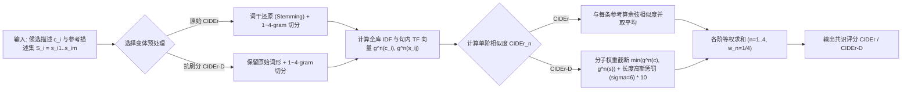

# CIDEr

**CIDEr: Consensus-Based Image Description Evaluation** 收录于 [Awesome World-Action Models (RCL)](https://github.com/rcl-robotics/Awesome-World-Action-Models) **第 135/564** 篇，分组 **Evaluation metrics**。本页是 **清单索引**：给出它在清单中的位置与原文入口，方法细节和量化结果请看原文。

## 一句话定义

**CIDEr**（Consensus-based Image Description Evaluation）是一种基于 **TF-IDF 加权 n-gram 余弦相似度**的图像描述自动评测协议，通过比对候选句与大量人工参考描述之间的“大众共识（human-likeness）”来衡量生成描述的质量。

## 英文缩写速查

| 缩写 | 英文全称 | 简要说明 |
|------|----------|----------|
| CIDEr | Consensus-based Image Description Evaluation | 本文提出的基于共识的图像描述自动评测指标 |
| CIDEr-D | CIDEr Defended against Gaming | 去除词干化并加入长度高斯惩罚与计数截断的抗刷分变体（用于 MS COCO 服务器） |
| TF-IDF | Term Frequency–Inverse Document Frequency | 词频–逆文档频率，用于提升图像显著视觉词组权重并压低全库高频虚词 |
| 2AFC | Two-Alternative Forced Choice | 二选一强迫选择人工标注协议（判断 B 或 C 哪个更像参考句 A） |

## 为什么重要

- **区分“人喜欢的”与“像人写的”**：传统图像描述评测常依赖 1–5 分主观打分，但人类觉得“好”的句子往往不同于多数人会写的“自然共识”表达；CIDEr 引入三元组 2AFC 共识标注协议，客观量化“类人性（human-likeness）”。
- **证明 5 条参考句不足以捕捉共识**：本文发布含每图 50 条描述的 **PASCAL-50S** 与 **ABSTRACT-50S**，证实评测准确率随参考句数量增至 ~50 条才趋于饱和（直接推动 MS COCO 测试集提供 40 条参考描述）。
- **具身/世界模型基准对照入口**：想横向对照同一分组的其他工作，可以从 [RCL Awesome WAM 技术地图](../overview/rcl-awesome-wam-technology-map.md) 逐条展开，或顺着列表实体 [Awesome World-Action Models](paper-rcl-wam-robot-learning-control-survey.md) 接回对应主线。

## 核心信息

| 字段 | 内容 |
|------|------|
| 编号 | 135/564 |
| 分组 | Evaluation metrics |
| 出处 | CVPR 2015 |
| 作者 / 机构 | Ramakrishna Vedantam, C. Lawrence Zitnick, Devi Parikh（Virginia Tech, Microsoft Research） |
| 论文 | <https://openaccess.thecvf.com/content_cvpr_2015/html/Vedantam_CIDEr_Consensus-Based_Image_2015_CVPR_paper.html> |
| 子类 / 象限 | 语言生成指标 · 评估指标与协议 · 不适用 |

## 核心机制（归纳）

> 注：以下机制与评测指标基于通读原文全文（CVPR 2015）核对补充。

CIDEr 将图像描述评测形式化为**多参考共识相似度计算**，同时针对模型直接优化指标时的“刷分（gaming）”漏洞提出了 **CIDEr-D**：

1. **三元组人类共识采集（2AFC）与 50 句数据集**：
   - 对每幅图像收集 50 条不同标注者编写的客观描述，构成 **PASCAL-50S**（1,000 张图，683 名 AMT 标注者，平均句长 8.8 词）与 **ABSTRACT-50S**（500 张剪贴画场景，465 名标注者，平均句长 10.59 词）。
   - 向标注者展示三元组 $(A, B, C)$，询问“$B$ 与 $C$ 中哪句与参考句 $A$ 更相似”，每组收集 3 次投票取多数作为相对共识真值。
2. **TF-IDF 加权与 CIDEr 打分公式**：
   - 将候选句 $c_i$ 与参考句集 $S_i = \{s_{i1}, \dots, s_{im}\}$ 的词映射为词干并提取 1-gram 至 $N$-gram（$N=4$）。对每个 $n$-gram $\omega_k$ 计算 TF-IDF 权重：
     $$g_k(s_{ij}) = \frac{h_k(s_{ij})}{\sum_{\omega_l \in \Omega} h_l(s_{ij})} \log \left( \frac{|I|}{\sum_{I_p \in I} \min\left(1, \sum_q h_k(s_{pq})\right)} \right)$$
     其中 $h_k$ 为词频，$|I|$ 为数据集图像总数，IDF 项压低跨全库普遍出现的无区分度词组（如冠词/常见背景词）。
   - 计算候选句与所有参考句在各阶 $n$-gram 向量 $g^n$ 上的平均余弦相似度并等权融合（$w_n = 1/N, \; N=4$）：
     $$\text{CIDEr}_n(c_i, S_i) = \frac{1}{m} \sum_{j=1}^m \frac{g^n(c_i) \cdot g^n(s_{ij})}{\|g^n(c_i)\| \|g^n(s_{ij})\|}, \quad \text{CIDEr}(c_i, S_i) = \sum_{n=1}^N w_n \text{CIDEr}_n(c_i, S_i)$$
3. **CIDEr-D（抗刷分改进版，部署于 MS COCO 评测服务器）**：
   - 针对原始 CIDEr 在直接优化时易被“长句重复高频词”或“忽略单复数/时态”钻空子的问题，CIDEr-D 做出三项关键修改：**（i）去除词干化（stemming）**以保留词形与时态准确性；**（ii）对分子中的 TF-IDF 权重进行截断（clipping）** $\min(g^n(c_i), g^n(s_{ij}))$ 惩罚重复堆词；**（iii）引入句子长度差异高斯惩罚（$\sigma = 6$）与比例系数 10**：
     $$\text{CIDEr-D}_n(c_i, S_i) = \frac{10}{m} \sum_{j=1}^m e^{-\frac{(l(c_i) - l(s_{ij}))^2}{2\sigma^2}} \frac{\min(g^n(c_i), g^n(s_{ij})) \cdot g^n(s_{ij})}{\|g^n(c_i)\| \|g^n(s_{ij})\|}$$

### 方法流程图

关于生成式世界模型与多模态评价协议的联系，可对照站内 [World Action Models（WAM）](../concepts/world-action-models.md) 与 [generative-world-models.md](../methods/generative-world-models.md)。

## 评测与指标

- **参考句数量影响（50 图 179 句对预实验）**：从 1 句增加到 5 句参考描述时 ROUGE-1 准确率从 0.63 升至 0.77；CIDEr-1 与 ROUGE-1 在增至 **50 句**时持续上升并在 50 句后饱和，而 BLEU-1 因对参考句取最大值反而随参考数增加出现下降。
- **人类共识判断准确率（48 句参考，Sec 7.2）**：CIDEr 在 PASCAL-50S 与 ABSTRACT-50S 上均达到 **84%** 总体准确率（显著优于仅用 5 句参考时的 BLEU-1 76% 与 ROUGE-1 74%）。
- **细粒度句对子集准确率（Table 1，48 句参考）**：
  - **PASCAL-50S**（HC 同图人写正确 / HI 错图 / HM 人机 / MM 机机）：CIDEr 分别为 **71.8 / 99.7 / 92.1 / 72.2**，在 6 项评测（含 ABSTRACT-50S 的 HC **71.5** 与 HI **96.0**）中 **5 项第一**（仅 HM 项略低于 METEOR 的 96.4 与 ROUGE-L 的 95.8）；在最具挑战的 **HC**（71.8 vs. BLEU-4 64.8 / METEOR 65.2 / ROUGE-L 66.3）与 **MM**（72.2 vs. METEOR 67.7 / ROUGE-L 64.4 / BLEU-4 63.6）上优势最显著。
- **连续评分与系统排序一致性**：
  - **Flickr8K（1–5 分人工评分）**：CIDEr 的 Spearman 等级相关系数 $\rho = \mathbf{0.58}$（METEOR 为 0.56）。
  - **5 种图像描述方法系统胜率排序（100 张 UIUC Pascal 图，Midge / Babytalk / Video+ / Video / Story）**：CIDEr 胜率与人工共识胜率的 Pearson 相关系数达 **0.98**。
  - **24 参考句人机对比（Sec 7.4）**：将 48 句参考均分为“真值评估集”与“预测集”，CIDEr 在 PASCAL-50S 上达 **82%**（人类上限 **90%**），在 ABSTRACT-50S 上达 **82%**（人类上限 **83%**）。
- **CIDEr-D 一致性**：CIDEr-D 与原始 CIDEr 的 Spearman 秩相关系数为 **0.94**，同时显著抑制刷分行为。

## 与其他工作对比

- **CIDEr vs. BLEU / ROUGE / METEOR**：BLEU 与 ROUGE 缺乏跨文档词项显著性加权（TF-IDF），且 BLEU-1/METEOR 对多参考采取取最大值策略导致难以利用大参考集，或像 METEOR 一样依赖计算较慢的词义对齐；CIDEr 同时兼顾精确率与召回率（余弦内积），在 48 参考与细分 MM/HC 辨别上全面领先（仅 5 句参考 PASCAL-50S 上 METEOR 借助软匹配略占优）。
- 同分组其他评测指标的横向对照，请回到 [技术地图](../overview/rcl-awesome-wam-technology-map.md) 的 **Evaluation metrics** 分组逐条展开。

## 结论

**CIDEr 确立了以“多参考 TF-IDF 加权 n-gram 共识”评测视觉描述生成的核心范式，并以抗刷分变体 CIDEr-D 成为 MS COCO 等图像字幕基准的标准指标。**

1. **参考句数量决定共识质量**：仅用 5 条参考句会低估共识，评测集设计应尽量提供 40–50 条参考句（如 PASCAL-50S、ABSTRACT-50S 与 MS COCO 40-ref 测试集）。
2. **优化/打榜必须使用 CIDEr-D**：直接用梯度或强化学习（RL）优化原始 CIDEr 会诱发高频词重复与词尾形态失真；实际评测与奖励函数应选用去词干化、带计数截断和长度高斯惩罚（$\sigma=6$）的 **CIDEr-D**。
3. **小参考集或 HM 判别可配合 METEOR**：当参考句仅有 5 条或需区分人类与机器句子（HM）时，结合带有同义词/词干软匹配的 METEOR 能提供有效补充。
4. **IDF 依赖评测集分布**：TF-IDF 权重受全库词频统计影响，跨领域或极小数据集计算 CIDEr 时需保证参考语料库规模与分布代表性。

## 常见误区

1. **误以为 CIDEr 衡量的是“最高分单句创意度”**：CIDEr 度量的是“符合大众共识的常见描述方式”，富有创意但偏离大多数人措辞的正确描述得分可能并不高。
2. **混淆 CIDEr 与 CIDEr-D 的数值尺度**：CIDEr-D 乘以了尺度因子 10（因此常见得分可达上百），且去除了词干化与截断了重复 n-gram，不可与未缩放的原版 CIDEr 直接比数值。
3. **在 5 条参考句下过度依赖单句 CIDEr 排序**：少参考情况下词面偶合噪声较大，细微差距需在语料库级统计或结合 METEOR/人工抽检。

## 关联页面

- 列表实体：[Awesome World-Action Models（RCL）](paper-rcl-wam-robot-learning-control-survey.md)
- 技术地图：[RCL Awesome WAM 技术地图](../overview/rcl-awesome-wam-technology-map.md)
- 方法/任务：[generative-world-models.md](../methods/generative-world-models.md)、[manipulation.md](../tasks/manipulation.md)

## 参考来源

- [`sources/papers/rcl_awesome_wam_ref_24ca74d7b1d59b2ae206_cider-consensus-based-image-description.md`](../../sources/papers/rcl_awesome_wam_ref_24ca74d7b1d59b2ae206_cider-consensus-based-image-description.md) — 本条目策展摘录
- [`sources/papers/rcl_awesome_wam_catalog.md`](../../sources/papers/rcl_awesome_wam_catalog.md) — 列表总表
- [`sources/repos/awesome-world-action-models-rcl.md`](../../sources/repos/awesome-world-action-models-rcl.md)
- [`docs/PAPERS.md`](https://github.com/RCL-Robotics/Awesome-World-Action-Models/blob/main/docs/PAPERS.md) — 上游论文目录
- 论文：<https://openaccess.thecvf.com/content_cvpr_2015/html/Vedantam_CIDEr_Consensus-Based_Image_2015_CVPR_paper.html>

## 推荐继续阅读

- [Awesome World-Action Models (RCL) 仓库](https://github.com/rcl-robotics/Awesome-World-Action-Models)
- [原文](https://openaccess.thecvf.com/content_cvpr_2015/html/Vedantam_CIDEr_Consensus-Based_Image_2015_CVPR_paper.html)
