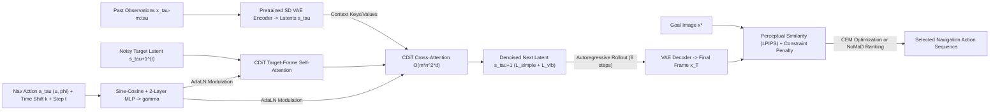

# Navigation World Models

**Navigation World Models** 收录于 [Awesome World-Action Models (RCL)](https://github.com/rcl-robotics/Awesome-World-Action-Models) **第 438/564** 篇，分组 **WAMs**。本页是 **清单索引**：给出它在清单中的位置与原文入口，方法细节和量化结果请看原文。

## 一句话定义

RCL Awesome WAM 清单收录（WAMs）；细节以原文 PDF / 项目页为准。

## 英文缩写速查

| 缩写 | 英文全称 | 简要说明 |
|------|----------|----------|
| WAM | World Action Model | 世界预测与动作生成耦合 |
| VLA | Vision-Language-Action | 视觉–语言–动作策略 |
| IDM | Inverse Dynamics Model | 先预测未来再反推动作 |
| WM | World Model | 环境前向预测模型 |

## 为什么重要

- RCL Awesome WAM 清单收录（WAMs）；细节以原文 PDF / 项目页为准。
- 想横向对照同一分组的其他工作，可以从 [RCL Awesome WAM 技术地图](../overview/rcl-awesome-wam-technology-map.md) 逐条展开。
- 顺着列表实体 [Awesome World-Action Models](paper-rcl-wam-robot-learning-control-survey.md) 与站内 WAM / VLA 方法页，可以接回对应的学习主线。

## 核心信息

| 字段 | 内容 |
|------|------|
| 编号 | 438/564 |
| 分组 | WAMs |
| 出处 | CVPR 2025 |
| 论文 | <https://openaccess.thecvf.com/content/CVPR2025/html/Bar_Navigation_World_Models_CVPR_2025_paper.html> |
| 子类 / 象限 | 导航 · 四象限外 |

## 核心机制（归纳）

> 注：以下机制与评测指标基于通读开放获取原文全文核对补充（[CVPR 2025 原文](https://openaccess.thecvf.com/content/CVPR2025/html/Bar_Navigation_World_Models_CVPR_2025_paper.html)）。

**Navigation World Models（NWM）** 是一种可动作控制的条件视频生成世界模型，在无需显式 3D 先验或环境地图的前提下，于预训练 VAE 隐空间中自回归预测未来观测并支持基于仿真的轨迹规划与策略重排（与 [World Action Models（WAM）](../concepts/world-action-models.md) 体系对齐）：

1. **隐空间动力学与动作–时间联合条件化（§3.1）**：
   - 使用预训练 Stable Diffusion VAE 将连续观测编码为隐变量 $s_\tau = (s_\tau, \dots, s_{\tau-m})$（默认上下文 $m=4$ 帧），模型预测随机转移 $s_{\tau+1} \sim F_\theta(s_{\tau+1} | s_\tau, a_\tau)$。
   - 动作条件扩展为 $a_\tau = (u, \phi, k)$：平面位移 $u \in \mathbb{R}^2$（按各机器人平均步长归一化以统一跨本体尺度）、偏航角变化 $\phi \in \mathbb{R}$，以及时间偏移量 $k \in [T_{\min}, T_{\max}]$（最大 $\pm 16$ 秒）；对无动作标签的视频（如 Ego4D），在条件嵌入中省去显式 $(u, \phi)$ 仅保留时间偏移 $k$。
   - 训练时对同一状态采样多个时间目标（默认 4 个）以制造自然反事实样本，缓解动作与时间的耦合退化。
2. **线性上下文复杂度的 Conditional Diffusion Transformer（CDiT，§3.2）**：
   - 与标准 DiT 在全部历史帧令牌上做全注意力（复杂度 $O(m^2 n^2 d)$）不同，**CDiT** 块将自注意力仅限制在当前待去噪的目标帧令牌内部，再通过**交叉注意力（Cross-Attention）**让目标帧查询（Query）关注过去上下文帧的键/值（Key/Value），使主注意力复杂度随上下文帧数 $m$ 呈线性 $O(m n^2 d)$（1B 参数下 FLOPs 不到标准 DiT 的一半，同参数量下提速约 $4\times$）。
   - 动作 $a$、时间偏移 $k$ 与扩散步 $t$ 分别经正余弦编码和 2 层 MLP 映射后相加为条件向量 $\gamma = \psi_a + \psi_k + \psi_t$，通过 **AdaLN** 调制层归一化与注意力输出；默认规模为 **CDiT-XL（1B 参数）**，训练目标为去噪 MSE 损失 $L_{\text{simple}}$ 与协方差变分下界损失 $L_{\text{vlb}}$。
3. **基于世界模型仿真的规划与策略重排（§3.3）**：
   - **独立 MPC 规划（Standalone Planning）**：给定初始潜变量 $s_0$ 与目标图像潜变量 $s^*$，NWM 自回归推演 8 步（$k=0.25$s，对应 2 秒轨迹），将终帧 $s_T$ 与 $s^*$ 解码回像素空间，利用 **LPIPS** 感知相似度（每条序列评估 3 次取均值）构建能量函数 $E = -S(s_T, s^*) + \sum I(a_\tau \notin \mathcal{A}_{\text{valid}}) + \sum I(s_\tau \notin \mathcal{S}_{\text{safe}})$，并通过无梯度 **交叉熵方法（CEM）** 求解最优动作序列，支持在推理期动态注入硬约束（如先直行后转弯、禁止某方向等）。
   - **外部策略重排（Trajectory Ranking）**：从外部导航策略（如 `NoMaD`）采样 $n \in \{16, 32\}$ 条候选轨迹，用 NWM 逐条仿真终帧并按同一能量函数打分选优。

### 方法流程图

## 评测与指标

- **训练与评测数据集（§4.1）**：
  - 域内带动作标签机器人数据集：**SCAND**、**TartanDrive**、**RECON**、**HuRoN**（过滤倒车轨迹）。
  - 跨域扩展：**Ego4D**（无动作/无奖励第一视角视频，仅用时间偏移 $k$ 联合训练）与未见评测集 **GO Stanford**。
- **视频预测与长时生成质量（RECON 已知环境，Table 1 & Fig. 4/6）**：
  - **4 秒单步预测消融（Table 1）**：目标数从 1 $\rightarrow$ 4 将 LPIPS 从 0.312 降至 **0.296**、DreamSim 从 0.098 降至 **0.091**、PSNR 升至 **15.331**；上下文从 1 帧增至 4 帧使 LPIPS 从 0.304 降至 **0.296**；仅用时间条件 LPIPS 0.760、仅用动作 0.318、动作+时间联合最佳（LPIPS **0.295** / DreamSim **0.091** / PSNR **15.343**）。
  - **16 秒 4 FPS 自回归生成 FVD（Fig. 6）**：`DIAMOND` **762.734 ± 3.361** vs. **`NWM (ours)` 200.969 ± 5.629**（显著更优，且 8 秒后 4 FPS 累积误差低于 1 FPS）。
- **目标条件视觉导航规划（2 秒轨迹，指标 ATE$\downarrow$ / RPE$\downarrow$，Table 2）**：
  - `GNM`：ATE 1.87±0.00 / RPE 0.73±0.00。
  - `NoMaD`：ATE 1.93±0.04 / RPE 0.52±0.00。
  - `NWM + NoMaD (n=16)`：ATE 1.83±0.03 / RPE 0.50±0.01；`NWM + NoMaD (n=32)`：ATE 1.78±0.03 / RPE 0.48±0.01。
  - **`NWM (standalone planning)`**：ATE **1.13±0.02** / RPE **0.35±0.01**（全面超越监督与扩散基线）。
- **带约束规划与未知环境泛化（Table 3 & Table 4）**：
  - **三类动作约束规划（Table 3）**：`forward first`、`left-right first`、`straight then forward` 均满足约束，相对无约束终点的位置/航向差仅 $(+0.36, +0.61)$、$(-0.03, +0.20)$、$(+0.08, +0.22)$。
  - **无标签 Ego4D 增广对未见环境 GO Stanford 的影响（4 秒预测，Table 4）**：GO Stanford 上 LPIPS 由 0.658 降至 **0.652**、DreamSim 由 0.478 降至 **0.464**、PSNR 由 11.031 升至 **11.083**（同时已知域 RECON LPIPS 由 0.295 轻微回退至 0.368）。

## 与其他工作对比

- 本页 **不做** 与具体基线的逐项数值对比；同分组的横向对照请回到 [技术地图](../overview/rcl-awesome-wam-technology-map.md) 的 **WAMs** 分组逐条展开。
- 如果站内已经有这篇的深读页（含机构、实验表与源码运行时序图），请以那一页为准；本页只保留清单要点。
- 与清单内相邻条目孰优孰劣，本页不下结论：清单 Contribution 可能滞后于论文最新版本，差异应以各自原文的问题设定与评测口径为准。

## 结论

**NWM 证明通过线性复杂度的 Conditional Diffusion Transformer（CDiT，扩展至 1B 参数）在多机器人与无标签人类视频上联合训练单一隐空间导航世界模型，既能以更低计算量生成高保真未来帧，也能在推理期通过 CEM 规划与硬约束满足超越专用监督导航策略。**

- **架构可扩展性**：CDiT 取消上下文帧间自注意力、仅保留目标帧对上下文的交叉注意力，复杂度降至 $O(m n^2 d)$，在同等参数量下比标准 DiT 快 $4\times$ 且预测误差更低。
- **推理期灵活规划与重排**：独立 NWM 规划在 2 秒视觉导航上将 ATE/RPE 从 NoMaD 的 1.93/0.52 降至 1.13/0.35，同时支持重排外部策略轨迹及零样本注入动作/状态约束。
- **无动作视频迁移收益**：混入无动作标签的 Ego4D 视频可提升未知环境（GO Stanford）的想象生成质量，但在已知域 RECON 上存在轻度域分配权衡（LPIPS 0.295 $\to$ 0.368）。
- **当前边界**：在分布外长程滚动中会出现向训练集模式坍塌（mode collapse）的现象，对行人等动态主体动力学建模仍有限，且当前动作空间局限于平面 3-DoF 导航；项目主页见 <https://amirbar.net/nwm>。

## 常见误区

1. 不要把 Awesome 条目的 Contribution 当成完整方法证明——它只是策展导读。
2. 若站内已有这篇的深读页，以那一页为准——本页只是清单入口，不含实验数据。

## 关联页面

- 列表实体：[Awesome World-Action Models（RCL）](paper-rcl-wam-robot-learning-control-survey.md)
- 技术地图：[RCL Awesome WAM 技术地图](../overview/rcl-awesome-wam-technology-map.md)
- 方法/任务：[generative-world-models.md](../methods/generative-world-models.md)、[manipulation.md](../tasks/manipulation.md)

## 参考来源

- [`sources/papers/rcl_awesome_wam_ref_2624494a0f9cbb4a61d2_navigation-world-models.md`](../../sources/papers/rcl_awesome_wam_ref_2624494a0f9cbb4a61d2_navigation-world-models.md) — 本条目策展摘录
- [`sources/papers/rcl_awesome_wam_catalog.md`](../../sources/papers/rcl_awesome_wam_catalog.md) — 列表总表
- [`sources/repos/awesome-world-action-models-rcl.md`](../../sources/repos/awesome-world-action-models-rcl.md)
- [`docs/PAPERS.md`](https://github.com/RCL-Robotics/Awesome-World-Action-Models/blob/main/docs/PAPERS.md) — 上游论文目录
- 论文：<https://openaccess.thecvf.com/content/CVPR2025/html/Bar_Navigation_World_Models_CVPR_2025_paper.html>

## 推荐继续阅读

- [Awesome World-Action Models (RCL) 仓库](https://github.com/rcl-robotics/Awesome-World-Action-Models)
- [原文](https://openaccess.thecvf.com/content/CVPR2025/html/Bar_Navigation_World_Models_CVPR_2025_paper.html)
