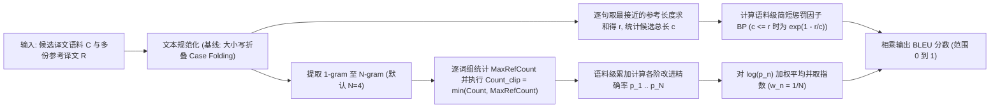

# Bleu

**Bleu: a Method for Automatic Evaluation of Machine Translation** 收录于 [Awesome World-Action Models (RCL)](https://github.com/rcl-robotics/Awesome-World-Action-Models) **第 134/564** 篇，分组 **Evaluation metrics**。本页是 **清单索引**：给出它在清单中的位置与原文入口，方法细节和量化结果请看原文。

## 一句话定义

**BLEU**（BiLingual Evaluation Understudy）是一种快速、语言无关的机器翻译自动评测指标，通过对多阶 **截断改进 n-gram 精确率（modified n-gram precision）** 取几何平均并乘以**语料级简短惩罚因子（Brevity Penalty）**来度量候选译文与人工参考译文的接近程度。

## 英文缩写速查

| 缩写 | 英文全称 | 简要说明 |
|------|----------|----------|
| BLEU | BiLingual Evaluation Understudy | 本文提出的基于截断 n-gram 精确率与长度惩罚的自动译文评估指标 |
| MT | Machine Translation | 机器翻译，BLEU 最初解决的核心评估任务 |
| BP | Brevity Penalty | 简短惩罚因子，防止过短高精确率候选句骗取高分 |
| NLG | Natural Language Generation | 自然语言生成，文中指出 BLEU 可迁移至摘要等 NLG 任务 |

## 为什么重要

- **打通每日研发迭代的评测瓶颈**：传统机器翻译人工评测耗时长达数周至数月且结果难以复用；BLEU 以极低边际成本提供高相关性自动打分，使研究者能高频筛选模型改进。
- **确立 NLG 自动评测基石**：BLEU 提出的截断计数（clipping）、高阶 n-gram 几何平均及简短惩罚思想深刻影响了后续 ROUGE、METEOR、CIDEr 等一系列语言与视觉–语言评测指标。
- 想横向对照同一分组的其他工作，可以从 [RCL Awesome WAM 技术地图](../overview/rcl-awesome-wam-technology-map.md) 逐条展开，或顺着列表实体 [Awesome World-Action Models](paper-rcl-wam-robot-learning-control-survey.md) 接回对应主线。

## 核心信息

| 字段 | 内容 |
|------|------|
| 编号 | 134/564 |
| 分组 | Evaluation metrics |
| 出处 | ACL 2002 (pp. 311–318) |
| 作者 / 机构 | Kishore Papineni, Salim Roukos, Todd Ward, Wei-Jing Zhu（IBM T. J. Watson Research Center） |
| 论文 | <https://aclanthology.org/P02-1040/> |
| 子类 / 象限 | 语言生成指标 · 评估指标与协议 · 不适用 |

## 核心机制（归纳）

> 注：以下机制与评测指标基于通读原文全文（ACL 2002）核对补充。

BLEU 的核心理念是“**机器译文越接近专业人工参考译文，质量越高**”，围绕充分性（adequacy）、流畅度（fluency）与长度约束构建了三步计算机制（基线版仅做大小写折叠归一化）：

1. **截断改进 n-gram 精确率（Modified n-gram Precision, $p_n$）**：
   - 朴素精确率会被无意义重复高词频词欺骗（例如候选句 `"the the the the the the the."` 朴素 1-gram 精确率为 $7/7$）。为此 BLEU 先统计每个 $n$-gram 在任意单条参考译文中的最大出现次数 $\text{MaxRefCount}$，并将候选计数截断为 $\text{Count}_{\text{clip}} = \min(\text{Count}, \text{MaxRefCount})$（上例截断后为 $2/7$）。
   - 在**整个测试语料库**上累加分子分母计算 $p_n$：
     $$p_n = \frac{\sum_{C \in \{\text{Candidates}\}} \sum_{\text{n-gram} \in C} \text{Count}_{\text{clip}}(\text{n-gram})}{\sum_{C' \in \{\text{Candidates}\}} \sum_{\text{n-gram}' \in C'} \text{Count}(\text{n-gram}')}$$
     其中 1-gram 精确率主要反映**语义充分性（adequacy）**，高阶 $n$-gram 精确率主要反映**局部语序与流畅度（fluency）**。
2. **为何弃用 Recall 而改用语料级简短惩罚（Brevity Penalty, BP）**：
   - 当存在多份参考译文时，不同人工译者可能采用不同同义表达；若强求召回全部参考用词，反而会诱导产生冗余坏译文（如 `"I always invariably perpetually do."`）。
   - 为抑制过短译文虚高精确率（如只输出 `"of the"` 获得 $p_1=2/2, p_2=1/1$），BLEU 对每个候选句匹配长度最接近的参考句长度作为“最佳匹配长度”，求和得到语料有效参考总长 $r$，并与候选语料总长 $c$ 比较：
     $$\text{BP} = \begin{cases} 1 & \text{if } c > r \\ e^{(1 - r/c)} & \text{if } c \le r \end{cases}$$
3. **几何平均融合（Baseline $N=4, w_n=1/N$）**：
   - 实验观察到 $p_n$ 随 $n$ 近似呈指数衰减，因此 BLEU 在对数域加权平均（等价于几何平均），基线取 $N=4$ 且 $w_n = 1/4$：
     $$\text{BLEU} = \text{BP} \cdot \exp\left(\sum_{n=1}^N w_n \log p_n\right), \quad \log \text{BLEU} = \min\left(1 - \frac{r}{c}, 0\right) + \sum_{n=1}^N w_n \log p_n$$

### 方法流程图

关于语言生成指标在具身模型与世界模型中的位置，可参考站内 [World Action Models（WAM）](../concepts/world-action-models.md) 与 [generative-world-models.md](../methods/generative-world-models.md)。

## 评测与指标

- **测试语料与参评系统**：在来自 40 篇新闻报道的 **500 句**汉译英测试集上评估 5 个“系统”——3 个商用 MT 系统（S1、S2、S3）与 2 位人类译者（H1 非母语者、H2 英语母语者），以另 2 份专业人工译文为参考（并对比 4 份参考下的 H2）。
- **BLEU 得分与统计显著性（Table 1 & Table 2）**：
  - **2 参考下 500 句聚合 BLEU**：S1 = **0.0527**，S2 = **0.0829**，S3 = **0.0930**，H1 = **0.1934**，H2 = **0.2571**（而在 **4 参考**下 H2 得分为 **0.3468**）。
  - **20 个 25 句分块配对 $t$ 检验（Table 2）**：相邻系统间成对 $t$ 统计量分别为 S1–S2（$t = 6$）、S2–S3（$t = 3.4$）、S3–H1（$t = 24$）、H1–H2（$t = 11$），均远高于 95% 置信阈值 $t = 1.7$。
- **与人类主观评分相关性（Sec 4 & 5）**：
  - 抽取 250 对译文，由 **10 名英语单语评委**（侧重可读性与流畅度，1–5 分）与 **10 名汉语母语双语评委**（侧重语义充分性）盲评。
  - BLEU 与人类评分的线性回归相关系数分别高达 **$r = 0.99$**（单语组）与 **$r = 0.96$**（双语组）。双语组对 H1 与 H2 在 95% 置信水平下难以区分，而单语组和 BLEU 均能清晰分辨母语者 H2 在流畅度上的显著优势。
- **单参考大语料验证（Sec 3）**：每篇新闻随机只保留 1 份参考译文时，5 个系统的排序（S1 < S2 < S3 < H1 < H2）保持完全一致。

## 与其他工作对比

- **BLEU vs. METEOR / ROUGE**：BLEU 仅基于位置无关的截断 $n$-gram 精确率（搭配 BP）在语料库级统计，缺少显式召回率、词干/同义词匹配与长距离词序建模；在单句级会因任一阶 $p_n=0$ 导致整体得分为 0，这些正是 METEOR 与 ROUGE 重点改进的方向。
- 同分组其他评测指标的横向对照，请回到 [技术地图](../overview/rcl-awesome-wam-technology-map.md) 的 **Evaluation metrics** 分组逐条展开。

## 结论

**BLEU 以“截断 n-gram 精确率几何平均 + 语料级简短惩罚”实现了机器翻译自动评测与人工判断的极高系统级相关性（$r = 0.96\text{–}0.99$），确立了“以量换质（quantity leads to quality）”的语料级评测原则。**

1. **只作语料级系统对比，不作单句绝对打分**：由于几何平均在 $p_n = 0$ 时归零且参考风格存在偶然偏差（如 `"East Asian economy"` vs. `"economy of East Asia"`），BLEU 依赖大测试集上的误差平均抵消，单句打分不可靠。
2. **禁止跨参考数与跨分词口径比较分数**：同一译者 H2 在 2 参考下得 0.2571、在 4 参考下即升至 0.3468；对比不同模型时必须严格锁定参考译文数量、大小写及分词脚本。
3. **配合置信检验确认微弱提升**：对于分值相近的系统（如 S2 0.0829 vs. S3 0.0930），应分块计算方差或使用配对 $t$ 检验 / bootstrap 检验确认显著性。
4. **语义改写与词形变化不敏感**：基线 BLEU 仅支持表面词精确匹配，在同义替换丰富或形态变化复杂任务中应结合 METEOR、BERTScore 或人工抽检。

## 常见误区

1. **误把单句 BLEU=0 当作完全错误**：只要候选句与参考句在 4-gram（或任意一阶）没有重合，未平滑的几何平均就会直接给出 0 分，即便句意完全正确。
2. **误认为人类译者的 BLEU 应该接近 1.0**：即使专业人类译者也只会采用多种合法译法之一，原文测试中英语母语译者 H2 在 2 参考和 4 参考下的 BLEU 也仅为 0.2571 和 0.3468。
3. **跨论文直接对比 BLEU 数值**：参考译文数量、标点/大小写规范化与分词方式不同会导致分数大幅漂移，不具跨配置可比性。

## 关联页面

- 列表实体：[Awesome World-Action Models（RCL）](paper-rcl-wam-robot-learning-control-survey.md)
- 技术地图：[RCL Awesome WAM 技术地图](../overview/rcl-awesome-wam-technology-map.md)
- 方法/任务：[generative-world-models.md](../methods/generative-world-models.md)、[manipulation.md](../tasks/manipulation.md)

## 参考来源

- [`sources/papers/rcl_awesome_wam_ref_268dde884b1840a3a100_bleu-a-method-for-automatic-evaluation-o.md`](../../sources/papers/rcl_awesome_wam_ref_268dde884b1840a3a100_bleu-a-method-for-automatic-evaluation-o.md) — 本条目策展摘录
- [`sources/papers/rcl_awesome_wam_catalog.md`](../../sources/papers/rcl_awesome_wam_catalog.md) — 列表总表
- [`sources/repos/awesome-world-action-models-rcl.md`](../../sources/repos/awesome-world-action-models-rcl.md)
- [`docs/PAPERS.md`](https://github.com/RCL-Robotics/Awesome-World-Action-Models/blob/main/docs/PAPERS.md) — 上游论文目录
- 论文：<https://aclanthology.org/P02-1040/>

## 推荐继续阅读

- [Awesome World-Action Models (RCL) 仓库](https://github.com/rcl-robotics/Awesome-World-Action-Models)
- [原文](https://aclanthology.org/P02-1040/)
