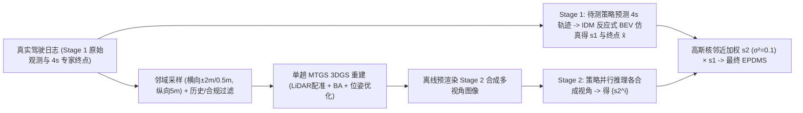

# Pseudo-Simulation for Autonomous Driving

**Pseudo-Simulation for Autonomous Driving** 收录于 [Awesome World-Action Models (RCL)](https://github.com/rcl-robotics/Awesome-World-Action-Models) **第 045/564** 篇，分组 **Benchmarks & simulators**。本页是 **清单索引**：给出它在清单中的位置与原文入口，方法细节和量化结果请看原文。

## 一句话定义

面向端到端自动驾驶的两阶段伪仿真评测范式（Pseudo-Simulation / **NAVSIM v2**，CoRL 2025）：在**评测前**利用单趟动态 3D 高斯泼溅（MTGS）离线预渲染自车偏离后的合成视角，并通过与第一阶段规划终点距离相关的高斯加权聚合双阶段 EPDMS 分数，在不运行逐帧在线交互仿真的前提下捕捉累积误差与因果混淆。

## 英文缩写速查

| 缩写 | 英文全称 | 简要说明 |
|------|----------|----------|
| EPDMS | Extended Predictive Driver Model Score | 含乘法惩罚、加权进展/舒适项及人类豁免过滤的综合规划指标 |
| MTGS | Multi-Traversal Gaussian Splatting | 本文适配为单趟动态场景图重建的 3DGS 神经渲染方法 |
| NVS | Novel View Synthesis | 新视角合成，用于预先渲染轨迹扰动后的合成相机图像 |
| IDM | Intelligent Driver Model | 智能驾驶员模型，用于 Stage 1/2 中背景车辆的反应式仿真 |
| CLS | Closed-Loop Score | nuPlan 闭环仿真器分数，用于检验伪仿真的闭环对齐度 |

## 为什么重要

- 传统自动驾驶评测陷入两难：开环位移误差（如 ADE）无法发现分布偏移下的累积误差与因果混淆，而在线闭环仿真（如 CARLA、nuPlan 或在线神经渲染）串行推演成本极高且存在真实感或速度瓶颈。
- 伪仿真将耗时的 3DGS 新视角渲染完全前置为**离线数据预处理**，评测阶段可像开环一样高度并行（交互次数仅为 nuPlan `8 s` 闭环的 **1/6**），同时在 83 个多样化规划器上与闭环评分达成 **$R^2 = 0.8$**（$r = 0.89$）的高相关性。
- 基于此构建的 **`navhard`** 公开基准揭示了现有 SOTA 端到端策略（如 `LTF`）与特权规划器（如 `PDM-Closed`）在偏离恢复或驾驶舒适度上的隐蔽失效模式；可与站内 [NAVSIM](paper-rcl-ref-e25271fa6f028e5611cf-navsim-data-driven-non-reactive-autonomous-vehic.md) 及 [RCL Awesome WAM 技术地图](../overview/rcl-awesome-wam-technology-map.md) 对照阅读。

## 核心信息

| 字段 | 内容 |
|------|------|
| 编号 | 045/564 |
| 分组 | Benchmarks & simulators |
| 出处 | CoRL 2025 (PMLR v305) |
| 作者与机构 | Wei Cao*, Marcel Hallgarten*, Tianyu Li* et al. (Univ. of Tübingen / NVIDIA / Bosch / OpenDriveLab / Univ. of Toronto 等) |
| 论文 | <https://proceedings.mlr.press/v305/cao25a.html> |
| 代码与榜单 | <https://github.com/autonomousvision/navsim>（NAVSIM v2 / `navhard`） |
| 子类 / 象限 | 自动驾驶基准 · 评测协议与诊断 · 驾驶仿真 · 3DGS 预渲染 |

## 核心机制（归纳）

> 注：以下内容基于通读 CoRL 2025 开放获取原文全文核对补充。

### 1. Stage 1：真实观测与反应式 BEV 推演

- 待测规划器接收多视角相机图像、自车速度/运动历史以及离散驾驶意图 `{left, straight, right}`，输出未来 `4 s` 轨迹；
- 在 `10 Hz` 步长下通过**运动学自行车模型 + LQR 控制器**执行该轨迹，同时背景车由**智能驾驶员模型（IDM）**反应式更新（改进自 NAVSIM v1 的非反应式回放），输出 Stage 1 得分 $s_1$ 与 `4 s` 终点位置 $\hat{x}$。
- **扩展 PDM 评分（EPDMS）**：
  $$\text{EPDMS} = \prod_{m\in M_{\text{pen}}}\text{filter}_m(\text{agent}, \text{human}) \cdot \frac{\sum_{m\in M_{\text{avg}}} w_m \cdot \text{filter}_m(\text{agent}, \text{human})}{\sum_{m\in M_{\text{avg}}} w_m}$$
  乘法惩罚集合 $M_{\text{pen}}=\{\text{NC}, \text{DAC}, \text{DDC}, \text{TLC}\}$（无过错碰撞、可行驶区、行驶方向、交通灯合规）；加权集合 $M_{\text{avg}}=\{\text{TTC}(w=5), \text{EP}(w=5), \text{LK}(w=2), \text{HC}(w=2), \text{EC}(w=2)\}$。若人类专家在同场景也触发相同违规，则 `filter_m` 忽略该处罚以消除标注噪声与合理绕行误判。

### 2. Stage 2：离线 3DGS 预渲染与近邻加权聚合

1. **偏离起点与历史轨迹构造（离线预处理）**：围绕人类专家 `4 s` 后终点采样横向（每 `0.5 m` 至 `±2.0 m`）与纵向（每 `5.0 m`，按 `±4.0 m/s²` 加减速可达区间，实践最多 20 个、平均 12 个）候选起点；从人类驾驶库匹配最近历史轨迹并过滤异常样本（速度差 `>1.0 m/s`、加速度差 `>1.0 m/s²`、航向差 `>20°` 及违反 $M_{\text{pen}}$ 项者剔除；剩余少于 5 个有效点则舍弃该场景）。
2. **单趟 MTGS 神经渲染**：改造 MTGS 动态场景图管线以支持单趟驾驶日志重建，通过 **LiDAR 配准（KISS-ICP）+ 束调整（BA）+ 联合位姿优化**抑制定位抖动，预渲染各扰动起点的多视角图像（自动剔除水滴/眩光与低质重建场景）。
3. **高斯核近邻聚合**：在预渲染视图上再推理 `4 s` 得各视角分数 $\{s_2^i\}$，按 Stage 2 起点 $x_i$ 与 Stage 1 规划终点 $\hat{x}$ 的距离赋予高斯权重（默认 $\sigma^2 = 0.1$）：
   $$w_i = \exp\!\left(-\frac{\|x_i - \hat{x}\|^2}{2\sigma^2}\right),\quad s_2 = \sum_i \hat{w}_i s_2^i,\quad s_{\text{combined}} = s_1 \cdot s_2$$

### 方法流程图

## 评测与指标

- **与 nuPlan 闭环仿真的相关性（Sec 4.1 & Fig. 3，244 个 Stage 1 + 4,164 个 Stage 2 观测，83 个规划器：37 规则 + 46 学习）**：
  - 对比 nuPlan `8 s` 闭环分数 CLS（去掉 nuPlan 不支持的 TLC/LK/EC 口径），`2×4 s` 两阶段伪仿真取得 Pearson **$r = 0.89$**（**$R^2 = 0.8$**），显著优于单阶段开环基线（`1×4 s` / `1×8 s`）的 **$r = 0.83$**（**$R^2 = 0.7$**）。
  - **计算效率**：全密度每场景需 `1 + 12 = 13` 次策略推理，比 nuPlan `8 s @ 10 Hz` 闭环所需 `80` 次推理减少 **6×** 交互；将合成视角下采样至 `25%`（约 3 视角/场景）时，相关性仍保持 **$> 0.85$**。
- **`navhard` 公开榜单结果（Table 2，450 Stage 1 + 5,462 Stage 2 观测，百分比 ↑）**：
  - `Constant Velocity (CV)`：综合 **`EPDMS = 10.9`**（`NC S1/S2: 88.8/83.2`、`DAC: 42.8/59.1`、`EP: 77.5/71.3`）。
  - `Ego-history MLP`：综合 **`EPDMS = 12.7`**（`NC: 93.2/77.2`、`DAC: 55.7/51.9`、`LK: 83.5/40.8`）。
  - `Latent TransFuser (LTF)`（最强纯相机模型）：综合 **`EPDMS = 23.1`**（Stage 1 表现尚可 `NC=96.2, DAC=79.5, LK=94.2`，但在 Stage 2 分布偏移下大跌至 `NC=77.7, DAC=70.2, LK=45.4`）。
  - `PDM-Closed (PDM-C)`（特权规则规划器）：综合 **`EPDMS = 51.3`**（`NC: 94.4/88.1`、`DAC: 98.8/90.6`、`EP: 100/100`），但暴露出过往基准未发现的舒适度短板（`HC: 87.7/91.5`、`EC: 36.0/25.4`）。
- **合成视角保真度与 NVS 消融（Table 3a & 3b）**：
  - 真实数据训练的 LTF 评测：从 Stage 1 真实视图换为 Stage 1 合成视图，BEV 感知 `mIoU` 由 `46.0` 降至 `37.6`，但规划 `EPDMS` 仅从 `62.3` 微降至 `61.0`；进一步切换至扰动后的 Stage 2 合成视图，`mIoU` 几乎不变（`36.9`），而 `EPDMS` 骤降至 `44.2`，证明性能落差主要源于分布偏移下的恢复能力不足而非渲染伪影。
  - 8 个 `navhard` 场景 10 Hz 交替视图 NVS 质量（`LPIPS ↓`）：`Street Gaussians` `0.354` → `Ours (w/o pose opt.)` `0.322` → **`Ours`（完整位姿优化）`0.253`**。

## 与其他工作对比

- 相较于 **NAVSIM v1**（纯开环单阶段、非反应式背景交通），伪仿真新增反应式 IDM 交通、Stage 2 预渲染反事实视角与人类豁免过滤，首次在不在线交互的条件下检出 LTF 的分布偏移崩溃。
- 相较于 **nuPlan / CARLA** 等在线闭环或 **UniSim / NeuRAD / HugSim** 等在线神经闭环仿真器，本方法将 3DGS 渲染全部移至离线阶段，评测阶段支持全并行批处理且推理次数降低 **6×**。

## 结论

**伪仿真（NAVSIM v2）通过“离线单趟 3DGS 预渲染偏离视角 + 高斯邻近加权聚合 + EPDMS 评分”，在保留开环并行高效率的同时实现了与闭环仿真高度对齐（$R^2 = 0.8$）的误差恢复能力评测。**

1. **闭环替代性价比高**：2×4 s 两阶段评估仅需 13 次模型推理（即使 25% 视角密度也保持 `>0.85` 相关性），大幅加快端到端规划器的迭代周期。
2. **揭示隐蔽失效模式**：`navhard` 榜单证明纯相机 SOTA 模型（LTF `EPDMS 23.1`）在轨迹微小偏离后车道保持与避撞急剧恶化，而规则方法 `PDM-C` 存在高频不舒适隐患（`EC 25.4`）。
3. **开源与榜单完备**：代码与 `navhard` 评测流水线已在 `autonomousvision/navsim` 开源并托管公开排行榜。
4. **渲染与感知解耦验证**：LPIPS `0.253` 与 Stage 1 真/合成视图规划分数近乎持平（`62.3 vs 61.0`），确认单趟 MTGS 足够支撑当前规划评测。

## 常见误区

1. **误以为伪仿真可以彻底取代实车或完整多步闭环测试**：本文仅验证了与 nuPlan 闭环仿真器的相关性，尚未直接证明与真实实车路测指标的等效性；且 Stage 2 背景车仍沿中心线按 IDM 简单跟驰，缺乏强博弈交互。
2. **忽视离线预处理的算力成本**：逐场景 MTGS 重建仍需约 **1–2 小时/场景**，适合千级场景规模的标准化榜单，若扩展至十万级场景需转向前馈式 3D 重建模型。
3. **盲目信任人类豁免过滤（`filter_m`）**：忽略人类专家同样犯下的违规虽能减少假阳性，但也可能放过人类本身不安全的驾驶边缘案例。

## 关联页面

- 列表实体：[Awesome World-Action Models（RCL）](paper-rcl-wam-robot-learning-control-survey.md)
- 技术地图：[RCL Awesome WAM 技术地图](../overview/rcl-awesome-wam-technology-map.md)
- 方法/任务：[generative-world-models.md](../methods/generative-world-models.md)、[manipulation.md](../tasks/manipulation.md)

## 参考来源

- [`sources/papers/rcl_awesome_wam_ref_361c60313b366d2109f0_pseudo-simulation-for-autonomous-driving.md`](../../sources/papers/rcl_awesome_wam_ref_361c60313b366d2109f0_pseudo-simulation-for-autonomous-driving.md) — 本条目策展摘录
- [`sources/papers/rcl_awesome_wam_catalog.md`](../../sources/papers/rcl_awesome_wam_catalog.md) — 列表总表
- [`sources/repos/awesome-world-action-models-rcl.md`](../../sources/repos/awesome-world-action-models-rcl.md)
- [`docs/PAPERS.md`](https://github.com/RCL-Robotics/Awesome-World-Action-Models/blob/main/docs/PAPERS.md) — 上游论文目录
- 论文：<https://proceedings.mlr.press/v305/cao25a.html>

## 推荐继续阅读

- [Awesome World-Action Models (RCL) 仓库](https://github.com/rcl-robotics/Awesome-World-Action-Models)
- [原文](https://proceedings.mlr.press/v305/cao25a.html)
