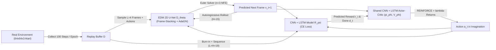

# Diffusion for World Modeling

**Diffusion for World Modeling: Visual Details Matter in Atari** 收录于 [Awesome World-Action Models (RCL)](https://github.com/rcl-robotics/Awesome-World-Action-Models) **第 154/564** 篇，分组 **Foundational work**。本页是 **清单索引**：给出它在清单中的位置与原文入口，方法细节和量化结果请看原文。

## 一句话定义

RCL Awesome WAM 清单收录（Foundational work）；细节以原文 PDF / 项目页为准。

## 英文缩写速查

| 缩写 | 英文全称 | 简要说明 |
|------|----------|----------|
| WAM | World Action Model | 世界预测与动作生成耦合 |
| VLA | Vision-Language-Action | 视觉–语言–动作策略 |
| IDM | Inverse Dynamics Model | 先预测未来再反推动作 |
| WM | World Model | 环境前向预测模型 |

## 为什么重要

- RCL Awesome WAM 清单收录（Foundational work）；细节以原文 PDF / 项目页为准。
- 想横向对照同一分组的其他工作，可以从 [RCL Awesome WAM 技术地图](../overview/rcl-awesome-wam-technology-map.md) 逐条展开。
- 顺着列表实体 [Awesome World-Action Models](paper-rcl-wam-robot-learning-control-survey.md) 与站内 WAM / VLA 方法页，可以接回对应的学习主线。

## 核心信息

| 字段 | 内容 |
|------|------|
| 编号 | 154/564 |
| 分组 | Foundational work |
| 出处 | NeurIPS 2024 |
| 论文 | <https://proceedings.neurips.cc/paper_files/paper/2024/hash/6bdde0373d53d4a501249547084bed43-Abstract-Conference.html> |
| 项目页 | <https://diamond-wm.github.io> |
| 子类 / 象限 | 经典WM与模型式RL · 不适用 |

## 核心机制（归纳）

> 注：以下机制与评测指标基于通读开放获取原文全文核对补充（[NeurIPS 2024 原文](https://proceedings.neurips.cc/paper_files/paper/2024/hash/6bdde0373d53d4a501249547084bed43-Abstract-Conference.html)）。

**DIAMOND（DIffusion As a Model Of eNvironment Dreams）** 首次将像素空间连续扩散模型用作强化学习世界模型，直接在原始图像空间预测环境动力学而非压缩为离散潜在令牌，从而避免离散化丢失关键视觉细节（与 [World Action Models（WAM）](../concepts/world-action-models.md) 体系对齐）：

1. **基于 EDM 范式的像素扩散世界模型 $D_\theta$（§3.1, Appendix C–D）**：
   - 采用 Karras 等人的 **EDM** 连续噪声调度与预处理：$D_\theta(x_{t+1}^\tau, y_t^\tau) = c_{\text{skip}}^\tau x_{t+1}^\tau + c_{\text{out}}^\tau F_\theta(c_{\text{in}}^\tau x_{t+1}^\tau, y_t^\tau)$，其中 $\sigma_{\text{data}}=0.5$，训练时从对数正态分布 $\log(\sigma) \sim \mathcal{N}(-0.4, 1.2^2)$ 采样噪声尺度，以 L2 重建损失 $\|\hat{x}_{t+1}^0 - x_{t+1}^0\|^2$ 训练。
   - **EDM 优于 DDPM 的原因（§5.1）**：DDPM 在高噪声区域预测噪声容易退化为恒等映射，在低去噪步数（$n \le 10$）自回归滚动时迅速产生色偏与分布漂移；而 EDM 的 $c_{\text{skip}}^\tau$ 在高噪声下将目标自适应切换为干净图像 $x_{t+1}^0$，使模型在 1000 步长时滚动下依然稳定。
   - **架构与采样（§3.1, §5.2）**：$F_\theta$ 为 2D U-Net（`[2,2,2,2]` 残差块、64 通道），将过去 $L=4$ 帧观测在通道维拼接（**Frame-stacking**），离散动作 $a_{\le t}$ 与扩散步 $\tau$ 通过 **Adaptive Group Normalization（AdaGN）** 注入。采样采用确定性 **Euler 求解器 $n=3$ 步**（3 NFE，兼顾多模态消歧与推理开销）。
2. **独立奖励与终止预测模型 $R_\psi$（§3.2, Appendix D & G）**：
   - 使用共享 CNN 残差块（`[2,2,2,2]`、32 通道、AdaGN 动作条件）+ 512 维 **LSTM**（burn-in 长度 $B_R=4$，训练序列长 $B_R+H=19$）分别预测裁剪奖励符号 $\{-1, 0, 1\}$ 与回合终止标志 $d_t$，以交叉熵损失联合训练。
3. **想象空间 Actor–Critic 强化学习循环（§3.2, Appendix F–G）**：
   - 策略 $\pi_\phi$ 与价值网络 $V_\phi$ 共享 4 层残差 CNN 主干（`[32,32,64,64]`）+ 512 维 **LSTM**。
   - 每轮循环（共 1000 epoch）：在真实环境采集 100 步（$\epsilon$-greedy $\epsilon=0.01$）存入回放池 $\mathcal{D}$ $\rightarrow$ 更新 $D_\theta$ 400 步 $\rightarrow$ 更新 $R_\psi$ 400 步 $\rightarrow$ 在世界模型想象中自回归推演 $H=15$ 步（$\gamma=0.985, \lambda=0.95$），用 $\lambda$-return 平方误差更新 $V_\phi$，用带价值基线与熵正则（$\eta=0.001$）的 **REINFORCE** 更新 $\pi_\phi$。
4. **可扩展至 3D 交互神经游戏引擎（§6）**：
   - 在 CS:GO 静态操作数据上将 U-Net 扩至 381M 参数（含 51M 像素上采样扩散模型，$56\times 30 \rightarrow 280\times 150$），动力学模型保持 3 步去噪、上采样器用 10 步，可在单卡 RTX 3090 上以 **10 Hz** 交互运行。

### 方法流程图

## 评测与指标

- **Atari 100k 基准（26 款游戏，每款仅 10 万环境步 / 约 2 小时人类游戏时长，5 随机种子，Table 1 & Table 4）**：
  - **总指标对比（纯世界模型训练方法）**：
    - `DIAMOND (ours)`（**13M 参数**，单卡 RTX 4090 约 2.9 天 / 12GB 显存）：超越人类游戏数 **11** 款、**Mean HNS = 1.459**（1.46，世界模型方法新高）、**IQM = 0.641**。
    - 基线对比：`STORM`（10 款超人 / Mean 1.266 / IQM 0.636）、`DreamerV3`（18M 参数，9 款 / Mean 1.097 / IQM 0.497）、`IRIS`（30M 参数，10 款 / Mean 1.046 / IQM 0.501）、`TWM`（8 款 / 0.956 / 0.459）、`SimPLe`（1 款 / 0.332 / 0.130）。
  - **典型细节敏感游戏得分（Table 1）**：`Breakout` **132.5**（IRIS 83.7、DreamerV3 31.0、STORM 15.9）、`Asterix` **3698.5**（STORM 1028.0、DreamerV3 932.0）、`RoadRunner` **20673.2**（STORM 17564.0）、`CrazyClimber` **99167.8**；相比之下，离散令牌基线 IRIS 在这些游戏中存在敌人与奖励闪烁或砖块得分不一致等细节失真（§5.3）。
- **扩散框架与去噪步数消融（§5.1–5.2, Appendix K–L）**：
  - Breakout 1000 步长时滚动（400 条测试轨迹）显示：DDPM 在 $\le 10$ 步去噪时出现严重色偏漂移，而 EDM 即使在 $n=1$ 步仍远更稳定。
  - 在 DIAMOND 表现最好的 10 款游戏上将采样步数从 $n=3$ 降至 $n=1$（Table 7）：Mean HNS 从 **3.052** 降至 **1.962**（部分可观测对弈游戏 `Boxing` 得分从 **86.9** 跌至 **41.9**），验证适度多步对解决多模态模糊的必要性。
- **复杂 3D 环境扩展（§6 & Appendix M）**：
  - **CS:GO Dust II 神经游戏引擎**：基于 87 小时（5M 帧，16Hz）离线操作数据训练 381M 参数扩散模型，无需 RL 即可在 RTX 3090 上以 **10 Hz** 实时响应键鼠输入运行数百步。
  - **静态 3D 视频生成对比（CS:GO 与高速公路驾驶，64×64、16 帧生成，Table 8）**：`DIAMOND frame-stack`（122M 参数，7.4 Hz）在两个环境的 FID、FVD 与 LPIPS 全部指标上均优于 `DIAMOND cross-attention`（184M 参数，2.5 Hz）、`IRIS (K=16/64)` 与 `DreamerV3`。

## 与其他工作对比

- 本页 **不做** 与具体基线的逐项数值对比；同分组的横向对照请回到 [技术地图](../overview/rcl-awesome-wam-technology-map.md) 的 **Foundational work** 分组逐条展开。
- 如果站内已经有这篇的深读页（含机构、实验表与源码运行时序图），请以那一页为准；本页只保留清单要点。
- 与清单内相邻条目孰优孰劣，本页不下结论：清单 Contribution 可能滞后于论文最新版本，差异应以各自原文的问题设定与评测口径为准。

## 结论

**DIAMOND 证明直接在像素空间采用 EDM 连续扩散世界模型，能以更少参数（13M）和极少去噪步数（3 NFE）保留关键视觉细节并稳定长时滚动，在 Atari 100k 上取得纯世界模型方法新高（Mean HNS 1.46），并可扩展为实时交互的 3D 神经游戏引擎。**

- **EDM 目标是低 NFE 长时稳定性的关键**：相较预测噪声的 DDPM，EDM 在高噪声区回归干净图像的自适应目标消除了自回归颜色漂移，使 3 步 Euler 采样兼具速度与多模态消歧能力。
- **像素保真直接决定策略上限**：在 Breakout、Asterix、RoadRunner 等依赖数个像素语义的游戏中，消除离散 tokenizer 的闪烁失真带来了显著的 RL 回报跃升。
- **Frame-stacking 优于重型交叉注意力**：在 64×64 像素动力学建模中，直接通道拼接历史帧的 2D U-Net 在视觉质量（FID/FVD/LPIPS）与采样速度上均超过自回归交叉注意力变体。
- **已知边界（§8）**：主评测聚焦离散动作空间（连续控制待验证）；帧堆叠仅提供短时局部记忆（如 CS:GO 中贴墙或失焦后会遗忘地图与武器状态）；奖励/终止预测仍由独立 CNN-LSTM 承担，尚未与扩散主干统一；项目主页与开源代码见 <https://diamond-wm.github.io>。

## 常见误区

1. 不要把 Awesome 条目的 Contribution 当成完整方法证明——它只是策展导读。
2. 若站内已有这篇的深读页，以那一页为准——本页只是清单入口，不含实验数据。

## 关联页面

- 列表实体：[Awesome World-Action Models（RCL）](paper-rcl-wam-robot-learning-control-survey.md)
- 技术地图：[RCL Awesome WAM 技术地图](../overview/rcl-awesome-wam-technology-map.md)
- 方法/任务：[generative-world-models.md](../methods/generative-world-models.md)、[manipulation.md](../tasks/manipulation.md)

## 参考来源

- [`sources/papers/rcl_awesome_wam_ref_3b350556ce83b51f84c8_diffusion-for-world-modeling-visual-deta.md`](../../sources/papers/rcl_awesome_wam_ref_3b350556ce83b51f84c8_diffusion-for-world-modeling-visual-deta.md) — 本条目策展摘录
- [`sources/papers/rcl_awesome_wam_catalog.md`](../../sources/papers/rcl_awesome_wam_catalog.md) — 列表总表
- [`sources/repos/awesome-world-action-models-rcl.md`](../../sources/repos/awesome-world-action-models-rcl.md)
- [`docs/PAPERS.md`](https://github.com/RCL-Robotics/Awesome-World-Action-Models/blob/main/docs/PAPERS.md) — 上游论文目录
- 论文：<https://proceedings.neurips.cc/paper_files/paper/2024/hash/6bdde0373d53d4a501249547084bed43-Abstract-Conference.html>

## 推荐继续阅读

- [Awesome World-Action Models (RCL) 仓库](https://github.com/rcl-robotics/Awesome-World-Action-Models)
- [原文](https://proceedings.neurips.cc/paper_files/paper/2024/hash/6bdde0373d53d4a501249547084bed43-Abstract-Conference.html)
