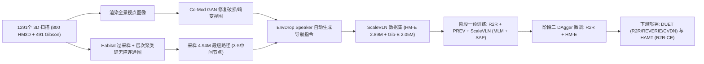

# Scaling Data Generation in Vision-and-Language Navigation

**Scaling Data Generation in Vision-and-Language Navigation** 收录于 [Awesome World-Action Models (RCL)](https://github.com/rcl-robotics/Awesome-World-Action-Models) **第 123/564** 篇，分组 **Datasets**。本页是 **清单索引**：给出它在清单中的位置与原文入口，方法细节和量化结果请看原文。

## 一句话定义

RCL Awesome WAM 清单收录（Datasets）；细节以原文 PDF / 项目页为准。

## 英文缩写速查

| 缩写 | 英文全称 | 简要说明 |
|------|----------|----------|
| WAM | World Action Model | 世界预测与动作生成耦合 |
| VLA | Vision-Language-Action | 视觉–语言–动作策略 |
| IDM | Inverse Dynamics Model | 先预测未来再反推动作 |
| WM | World Model | 环境前向预测模型 |

## 为什么重要

- RCL Awesome WAM 清单收录（Datasets）；细节以原文 PDF / 项目页为准。
- 想横向对照同一分组的其他工作，可以从 [RCL Awesome WAM 技术地图](../overview/rcl-awesome-wam-technology-map.md) 逐条展开。
- 顺着列表实体 [Awesome World-Action Models](paper-rcl-wam-robot-learning-control-survey.md) 与站内 WAM / VLA 方法页，可以接回对应的学习主线。

## 核心信息

| 字段 | 内容 |
|------|------|
| 编号 | 123/564 |
| 分组 | Datasets |
| 出处 | ICCV 2023 |
| 论文 | <https://openaccess.thecvf.com/content/ICCV2023/papers/Wang_Scaling_Data_Generation_in_Vision-and-Language_Navigation_ICCV_2023_paper.pdf> |
| 代码/项目 | <https://github.com/wz0919/ScaleVLN> |
| 子类 / 象限 | 合成数据与数据生成 · 视觉语言导航数据 · 语言标注与再标注 · 不适用 |

## 核心机制（归纳）

> 注：以下机制与评测指标基于通读开放获取原文全文核对补充。

ScaleVLN 针对视觉–语言导航（VLN）受限于 Matterport3D（MP3D 仅 61 个训练场景、约 2 万 $\text{m}^2$）导致的未见环境泛化瓶颈，提出一套完全可复现的大规模数据生成与两阶段训练范式，共构建 **4,941,710 条**指令–轨迹对（R2R 的约 352×，PREVALENT 的约 4.62×）：

1. **大规模自动化数据生成流水线（Section 3.2）**：
   - **多场景汇集**：采用 **800 个 HM3D 训练场景**与 **491 个 Gibson 训练/验证场景**（共 1,291 个室内 3D 扫描，可通行面积超 15 万 $\text{m}^2$，约为 MP3D 训练集的 7.5 倍）。
   - **高覆盖无碰撞导航图构建**：在 Habitat 仿真器中过量采样测地距 $> 0.4\text{ m}$ 的可通行点，经阈值 1.0 m 的**凝聚层次聚类（Agglomerative Clustering）**聚合到开阔空间中心，随后在 5.0 m 内建边（每节点最多 5 条边）并做图精炼，得到平均边长 1.41 m、平均度 4.55、**节点密度 1.16 node/$\text{m}^2$ 且穿障率 0.00%**（AutoVLN 为 0.36 node/$\text{m}^2$ 与 29.35% 穿障）的连通图。
   - **Co-Modulated GAN 破损渲染修复**：针对 HM3D 尤其是低质量 3D 网格的 Gibson 渲染图存在撕裂、畸变和空洞的问题，在 MP3D 渲染–实拍配对数据上训练 **Co-Mod GAN** 进行图像到图像修复，恢复相机级视觉质量。
   - **路径采样与指令生成**：在连通图上采样含 3–5 个中间节点的最短路径（HM3D 得 2,890,267 条、Gibson 得 2,051,443 条），并采用 R2R 上训练的轻量开源 LSTM 模型 **EnvDrop Speaker** 生成指令（BLEU-4 27.66，优于微调 GPT-2 的 24.36）。
2. **两阶段代理训练策略（Section 4.1 & 4.3）**：
   - **主干与基线智能体**：默认使用 CLIP ViT-B/16 提取视觉特征（最佳变体进一步使用 CLIP ViT-H/14 + EnvEdit 图像增强）；在离散任务 R2R、REVERIE、CVDN 上使用 **DUET**，在连续环境 R2R-CE 上使用 **HAMT + 候选航点预测器**。
   - **阶段一——跨模态预训练**：在 R2R + PREVALENT + ScaleVLN（HM-E + Gib-E）上联合预训练（20k iter, batch 256, 2×A100 约 72 GPU 小时）；消融证实只需 **MLM（掩码语言建模）+ SAP（单步动作预测）**，加入 MRM 反而引入噪声轻微降点。
   - **阶段二——DAgger 模仿学习微调**：仅保留 **R2R + HM-E** 联合微调（200k iter, batch 16, 48 GPU 小时），剔除 PREV（避免对 61 个 MP3D 场景过拟合）和 Gib-E（Gibson 与 MP3D 域差距较大不利于微调），成功将 Seen 与 Unseen 成功率差距缩小至 **< 1%**。

### 方法流程图

若需对照世界模型与具身导航主线，可参见站内 [World Action Models（WAM）](../concepts/world-action-models.md) 与 [generative-world-models.md](../methods/generative-world-models.md)。

## 评测与指标

- **评测基准与指标**：在 **R2R**、**REVERIE**、**CVDN** 和连续环境 **R2R-CE** 上评估，主要指标包括路径长度 TL（m）、导航误差 NE（m，↓）、Oracle 成功率 OSR（%↑）、成功率 SR（%↑）、路径加权成功率 SPL（%↑）、归一化动态时间规整 nDTW（↑）及对话目标进度 GP（m，↑）。
- **核心量化结果（全单次运行 single-run，无预探索/束搜索/模型集成）**：
  - **R2R（Table 9）**：`DUET + ScaleVLN`（CLIP ViT-B/16）在 Val-Unseen 达 NE **2.34** / SR **79** / SPL **70**，在 Test-Unseen 达 NE **2.73** / SR **77** / SPL **68**（相比原 DUET Test SR 69 / SPL 59 提升 +8% SR / +9% SPL）；叠加 CLIP ViT-H/14 与 EnvEdit 的 `DUET* + ScaleVLN` 在 Val-Seen 达 SR **81** / SPL **75**，Val-Unseen 达 NE **2.09** / SR **81** / SPL **70**，**Test-Unseen 达 NE 2.27 / OSR 86 / SR 80 / SPL 70**，逼近人类表现（86% SR / 76% SPL）并显著超越前 SoTA BEVBert（Test SR 73）。
  - **REVERIE（Table 8）**：`DUET + ScaleVLN` 达 Val-Unseen OSR **63.85** / SR **56.97** / SPL **41.84**，Test-Unseen OSR **62.65** / SR **56.13** / SPL **39.52**，超越使用全部 1000 个 HM3D 场景的 AutoVLN（Test SR 55.17 / SPL 38.88）。
  - **CVDN（Table 10）**：`DUET + ScaleVLN` 在 Val-Unseen 达 GP **6.12 m**，Test-Unseen 达 GP **6.97 m**（前最佳 HAMT 为 5.58 m，原文报告提升 1.41 m / +25.26%）。
  - **R2R-CE 连续环境（Table 11）**：仅用离散图生成数据配合候选航点预测器，`HAMT + ScaleVLN` 在 Val-Unseen 达 NE **4.80** / nDTW **64** / SR **55** / SPL **51**，Test-Unseen 达 NE **5.11** / SR **55** / SPL **50**（相比此前最佳基线提升 5%–8% SR）。
- **关键消融发现（Table 1, 2, 4, 6, 7）**：(1) 场景数（#Scenes）对未见环境泛化比同场景采样量（#Samples）更关键；(2) 未经 Co-Mod GAN 修复的 Gibson 渲染图反而拖累表现（Table 4 中 `HM-E(R)+Gib-E(F)` Val-Unseen SR 为 76.33，修复后 `Gib-E(R)` 升至 **78.08**）；(3) 在微调阶段保留 HM-E 使 Val-Seen 与 Val-Unseen SR 差距从常见约 8% 降至 **< 1%**（80.02% vs. 79.10%）。

## 与其他工作对比

- 本页 **不做** 与具体基线的逐项数值对比；同分组的横向对照请回到 [技术地图](../overview/rcl-awesome-wam-technology-map.md) 的 **Datasets** 分组逐条展开。
- 如果站内已经有这篇的深读页（含机构、实验表与源码运行时序图），请以那一页为准；本页只保留清单要点。
- 与清单内相邻条目孰优孰劣，本页不下结论：清单 Contribution 可能滞后于论文最新版本，差异应以各自原文的问题设定与评测口径为准。

## 结论

**ScaleVLN 验证了“全连通无障导航图 + Co-Mod GAN 渲染修复 + 全开源 LSTM Speaker + 分层预训练/微调数据配比”的数据工程范式，仅靠简单模仿学习即可将 R2R 单次运行成功率推至 80%，并将 Seen/Unseen 泛化鸿沟压低到 1% 以内。**

- **数据质量三要素**：场景数量与视觉多样性优先于单场景过采样；导航图必须保证 0% 穿障率与高空间密度；低质量 3D 扫描渲染图必须先经过图像恢复再用于训练。
- **训练配方关键**：预训练仅需 MLM + SAP（去掉 MRM 噪声更少），融合 MP3D、HM3D 与 Gibson 全部数据；微调阶段应仅保留域内最干净的 R2R + HM-E，避免对小规模 MP3D 过拟合及受 Gibson 噪声干扰。
- **后续瓶颈与局限**：即使在 494 万条数据下，Agent 的 OSR（86%）与实际 SR（80%）之间仍存在约 6% 差距，表明在正确“停止决策（stopping problem）”与更高质量指令生成上仍有改进空间。

## 常见误区

1. 不要把 Awesome 条目的 Contribution 当成完整方法证明——它只是策展导读。
2. 若站内已有这篇的深读页，以那一页为准——本页只是清单入口，不含实验数据。

## 关联页面

- 列表实体：[Awesome World-Action Models（RCL）](paper-rcl-wam-robot-learning-control-survey.md)
- 技术地图：[RCL Awesome WAM 技术地图](../overview/rcl-awesome-wam-technology-map.md)
- 方法/任务：[generative-world-models.md](../methods/generative-world-models.md)、[manipulation.md](../tasks/manipulation.md)

## 参考来源

- [`sources/papers/rcl_awesome_wam_ref_3fa175f81e25ece6b23f_scaling-data-generation-in-vision-and-la.md`](../../sources/papers/rcl_awesome_wam_ref_3fa175f81e25ece6b23f_scaling-data-generation-in-vision-and-la.md) — 本条目策展摘录
- [`sources/papers/rcl_awesome_wam_catalog.md`](../../sources/papers/rcl_awesome_wam_catalog.md) — 列表总表
- [`sources/repos/awesome-world-action-models-rcl.md`](../../sources/repos/awesome-world-action-models-rcl.md)
- [`docs/PAPERS.md`](https://github.com/RCL-Robotics/Awesome-World-Action-Models/blob/main/docs/PAPERS.md) — 上游论文目录
- 论文：<https://openaccess.thecvf.com/content/ICCV2023/papers/Wang_Scaling_Data_Generation_in_Vision-and-Language_Navigation_ICCV_2023_paper.pdf>

## 推荐继续阅读

- [Awesome World-Action Models (RCL) 仓库](https://github.com/rcl-robotics/Awesome-World-Action-Models)
- [原文](https://openaccess.thecvf.com/content/ICCV2023/papers/Wang_Scaling_Data_Generation_in_Vision-and-Language_Navigation_ICCV_2023_paper.pdf)
