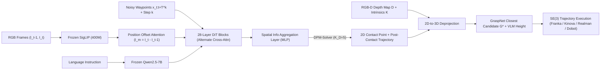

# A0

**A0: An Affordance-Aware Hierarchical Model for General Robotic Manipulation** 收录于 [Awesome World-Action Models (RCL)](https://github.com/rcl-robotics/Awesome-World-Action-Models) **第 273/564** 篇，分组 **WAMs**。本页是 **清单索引**：给出它在清单中的位置与原文入口，方法细节和量化结果请看原文。

## 一句话定义

RCL Awesome WAM 清单收录（WAMs）；细节以原文 PDF / 项目页为准。

## 英文缩写速查

| 缩写 | 英文全称 | 简要说明 |
|------|----------|----------|
| WAM | World Action Model | 世界预测与动作生成耦合 |
| VLA | Vision-Language-Action | 视觉–语言–动作策略 |
| IDM | Inverse Dynamics Model | 先预测未来再反推动作 |
| WM | World Model | 环境前向预测模型 |

## 为什么重要

- RCL Awesome WAM 清单收录（WAMs）；细节以原文 PDF / 项目页为准。
- 想横向对照同一分组的其他工作，可以从 [RCL Awesome WAM 技术地图](../overview/rcl-awesome-wam-technology-map.md) 逐条展开。
- 顺着列表实体 [Awesome World-Action Models](paper-rcl-wam-robot-learning-control-survey.md) 与站内 WAM / VLA 方法页，可以接回对应的学习主线。

## 核心信息

| 字段 | 内容 |
|------|------|
| 编号 | 273/564 |
| 分组 | WAMs |
| 出处 | ICCV 2025 |
| 论文 | <https://openaccess.thecvf.com/content/ICCV2025/html/Xu_A0_An_Affordance-Aware_Hierarchical_Model_for_General_Robotic_Manipulation_ICCV_2025_paper.html> |
| 子类 / 象限 | 三维多视角建模 · 视觉规划与IDM · 四象限外 |

## 核心机制（归纳）

> 注：以下机制与评测指标基于通读开放获取原文全文核对补充（[ICCV 2025 原文](https://openaccess.thecvf.com/content/ICCV2025/html/Xu_A0_An_Affordance-Aware_Hierarchical_Model_for_General_Robotic_Manipulation_ICCV_2025_paper.html)）。

**$A_0$** 是一种面向通用机器人操作的**层次化可供性感知扩散模型**，将操作任务解耦为「高层空间可供性理解（Embodiment-Agnostic Affordance Representation）」与「低层动作执行」两级，以实现跨机械臂本体的快速部署（与 [World Action Models（WAM）](../concepts/world-action-models.md) 的表征解耦思路相呼应）：

1. **本体无关的物体中心可供性表征（§3.2）**：
   - 将异构数据统一为 $\mathcal{R} = \mathcal{R}_R \cup \mathcal{R}_H \cup \mathcal{R}_C = \{(I, L, C, T)\}$，以图像归一化坐标预测未来 $T$ 个 2D 航点 $\mathbf{x}_{t:t+T} \in [0,1]^2$（默认 chunk size $T=5$）：首点为初始接触点，其余 $T-1$ 点刻画接触后的运动方向轨迹。
   - 配套构建四部分数据：**PixMo-One-Point**（100 万单点定位样本）、**HOI4D-22k**（22,000 条人–物交互轨迹）、**DROID-3k**（3,056 条真机轨迹）与 **ManiSkill-5k**（4,965 条仿真轨迹转 2D）。
2. **$A_0$-1B 扩散 Transformer 主干与关键组件（§3.3）**：
   - **冻结多模态编码**：分别使用预训练 **SigLIP（400M）** 编码当前帧 $I_t$ 与上一帧 $I_{t-1}$ 图像令牌，使用 **Qwen2.5-7B** 编码语言指令 $\ell$。
   - **Position Offset Attention（POA）**：计算相邻帧特征差 $I_m^i = I_t^i - I_{t-1}^i$ 并与当前帧令牌拼接 $o_t = \text{concat}([I_t^i, I_m^i])$，叠加多维正弦位置编码以显式注入物体运动线索。
   - **DiT 主干与交替交叉注意力**：$N=28$ 层 DiT 块（总参数量 1B）接收扩散时间步 $k$ 嵌入与带噪航点 $\mathbf{x}_{t:t+T}^k$，通过交替注入（Alternative Inject）的交叉注意力层融合视觉运动令牌 $o_t$ 与文本令牌。
   - **Spatial Information Aggregation Layer（SIAL）**：末端非线性 MLP 解码器，将潜在空间表征精准映射回物理图像空间 2D 航点坐标。
3. **两阶段训练与快速 ODE 采样（§3.4, §5.1.1）**：
   - **预训练**：在 1M `PixMo-One-Point` 上使用单帧输入与 MSE 损失 $\mathcal{L}_p(\theta)$ 训练初始接触点定位（4× A100 80GB，batch size 200，80k 步 / 5 天）。
   - **监督微调（SFT）**：在 `HOI4D-22k`、`DROID-3k`、`ManiSkill-5k` 上以 MSE 损失 $\mathcal{L}_s(\theta)$ 联合微调 $T=5$ 航点轨迹预测（30k 步 / 50 小时）。
   - **单次（Single-Shot）推理**：前向 $K_F=1000$ 步，推理采用快速 ODE 求解器（DPM-Solver）仅需 **$K_D=5$** 步去噪即可一次性输出整段 2D 航点。
4. **低层 2D-to-3D 动作执行模块（§4）**：
   - 经深度反投影 $X_i = D(\mathbf{x}_i) K^{-1} \tilde{\mathbf{x}}_i$ 将接触点与方向点升维至 3D；调用 **GraspNet** 等抓取采样器选取距 $X_t$ 最近的候选抓取位姿 $G^*$；利用 VLM 对接触后航点选择离散高度类别（如平齐或高于目标），最终在 $SE(3)$ 空间规划平滑运动轨迹。

### 方法流程图

## 评测与指标

- **离线像素绝对误差评测（MAE$\downarrow$，8:2 训练/测试划分，$T=5$，§5.1）**：
  - **预训练有效性（Fig. 4）**：在跨域迁移下显著降低 MAE——Real-to-Sim（HOI4D+DROID $\rightarrow$ `ManiSkill-5k`）从 50.4 降至 **43.9**；Sim-to-Real（ManiSkill $\rightarrow$ `HOI4D-22k` 从 172.2 降至 **125.2**，`DROID-3k` 从 35.1 降至 **29.1**）。
  - **结构消融（Table 1）**：完整模型 `A0-1B` 在 `HOI4D-22k` / `ManiSkill-5k` / `DROID-3k` 的 MAE 为 **47.5 / 5.5 / 17.5**；移除 **POA** 退化为 47.9 / 6.3 / 18.5；移除 **SIAL** 显著恶化至 61.1 / 10.2 / 19.6。
- **真机实验（4 项任务每项 20 次试验：`Place Object`、`Open Drawer`、`Press Button`、`Wipe Board`，Table 2）**：
  - **Kinova Gen3 平台**：`MOKA` 平均 **45.00%**（70/50/30/30）、`ReKep` 平均 **33.75%**（75/55/5/0）、**`A0-1B` 平均 53.75%**（60/65/40/50，其中 Wipe Board 达 50%）。
  - **Franka Emika 平台**（Magma/Molmo 接入本文动作执行模块对比）：`Magma` 平均 **16.25%**（25/10/30/0）、`Molmo` 平均 **43.75%**（60/40/55/20）、**`A0-1B` 平均 62.50%**（Place 60%、Open Drawer **75%**、Press Button **70%**、Wipe Board **45%**，超越 Molmo 18.75 个百分点）。此外并在 **Realman** 与 **Dobot XTrainer** 上完成跨平台部署。
- **与端到端 VLA 大模型对比（Kinova Gen3，每任务 5 条演示微调基线，Table 3）**：
  - `RDT-1B` 平均 **11.25%**（20/0/25/0，需 25–50 步推理）、`pi0` 平均 **20.00%**（40/20/10/10，25–50 步）、`pi0 + FAST` 平均 **18.75%**（35/10/30/0，25–50 步）。
  - **`A0-1B`** 平均 **53.75%**（+33.75% 优于次优 `pi0`），在强轨迹依赖的 `Wipe Board` 上达 **50%**（超越 `pi0` 40 个百分点），且仅需单次推理 **4–5 个关键航点步**。

## 与其他工作对比

- 本页 **不做** 与具体基线的逐项数值对比；同分组的横向对照请回到 [技术地图](../overview/rcl-awesome-wam-technology-map.md) 的 **WAMs** 分组逐条展开。
- 如果站内已经有这篇的深读页（含机构、实验表与源码运行时序图），请以那一页为准；本页只保留清单要点。
- 与清单内相邻条目孰优孰劣，本页不下结论：清单 Contribution 可能滞后于论文最新版本，差异应以各自原文的问题设定与评测口径为准。

## 结论

**$A_0$ 通过「百万级 2D 接触点预训练 + 物体中心轨迹微调 + DiT/POA/SIAL 航点扩散 + 深度反投影与 GraspNet 执行」的分层解耦，在无需按机械臂重训策略的情况下，在 Franka 与 Kinova 真机上大幅超越 2D 可供性基线及少样本微调后的端到端 VLA（RDT-1B、$\pi_0$）。**

- **层次解耦兼顾跨本体与轨迹精度**：输出为归一化 2D 接触点与接触后航点（单次推理 4–5 步，$K_D=5$ 步 ODE 采样），避开了端到端 VLA 高频步进推演在 `Wipe Board` 等长轨迹任务上的累积偏差（Kinova 53.75% vs. $\pi_0$ 20.00%）。
- **POA 与 SIAL 对细粒度空间推理不可或缺**：帧差令牌（POA）补全了静态图像缺失的运动方向，MLP 聚合解码（SIAL）在 HOI4D-22k 上将像素 MAE 从 61.1 降至 47.5。
- **大规模单点预训练有效缓解 Sim-to-Real 与 Real-to-Sim 鸿沟**：1M PixMo-One-Point 预训练在三组跨域离线评测上均大幅降低航点误差。
- **当前局限（§6）**：长程任务规划及朝向敏感操作仍依赖外部 VLM 分解阶段，面向动态与非结构化环境的鲁棒性有待进一步拓展；项目主页见 <https://a-embodied.github.io/A0/>。

## 常见误区

1. 不要把 Awesome 条目的 Contribution 当成完整方法证明——它只是策展导读。
2. 若站内已有这篇的深读页，以那一页为准——本页只是清单入口，不含实验数据。

## 关联页面

- 列表实体：[Awesome World-Action Models（RCL）](paper-rcl-wam-robot-learning-control-survey.md)
- 技术地图：[RCL Awesome WAM 技术地图](../overview/rcl-awesome-wam-technology-map.md)
- 方法/任务：[generative-world-models.md](../methods/generative-world-models.md)、[manipulation.md](../tasks/manipulation.md)

## 参考来源

- [`sources/papers/rcl_awesome_wam_ref_4482db2c9a502c2e3bae_a0-an-affordance-aware-hierarchical-mode.md`](../../sources/papers/rcl_awesome_wam_ref_4482db2c9a502c2e3bae_a0-an-affordance-aware-hierarchical-mode.md) — 本条目策展摘录
- [`sources/papers/rcl_awesome_wam_catalog.md`](../../sources/papers/rcl_awesome_wam_catalog.md) — 列表总表
- [`sources/repos/awesome-world-action-models-rcl.md`](../../sources/repos/awesome-world-action-models-rcl.md)
- [`docs/PAPERS.md`](https://github.com/RCL-Robotics/Awesome-World-Action-Models/blob/main/docs/PAPERS.md) — 上游论文目录
- 论文：<https://openaccess.thecvf.com/content/ICCV2025/html/Xu_A0_An_Affordance-Aware_Hierarchical_Model_for_General_Robotic_Manipulation_ICCV_2025_paper.html>

## 推荐继续阅读

- [Awesome World-Action Models (RCL) 仓库](https://github.com/rcl-robotics/Awesome-World-Action-Models)
- [原文](https://openaccess.thecvf.com/content/ICCV2025/html/Xu_A0_An_Affordance-Aware_Hierarchical_Model_for_General_Robotic_Manipulation_ICCV_2025_paper.html)
