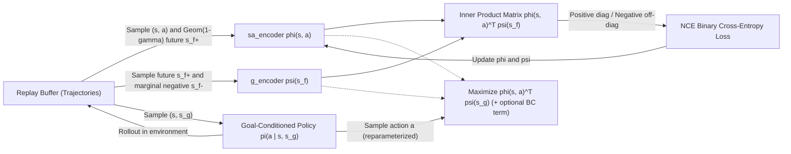

# Contrastive Learning as Goal-Conditioned Reinforcement Learning

**Contrastive Learning as Goal-Conditioned Reinforcement Learning** 收录于 [Awesome World-Action Models (RCL)](https://github.com/rcl-robotics/Awesome-World-Action-Models) **第 149/564** 篇，分组 **Foundational work**。本页是 **清单索引**：给出它在清单中的位置与原文入口，方法细节和量化结果请看原文。

## 一句话定义

RCL Awesome WAM 清单收录（Foundational work）；细节以原文 PDF / 项目页为准。

## 英文缩写速查

| 缩写 | 英文全称 | 简要说明 |
|------|----------|----------|
| WAM | World Action Model | 世界预测与动作生成耦合 |
| VLA | Vision-Language-Action | 视觉–语言–动作策略 |
| IDM | Inverse Dynamics Model | 先预测未来再反推动作 |
| WM | World Model | 环境前向预测模型 |

## 为什么重要

- RCL Awesome WAM 清单收录（Foundational work）；细节以原文 PDF / 项目页为准。
- 想横向对照同一分组的其他工作，可以从 [RCL Awesome WAM 技术地图](../overview/rcl-awesome-wam-technology-map.md) 逐条展开。
- 顺着列表实体 [Awesome World-Action Models](paper-rcl-wam-robot-learning-control-survey.md) 与站内 WAM / VLA 方法页，可以接回对应的学习主线。

## 核心信息

| 字段 | 内容 |
|------|------|
| 编号 | 149/564 |
| 分组 | Foundational work |
| 出处 | NeurIPS 2022 |
| 论文 | <https://proceedings.neurips.cc/paper_files/paper/2022/hash/e7663e974c4ee7a2b475a4775201ce1f-Abstract-Conference.html> |
| 子类 / 象限 | 理论与规划 · 动作策略基础 · 不适用 |

## 核心机制（归纳）

> 注：以下机制与评测指标基于通读开放获取原文全文核对补充。

### 核心思想与理论联系

该论文提出将**对比表征学习（Contrastive Representation Learning）直接作为目标条件强化学习（Goal-Conditioned RL）算法**，而非在传统 RL 算法之外叠加辅助重构损失或数据增强模块：

- **奖励与折扣状态占据测度等价（Proposition 1）**：将目标条件奖励定义为到达目标状态的概率密度 $r_g(s_t, a_t) \triangleq (1 - \gamma) p(s_{t+1} = s_g \mid s_t, a_t)$（初始步含 $p_0(s_0 = s_g)$），则对应 Q 函数等价于折扣状态占据测度下未来到达 $s_g$ 的概率：$Q^\pi_{s_g}(s, a) = p^{\pi(\cdot\mid\cdot, s_g)}(s_{t+} = s_g \mid s, a)$，其中时间偏移按几何分布 $t \sim \mathrm{Geom}(1 - \gamma)$ 采样。
- **对比学习即 Q 函数估计（Lemma 4.1）**：将状态–动作对 $(s, a)$ 与未来状态 $s_f$ 构成输入对，通过 NCE-binary（InfoMAX）二元分类目标区分同轨迹未来状态 $s_f^+ \sim p^{\pi(\cdot\mid\cdot)}(s_{t+} \mid s, a)$ 与随机边缘分布状态 $s_f^- \sim p(s_{t+})$。用内积参数化 critic $f(s, a, s_f) = \phi(s, a)^T \psi(s_f)$ 时，贝叶斯最优 critic 满足 $\exp(f^*(s, a, s_f)) = \frac{1}{p(s_f)} Q^{\pi(\cdot\mid\cdot)}_{s_f}(s, a)$，因此内积直接编码未归一化的对数 Q 值；在选动作时配分函数 $p(s_g)$ 可忽略。

### 核心模块、输入输出与训练管线

- **状态–动作编码器 `sa_encoder`（$\phi(s, a)$）**：输入状态 $s$ 与动作 $a$，输出表征向量（维度 `repr_dim`）。
- **目标/未来状态编码器 `g_encoder`（$\psi(s_f)$ / $\psi(s_g)$）**：输入未来状态或目标状态，输出同维表征向量；批内复用同一批表征同时计算正负样本内积矩阵 `logits = einsum('ik,jk->ij', sa_repr, g_repr)`。
- **Critic 更新（Contrastive RL (NCE), Algorithm 1）**：以单位矩阵 `eye(batch_size)` 为正样本标签优化 `sigmoid_binary_cross_entropy`，**无需多 Q 网络、目标 Q 网络、图像数据增强或辅助重构损失**。作者同时推导了基于 InfoNCE 的 `Contrastive RL (CPC)` 变体以及结合 C-learning 的 `Contrastive RL (NCE + C-learning)` 变体。
- **Actor 更新（Eq. 7）**：策略 $\pi(a \mid s, s_g)$ 输入当前状态 $s$ 与目标 $s_g$，通过重参数化梯度最大化内积相似度 $\phi(s, a)^T \psi(s_g)$（图像观测任务附加动作熵正则项）。在**离线 RL（Offline RL）**场景下，目标函数加入系数 $\lambda$ 的目标条件行为克隆（GCBC）约束，并可集成多个 critic（2 个或 5 个网络）取最小值抑制外推误差。
- **工程吞吐**：基于 JAX + Acme 实现，在单颗 TPUv2 上状态任务训练速度达 `1100 batches/sec`，图像任务达 `105 batches/sec`（同硬件 DrQ 为 `28 batches/sec`，慢 3.9 倍）。

### 方法流程图

## 评测与指标

- **评测基准与任务**：
  - **在线 Goal-Conditioned RL（无真实奖励函数，每项 5 个随机种子，报告均值与标准差）**：4 个机械臂操作任务（`fetch reach`、`fetch push`、`sawyer push`、`sawyer bin`，同时评测状态输入与像素图像输入），2 个导航/运动控制任务（图像 2D 迷宫 `point Spiral11x11` 与 111 维 `ant umaze`），以及手腕随动相机的部分可观测 `sawyer push` 变体。
  - **离线 RL 基准**：D4RL `AntMaze` 6 个任务（`umaze-v2`、`umaze-diverse-v2`、`medium-play-v2`、`medium-diverse-v2`、`large-play-v2`、`large-diverse-v2`）。
- **核心量化发现**：
  - **在线状态与图像任务（Fig. 2）**：在状态任务中，`Contrastive RL (NCE)` 优于 `TD3 + HER`、`GCBC` 与 `model-based` 基线，是唯一能解出高探索难度 `sawyer bin` 的方法（仅在低维 XY 目标的 `ant umaze` 上 `model-based` 最优）；在图像任务中，`Contrastive RL (NCE)` 领先所有基线，尤其在 `sawyer push` 与 `sawyer bin` 上基线均无进展而 NCE 持续提升（成功率尚低于 50%）。
  - **对比专用表征学习方法（Fig. 4）**：在不使用任何图像增强或辅助损失的情况下，`Contrastive RL (NCE)` 在全部图像任务上超越 `TD3+HER`、`TD3+HER + DrQ`、`TD3+HER + AE` 与 `TD3+HER + CURL`。
  - **部分可观测移动相机 `sawyer push`（Fig. 6）**：当相机绑定至机械手导致起点冰球被遮挡时，`Contrastive RL (NCE)` 仍可取得约 **35%** 成功率（固定静态相机基线为 **75%**）。
  - **D4RL AntMaze 离线 RL（Table 1，5 个随机种子）**：`Contrastive RL + BC`（2 nets / 5 nets）在 6 个任务中的 **5 个**刷新最佳成绩，相对无 TD 的 GCBC 中位绝对提升约 **15%**，在最难的大迷宫任务上相对 `IQL` 提升 6.6–9.0 个百分点：
    - `umaze-v2`：81.9±1.7 (2 nets) / 79.8±1.4 (5 nets)，对比 IQL 87.5、GCBC 65.4；
    - `umaze-diverse-v2`：**77.6±2.8** (5 nets) vs IQL 62.2、TD3+BC 71.4；
    - `medium-play-v2`：**72.6±2.9** (5 nets) vs IQL 71.2、GCBC 58.1；
    - `medium-diverse-v2`：**72.5±2.8** (2 nets) vs IQL 70.0、GCBC 67.3；
    - `large-play-v2`：**48.6±4.4** (5 nets) vs IQL 39.6、GCBC 32.4；
    - `large-diverse-v2`：**54.1±5.5** (5 nets) vs IQL 47.5、GCBC 36.9。

## 与其他工作对比

- 本页 **不做** 与具体基线的逐项数值对比；同分组的横向对照请回到 [技术地图](../overview/rcl-awesome-wam-technology-map.md) 的 **Foundational work** 分组逐条展开。
- 如果站内已经有这篇的深读页（含机构、实验表与源码运行时序图），请以那一页为准；本页只保留清单要点。
- 与清单内相邻条目孰优孰劣，本页不下结论：清单 Contribution 可能滞后于论文最新版本，差异应以各自原文的问题设定与评测口径为准。

## 结论

**Contrastive Learning as Goal-Conditioned Reinforcement Learning 证明了直接以“未来状态对比分类”替代传统 TD 价值学习，即可在无需奖励函数、目标网络或图像数据增强的前提下端到端学出目标条件 Q 函数与策略。**

- **理论统一性**：当正样本来自折扣状态占据测度时，二元 NCE 的最优内积 critic 严格对应对数未归一化目标条件 Q 函数，并将 C-learning 统一为同族特例。
- **图像与高难度稀疏探索优势**：在无外部感知辅助损失下超越 `DrQ`、`AE`、`CURL` 等表征增强基线，并在 `sawyer bin` 与图像 `sawyer push` 上取得实质进展。
- **离线扩展与容量效应**：加入行为克隆正则并将 critic 集成从 2 个扩展到 5 个网络后，在 D4RL AntMaze 5/6 基准上超越 IQL 与 TD3+BC。
- **适用边界**：论文方法与理论推导目前仅适用于目标条件（goal-conditioned）RL 设定，向任意通用奖励函数的 RL 推广仍为开放问题；理论收敛证明所需的轨迹过滤 `ExcludeTraj` 在实际训练中被移除（消融显示会降性能）。

## 常见误区

1. 不要把 Awesome 条目的 Contribution 当成完整方法证明——它只是策展导读。
2. 若站内已有这篇的深读页，以那一页为准——本页只是清单入口，不含实验数据。

## 关联页面

- 列表实体：[Awesome World-Action Models（RCL）](paper-rcl-wam-robot-learning-control-survey.md)
- 技术地图：[RCL Awesome WAM 技术地图](../overview/rcl-awesome-wam-technology-map.md)
- 方法/任务：[generative-world-models.md](../methods/generative-world-models.md)、[manipulation.md](../tasks/manipulation.md)

## 参考来源

- [`sources/papers/rcl_awesome_wam_ref_4db46d89f6231c67051e_contrastive-learning-as-goal-conditioned.md`](../../sources/papers/rcl_awesome_wam_ref_4db46d89f6231c67051e_contrastive-learning-as-goal-conditioned.md) — 本条目策展摘录
- [`sources/papers/rcl_awesome_wam_catalog.md`](../../sources/papers/rcl_awesome_wam_catalog.md) — 列表总表
- [`sources/repos/awesome-world-action-models-rcl.md`](../../sources/repos/awesome-world-action-models-rcl.md)
- [`docs/PAPERS.md`](https://github.com/RCL-Robotics/Awesome-World-Action-Models/blob/main/docs/PAPERS.md) — 上游论文目录
- 论文：<https://proceedings.neurips.cc/paper_files/paper/2022/hash/e7663e974c4ee7a2b475a4775201ce1f-Abstract-Conference.html>

## 推荐继续阅读

- [Awesome World-Action Models (RCL) 仓库](https://github.com/rcl-robotics/Awesome-World-Action-Models)
- [原文](https://proceedings.neurips.cc/paper_files/paper/2022/hash/e7663e974c4ee7a2b475a4775201ce1f-Abstract-Conference.html)
