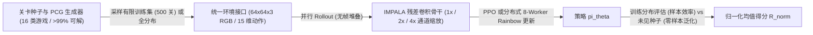

# Leveraging Procedural Generation to Benchmark Reinforcement Learning

**Leveraging Procedural Generation to Benchmark Reinforcement Learning**（Cobbe 等，OpenAI，ICML 2020）收录于 [Awesome World-Action Models (RCL)](https://github.com/rcl-robotics/Awesome-World-Action-Models) **第 032/564** 篇，分组 **Benchmarks & simulators**。本文提出了 **Procgen Benchmark**，旨在解决经典 Atari（ALE）基准关卡固定导致的「轨迹记忆/过拟合」隐疾。

## 一句话定义

构建包含 **16** 个高速程序化生成（PCG）游戏环境的 **Procgen Benchmark**，将所有任务统一为 **15 维离散动作空间**与 **$64 \times 64 \times 3$ RGB 观测**，通过划分有限训练关卡集与全分布未见测试关卡集，系统评测深度强化学习的**样本效率**与**零样本泛化能力**。

## 英文缩写速查

| 缩写 | 英文全称 | 简要说明 |
|------|----------|----------|
| PCG | Procedural Content Generation | 程序化内容生成，按随机种子实时生成近乎无限的关卡变体 |
| ALE | Arcade Learning Environment | 街机学习环境（Atari 经典基准，状态序列高度重复） |
| PPO | Proximal Policy Optimization | 近端策略优化（Procgen 默认基准策略梯度算法） |
| IMPALA | Importance Weighted Actor-Learner Architectures | 本文默认使用的残差卷积网络编码器结构 |
| RGB | Red-Green-Blue | 三通道彩色像素图像观测空间（$64\times 64\times 3$） |

## 为什么重要

- **刺破固定关卡基准的「泛化幻觉」**：消融实验表明，当按类似 ALE 的固定顺序关卡训练时，智能体能在前若干关表现优异，但在随机打乱的未见关卡上测试得分几乎归零——证明传统高分可能只是局部轨迹背诵。
- **建立标准化的 RL 泛化评测协议**：提供 `hard`（200M 步、500 训练关卡）与 `easy`（25M 步、200 训练关卡，算力省 **8×**）两档开箱即用协议及归一化得分公式，兼顾深度对比与低预算复现。
- **首次大规模验证 RL 中的「模型规模定律」**：与监督学习常忧虑大模型过拟合相反，将 IMPALA CNN 通道放大 2×、4× 后，不仅提升了训练样本效率，也同步显著提升了未见关卡上的零样本泛化得分。

## 核心信息

| 字段 | 内容 |
|------|------|
| 编号 | 032/564 |
| 分组 | Benchmarks & simulators |
| 出处 | ICML 2020（PMLR 119） |
| 作者 | Karl Cobbe, Christopher Hesse, Jacob Hilton, John Schulman（OpenAI） |
| 论文 | <https://proceedings.mlr.press/v119/cobbe20a.html> |
| 代码仓库 | <https://github.com/openai/procgen> |
| 子类 / 象限 | 强化学习基准 · 泛化评测 · 程序化仿真 |

## 核心机制（归纳）

### 1. 16 个高多样性程序化生成环境设计准则

- **程序化内容生成（PCG）**：在 16 个不同机制的街机风格环境（含 CoinRun、Chaser、Miner、Leaper 等）中，关卡拓扑布局、贴图资产、实体位置与生成时刻均由关卡种子控制；状态转移保持确定性（仅 Chaser 敌人 AI 根据关卡种子作伪随机决策），保证 **>99%** 的生成关卡可解。
- **统一流水线接口**：全部环境共享 **15 维离散动作空间**（多余维度作 no-op）与 **$64 \times 64 \times 3$ RGB** 观测，无需帧堆叠（frame stacking 对性能影响极微），单核 CPU 即可实现每秒数千步的仿真与渲染。
- **隔离核心挑战**：默认设定刻意降低对长程记忆和极端探索奖励的依赖（需专门评测时可启用记忆/探索变体），从而聚焦**视觉识别 + 底层运动控制 + 分布外泛化**。

### 2. 双轨评测协议与归一化指标

1. **样本效率（Sample Efficiency）**：在全分布随机关卡上训练与测试（默认 `hard` 模式 **200M** 步，单环境 PPO 约需 **24 GPU-hrs + 60 CPU-hrs**；`easy` 模式 **25M** 步，约 **3 GPU-hrs**）。
2. **零样本泛化（Generalization）**：在有限固定训练关卡集（`hard` 默认 **500** 关、`easy` 默认 **200** 关）上训练 **200M** 步，并在未见过的全分布关卡上测量零样本平均回报。
3. **跨环境汇总指标**：定义各环境的归一化回报 $R_{\text{norm}} = \frac{R - R_{\min}}{R_{\max} - R_{\min}}$（将各环境回报约映射至 $[0,1]$），全基准取均值（Mean Normalized Return）以防止少数高分游戏主导结果。

### 方法流程图

## 工程实践

- **网络结构与超参缩放法则**：
  - 经典 Atari 常用的 **Nature-CNN**（Mnih et al., 2015）因容量不足，在 Procgen 高多样性环境下几乎完全无法训练；建议至少采用 **IMPALA** 残差卷积网络。
  - 将 IMPALA 每层卷积通道放大 $k$ 倍（参数量约按 $k^2$ 增长）时，学习率需同步按 $1/\sqrt{k}$ 缩放以匹配 Xavier/Glorot 权重尺度。
- **Off-Policy 算法（Rainbow）在高多样性环境下的稳定化**：直接套用默认 Rainbow 超参在 Procgen 上因梯度方差过大而崩溃；作者通过 **8 个并行 Worker 共享参数并平均梯度**，同时将 batch size 增大 **16×**、降低更新频率 **16×**、学习率放大 **4×**，成功在显著缩短墙钟时间的同时恢复稳定学习。
- **训练集规模与隐式课程效应**：当训练关卡过少（如 100–500 关）时智能体严重过拟合，通常需要扩展至约 **10,000** 关才基本抹平泛化差距；在多数环境上跨过阈值后，增大训练关卡数反而会通过「隐式课程」提高训练集自身得分。

## 评测与指标

| 实验维度 | 关键设置 | 原文核心实证结论 |
|----------|----------|------------------|
| 基准算力成本 | `hard` 200M 步 vs `easy` 25M 步 | `hard` 单环境 PPO 约 **24 GPU-hrs + 60 CPU-hrs**；`easy` 算力消耗降低约 **8×**（~**3 GPU-hrs**） |
| 固定序列消融（Section 3.2） | 仅按固定顺序推进关卡（模拟 ALE） | 训练期看似能顺利通关前几关（极少超过第 20 关），但测试时随机化关卡顺序后回报几乎跌至 **0**，揭示训练假象 |
| 训练集规模扫描（Section 3.1） | 100 至 100,000 关（200M 步） | 小训练集均严重过拟合；通常需多达 **10,000** 关才能闭合训练–测试泛化差距；标准泛化基准定在 **500** 关（刚好处于泛化能力开始涌现的临界区） |
| 模型容量缩放（Section 4） | Nature-CNN vs IMPALA (1× / 2× / 4×) | **Nature-CNN** 几乎完全失败；IMPALA 从 $1\times \to 2\times \to 4\times$ 在**样本效率**和**500 关泛化**双指标上均获得一致大幅提升 |
| 算法对比（Section 5） | 全分布训练 PPO vs 8-Worker Rainbow | **PPO** 在 16 个环境上整体最稳定；经过梯度平均稳定的 **Rainbow** 在若干特定环境上显著优于 PPO，但在部分环境仍存在未知不稳定性 |

## 与其他工作对比

- **对比 ALE（Bellemare et al. 2013）**：ALE 虽然包含丰富跨游戏种类，但单款游戏关卡近乎静态，sticky actions 或背景视频置换只触及表层随机性；Procgen 从状态分布源头迫使策略学会泛化而非记忆。
- **对比 CoinRun（Cobbe et al. 2019）与 Sonic（Nichol et al. 2018）**：Sonic 仅有少量固定关卡难以稳定度量进展，CoinRun 验证了 PCG 思路但仅单一环境（并直接作为 Procgen 的首个环境），Procgen 将其拓展为 16 个异构环境套件。
- **对比 Obstacle Tower（Juliani et al. 2019）与 Meta-World（Yu et al. 2019）**：Obstacle Tower 将 3D 视觉、控制与规划耦合在单个复杂环境中，而 Procgen 选择以 16 个轻量高速环境拆解视觉泛化与底层控制；Meta-World 聚焦连续控制多任务共享物理，Procgen 则强调离散视觉 PCG 分布泛化。
- **对比后续工作 [Craftax](paper-rcl-ref-3145193f87c43012f17a-craftax-a-lightning-fast-benchmark-for-open-ende.md)**：Craftax 在 JAX GPU 端将步速再提升两个数量级，并把重点从 Procgen 的「跨关卡泛化」进一步推进到「长程深度探索与记忆」。

## 结论

**Procgen Benchmark 通过 16 个高速程序化生成环境将「泛化能力」与「样本效率」同时纳入标准 RL 度量体系，并实证证明：丰富关卡分布与更大容量卷积架构是克服深度强化学习过拟合的必要条件。**

- **严禁仅凭固定关卡训练集曲线判断 RL 能力**：在有序固定关卡上高分可能完全来自轨迹背诵，必须报告未见种子测试集（如 500 关泛化协议）上的零样本回报。
- **放弃过小的 Nature-CNN 骨干**：面对程序化生成的高视觉多样性，至少使用 IMPALA 残差网络，并按通道宽度 $k$ 的平方根倒数（$1/\sqrt{k}$）同步下调学习率以释放尺度红利。
- **预算受限时采用 `easy` 协议先行筛选**：`easy` 模式（25M 步 / 200 关）仅需约 1/8 算力（~3 GPU-hrs），适合快速迭代超参后再上 `hard`（200M 步 / 500 关）终审。
- **Off-Policy 值函数方法需重点抑制梯度方差**：在多样化分布上训练 Rainbow 等算法时，须采用多 Worker 梯度平均与大 Batch 策略，否则极易崩溃。
- **使用归一化均值（Mean Normalized Return）汇总结果**：跨 16 环境评估时统一用 $R_{\text{norm}}$ 防止单个大尺度奖励环境掩盖整体退步。

## 常见误区与局限

1. **误区：把 500 关泛化协议当作已足够消除过拟合的训练集规模**。论文选择 500 关是因为它正好位于泛化刚起步、仍存在明显过拟合差距的挑战区间；若追求接近无过拟合的性能，实际需要上万（~10,000）关。
2. **误区：Procgen 能全面覆盖长程探索与长期记忆挑战**。设计准则中明确说明，默认 16 个环境为隔离视觉泛化与控制挑战，刻意最小化了记忆与探索难度（这两项需切换至 Appendix B 的专门变体）。
3. **程序化生成局限**：每个环境的关卡可解性虽超过 **99%**，但并不提供 100% 的数学可解性保证，评测方差解释时应纳入极少数不可解关卡的噪声。
4. **领域局限**：所有环境均为二维确定性离散动作游戏，不包含连续力控、三维遮挡或真实物理参数偏移，研究机器人迁移仍需配合 [Sim2Real](../concepts/sim2real.md) 框架。

## 关联页面

- 列表实体：[Awesome World-Action Models（RCL）](paper-rcl-wam-robot-learning-control-survey.md)
- 技术地图：[RCL Awesome WAM 技术地图](../overview/rcl-awesome-wam-technology-map.md)
- 同组对比：[Craftax](paper-rcl-ref-3145193f87c43012f17a-craftax-a-lightning-fast-benchmark-for-open-ende.md)
- 方法/任务：[generative-world-models.md](../methods/generative-world-models.md)、[vla.md](../methods/vla.md)、[manipulation.md](../tasks/manipulation.md)、[locomotion.md](../tasks/locomotion.md)

## 参考来源

- [`sources/papers/rcl_awesome_wam_ref_5c37def65669693c1520_leveraging-procedural-generation-to-benc.md`](../../sources/papers/rcl_awesome_wam_ref_5c37def65669693c1520_leveraging-procedural-generation-to-benc.md) — 本条目策展摘录
- [`sources/papers/rcl_awesome_wam_catalog.md`](../../sources/papers/rcl_awesome_wam_catalog.md) — 列表总表
- [`sources/repos/awesome-world-action-models-rcl.md`](../../sources/repos/awesome-world-action-models-rcl.md)
- [`docs/PAPERS.md`](https://github.com/RCL-Robotics/Awesome-World-Action-Models/blob/main/docs/PAPERS.md) — 上游论文目录
- 论文：<https://proceedings.mlr.press/v119/cobbe20a.html>

## 推荐继续阅读

- [Procgen 官方开源环境](https://github.com/openai/procgen)
- [Awesome World-Action Models (RCL) 仓库](https://github.com/rcl-robotics/Awesome-World-Action-Models)
- [原文（ICML 2020 / PMLR 119）](https://proceedings.mlr.press/v119/cobbe20a.html)
