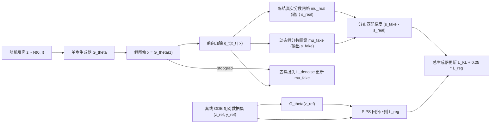

# One-step Diffusion with Distribution Matching Distillation

**One-step Diffusion with Distribution Matching Distillation** 收录于 [Awesome World-Action Models (RCL)](https://github.com/rcl-robotics/Awesome-World-Action-Models) **第 171/564** 篇，分组 **Foundational work**。本页是 **清单索引**：给出它在清单中的位置与原文入口，方法细节和量化结果请看原文。

## 一句话定义

RCL Awesome WAM 清单收录（Foundational work）；细节以原文 PDF / 项目页为准。

## 英文缩写速查

| 缩写 | 英文全称 | 简要说明 |
|------|----------|----------|
| WAM | World Action Model | 世界预测与动作生成耦合 |
| VLA | Vision-Language-Action | 视觉–语言–动作策略 |
| IDM | Inverse Dynamics Model | 先预测未来再反推动作 |
| WM | World Model | 环境前向预测模型 |

## 为什么重要

- RCL Awesome WAM 清单收录（Foundational work）；细节以原文 PDF / 项目页为准。
- 想横向对照同一分组的其他工作，可以从 [RCL Awesome WAM 技术地图](../overview/rcl-awesome-wam-technology-map.md) 逐条展开。
- 顺着列表实体 [Awesome World-Action Models](paper-rcl-wam-robot-learning-control-survey.md) 与站内 WAM / VLA 方法页，可以接回对应的学习主线。

## 核心信息

| 字段 | 内容 |
|------|------|
| 编号 | 171/564 |
| 分组 | Foundational work |
| 出处 | CVPR 2024 |
| 论文 | <https://openaccess.thecvf.com/content/CVPR2024/html/Yin_One-step_Diffusion_with_Distribution_Matching_Distillation_CVPR_2024_paper.html> |
| 项目页 | <https://tianweiy.github.io/dmd/> |
| 子类 / 象限 | 训练优化与蒸馏 · 扩散与流匹配基础 · 不适用 |

## 核心机制（归纳）

> 注：以下机制与评测指标基于通读开放获取原文全文核对补充。

Distribution Matching Distillation（DMD）不强求单步生成器逐点复现多步扩散 ODE 的精确路径，而是以**分布匹配**为核心目标，将预训练扩散模型（如 EDM、Stable Diffusion v1.5）蒸馏为高保真单步生成器：

1. **三网络协同架构**：
   - **单步生成器 $G_\theta(z)$**：复用基础去噪器 $\mu_{\text{base}}$ 架构并移除时间步条件，权重初始化自 $\mu_{\text{base}}(z, T-1)$（$T=1000$），单次前向即可将高斯噪声 $z \sim \mathcal{N}(0, I)$ 映射为图像 $x$。
   - **真实分数估计器 $\mu_{\text{real}}$（冻结）**：固定为预训练教师 $\mu_{\text{base}}$（支持 Classifier-Free Guidance 替换均值预测）。对生成图像前向加噪 $x_t \sim \mathcal{N}(\alpha_t x, \sigma_t^2 I)$ 后，提供“使其更接近真实分布”的分数方向 $s_{\text{real}}(x_t, t) = -\frac{x_t - \alpha_t \mu_{\text{base}}(x_t, t)}{\sigma_t^2}$。
   - **动态假分数估计器 $\mu_{\text{fake}}$（在线更新）**：同样初始化自 $\mu_{\text{base}}$，在训练中持续以生成样本的去噪损失 $\mathcal{L}_{\text{denoise}} = \|\mu_{\text{fake}}(x_t, t) - \text{stopgrad}(x)\|_2^2$ 更新，用于追踪当前合成分布 $p_{\text{fake}}$ 并给出 $s_{\text{fake}}(x_t, t)$。
2. **双路损失驱动的训练流程（Algorithm 1）**：
   - **无配对流——分布匹配 KL 梯度**：最小化平滑后真实分布与生成分布之间的近似 KL 散度，其梯度直接表示为两分数估计之差：
     $$\nabla_\theta D_{\text{KL}} \approx \mathbb{E}_{z, t, x, x_t}\left[w_t \alpha_t \big(s_{\text{fake}}(x_t, t) - s_{\text{real}}(x_t, t)\big) \frac{dG_\theta}{d\theta}\right]$$
     其中时间步权重 $w_t = \frac{\sigma_t^2}{\alpha_t} \frac{1}{\frac{1}{SC}\|\mu_{\text{base}}(x_t^{\text{CS}}, t) - x\|_1}$ 用于归一化不同噪声尺度下的梯度幅值（$t \sim \mathcal{U}(0.02T, 0.98T)$）。
   - **配对流——LPIPS 回归正则**：由于低噪声区 $s_{\text{real}}$ 易失真且纯分数优化易引发模式坍缩，作者离线用教师确定性 ODE 求解器（CIFAR-10 用 18 步 Heun、ImageNet 用 256 步 Heun、LAION 用 50 步 PNDM）预生成少量配对数据集 $\mathcal{D}=\{z_{\text{ref}}, y_{\text{ref}}\}$，计算 $\mathcal{L}_{\text{reg}} = \mathbb{E}[\text{LPIPS}(G_\theta(z_{\text{ref}}), y_{\text{ref}})]$，与 $D_{\text{KL}}$ 加权组合（$L_G = L_{\text{KL}} + \lambda_{\text{reg}} L_{\text{reg}}$，默认 $\lambda_{\text{reg}} = 0.25$）。

### 方法流程图

关于生成式加速蒸馏与世界模型结合，可参见站内 [World Action Models（WAM）](../concepts/world-action-models.md) 与 [generative-world-models.md](../methods/generative-world-models.md)。

## 评测与指标

- **评测基准与指标**：在 CIFAR-10（类别条件）、ImageNet 64×64（类别条件）和零样本 MS-COCO 2014-30k（512×512 文生图，蒸馏自 SD v1.5，LAION-Aesthetics 训练 72×A100 约 36 小时）上评估，核心指标为 FID（↓）、CLIP-Score（↑）与单卡推理延迟/前向次数。
- **核心量化结果**：
  - **ImageNet 64×64（Table 1）**：DMD 单步（1 次前向）取得 FID **2.62**，接近 512 步教师 EDM†（FID 2.32，实现 512× 加速），显著优于 Consistency Model（1 步 FID **6.20**，提升 2.4×）、Diff-Instruct（5.57）、TRACT（7.43）、DFNO（7.83）、Progressive Distillation（15.39）及 BigGAN-deep（4.06）。
  - **CIFAR-10 与损失/权重消融（Table 2）**：DMD 单步取得 FID **2.66**；去掉分布匹配损失退化至 3.82（CIFAR）/ 9.21（ImageNet），去掉回归损失退化至 5.58 / 5.61 并出现模式坍缩；本文提出的梯度归一化权重 $w_t$（FID 2.66）优于 $t/\alpha_t$（3.60）与 $t^3/\alpha_t$（3.71）。
  - **MS-COCO 2014-30k 零样本（guidance scale = 3，Table 3）**：DMD 单步延迟 **0.09s**（FP16 下达 **20 FPS**），FID **11.49**（教师 SDv1.5 为 2.59s / FID 8.78，加速近 30×），优于 UFOGen（0.09s, 12.78）、InstaFlow-0.9B（0.09s, 13.10）、StyleGAN-T（0.10s, 13.90）、UniPC 4 步（0.26s, 19.57）和 DPM++ 4 步（0.26s, 22.36）。
  - **高引导文生图（guidance scale = 8，Table 4）**：DMD 单步（0.09s）FID **14.93**、CLIP-Score **0.320**（教师 SDv1.5 2.59s 为 FID 13.45 / CLIP 0.322），显著领先 LCM-LoRA 1/2/4 步（FID 77.90 / 24.28 / 23.62，CLIP 0.238 / 0.294 / 0.297）及 DPM++/UniPC 4 步（FID 22.44 / 23.30）。

## 与其他工作对比

- 本页 **不做** 与具体基线的逐项数值对比；同分组的横向对照请回到 [技术地图](../overview/rcl-awesome-wam-technology-map.md) 的 **Foundational work** 分组逐条展开。
- 如果站内已经有这篇的深读页（含机构、实验表与源码运行时序图），请以那一页为准；本页只保留清单要点。
- 与清单内相邻条目孰优孰劣，本页不下结论：清单 Contribution 可能滞后于论文最新版本，差异应以各自原文的问题设定与评测口径为准。

## 结论

**DMD 验证了用双扩散分数差估计近似 KL 散度梯度、并辅以少量离线 ODE 配对 LPIPS 正则的蒸馏路线，能在不损失构图与文本对齐的情况下将 Stable Diffusion 压缩至 20 FPS 单步推理。**

- **核心工程权衡**：相比逐点回归的轨迹蒸馏，分布匹配大幅提升了单步保真度（ImageNet FID 2.62），但仍依赖教师预先采样配对数据集防止模式坍缩。
- **训练开销与局限**：训练过程需同时加载并更新生成器与假分数估计器（及冻结教师网络），显存占用较高；与 100–1000 步教师相比仍存在约 1.5–2.7 的 FID 差距，该局限在后续工作 DMD2 中通过 TTUR 与 GAN 判别损失被进一步突破。

## 常见误区

1. 不要把 Awesome 条目的 Contribution 当成完整方法证明——它只是策展导读。
2. 若站内已有这篇的深读页，以那一页为准——本页只是清单入口，不含实验数据。

## 关联页面

- 列表实体：[Awesome World-Action Models（RCL）](paper-rcl-wam-robot-learning-control-survey.md)
- 技术地图：[RCL Awesome WAM 技术地图](../overview/rcl-awesome-wam-technology-map.md)
- 方法/任务：[generative-world-models.md](../methods/generative-world-models.md)、[manipulation.md](../tasks/manipulation.md)

## 参考来源

- [`sources/papers/rcl_awesome_wam_ref_5c86e0d92b645b2b135f_one-step-diffusion-with-distribution-mat.md`](../../sources/papers/rcl_awesome_wam_ref_5c86e0d92b645b2b135f_one-step-diffusion-with-distribution-mat.md) — 本条目策展摘录
- [`sources/papers/rcl_awesome_wam_catalog.md`](../../sources/papers/rcl_awesome_wam_catalog.md) — 列表总表
- [`sources/repos/awesome-world-action-models-rcl.md`](../../sources/repos/awesome-world-action-models-rcl.md)
- [`docs/PAPERS.md`](https://github.com/RCL-Robotics/Awesome-World-Action-Models/blob/main/docs/PAPERS.md) — 上游论文目录
- 论文：<https://openaccess.thecvf.com/content/CVPR2024/html/Yin_One-step_Diffusion_with_Distribution_Matching_Distillation_CVPR_2024_paper.html>

## 推荐继续阅读

- [Awesome World-Action Models (RCL) 仓库](https://github.com/rcl-robotics/Awesome-World-Action-Models)
- [原文](https://openaccess.thecvf.com/content/CVPR2024/html/Yin_One-step_Diffusion_with_Distribution_Matching_Distillation_CVPR_2024_paper.html)
