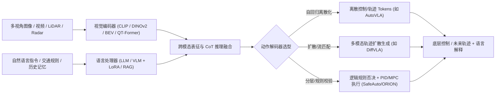

# A Survey on Vision-Language-Action Models for Autonomous Driving

**A Survey on Vision-Language-Action Models for Autonomous Driving** 收录于 [Awesome World-Action Models (RCL)](https://github.com/rcl-robotics/Awesome-World-Action-Models) **第 192/564** 篇，分组 **Related resources**。本页是 **清单索引**：给出它在清单中的位置与原文入口，方法细节和量化结果请看原文。

## 一句话定义

RCL Awesome WAM 清单收录（Related resources）；细节以原文 PDF / 项目页为准。

## 英文缩写速查

| 缩写 | 英文全称 | 简要说明 |
|------|----------|----------|
| WAM | World Action Model | 世界预测与动作生成耦合 |
| VLA | Vision-Language-Action | 视觉–语言–动作策略 |
| IDM | Inverse Dynamics Model | 先预测未来再反推动作 |
| WM | World Model | 环境前向预测模型 |

## 为什么重要

- RCL Awesome WAM 清单收录（Related resources）；细节以原文 PDF / 项目页为准。
- 想横向对照同一分组的其他工作，可以从 [RCL Awesome WAM 技术地图](../overview/rcl-awesome-wam-technology-map.md) 逐条展开。
- 顺着列表实体 [Awesome World-Action Models](paper-rcl-wam-robot-learning-control-survey.md) 与站内 WAM / VLA 方法页，可以接回对应的学习主线。

## 核心信息

| 字段 | 内容 |
|------|------|
| 编号 | 192/564 |
| 分组 | Related resources |
| 出处 | ICCV 2025 Workshops (WDFM-AD) |
| 论文 | <https://openaccess.thecvf.com/content/ICCV2025W/WDFM-AD/html/Jiang_A_Survey_on_Vision-Language-Action_Models_for_Autonomous_Driving_ICCVW_2025_paper.html> |
| 子类 / 象限 | 综述与技术资源 · 不适用 |

## 核心机制（归纳）

> 注：以下机制与评测指标基于通读开放获取原文全文核对补充。

本综述首次系统梳理了面向自动驾驶的视觉–语言–动作模型（VLA4AD）范式，对比经典模块化栈、端到端（E2E）学习与仅做感知/解释的 VLM4AD，系统拆解了 VLA4AD 的统一架构、四阶段演进路径与多阶段训练框架：

1. **VLA4AD 统一架构模块（Section 3）**：
   - **多模态输入**：单目/环视相机视频流（原始图像或 BEV 投影）、LiDAR/RADAR/IMU/GPS 与自车本体运动状态（转向角、速度、加速度），以及三类语言输入（直接驾驶指令如“overtake the truck”、环境状态问答、交通规则/导航信息或语音）。
   - **视觉编码器（Vision Encoder）**：采用自监督或图文预训练骨干（DINOv2、ConvNeXt-V2、CLIP ViT、QT-Former），部分工作引入 BEV 投影或 3D 点云/体素适配器（PointVLA、3D-VLA）及文本引导空间融合。
   - **语言处理器（Language Processor）**：以 LLaMA-2、Vicuna-1.5、Qwen-2/2.5-VL、PaliGemma-3B、InternVL2、Gemini 或 GPT-4o 为底座，配合视觉指令微调、RAG 交通规则检索（RAG-Driver）与 LoRA 高效微调。
   - **动作解码器与驾驶输出（Action Decoder）**：分为三类路线——(i) 自回归离散动作/航点 tokenizer（如 AutoVLA 的离散“drive tokens”、FAST）；(ii) 条件扩散头（DiffVLA 稀疏航点+稠密占据栅格扩散、Diffusion-VLA）；(iii) 流匹配 / 策略梯度专家（GRPO / DPO）或由语言规划器向底层 PID/MPC 派发子目标草图的分层控制器（ORION）。输出形式为底层控制信号（转向、油门、刹车）或 BEV/自车坐标系未来轨迹（经 MPC 执行），并可同步生成自然语言解释或思维链（CoT）。
2. **四阶段范式演进（Section 4，Table 1 梳理 15 个 2023–2025 代表模型）**：
   - **Pre-VLA（VLM 作为解释器）**：语言仅作场景旁白与 QA，不参与闭环控制（DriveGPT-4、TS-VLM、DynRslVLM）。
   - **模块化 VLA**：语言输出中间可解释路径/规则约束或路由专家，再交由规划控制执行（OpenDriveVLA、DriveMoE、LangCoop V2V、SafeAuto 规则否决、RAG-Driver）。
   - **统一端到端 VLA**：单一多模态网络前向直接输出轨迹/控制（EMMA、ADriver-I 扩散世界模型、CoVLA-Agent、VaViM、DiffVLA、SimLingo“action dreaming”）。
   - **推理增强 VLA**：引入长程记忆压缩与显式 CoT 对齐闭环动作（ORION 的 QT-Former 记忆、Impromptu-VLA 的 8 万长尾角例 CoT 动作对齐、AutoVLA 思考/动作 token 交错解码）。
3. **典型四步训练流水线（Clone → Adapt → Verify → Compress）**：
   - (1) 预训练视觉与语言骨干；(2) 基于监督模仿学习（IL，连续控制 $\ell_2$ 或离散交叉熵）进行图–文–动作对齐；(3) 注入角例/指令增强数据（如 SimLingo、Bench2Drive）并在 CARLA/Bench2Drive 上通过 PPO/DPO/GRPO 强化微调安全与合规；(4) 采用 LoRA、稀疏 MoE（DriveMoE）、token 池化（TS-VLM）或蒸馏压缩以满足车载 $\ge 30\text{ Hz}$ 实时约束。

### 方法流程图

关于 VLA 与生成式世界模型的跨领域对照，可参见站内 [World Action Models（WAM）](../concepts/world-action-models.md) 与 [vla.md](../methods/vla.md)。

## 评测与指标

- **综述定位说明**：本文为领域综述（Survey），**未对自研新模型做统一实机/仿真新跑分**，而是系统整理了 2018–2025 年间 **8 个核心数据集/基准** 与三轴评测协议（原文 Table 2 与 Section 5–6）：
  - **经典感知/解释与多模态底座**：`BDD100K / BDD-X`（2018，100k 美国实车视频 / 7k 时间对齐解释片段，Captioning & QA）、`nuScenes`（2020，波士顿/新加坡 1k 个 20s 6 相机+LiDAR+Radar 场景，3D 检测/QA/开环规划）。
  - **闭环仿真与长尾角例**：`Bench2Drive`（2024，CARLA 仿真 220 条路线 / 44 类场景 / 2M 帧训练集，闭环控制与分技能评测）、`Impromptu VLA`（2025，由 8 个公开集挖掘的 80k 个 30s 长尾角例片段约 2M 帧，QA + 专家轨迹，支持开源评测服务器）。
  - **推理链与人车对齐 QA**：`Reason2Drive`（2024，nuScenes/Waymo/ONCE 共 600k 视频–QA，感知→预测→动作 CoT 一致性）、`DriveLM-Data`（2024，nuScenes 18k + CARLA 16k 图结构条件 QA；文中引述基线 TS-VLM 达 BLEU-4 56 但图一致性较低）、`NuInteract`（2025，nuScenes 1k 多视角 LiDAR 对齐多轮 3D QA）、`DriveAction`（2025，真实车队 2.6k 场景 / 16.2k 动作级人类偏好 QA）。
- **三轴评测口径（Section 6.2）**：
  - **闭环驾驶**：CARLA / Bench2Drive 路线完成率、碰撞/闯红灯/偏离道路违规率（文中引述 DiffVLA 借 PDMS 层将误差减半、SafeAuto 采用形式化规则否决）及未知天气泛化。
  - **开环预测**：nuScenes 轨迹 $\ell_2$ 误差与碰撞率、指令条件目标到达率。
  - **鲁棒与压力测试**：传感器退化（模糊、丢帧、延迟）、对抗提示/补丁、OOD 事件及方言/跨语种边缘指令。
- **待解关键挑战（Section 7）**：(1) 传感器干扰与 LLM 幻觉下的鲁棒性及形式化安全验证；(2) 车载硬件 $\ge 30\text{ Hz}$ 实时推理吞吐瓶颈；(3) 三模态（图像+动作+语言）高质量标注稀缺；(4) 相机、LiDAR、Radar 与高精地图及长程时序记忆的统一对齐；(5) 控制套件与语言推理测试割裂，亟需统一评测体系（“AI driver's licence”）。

## 与其他工作对比

- 本页 **不做** 与具体基线的逐项数值对比；同分组的横向对照请回到 [技术地图](../overview/rcl-awesome-wam-technology-map.md) 的 **Related resources** 分组逐条展开。
- 如果站内已经有这篇的深读页（含机构、实验表与源码运行时序图），请以那一页为准；本页只保留清单要点。
- 与清单内相邻条目孰优孰劣，本页不下结论：清单 Contribution 可能滞后于论文最新版本，差异应以各自原文的问题设定与评测口径为准。

## 结论

**本综述首次为自动驾驶领域的 VLA4AD 建立了统一的架构词汇表、四代演进谱系与“克隆–适应–验证–压缩”训练范式，指明了从被动解释器走向可验证、实时闭环推理智能体的关键瓶颈。**

- **演进主线清晰**：VLA4AD 正从早期纯文本旁白（Pre-VLA）和分段式语言规划（Modular VLA），向端到端统一控制及融合长程记忆与思维链的推理型代理（ORION、Impromptu-VLA、AutoVLA）加速收敛。
- **工程落地核心约束**：实际部署须平衡三大矛盾——多模态骨干与 $\ge 30\text{ Hz}$ 车载实时性之间的算力矛盾、单纯模仿学习面对长尾角例的分布外退化，以及神经网络灵活性与形式化交规安全约束（神经符号安全核）的结合。
- **评测体系缺口**：当前文献仍缺乏能同时衡量闭环驾驶安全、指令忠实度与语言解释一致性的统一基准，后续研究需优先补齐三模态对齐语料与联合评测协议。

## 常见误区

1. 不要把 Awesome 条目的 Contribution 当成完整方法证明——它只是策展导读。
2. 若站内已有这篇的深读页，以那一页为准——本页只是清单入口，不含实验数据。

## 关联页面

- 列表实体：[Awesome World-Action Models（RCL）](paper-rcl-wam-robot-learning-control-survey.md)
- 技术地图：[RCL Awesome WAM 技术地图](../overview/rcl-awesome-wam-technology-map.md)
- 方法/任务：[generative-world-models.md](../methods/generative-world-models.md)、[manipulation.md](../tasks/manipulation.md)

## 参考来源

- [`sources/papers/rcl_awesome_wam_ref_5d03f3be7549eb8453b0_a-survey-on-vision-language-action-model.md`](../../sources/papers/rcl_awesome_wam_ref_5d03f3be7549eb8453b0_a-survey-on-vision-language-action-model.md) — 本条目策展摘录
- [`sources/papers/rcl_awesome_wam_catalog.md`](../../sources/papers/rcl_awesome_wam_catalog.md) — 列表总表
- [`sources/repos/awesome-world-action-models-rcl.md`](../../sources/repos/awesome-world-action-models-rcl.md)
- [`docs/PAPERS.md`](https://github.com/RCL-Robotics/Awesome-World-Action-Models/blob/main/docs/PAPERS.md) — 上游论文目录
- 论文：<https://openaccess.thecvf.com/content/ICCV2025W/WDFM-AD/html/Jiang_A_Survey_on_Vision-Language-Action_Models_for_Autonomous_Driving_ICCVW_2025_paper.html>

## 推荐继续阅读

- [Awesome World-Action Models (RCL) 仓库](https://github.com/rcl-robotics/Awesome-World-Action-Models)
- [原文](https://openaccess.thecvf.com/content/ICCV2025W/WDFM-AD/html/Jiang_A_Survey_on_Vision-Language-Action_Models_for_Autonomous_Driving_ICCVW_2025_paper.html)
