# Exploring the Limits of Transfer Learning with a Unified Text-to-Text Transfo...

**Exploring the Limits of Transfer Learning with a Unified Text-to-Text Transformer（T5）** 收录于 [Awesome World-Action Models (RCL)](https://github.com/rcl-robotics/Awesome-World-Action-Models) **第 071/564** 篇，分组 **Components of WAMs（Language & vision-language backbones）**。本页基于 JMLR 2020 原文全文（`arXiv:1910.10683v4`）完成结构化精读升级。

## 一句话定义

**T5** 将所有基于文本的自然语言处理任务统一为「带任务前缀的文本输入 → 文本输出」的编解码器（Encoder–Decoder）Transformer 框架，并结合新构建的 **C4** 清洗网页语料库与大规模受控消融实验，在 24 项基准中的 18 项上取得当时 SOTA。

## 英文缩写速查

| 缩写 | 英文全称 | 简要说明 |
|------|----------|----------|
| T5 | Text-to-Text Transfer Transformer | 统一文本到文本格式的迁移学习 Transformer |
| C4 | Colossal Clean Crawled Corpus | 从 Common Crawl 启发式清洗得到的约 745 GB 英文语料 |
| LM | Language Modeling | 自回归语言建模预训练目标（对比去噪目标） |
| WAM | World Action Model | 世界预测与动作生成耦合模型（T5 为其语言主干参考） |
| VLA | Vision-Language-Action | 视觉–语言–动作策略（常采用编码器–解码器语言主干） |

## 为什么重要

- **统一接口消除任务头碎片化**：通过任务文本前缀（如 `translate English to German:`、`mnli premise:`）与统一最大似然/束搜索解码，单一模型架构与目标即可覆盖分类、回归（STS-B 离散化为 0.2 步长字符串）、摘要、问答与翻译。
- **建立迁移学习受控消融范式**：在统一 220M 基线与同等算力约束下，首次系统剥离架构、无监督目标、语料质量/重复次数、微调方式与算力缩放策略的各自贡献（见 Table 15 非缩放增益对比）。
- **面向具身与 WAM/VLA 底座的价值**：T5 编码器（如 T5-XXL）及文本到文本序列化范式成为后续多模态生成、跨模态条件表征与离散动作 token 化策略的重要语言底座参考，相关分组见 [RCL Awesome WAM 技术地图](../overview/rcl-awesome-wam-technology-map.md) 与 [Awesome World-Action Models](paper-rcl-wam-robot-learning-control-survey.md)。

## 核心信息

| 字段 | 内容 |
|------|------|
| 编号 | 071/564 |
| 分组 | Components of WAMs |
| 作者与机构 | Colin Raffel, Noam Shazeer, Adam Roberts, Katherine Lee, Sharan Narang, Michael Matena, Yanqi Zhou, Wei Li, Peter J. Liu（Google） |
| 出处 | Journal of Machine Learning Research (JMLR 21, 2020) · `arXiv:1910.10683v4` |
| 论文 | <https://www.jmlr.org/beta/papers/v21/20-074.html> |
| 官方代码 | <https://github.com/google-research/text-to-text-transfer-transformer> |
| 子类 / 象限 | Language & vision-language backbones · 语言与VLM Backbone · 已开源（代码、C4 与权重） |

## 核心机制（归纳）

> 注：以下机制与评测指标基于通读原文全文（JMLR 21, 2020 / `arXiv:1910.10683v4`）核对补充。

### 1. 统一文本到文本格式与编解码架构（§2.1, §2.4, §3.2）

- **Text-to-Text 统一建模**：所有下游任务均以「任务前缀 + 输入文本」送入编码器，解码器以标准教师强制交叉熵训练并自回归生成目标文本。回归任务 STS-B（1–5 分）按 0.2 步长四舍五入映射为 21 个字符串类别；Winograd 代词消歧（WNLI/WSC/DPR）转为高亮代词并预测对应名词短语。
- **架构细节与消融（Table 2）**：采用原始 Encoder–Decoder Transformer 的轻量变体——去除 LayerNorm 加性偏置（仅做 RMS 缩放）、使用跨层共享但按注意力头独立的标量相对位置偏置（relative position embeddings）。在相同去噪目标下，标准 Encoder–Decoder（$2P$ 参数、$M$ FLOPs）全面优于参数共享 Enc–Dec（$P, M$）、6 层 Enc–Dec（$P, M/2$）、自回归 LM（$P, M$）与 Prefix LM（$P, M$）；且去噪目标在所有架构上均一致优于标准语言建模（LM）目标。

### 2. C4 语料清洗管线（§2.2, §3.4）

- 针对 Common Crawl（每月约 20 TB HTML 提取文本）充斥乱码、菜单与样板文本的问题，基于 2019 年 4 月抓取数据设计 9 步启发式过滤（终止标点、至少 3 句且每行 ≥5 词、过滤脏词表与 `Javascript`/`lorem ipsum`/`{` 代码片段、去除引用标记与隐私/Cookie 声明、3 句滑动跨度去重）及 `langdetect`（英文概率 ≥0.99），构建约 **745 GB**（正文约 750 GB）的 **C4** 语料库。
- 实验表明：未过滤 C4（6.1 TB）在全部基准上显著掉点；领域内语料（如 Wikipedia+TBC 对小说阅读理解 MultiRC、RealNews-like 对 ReCoRD）可带来特定增益，但规模受限；当小语料在预训练中被重复 **256–4,096 次**时，模型发生记忆并导致下游指标持续退化（Table 9）。

### 3. Span Corruption 去噪与多任务预训练 + 算力缩放（§3.3, §3.5–§3.7）

- **Span Corruption（§3.3.4, Table 7）**：以 15% 破坏率替换连续随机长度片段（平均 span 长度 **3**），每个被破坏片段替换为唯一哨兵词（sentinel token，如 `<X>`），解码器仅预测被掩盖片段拼接成的短序列，既略微提升理解/摘要任务精度，又缩短目标序列、加快训练速度。
- **多任务预训练 + 单任务微调（§3.5.3, Table 12）**：先在「C4 无监督任务 + 下游监督任务」混合分布（按样本数比例混合并设上限 $K=2^{19}$）上预训练，再逐任务微调，兼具多任务早期迁移优势与全生命周期验证集监控能力，避免纯多任务训练在混合比上的此消彼长。
- **4× 算力分配与 T5 家族缩放（§3.6–§3.7, Table 13）**：在 4× 算力预算下，**同时扩大模型规模与训练步数（2× size + 2× steps）** 或 **4× size** 的收益显著优于单纯 4× 步数或 4× 批大小。最终 T5 家族基于 SentencePiece 32,000 词表、AdaFactor 优化器，在 C4 上训练 **1 万亿（1T）tokens**（batch size $2^{11}$ 序列 × 长度 512 × 1M 步），覆盖 5 个规格：`T5-Small`（60M）、`T5-Base`（220M）、`T5-Large`（770M）、`T5-3B`（2.8B）与 `T5-11B`（11B，重点放大 $d_{ff}=65536$ 与 128 头以适配 TPU 大矩阵乘）。

### 方法流程图

```mermaid
flowchart LR
    CC["Common Crawl 网页文本 (2019-04)"] -->|"9步启发式清洗 + 去重 + 英文过滤"| C4["C4 清洗语料库 (~745 GB)"]
    C4 -->|"Span Corruption (15% 破坏, 平均长度 3)"| MIX["多任务混合预训练 (C4 + 有监督前缀任务, 1T tokens)"]
    MIX -->|"Encoder-Decoder Transformer (相对位置偏置)"| ENC["Encoder 双向编码带前缀输入"]
    ENC -->|"Cross-Attention"| DEC["Decoder 自回归生成哨兵片段 / 目标文本"]
    DEC -->|"逐任务微调 (GLUE / SuperGLUE / SQuAD / CNNDM / WMT)"| OUT["统一 Text-to-Text 预测输出"]
```

## 评测与指标

- **架构与目标受控消融（220M 基线验证集，Tables 2, 7, 8, 9, 13, 15）**：
  - **架构对比（Table 2）**：Encoder–Decoder + Denoising（GLUE **83.28** / CNNDM **19.24** / SQuAD **80.88** / SGLUE **71.36**）优于 Enc–Dec 共享参数（82.81 / 18.78 / 80.63 / 70.73）、Prefix LM（81.82 / 18.61 / 78.94 / 68.11）与标准 LM（74.70 / 17.93 / 61.14 / 55.02）。
  - **去噪目标（Table 7）**：Span Corruption（平均跨度 3）在 SGLUE（**72.53** vs 71.36）、SQuAD（**81.84** vs 80.88）、CNNDM（**19.62** vs 19.24）优于 i.i.d. 基线且训练更快。
  - **非缩放设计贡献（Table 15）**：同为 220M 与 1T tokens 训练，`T5-Base` 在全部任务上超越 `Baseline-1T`（GLUE **85.97** vs 84.80，SQuAD **85.44** vs 83.01，SGLUE **75.64** vs 73.90，CNNDM ROUGE-2 **20.90** vs 19.62）。
- **T5 家族最终基准结果（Table 14，24 项任务中 18 项达当时 SOTA）**：
  - **GLUE（测试集）**：`T5-11B` 平均 **90.3**（超越此前最佳 89.4），其中 CoLA **71.6**、SST-2 **97.5**、MNLI-m/mm **92.2 / 91.9**、RTE **92.8**、WNLI **94.5**。
  - **SuperGLUE（测试集）**：`T5-11B` 平均 **88.9**（大幅超越此前最佳 84.6，逼近人类 89.8），其中 BoolQ **91.2**、CB F1/Acc **93.9 / 96.8**、COPA **94.8**、MultiRC F1a/EM **88.1 / 63.3**、ReCoRD F1/Acc **94.1 / 93.4**、RTE **92.5**、WiC **76.9**、WSC **93.8**。
  - **SQuAD v1.1（验证集）**：`T5-11B` 达 **91.26 EM / 96.22 F1**（此前最佳 90.1 / 95.5）。
  - **CNN/Daily Mail 摘要（测试集）**：`T5-11B` 达 **43.52 ROUGE-1 / 21.55 ROUGE-2 / 40.69 ROUGE-L**（此前最佳 43.47 / 20.30 / 40.63）。
  - **WMT 机器翻译（BLEU）**：EnDe **32.1**（前最佳 33.8）、EnFr **43.4**（前最佳 43.8）、EnRo **28.1**（前最佳 38.5），未达 SOTA。

## 与其他工作对比

- 本页 **不做** 与具体基线的逐项数值对比；同分组的横向对照请回到 [技术地图](../overview/rcl-awesome-wam-technology-map.md) 的 **Components of WAMs** 分组逐条展开。
- 如果站内已经有这篇的深读页（含机构、实验表与源码运行时序图），请以那一页为准；本页基于原文补全核心机制与评测数字。
- 与清单内相邻条目孰优孰劣，本页不下结论：清单 Contribution 可能滞后于论文最新版本，差异应以各自原文的问题设定与评测口径为准。

## 结论

**T5 通过系统性的受控消融验证了「Encoder–Decoder 架构 + Span Corruption 去噪 + 高质量去重语料 C4 + 多任务预训练与模型/步数联合缩放」的组合威力，确立了统一文本到文本范式在大规模迁移学习中的基石地位。**

- **目标与结构优先级明确**：在同等计算开销下，Encoder–Decoder + 去噪目标一致优于纯解码器 LM 与 Prefix LM，而不同去噪变体的精度差异较小，应优先选择缩短目标序列、提高吞吐的 Span Corruption（平均跨度 3）。
- **数据清洗与防重复至关重要**：未过滤的 Common Crawl 会系统性拉低性能，小语料被反复训练（≥256 次）会诱发记忆退化；保持海量、干净且多样化的预训练语料是规模化前提。
- **规模之外仍有显著设计红利**：即便将基线同样扩训至 1T tokens（`Baseline-1T`），融合全部消融改进的 `T5-Base` 仍全线领先，证明架构、目标与多任务混合配方不可或缺。
- **算力扩展应模型与步数并进**：4× 算力预算下，同步提升模型容量与训练步数比单一拉长训练或放大批大小更有效；但 3B/11B 模型推理与部署代价高，实际工程需在效果与蒸馏/高效微调（Adapter 等）间权衡。
- **开源与适用边界**：代码、C4 数据集与 60M–11B 预训练权重已完整开源于 <https://github.com/google-research/text-to-text-transfer-transformer>；但受限于纯英文预训练语料与缺乏回译/跨语言目标，在机器翻译与低资源推理（COPA/WSC 仍低于人类 100%）上存在明显边界。

## 常见误区或局限

1. **误认为纯英文大模型缩放能自动解决机器翻译**：原文明确指出 T5 未能在 WMT EnDe/EnFr/EnRo 上超越 SOTA，归因于仅使用英文 C4 预训练，且缺少回译（backtranslation）与跨语言无监督预训练。
2. **误认为 Adapter 微调可无条件替代全量微调**：Table 10 显示在 GLUE/SuperGLUE 等高资源混合任务上，低维 Adapter（$d=32/128$）与渐进解冻（Gradual Unfreezing）均显著落后于全参数微调，需将 Adapter 维度扩至 $d=2048$ 才能逼近全微调效果。
3. **误将高 ROUGE 或超越人类读解均值等同于全面超越人类语言能力**：作者在 §3.7 提示 CNN/DM 的 ROUGE 提升未必线性对应摘要连贯性，MultiRC/ReCoRD 超越人类分数可能反映指标偏向机器输出分布，而 COPA 与 WSC 仍未达到人类 100% 水平。
4. **注意清单定位**：若站内另有其他专题对 T5 在具体 VLA/WAM 管线中的集成方式作深入分析，请结合对应方法页交叉对照。

## 关联页面

- 列表实体：[Awesome World-Action Models（RCL）](paper-rcl-wam-robot-learning-control-survey.md)
- 技术地图：[RCL Awesome WAM 技术地图](../overview/rcl-awesome-wam-technology-map.md)
- 方法/任务：[generative-world-models.md](../methods/generative-world-models.md)、[manipulation.md](../tasks/manipulation.md)

## 参考来源

- [`sources/papers/rcl_awesome_wam_ref_626d1fe7536ab14c8fdc_exploring-the-limits-of-transfer-learnin.md`](../../sources/papers/rcl_awesome_wam_ref_626d1fe7536ab14c8fdc_exploring-the-limits-of-transfer-learnin.md) — 本条目策展摘录
- [`sources/papers/rcl_awesome_wam_catalog.md`](../../sources/papers/rcl_awesome_wam_catalog.md) — 列表总表
- [`sources/repos/awesome-world-action-models-rcl.md`](../../sources/repos/awesome-world-action-models-rcl.md)
- [`docs/PAPERS.md`](https://github.com/RCL-Robotics/Awesome-World-Action-Models/blob/main/docs/PAPERS.md) — 上游论文目录
- 论文：<https://www.jmlr.org/beta/papers/v21/20-074.html>

## 推荐继续阅读

- [Awesome World-Action Models (RCL) 仓库](https://github.com/rcl-robotics/Awesome-World-Action-Models)
- [原文](https://www.jmlr.org/beta/papers/v21/20-074.html)
