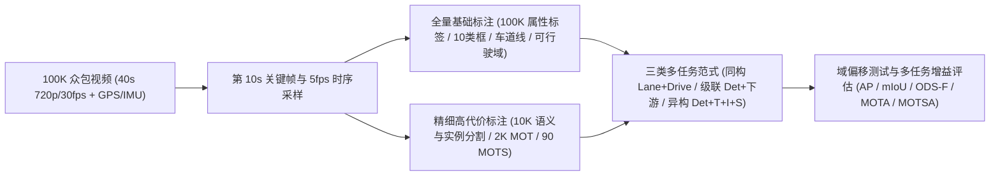

# BDD100K

**BDD100K: A Diverse Driving Dataset for Heterogeneous Multitask Learning** 收录于 [Awesome World-Action Models (RCL)](https://github.com/rcl-robotics/Awesome-World-Action-Models) **第 099/564** 篇，分组 **Datasets**。本页是 **清单索引**：给出它在清单中的位置与原文入口，方法细节和量化结果请看原文。

## 一句话定义

UC Berkeley 联合 Nexar 众包构建的大规模多样化自动驾驶视频与异构多任务学习基准（BDD100K, CVPR 2020）：汇集 **100,000 段 40 秒（720p/30fps + GPS/IMU）** 驾驶视频，涵盖图像标签、目标检测、车道线、可行驶区域、语义/实例分割、MOT、MOTS、域适应与模仿学习 **10 项任务**，并系统验证了同构、级联与异构多任务联合训练范式。

## 英文缩写速查

| 缩写 | 英文全称 | 简要说明 |
|------|----------|----------|
| MOT | Multiple Object Tracking | 多目标框级检测与跨帧身份关联跟踪 |
| MOTS | Multiple Object Tracking and Segmentation | 像素级多目标实例分割与跟踪 |
| ODS-F | Optimal Dataset Scale F-measure | 车道线轮廓检测使用的最优数据集尺度 F1 指标 |
| MOTA / MOTSA | Multi-Object Tracking (and Segmentation) Accuracy | 框级与分割级多目标跟踪综合准确率指标 |
| DLA | Deep Layer Aggregation | 本文车道线/可行驶区与多任务跟踪选用的骨干网络 |

## 为什么重要

- 针对既有驾驶数据集（KITTI、Cityscapes 等）地理与天气单一、且多数仅支持同构输出多任务学习的问题，BDD100K 凭借众包数据覆盖美国多城昼夜晴雨雪等复杂长尾场景，暴露出强烈的昼夜与跨区域域偏移。
- 构建了涵盖像素级、区域级与时序级输出结构的 **10 项异构任务**基准，量化回答了工程中关键的标注预算分配问题：**大量低成本基础标注（如 70K 目标框）如何有效提升高代价复杂任务（实例分割、MOT、MOTS）**。
- 可顺着 [Awesome World-Action Models](paper-rcl-wam-robot-learning-control-survey.md)、[RCL Awesome WAM 技术地图](../overview/rcl-awesome-wam-technology-map.md) 与站内 [World Action Models（WAM）](../concepts/world-action-models.md) 对照学习。

## 核心信息

| 字段 | 内容 |
|------|------|
| 编号 | 099/564 |
| 分组 | Datasets |
| 出处 | CVPR 2020 (pp. 2636–2645) |
| 作者与机构 | Fisher Yu, Haofeng Chen, Xin Wang, Trevor Darrell et al. (UC Berkeley / Cornell / UCSD) |
| 论文 | <https://openaccess.thecvf.com/content_CVPR_2020/html/Yu_BDD100K_A_Diverse_Driving_Dataset_for_Heterogeneous_Multitask_Learning_CVPR_2020_paper.html> |
| 数据主页 | <https://bdd-data.berkeley.edu> |
| 子类 / 象限 | 自动驾驶感知数据 · 多任务视觉标注 · 基准与评测协议 · 异构多任务学习 |

## 核心机制（归纳）

> 注：以下内容基于通读 CVPR 2020 开放获取原文全文核对补充。

### 1. 众包视频底座与 10 任务分层标注

1. **原始采集与划分**：通过 Nexar 众包自超过 5 万次真实驾驶行程中收集 **100,000 段 40 秒 720p/30fps 视频**（纽约、旧金山湾区等美国人口密集区），配齐 GPS/IMU 轨迹，按 `70K train / 10K val / 20K test` 划分；取第 10 秒帧作为图像任务关键帧。约半数视频为夜间场景，覆盖 6 种天气、6 类道路环境与 3 类时段。
2. **图像与区域级基础标注（全量 100K 关键帧）**：
   - **Image Tagging & Object Detection**：10 类道路目标 2D 框（含遮挡与截断属性；约半数实例存在遮挡、约 7% 存在截断，类别呈显著长尾分布，如 Car 超 102 万例而 Train 仅 179 例）。
   - **Lane Marking & Drivable Area**：8 主类车道线（含实/虚线连续性与平行/垂直方向属性），以及区分当前优先通行区（directly drivable）与可换道通行区（alternatively drivable）的两类可行驶区域。
3. **像素与时序级高代价标注**：
   - **Semantic & Instance Segmentation**：随机抽样 **10,000 帧**（`7K/1K/2K`），标注 40 类像素级语义与可数实例掩码。
   - **MOT（2,000 段视频，5 fps 约 400K 帧）**：`1,400 train / 200 val / 400 test`，训练+验证集共 `318K` 帧、`130.6K` 轨迹 ID 与 `3.3M` 框；共包含 `49,418` 次遮挡事件（平均每 `3.51` 条轨迹即发生 1 次再出现遮挡）。
   - **MOTS（90 段视频，5 fps）**：`60 train / 10 val / 20 test`，训练+验证集 `14K` 帧含 `6.3K` 轨迹 ID 与 `129K` 实例掩码（平均每帧 `9.20` 个实例），规模显著大于 KITTI MOTS（21 视频 / 8K 帧）。
   - **Domain Adaptation & Imitation Learning**：基于昼夜/城郊子集划分与 GPS/IMU 动作轨迹监督。

### 2. 三种多任务学习范式设计

- **同构多任务（Homogeneous）**：共享 `DLA-34` 骨干，同时输出结构相近的道路分割掩码（Drivable Area mIoU）与车道线轮廓图（3 属性头加权交叉熵 + 形态学细化，ODS-F）。
- **级联多任务（Cascaded）**：采用 batch 级轮询（round-robin）采样，以 `70K` 廉价目标检测框分别联合 `7K` 实例分割（Mask R-CNN R50）、`1,400` 视频 MOT（Faster R-CNN + DLA-34）及 `7K` 语义分割。
- **异构四任务联合（Heterogeneous）**：在稀疏标注的 `MOTS (12K 训)` 上先后借助上游 `InstSeg (I)`、`MOT (T)` 预训练，并最终联合 `Det + T + I + S` 四项异构任务微调，实现特征复用与标注成本分摊。

### 方法流程图

## 评测与指标

- **域差异量化（Table 4, Faster R-CNN R50 COCO AP）**：在相同 `30K` 训练量下，白天训→白天测 `30.6`、→非白天测跌至 **`23.6`**；城市训→城市测 `29.5`、→非城市测跌至 **`26.5`**。此外在德国 Cityscapes 训练的 DRN 分割模型迁移到 BDD100K 时因基础设施差异严重误判天空与交通标志（Fig. 9）。
- **同构多任务收益递减（Table 5, DLA-34）**：在 `10K` 数据量下，Lane+Drive 联合使 Lane 平均 ODS-F（$\tau=10$）由 `45.41%` 升至 **`50.40%`**（Drivable IoU `64.23% -> 64.37%`）；但扩至 `20K` 与 `70K` 后联合训练优势消失（70K Lane 单任务 `54.48%` vs 联合 `54.24%`；Drivable `71.37%` vs `72.21%`）。
- **级联多任务显著增益（Tables 6–8）**：
  - `Inst-Seg + Det (70K)`（Mask R-CNN R50）：实例分割 `AP` 由 `21.8` 升至 **`24.5`**（`AP50: 40.5 -> 45.4`）。
  - `MOT + Det (70K)`（Faster R-CNN + DLA-34）：检测 `AP` 由 `28.1` 升至 **`30.7`**，`MOTA` 由 `55.0` 升至 **`56.7`**（`MOTP: 84.0 -> 84.1`，`IDS: 8386 -> 9098`）。
  - `Sem-Seg + Det (70K)`：全类 `mIoU` 由 `56.9` 升至 **`58.3`**；相反若联合 `Lane + Drivable`，Road/Sidewalk 提升但整体 `mIoU` 降至 `53.3`。
- **异构四任务联合（Table 9, MOTS）**：单任务 `MOTS (S)` 仅得 `AP = 13.0, MOTSA = 30.4`；联合 `InstSeg (I)` 升至 `AP = 18.7, MOTSA = 33.7`；联合 `MOT (T)` 使 `IDSW` 降至 `390`、`MOTSA = 40.3`；**`Det + T + I + S` 四任务联合微调**取得最优 **`AP = 23.3`、`MOTSA = 41.4`**（`MOTSP = 81.6`、`IDSW = 472`）。

## 与其他工作对比

- 相较于 **Cityscapes / KITTI** 等小规模地域集中数据集，BDD100K 提供了美国多城大规模视频与昼夜全覆盖样本，更能检验跨城与昼夜域适应能力。
- 相较于 **Waymo Open Dataset**（1,150 序列、230K 帧、含 2D/3D LiDAR），BDD100K 拥有更多跟踪序列（2,000 视频、398K 帧）与 10 项视觉异构任务，但缺乏 LiDAR 与 3D 框标注。
- 在 **MOTS** 任务上，BDD100K MOTS（70 训+验视频 / 14K 帧 / 129K 掩码）标注密度（9.20/帧）与规模大幅超过 KITTI MOTS（21 视频 / 8K 帧 / 38K 掩码）。

## 结论

**BDD100K 通过“100K 众包多样化驾驶视频 + 10 项阶梯式异构任务标注”，证明了在现实标注预算受限时，大规模低成本检测框与跟踪标注能够显著撬动高代价实例分割及分割跟踪（MOTS）的性能跃升。**

1. **标注预算分配指导**：在同构任务（Lane+Drivable）数据量充足（≥20K）时联合收益趋零；应将标注预算向检测框倾斜，通过级联或四任务联合（`Det+T+I+S` 将 MOTSA 从 `30.4` 推至 `41.4`）反哺昂贵像素跟踪任务。
2. **警惕异构负迁移**：语义分割联合车道线/可行驶区会导致总 `mIoU` 从 `56.9` 跌至 `53.3`，多任务并非无条件互补，需匹配任务结构与损失平衡。
3. **昼夜域偏移显著**：`30K` 训练下的 Faster R-CNN 跨昼夜掉点达 `7.0 AP`，是研究无监督域适应的天然测试床。
4. **适用范围边界**：仅含单目 720p RGB 视频与 GPS/IMU，3D 感知与点云融合任务需结合 Waymo、nuScenes 或 ZOD。

## 常见误区

1. **误以为 BDD100K 包含 3D 激光雷达数据**：该数据集仅由众包行车记录仪单目 720p 视频与 GPS/IMU 组成，不含 LiDAR 点云与 3D 边界框。
2. **忽略类别极度长尾与天气不均**：检测类中 `Car` 超百万例而 `Train` 仅 179 例；`foggy` 等罕见天气样本极少（Fig. 4 中 DLA-34 雾天分类准确率为 `0.0%`），训练时需做重采样或损失加权。
3. **将 100K 视频误当作全帧标注**：全量 100K 视频仅第 10 秒单帧有检测/车道/可行驶域标注，时序密集标注集中在 2,000 段 MOT（5 fps）与 90 段 MOTS（5 fps）子集中。

## 关联页面

- 列表实体：[Awesome World-Action Models（RCL）](paper-rcl-wam-robot-learning-control-survey.md)
- 技术地图：[RCL Awesome WAM 技术地图](../overview/rcl-awesome-wam-technology-map.md)
- 方法/任务：[generative-world-models.md](../methods/generative-world-models.md)、[manipulation.md](../tasks/manipulation.md)

## 参考来源

- [`sources/papers/rcl_awesome_wam_ref_663c359ac9bfe090d027_bdd100k-a-diverse-driving-dataset-for-he.md`](../../sources/papers/rcl_awesome_wam_ref_663c359ac9bfe090d027_bdd100k-a-diverse-driving-dataset-for-he.md) — 本条目策展摘录
- [`sources/papers/rcl_awesome_wam_catalog.md`](../../sources/papers/rcl_awesome_wam_catalog.md) — 列表总表
- [`sources/repos/awesome-world-action-models-rcl.md`](../../sources/repos/awesome-world-action-models-rcl.md)
- [`docs/PAPERS.md`](https://github.com/RCL-Robotics/Awesome-World-Action-Models/blob/main/docs/PAPERS.md) — 上游论文目录
- 论文：<https://openaccess.thecvf.com/content_CVPR_2020/html/Yu_BDD100K_A_Diverse_Driving_Dataset_for_Heterogeneous_Multitask_Learning_CVPR_2020_paper.html>

## 推荐继续阅读

- [Awesome World-Action Models (RCL) 仓库](https://github.com/rcl-robotics/Awesome-World-Action-Models)
- [原文](https://openaccess.thecvf.com/content_CVPR_2020/html/Yu_BDD100K_A_Diverse_Driving_Dataset_for_Heterogeneous_Multitask_Learning_CVPR_2020_paper.html)
