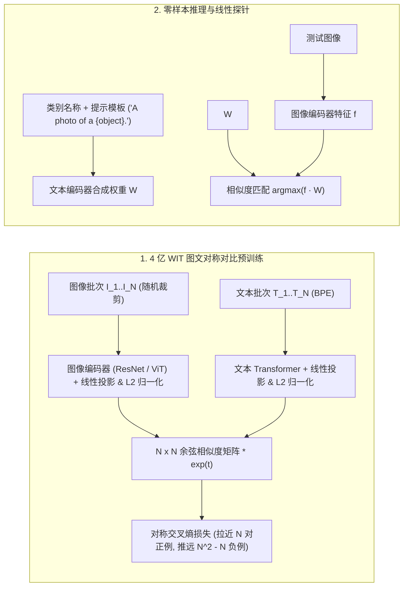

# Learning Transferable Visual Models From Natural Language Supervision

**Learning Transferable Visual Models From Natural Language Supervision**（Radford 等，OpenAI，ICML 2021，即 **CLIP**）收录于 [Awesome World-Action Models (RCL)](https://github.com/rcl-robotics/Awesome-World-Action-Models) **第 078/564** 篇，分组 **Components of WAMs**。本文验证了用互联网级自然语言监督从零训练通用视觉表征的可行性，并奠定了后续多模态基础模型与 VLA 视觉编码器的标准范式。

## 一句话定义

提出 **CLIP**（Contrastive Language-Image Pre-training），在互联网收集的 **4 亿**组（图像, 文本）对 **WIT** 上通过批内对称对比交叉熵损失从零联合预训练图像与文本编码器，借助自然语言提示直接合成零样本分类器，实现在 0 标注样本下匹配 ImageNet 全监督 ResNet50 精度并大幅提升自然分布偏移鲁棒性。

## 英文缩写速查

| 缩写 | 英文全称 | 简要说明 |
|------|----------|----------|
| CLIP | Contrastive Language-Image Pre-training | 对比语言–图像预训练模型 |
| WIT | WebImageText | 本文构建的 4 亿对互联网（图像, 文本）预训练数据集 |
| ViT | Vision Transformer | 基于图像块序列的视觉 Transformer 编码器 |
| BPE | Byte Pair Encoding | 文本编码器采用的字节对子词编码 |
| VLA | Vision-Language-Action | 视觉–语言–动作策略（常以 CLIP 作为视觉主干之一） |

## 为什么重要

- **突破封闭类别监督瓶颈**：传统视觉预训练受限于固定类别词表（如 ImageNet 1000 类），新增任何概念都需重新标注训练；自然语言监督使开放词表识别、OCR、动作理解与地理定位等能力在单一预训练模型中自然涌现。
- **确立「对比目标 > 生成字幕」的效率法则**：相比逐词预测图像字幕（类似 VirTex），仅预测图像与整句文本在批内的匹配关系（对比学习）将零样本迁移学习效率提升高达 **12×**。
- **重塑分布外鲁棒性前沿**：不针对特定目标数据集微调的零样本 CLIP，摆脱了对单一数据集伪相关特征的过拟合，在 **7 个自然分布偏移基准**上将相对准确率落差缩减最高达 **75%**——这一特性使其成为机器人 Sim2Real 视觉感知与 [VLA](../methods/vla.md) 的关键组件。

## 核心信息

| 字段 | 内容 |
|------|------|
| 编号 | 078/564 |
| 分组 | Components of WAMs |
| 出处 | ICML 2021（PMLR 139） |
| 作者 | Alec Radford*, Jong Wook Kim*, Chris Hallacy, Aditya Ramesh 等（OpenAI） |
| 论文 | <https://proceedings.mlr.press/v139/radford21a.html> |
| 代码仓库 | <https://github.com/OpenAI/CLIP>（含预训练权重） |
| 子类 / 象限 | 视觉编码器与表征 · 语言与VLM Backbone |

## 核心机制（归纳）

### 1. WIT 数据构建与高效对称对比目标

- **WIT（WebImageText）数据集**：围绕 **500,000** 条查询词（维基高频词、PMI 二元组、维基词条与 WordNet 同义词集）从公开网页采集 **4 亿**（图像, 文本）对，每条查询上限 **20,000** 对以维持概念平衡，总词数与 GPT-2 的 WebText 相当。
- **为什么选择对比学习（Section 2.2）**：从零训练 63M Transformer 生成图像精确字幕效率极低——词袋预测比生成字幕快 **3×**，而将目标进一步简化为对比匹配哪个句子对应哪张图后效率再提升 **4×**（总计 **12×**）。
- **批内对称交叉熵损失**：给定一批 $N$ 个配对样本，图像编码器与文本编码器分别提取特征后经**纯线性投影**（移除非线性投影头，且仅用随机方形裁剪作图像增强）并 $L_2$ 归一化得到 $I_e, T_e \in \mathbb{R}^{N\times d_e}$，计算带可学习对数温度标量 $\exp(t)$ 的余弦相似度矩阵 $\text{logits} = (I_e T_e^\top)\cdot e^t$，对行（图像检索文本）与列（文本检索图像）分别计算对角线交叉熵损失并取平均。

### 2. 双塔模型族与零样本推理流程

- **图像编码器（5 个 ResNet + 3 个 ViT）**：
  - ResNet 系列（`RN50`、`RN101`、`RN50x4`、`RN50x16`、`RN50x64`）：引入 ResNet-D 改进、抗锯齿 blur pooling，并用单层 Transformer 风格多头 QKV 注意力池化取代全局平均池化；按 EfficientNet 原则将额外算力均分至宽度、深度与分辨率。
  - ViT 系列（`ViT-B/32`、`ViT-B/16`、`ViT-L/14` 及高分辨率微调 1 epoch 的旗舰模型 `ViT-L/14@336px`）：在 patch+position embedding 后额外加入一层 LayerNorm。
- **文本编码器**：12 层、512 宽、8 头的因果掩码 Transformer（随 ResNet 缩放时仅按比例增加宽度、不加深层数），以 `[SOS]`/`[EOS]` 包裹小写 BPE 序列，取 `[EOS]` 处最高层激活经 LayerNorm 与线性投影进入共享多模态空间。
- **零样本分类器合成**：测试时将目标数据集的所有类别名称嵌入提示模板（如 `"A photo of a {object}."`）或集成多组模板，经文本编码器一次性编码即为线性分类器权重，直接与图像特征计算点积输出预测。

### 方法流程图

## 工程实践

- **算力与骨干选型**：在 27 个数据集线性探针评测中，**CLIP-ViT 的计算效率约为 CLIP-ResNet 的 3×**；完整预训练规模极大（`RN50x64` 耗时 592 张 V100 训练 18 天，`ViT-L/14` 耗时 256 张 V100 训练 12 天），实际下游应用应直接复用官方预训练权重作为冻结或微调视觉骨干。
- **提示工程（Prompt Engineering）与模板集成**：直接输入裸类名易产生多义性（如 `"boxer"` 指拳击手还是犬种），补全上下文模板（如 `"A photo of a {label}, a type of pet."`）并对多组提示向量求平均可稳定提升零样本准确率，同时在公平性实验中显著影响误判率。
- **机器人与具身感知落点**：CLIP 对**动词/动作（Kinetics700、UCF101）与自然场景鲁棒性**优势明显，但在**精确计数（CLEVRCounts）与深度/距离估计（KITTI Distance）**上很弱——因此在 VLA 或机械臂策略中，CLIP 特征常需与空间几何特征或动作头联合微调，不能直接替代几何度量模块。

## 评测与指标

本文所有 CLIP 主结果若无特别说明均基于 **`ViT-L/14@336px`**：

| 评测维度与基准 | 关键对比结果（原文数值） |
|----------------|--------------------------|
| **零样本 vs Visual N-Grams（Table 1）** | ImageNet：**76.2%**（vs Visual N-Grams 11.5%，Top-5 达 **95%** 匹配 Inception-V4）；SUN：**58.5%**（vs 23.0%）；aYahoo：**98.4%**（vs 72.4%）。零样本直接匹配全监督 ResNet50（无需 128 万训练样本） |
| **27 数据集零样本 vs ResNet50 线性探针（Fig. 4）** | 在 **16/27** 个数据集胜出：STL10 零样本达 **99.3%**；StanfordCars **+28.9%**；Country211 **+23.2%**；Food101 **+22.5%**；Kinetics700 **+14.5%**；UCF101 **+7.7%**。明显落后的专精/抽象任务：EuroSAT **-37.1%**、KITTI Distance **-34.0%**、PatchCamelyon **-19.5%**、GTSRB **-18.4%**、CLEVRCounts **-18.2%** |
| **少样本对比（Fig. 5，20 数据集）** | 零样本 CLIP 平均性能等同于同特征空间上的 **4-shot** 线性探针，且接近当时公开最佳模型（ImageNet-21K 预训练 **BiT-M ResNet152x2**）的 **16-shot** 线性探针 |
| **表征学习线性探针（Fig. 6）** | `ViT-L/14@336px` 超越包含 Noisy Student EfficientNet-L2 在内的既有最优基线：在 Kornblith 12 数据集上平均 **+2.6%**，在 27 广泛数据集上平均 **+5%** |
| **自然分布偏移鲁棒性（Fig. 7，7 数据集）** | 相对 204 个既有 ImageNet 模型将分布偏移落差最高缩减 **75%**。与 ImageNet 同为 **76.2%** 的 ResNet101 相比：ImageNetV2 **70.1%**（+5.8%）、ImageNet-R **88.9%**（+51.2%）、ObjectNet **72.3%**（+39.7%）、ImageNet Sketch **60.2%**（+35.0%）、ImageNet-A **77.1%**（+74.4%） |
| **数据重叠分析（Section 4）** | 35 个评测集检测中位数重叠仅 **2.2%**、均值 **3.2%**（9 个数据集 0 重叠），多数准确率影响 <0.1%（最大 Birdsnap +0.6%） |
| **社会偏见与隐私风险（Section 5）** | FairFace 混入 `"criminal"`/`"animal"` 等词时，0–20 岁人群被归入恶意类别比例达 **32.3%**，加入 `"child"` 标签后降至 **8.7%**；CelebA 零样本名人识别 Top-1 在 100 选 1 达 **59.2%**、1000 选 1 达 **43.3%** |

## 与其他工作对比

- **对比弱监督图文先驱（Visual N-Grams / VirTex / ICMLM / ConVIRT）**：VirTex 等工作验证了语言监督的潜力但仅在十万级数据上训练；CLIP 简化了 ConVIRT（去除了非线性投影头与复杂文本变换）并将其扩展至 **4 亿**样本，首次在标准 ImageNet 规模上与强监督模型分庭抗礼。
- **对比 ImageNet 预训练/自监督模型（BiT / SimCLRv2 / EfficientNet-NoisyStudent）**：ImageNet 监督特征在与之分布接近的物体识别上依然强劲，但缺乏对动词、OCR 及宽分布自然偏移的泛化能力；CLIP 的多模态嵌入使单个模型同时覆盖多类下游领域。
- **站内对照**：可结合 [VLA 方法页](../methods/vla.md) 与 [RCL Awesome WAM 技术地图](../overview/rcl-awesome-wam-technology-map.md)，追踪 CLIP 如何作为视觉–语言语义对齐底座接入机器人操作策略与世界模型。

## 结论

**CLIP 证明了在 4 亿级互联网图文对上使用简单对称对比目标即可学得兼具强零样本迁移力与高自然分布鲁棒性的视觉表征，为后续多模态大模型与具身 VLA 架构奠定了基础。**

- **将 CLIP 定位为强零样本骨干而非全能感知器**：零样本 CLIP 平均仅相当于 ResNet50 线性探针水平（作者估算达到全基准当时 SOTA 需再扩大约 **1000×** 算力），精细空间/计数/专精域任务仍需微调或叠加专用编码器。
- **优先选择 ViT 变体作为视觉主干**：在同等前向计算量（GFLOPs）下，CLIP-ViT 比 CLIP-ResNet 具备约 **3×** 更高的表征迁移效率。
- **部署零样本分类时务必设计并审查类别词表与提示模板**：提示词与候选类别集合（如缺少 `"child"`）会同时剧烈左右准确率与社会偏见输出。
- **少样本场景慎用冻结线性探针覆盖零样本语义**：直接拟合 1-shot/2-shot 线性分类器会出现性能反而低于零样本的反直觉下降，需要更合理的文本–图像融合微调策略。

## 常见误区与局限

1. **误区：零样本 CLIP 在所有视觉基准上都接近顶尖监督模型**。论文第 6 节明确指出，零样本 CLIP 在 27 个数据集上平均只与「ResNet50 特征 + 线性分类器」相当，且在卫星遥感（EuroSAT）、医学病理（PatchCamelyon）、合成计数（CLEVRCounts）、驾驶距离估计（KITTI）与交通标志（GTSRB）上大幅落后。
2. **误区：从零样本平滑增加到 1-shot/2-shot 线性微调一定带来收益**。由于 CLIP 的零样本分类器直接通过自然语言「传达」概念边界，而 1-shot 图像特征存在多义歧义，切换到线性探针时准确率反而会出现先降后升的反常现象。
3. **验证集泄露与基准共适应局限**：论文承认在开发过程中反复查询了 27 个评测集上的验证性能以调优提示词与结构，与严格意义上的盲测零样本存在差异，且评测集本身与 CLIP 能力存在共适应。
4. **隐私与社会偏见风险**：模型直接继承互联网文本中的刻板印象与身份关联，且无需专用训练数据即可实现中等精度的「野生环境」人物/属性识别，部署前需做严格类别审计与安全过滤。

## 关联页面

- 列表实体：[Awesome World-Action Models（RCL）](paper-rcl-wam-robot-learning-control-survey.md)
- 技术地图：[RCL Awesome WAM 技术地图](../overview/rcl-awesome-wam-technology-map.md)
- 相关基础模型：[GPT-4 Technical Report](paper-as-2303-08774-gpt-4-technical-report.md)
- 方法/任务：[generative-world-models.md](../methods/generative-world-models.md)、[vla.md](../methods/vla.md)、[manipulation.md](../tasks/manipulation.md)、[locomotion.md](../tasks/locomotion.md)

## 参考来源

- [`sources/papers/rcl_awesome_wam_ref_6f620ba80d9567d982a6_learning-transferable-visual-models-from.md`](../../sources/papers/rcl_awesome_wam_ref_6f620ba80d9567d982a6_learning-transferable-visual-models-from.md) — 本条目策展摘录
- [`sources/papers/rcl_awesome_wam_catalog.md`](../../sources/papers/rcl_awesome_wam_catalog.md) — 列表总表
- [`sources/repos/awesome-world-action-models-rcl.md`](../../sources/repos/awesome-world-action-models-rcl.md)
- [`docs/PAPERS.md`](https://github.com/RCL-Robotics/Awesome-World-Action-Models/blob/main/docs/PAPERS.md) — 上游论文目录
- 论文：<https://proceedings.mlr.press/v139/radford21a.html>

## 推荐继续阅读

- [CLIP 官方开源代码与模型权重](https://github.com/OpenAI/CLIP)
- [Awesome World-Action Models (RCL) 仓库](https://github.com/rcl-robotics/Awesome-World-Action-Models)
- [原文（ICML 2021 / PMLR 139）](https://proceedings.mlr.press/v139/radford21a.html)
