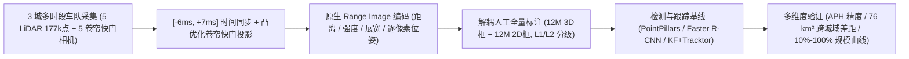

# Scalability in Perception for Autonomous Driving

**Scalability in Perception for Autonomous Driving: Waymo Open Dataset** 收录于 [Awesome World-Action Models (RCL)](https://github.com/rcl-robotics/Awesome-World-Action-Models) **第 122/564** 篇，分组 **Datasets**。本页是 **清单索引**：给出它在清单中的位置与原文入口，方法细节和量化结果请看原文。

## 一句话定义

Waymo 发布的大规模多城市多传感器自动驾驶感知数据集与评测基准（Waymo Open Dataset, CVPR 2020）：包含 **1,150 段 20 秒（10 Hz）** 场景、**230K 标注帧**与各约 **1,200 万个**解耦的 3D LiDAR 框和 2D 相机框，覆盖旧金山、凤凰城、山景城 **76 km²** 地理区域，首次以原生 **Range Image（距离图像）**释放 LiDAR 数据并提出航向加权指标 **APH**。

## 英文缩写速查

| 缩写 | 英文全称 | 简要说明 |
|------|----------|----------|
| APH | Average Precision weighted by Heading | 在 AP 基础上按航向角预测精度加权的 3D 检测指标 |
| MOTA / MOTP | Multi-Object Tracking Accuracy / Precision | CLEAR MOT 多目标跟踪准确度与定位精密度指标 |
| HFOV / VFOV | Horizontal / Vertical Field of View | 传感器水平与垂直视场角 |
| BEV | Bird's Eye View | 鸟瞰图视角（PointPillars 等检测基线与 5-DOF 框评测视角） |
| SF / SUB | San Francisco / Suburban (Phoenix + Mountain View) | 论文跨域泛化实验中划分的城市与郊区两个地理域 |

## 为什么重要

- 将当时公开相机+LiDAR 数据集的地理覆盖面积提升至 nuScenes（`5 km²`）的 **15.2×**（**76 km²**），并专门划出地理隔离的 150 段测试集，直接量化了跨城市（旧金山 vs. 凤凰城/山景城）显著的 3D 感知域差距与数据规模扩展收益。
- 首次大规模以**原生 Range Image** 形式（而非仅无序点云）发布双回波 LiDAR 物理量（含 `elongation` 脉冲展宽与逐像素精确车体位姿），并配套 **[-6 ms, +7 ms]** 同步精度与卷帘快门时间补偿投影库，打通点云、距离图与多视角图像融合研究。
- 可顺着 [Awesome World-Action Models](paper-rcl-wam-robot-learning-control-survey.md)、[RCL Awesome WAM 技术地图](../overview/rcl-awesome-wam-technology-map.md) 与站内 [World Action Models（WAM）](../concepts/world-action-models.md) 页面横向对照。

## 核心信息

| 字段 | 内容 |
|------|------|
| 编号 | 122/564 |
| 分组 | Datasets |
| 出处 | CVPR 2020 (pp. 2446–2454) |
| 作者与机构 | Pei Sun, Henrik Kretzschmar, Dragomir Anguelov et al. (Waymo LLC & Google LLC) |
| 论文 | <https://openaccess.thecvf.com/content_CVPR_2020/html/Sun_Scalability_in_Perception_for_Autonomous_Driving_Waymo_Open_Dataset_CVPR_2020_paper.html> |
| 数据主页 | <http://www.waymo.com/open> |
| 子类 / 象限 | 自动驾驶感知数据 · 多传感器与空间标注 · 基准与评测协议 · 跨域与规模扩展 |

## 核心机制（归纳）

> 注：以下内容基于通读 CVPR 2020 开放获取原文全文核对补充。

### 1. 传感器套件、Range Image 与卷帘快门标定

1. **5 LiDAR + 5 Camera 同步布局**：
   - **LiDAR 阵列（10 Hz，保留前 2 个回波，平均 177k 点/帧）**：1 颗车顶中距传感器（范围限制 `75 m`，VFOV `[-17.6°, +2.4°]`）+ 4 颗车周短距传感器（前/后/左/右，范围 `20 m`，VFOV `[-90°, +30°]`）。
   - **相机阵列**：前/前左/前右（`1920×1280`）与侧左/侧右（`1920×1040`）5 颗卷帘快门（rolling shutter）相机，单颗 HFOV `±25.2°`。相机中心曝光与 LiDAR 同步误差在 `[-6 ms, +7 ms]` 区间（`99.7%` 置信度）。
2. **原生 Range Image 编码**：按俯仰角（行）与方位角（列）组织扫描回波，每个像素携带 `range`、`intensity`、`elongation`（激光脉冲展宽，结合低强度可用于剔除雨雾扬尘伪回波）、`no-label zone` 掩码及采集时刻的精确车体 4×4 位姿；同时通过 2–3 次单变量凸二次优化求解卷帘快门捕捉时刻 $t$，实现高精度 LiDAR-to-Camera 投影。

### 2. 解耦全量标注、难度分级与 APH 指标

- **全量多模态标注（798 train / 202 val / 150 geographical holdout test，总计 6.4 h / 230k 帧）**：
  - **LiDAR 75 m 半径 7-DOF 3D 框**：共约 **1,200 万个**（Vehicle `6.1M`、Sign `3.2M`、Pedestrian `2.8M`、Cyclist `67k`），含 **113k** 独立 3D 轨迹 ID（Vehicle `60k`、Pedestrian `23k`、Sign `23k`、Cyclist `620`）。
  - **相机 4-DOF 2D 紧致框**：独立全量标注约 **1,200 万个**（Vehicle `9.0M`、Pedestrian `2.7M`、Cyclist `81k`），含 **254k** 独立 2D 轨迹 ID。
  - **难度分级**：`LEVEL 2` 为累计全集（含人工标难样本及 LiDAR 点数 `≤ 5` 的稀疏目标），`LEVEL 1` 剔除上述困难样本。
- **航向加权精度 APH**：在 P/R 曲线匈牙利匹配后，将每个真阳性样本乘以航向精度权重 $\min(|\tilde{\theta}-\theta|, 2\pi-|\tilde{\theta}-\theta|)/\pi$，并在召回率间隔超过 `0.05` 时插入保守零精度点以防稀疏采样高估 AP。

### 方法流程图

## 评测与指标

- **3D 目标检测基线（Table 6, PointPillars 单帧全雷达，150 场景隐藏测试集，IoU: Veh 0.7 / Ped 0.5，格式 `LEVEL 1 / LEVEL 2`）**：
  - `Vehicle 3D`：Overall `AP = 63.3 / 55.6`、**`APH = 62.8 / 55.1`**（分距 APH：`0–30m` `81.9/80.8`、`30–50m` `58.5/52.3`、`50m+` `34.9/26.7`）；BEV Overall `AP = 80.1 / 71.9`、`APH = 79.1 / 71.0`。
  - `Pedestrian 3D`：Overall `AP = 62.1 / 55.9`、**`APH = 50.2 / 45.1`**（行人航向误差显著拉低 APH）；BEV Overall `AP = 70.0 / 63.8`、`APH = 56.1 / 51.1`。
- **2D 图像检测与跟踪基线（Sec 5.1–5.2）**：
  - `2D 检测`（Faster R-CNN ResNet-101，COCO 预训练微调）：Vehicle `AP = 63.7 (L1) / 53.3 (L2)`；Pedestrian `AP = 55.8 (L1) / 52.7 (L2)`。
  - `3D 跟踪`（Table 7, PointPillars + 匈牙利匹配 + 10 维卡尔曼滤波）：Vehicle `MOTA = 42.5 / 40.1`、`MOTP = 18.6 / 18.6`（`0–30m` `70.6/69.9`、`50m+` `12.5/11.2`）；Pedestrian `MOTA = 38.9 / 37.7`、`MOTP = 34.0 / 34.0`。
  - `2D 跟踪`（Tracktor）：Vehicle `MOTA = 34.8 (L1) / 28.3 (L2)`。
- **跨城市域差距（Table 9, 验证集 LEVEL 2 APH）**：
  - 车辆在 `SUB`（MTV+PHX）测：`SUB→SUB` **`44.0`** vs `SF→SUB` **`36.7`**（`ALL→SUB 45.3`）；在 `SF` 测：`SF→SF` **`49.2`** vs `SUB→SF` **`42.5`**（`ALL→SF 50.3`）。
  - 行人在 `SF` 测：`SF→SF` **`47.6`** vs `SUB→SF` **`29.7`**（暴跌近 `18` 点；且 `ALL→SF` 仅为 `46.0` 反略低于单域 SF），原因是 SUB 训练行人样本极稀疏（`210K` vs SF `2.0M`）。
- **数据规模扩展规律（Table 10, 验证集 LEVEL 2 `AP / APH`，无数据增强）**：随训练集占比从 `10% → 30% → 50% → 100%` 增加，Vehicle 从 `29.7/28.9 → 41.4/41.0 → 46.3/45.8 → 49.8/49.4`，Pedestrian 从 `39.5/27.7 → 45.7/35.7 → 50.3/40.4 → 53.0/43.0` 持续单调提升。

## 与其他工作对比

- 相较于 **KITTI / nuScenes / Argoverse v1**（表 1 对比口径）：Waymo Open 在 3D 标注总量（`12M` vs nuScenes `1.4M`、Argoverse Tracking `993k`）、LiDAR 点密度（`177k` vs nuScenes `34k`、Argoverse `107k`）和地理覆盖面积（`76 km²` vs nuScenes `5 km²`、Argoverse `1.6 km²`）均形成数量级领先。
- 相较于 **Argoverse / nuScenes**，初版 Waymo Open（CVPR 2020）**未附带语义或矢量高清地图（HD Map）**（论文 Conclusion 中列为未来计划），且 LiDAR 范围截断至 `75 m`（后续 ZOD 与 Argoverse 2 将标注扩展到 `214–245 m`）。

## 结论

**Waymo Open Dataset 以 76 km² 三城覆盖、1,200 万 3D/2D 框、原生 Range Image 与 APH 指标确立了多模态 3D 感知与跨域泛化的工业级基准。**

1. **Range Image + 展宽特征实用价值高**：提供双回波与逐像素精确位姿，使研究者无需仅局限于无序点云体素化，可直接探索距离图卷积与雨雾噪点过滤。
2. **航向评测（APH）揭示行人朝向短板**：PointPillars 行人 `AP (62.1)` 与车辆 `AP (63.3)` 相近，但 `APH` 差距拉大至 `50.2 vs 62.8`，说明小尺寸对称目标的朝向回归仍是重要难点。
3. **跨城域迁移不可忽略**：旧金山与凤凰城/山景城之间存在显著分布偏移（行人跨城掉点近 18 APH），简单合并数据集在数据分布倾斜时未必优于单域训练（`ALL→SF 46.0 vs SF→SF 47.6`）。
4. **规模红利未见顶**：从 10% 增至 100% 数据集时性能持续上升且无需额外增强，为数据驱动型 3D 检测器提供了明确增益预期。

## 常见误区

1. **误把 2D 框与 3D 框当成一对一关联**：Waymo 的 2D 图像框与 3D LiDAR 框是**独立人工标注**且拥有各自独立的跟踪 ID；若需 3D 到 2D 的非模态（amodal）投影框，必须调用官方卷帘快门投影库生成。
2. **忽略初版无高精地图与 75 m 截断限制**：CVPR 2020 初版不含地图拓扑信息，且 LiDAR 仅保留 75 m 半径内数据（后续版本才逐步扩展运动预测与地图）。
3. **忽略卷帘快门时间补偿**：直接用刚体静态外参将 LiDAR 点投影到高速运动下的相机图像会产生明显重影错位，需使用随帧下发的卷帘快门时间参数补偿。

## 关联页面

- 列表实体：[Awesome World-Action Models（RCL）](paper-rcl-wam-robot-learning-control-survey.md)
- 技术地图：[RCL Awesome WAM 技术地图](../overview/rcl-awesome-wam-technology-map.md)
- 方法/任务：[generative-world-models.md](../methods/generative-world-models.md)、[manipulation.md](../tasks/manipulation.md)

## 参考来源

- [`sources/papers/rcl_awesome_wam_ref_7147250a035b50dba3eb_scalability-in-perception-for-autonomous.md`](../../sources/papers/rcl_awesome_wam_ref_7147250a035b50dba3eb_scalability-in-perception-for-autonomous.md) — 本条目策展摘录
- [`sources/papers/rcl_awesome_wam_catalog.md`](../../sources/papers/rcl_awesome_wam_catalog.md) — 列表总表
- [`sources/repos/awesome-world-action-models-rcl.md`](../../sources/repos/awesome-world-action-models-rcl.md)
- [`docs/PAPERS.md`](https://github.com/RCL-Robotics/Awesome-World-Action-Models/blob/main/docs/PAPERS.md) — 上游论文目录
- 论文：<https://openaccess.thecvf.com/content_CVPR_2020/html/Sun_Scalability_in_Perception_for_Autonomous_Driving_Waymo_Open_Dataset_CVPR_2020_paper.html>

## 推荐继续阅读

- [Awesome World-Action Models (RCL) 仓库](https://github.com/rcl-robotics/Awesome-World-Action-Models)
- [原文](https://openaccess.thecvf.com/content_CVPR_2020/html/Sun_Scalability_in_Perception_for_Autonomous_Driving_Waymo_Open_Dataset_CVPR_2020_paper.html)
