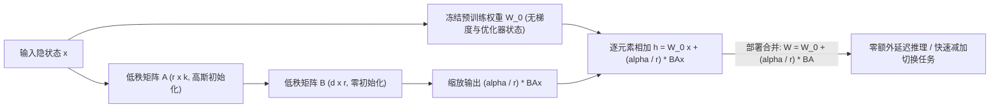

# LoRA

**LoRA: Low-Rank Adaptation of Large Language Models** 收录于 [Awesome World-Action Models (RCL)](https://github.com/rcl-robotics/Awesome-World-Action-Models) **第 163/564** 篇，分组 **Foundational work（训练优化与蒸馏）**。本页基于 ICLR 2022 原文全文（`arXiv:2106.09685v2`）完成结构化精读升级。

## 一句话定义

**LoRA（Low-Rank Adaptation）** 冻结预训练大模型原始权重 $W_0$，在 Transformer 自注意力层旁路注入可训练的低秩分解更新矩阵 $\Delta W = BA$（秩 $r \ll \min(d, k)$），在大幅削减可训练参数与训练显存的同时，通过权重合并实现**零额外推理延迟**。

## 英文缩写速查

| 缩写 | 英文全称 | 简要说明 |
|------|----------|----------|
| LoRA | Low-Rank Adaptation | 基于低秩矩阵分解的参数高效微调方法 |
| PEFT | Parameter-Efficient Fine-Tuning | 仅更新少量参数适配下游任务的微调范式 |
| SVD | Singular Value Decomposition | 奇异值分解，用于验证 $\Delta W$ 的低秩子空间特性 |
| VLA | Vision-Language-Action | 视觉–语言–动作策略（工程上广泛采用 LoRA 微调） |
| WAM | World Action Model | 世界预测与动作生成耦合模型 |

## 为什么重要

- **突破全量微调与既有高效微调的效率–延迟瓶颈**：全量微调 GPT-3 175B 需为每个任务存储 175B 参数与优化器状态；串行 Adapter 会增加推理深度（GPT-2 Medium 在 `BS=1, Seq=128` 下延迟增加 **20.7%–30.3%**，Table 1）；Prefix-Tuning 会占用可用序列长度并在超参变化时呈非单调性能退化。
- **以极低秩实现无损甚至超越全微调的下游效果**：验证了大模型下游适配权重增量 $\Delta W$ 具有极低「本征秩（intrinsic rank）」，即使在 $d_{\text{model}}=12,288$ 的 GPT-3 上，$r=1$ 或 $r=4$ 即可匹配或超过全量微调，同时支持多任务热切换与低成本微调 WAM / [VLA](../methods/vla.md) 策略主干。
- **跨分组与技术地图入口**：横向对照同一分组的训练优化工作，见 [RCL Awesome WAM 技术地图](../overview/rcl-awesome-wam-technology-map.md) 与 [Awesome World-Action Models](paper-rcl-wam-robot-learning-control-survey.md)。

## 核心信息

| 字段 | 内容 |
|------|------|
| 编号 | 163/564 |
| 分组 | Foundational work |
| 作者与机构 | Edward Hu*, Yelong Shen*, Phillip Wallis, Zeyuan Allen-Zhu, Yuanzhi Li, Shean Wang, Lu Wang, Weizhu Chen（Microsoft Corporation） |
| 出处 | ICLR 2022 · `arXiv:2106.09685v2` |
| 论文 | <https://openreview.net/forum?id=nZeVKeeFYf9> |
| 官方代码 | <https://github.com/microsoft/LoRA> |
| 子类 / 象限 | 训练优化与蒸馏 · 已开源（PyTorch 集成与 RoBERTa/DeBERTa/GPT-2 权重） |

## 核心机制（归纳）

> 注：以下机制与评测指标基于通读原文全文（ICLR 2022 / `arXiv:2106.09685v2`）核对补充。

### 1. 低秩参数化重参数与零延迟推理（§4.1）

- **低秩分解旁路**：对预训练权重矩阵 $W_0 \in \mathbb{R}^{d \times k}$，冻结 $W_0$ 梯度更新，将其适配增量约束为低秩分解 $\Delta W = B A$，其中 $B \in \mathbb{R}^{d \times r}$、$A \in \mathbb{R}^{r \times k}$，且 $r \ll \min(d, k)$。前向传播为：
  $$h = W_0 x + \Delta W x = W_0 x + \frac{\alpha}{r} B A x$$
- **初始化与缩放**：$A$ 采用随机高斯初始化 $\mathcal{N}(0, \sigma^2)$，$B$ 初始化为全零，确保训练起步时 $\Delta W = 0$；常数缩放因子 $\alpha / r$ 使得调整秩 $r$ 时无需重新精调学习率（实践常固定 $\alpha$ 为初始尝试的 $r$ 值）。
- **权重合并与任务热切换**：部署时直接预计算并存储 $W = W_0 + \frac{\alpha}{r}BA$，推理计算图与原模型完全一致（**零额外推理延迟**）；切换任务时只需减去当前 $BA$ 并加上另一任务的 $B'A'$，主干显存全任务共享。

### 2. Transformer 注入位置与资源收益（§4.2, §7.1–§7.3）

- **作用位置选择**：论文聚焦自注意力模块的投影矩阵（$W_q, W_k, W_v, W_o$），冻结 MLP、LayerNorm 与偏置。在 GPT-3 175B 上固定 18M 可训练参数预算（Table 5），同时适配 $\{W_q, W_v\}$（$r=4$）或 $\{W_q, W_k, W_v, W_o\}$（$r=2$）显著优于将全部预算集中到单一 $W_q$ 或 $W_k$（$r=8$）。
- **显存、存储与吞吐收益（§4.2）**：在 GPT-3 175B 上使用 Adam 训练，LoRA 将训练显存从 **1.2 TB** 降至 **350 GB**（减少约 2/3），$r=4$ 仅适配 $W_q, W_v$ 时单任务 Checkpoint 从 **350 GB** 缩小约 **10,000×** 至 **35 MB**，且训练吞吐从 **32.5** 提升至 **43.1 tokens/s/V100**（提速 **25%**）。
- **低秩子空间与特征放大机理（§7.2–§7.3）**：基于 Grassmann 距离的归一化子空间相似度 $\phi(A_{r=8}, A_{r=64}, i, j)$ 显示，不同秩与不同随机种子的最顶部奇异向量高度重合（top-1 相似度 > 0.5），解释了为何极小 $r$ 即可胜任；将 $W_q$ 投影到 $\Delta W_q$ 的奇异子空间（Table 7）发现，$\Delta W_q$ 并非重复 $W_q$ 的主方向，而是以约 **21.5×**（$6.91 / 0.32$，$r=4$）的放大倍数重点增强 $W_q$ 中原本未被突出的任务特定特征方向。

### 方法流程图

## 评测与指标

- **推理延迟对比（GPT-2 Medium，NVIDIA Quadro RTX8000，Table 1）**：
  - 在线小批场景（`BS=1, Seq=128`）：`Fine-Tune / LoRA` **19.8±2.7 ms**；`AdapterL` **23.9±2.1 ms（+20.7%）**；`AdapterH` **25.8±2.2 ms（+30.3%）**；大批量下（`BS=32, Seq=512`）Adapter 仍慢 +2.2%–3.0%。
- **NLU 基准 GLUE（RoBERTa / DeBERTa，Table 2）**：
  - `RoBERTa-base`：`LoRA (0.3M)` 平均 **87.2**，超越全微调 `FT (125M)` **86.4**、`BitFit (0.1M)` **85.2** 与 `AdptD (0.9M)` **85.4**。
  - `RoBERTa-large`：`LoRA (0.8M)` 平均 **89.0**（`FT 355M` **88.9**）；统一受限协议（†）下 `LoRA (0.8M)` **88.6** 优于 `AdptP (3M)` **88.4** 与 `AdptH (6M)` **87.8**。
  - `DeBERTa-XXL (1.5B)`：`LoRA (4.7M)` 平均 **91.3**，略超全微调 `FT (1500M)` **91.1**。
- **NLG 基准（GPT-2 M/L，Tables 3, 13, 14）**：
  - `E2E NLG`：`GPT-2 M (LoRA, 0.35M)` BLEU **70.4** / ROUGE-L **71.8** / CIDEr **2.53**（`FT 354.92M` 68.2 / 71.0 / 2.47；`PreLayer 0.35M` 69.7 / 71.4 / 2.49）；`GPT-2 L (LoRA, 0.77M)` BLEU **70.4** / ROUGE-L **72.0**（`FT 774M` 68.5 / 69.9）。
  - `DART` / `WebNLG`：在相当或更少可训练参数下，LoRA 在 GPT-2 M/L 上均取得最高或持平 BLEU（DART **47.1 / 47.5** vs FT **46.2 / 47.0**）。
- **GPT-3 175B 大规模与消融实验（Tables 4, 5, 6, 16）**：
  - **Table 4**：`LoRA (4.7M)` 在 WikiSQL **73.4%**、MNLI-m **91.7%**、SAMSum R1/R2/RL **53.8/29.8/45.9**；`LoRA (37.7M)` 达 WikiSQL **74.0%**、MNLI-m **91.6%**（全面超越 `FT 175B` 的 **73.8% / 89.5% / 52.0-28.0-44.5**、`AdapterH 40.1M` **73.2% / 91.5%** 及 `PreLayer 20.2M` **70.1% / 89.5%**）。
  - **矩阵与秩消融（Tables 5–6）**：18M 参数预算下，适配 $\{W_q, W_v\}$（$r=4$）获 **73.7 / 91.3**，适配 $\{W_q, W_k, W_v, W_o\}$（$r=2$）获 **73.7 / 91.7**，均显著高于单改 $W_q$（70.4 / 91.0）或 $W_k$（70.0 / 90.8）；在 $\{W_q, W_v\}$ 上甚至 **$r=1$** 即达 **73.4 / 91.3**。
  - **低数据区（MNLI-100，Table 16）**：LoRA 显著优于 PrefixEmbed（后者仅 37.6%，接近 33.3% 随机基线），并与 LoRA+PrefixEmbed 具备一定正交互补性（Appendix E）。

## 与其他工作对比

- 本页 **不做** 与具体基线的逐项数值对比；同分组的横向对照请回到 [技术地图](../overview/rcl-awesome-wam-technology-map.md) 的 **Foundational work** 分组逐条展开。
- 如果站内已经有这篇的深读页（含机构、实验表与源码运行时序图），请以那一页为准；本页基于原文补全核心机制与评测数字。
- 与清单内相邻条目孰优孰劣，本页不下结论：清单 Contribution 可能滞后于论文最新版本，差异应以各自原文的问题设定与评测口径为准。

## 结论

**LoRA 通过在冻结主干旁路注入可合并的低秩更新矩阵 $\Delta W = BA$，在 GPT-3 175B 等大模型上以万分之一的可训练参数（35 MB vs 350 GB）和 1/3 的训练显存达到或超越全量微调效果，且实现了真正的零额外推理延迟。**

- **工程默认配置建议**：优先将 LoRA 同时应用于多个注意力投影矩阵（如 $\{W_q, W_v\}$ 或 $\{W_q, W_k, W_v, W_o\}$）并取较小秩（$r=2 \sim 8$），相同参数预算下优于只给单个权重分配大秩；采用 $\alpha/r$ 缩放与 $B=0$ 初始化可减少调参成本。
- **推理合并与热切换**：单任务服务直接将 $\frac{\alpha}{r}BA$ 合并回 $W_0$ 以消除延迟；多任务共享底座时可通过 $W_0 \pm BA$ 快速切换权重。
- **可与提示微调叠加**：与 Prefix-Embedding 组合（LoRA+PE）在 WikiSQL 等结构化生成任务上可获得正交增益，但与超参敏感的 Prefix-Layer 组合易增加优化难度。
- **开源实现与边界**：PyTorch 工具包与 RoBERTa/DeBERTa/GPT-2 实现开源于 <https://github.com/microsoft/LoRA>；核心局限在于合并权重后难以对同一 batch 内混合不同任务的请求做高效批推理，且极小秩未必适用于跨语种或剧烈域偏移任务。

## 常见误区或局限

1. **误认为“所有任务用 $r=1$ 或 $r=4$ 都够用”**：论文 Footnote 6 明确指出，若下游任务与预训练语言或分布差异极大（例如跨语种迁移），仍可能需要更大的秩（趋近 $r = d_{\text{model}}$）或全量微调。
2. **误认为合并权重后仍可天然支持单 Batch 多任务混跑**：§4.2 指出一旦将 $BA$ 吸收到 $W_0$ 消除延迟，就无法在同一前向 batch 中为不同样本应用不同的 $(A, B)$；若需混批服务，必须保留分离旁路并动态路由，牺牲部分吞吐/延迟。
3. **未覆盖 MLP 与 LayerNorm 的系统探索**：原文仅系统验证了自注意力层 $W_q, W_k, W_v, W_o$ 的适配效果（冻结 MLP、LayerNorm 与偏置），如何更系统地选择适配层/权重矩阵留待后续研究（现代 VLA/LLM 实践中常扩展至 MLP 投影层）。
4. **注意清单定位**：若站内另有其他方法页引用 LoRA，可结合其具体任务配置对照参考。

## 关联页面

- 列表实体：[Awesome World-Action Models（RCL）](paper-rcl-wam-robot-learning-control-survey.md)
- 技术地图：[RCL Awesome WAM 技术地图](../overview/rcl-awesome-wam-technology-map.md)
- 方法/任务：[generative-world-models.md](../methods/generative-world-models.md)、[manipulation.md](../tasks/manipulation.md)

## 参考来源

- [`sources/papers/rcl_awesome_wam_ref_71811bf04d6371d0bd82_lora-low-rank-adaptation-of-large-langua.md`](../../sources/papers/rcl_awesome_wam_ref_71811bf04d6371d0bd82_lora-low-rank-adaptation-of-large-langua.md) — 本条目策展摘录
- [`sources/papers/rcl_awesome_wam_catalog.md`](../../sources/papers/rcl_awesome_wam_catalog.md) — 列表总表
- [`sources/repos/awesome-world-action-models-rcl.md`](../../sources/repos/awesome-world-action-models-rcl.md)
- [`docs/PAPERS.md`](https://github.com/RCL-Robotics/Awesome-World-Action-Models/blob/main/docs/PAPERS.md) — 上游论文目录
- 论文：<https://openreview.net/forum?id=nZeVKeeFYf9>

## 推荐继续阅读

- [Awesome World-Action Models (RCL) 仓库](https://github.com/rcl-robotics/Awesome-World-Action-Models)
- [原文](https://openreview.net/forum?id=nZeVKeeFYf9)
