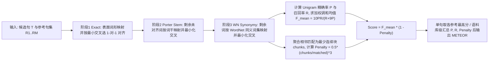

# METEOR

**METEOR: An Automatic Metric for MT Evaluation with Improved Correlation with Human Judgments** 收录于 [Awesome World-Action Models (RCL)](https://github.com/rcl-robotics/Awesome-World-Action-Models) **第 141/564** 篇，分组 **Evaluation metrics**。本页是 **清单索引**：给出它在清单中的位置与原文入口，方法细节和量化结果请看原文。

## 一句话定义

**METEOR**（Metric for Evaluation of Translation with Explicit ORdering）是一种针对机器翻译自动评测的指标，通过**多阶段一对一单词对齐（精确匹配 / Porter 词干 / WordNet 同义词）**、**重召回调和均值（$F_{\text{mean}}$）**与**显式语序碎片化惩罚（Chunk Penalty）**来显著提升与人类判断（尤其是句子级判断）的相关性。

## 英文缩写速查

| 缩写 | 英文全称 | 简要说明 |
|------|----------|----------|
| METEOR | Metric for Evaluation of Translation with Explicit ORdering | 本文提出的带显式词序惩罚与多阶段对齐的机器翻译评估指标 |
| MT | Machine Translation | 机器翻译，METEOR 的核心评估场景 |
| WN | WordNet | 英文语义词典，用于第 3 阶段同义词（synset）及可选词干映射 |
| LDC | Linguistic Data Consortium | 提供 DARPA/TIDES 2003 阿拉伯语/汉语英译人工评分数据集的机构 |

## 为什么重要

- **直面 BLEU 的四大结构性缺陷**：原文指出 BLEU/NIST 存在（1）缺乏直接召回率（固定简短惩罚无法充分补偿）、（2）依赖高阶 n-gram 间接衡量语法、（3）缺乏显式一对一词对齐（易误计高频虚词）、（4）几何平均在任一阶 n-gram 为 0 时归零导致句子级失效。
- **句子级敏感度与可解释性**：METEOR 在句子级（segment-by-segment）与系统级均能输出连续稳定评分，成为图像字幕、VLM 与具身语言生成评测中重要的语义软匹配基准之一。
- 想横向对照同一分组的其他工作，可以从 [RCL Awesome WAM 技术地图](../overview/rcl-awesome-wam-technology-map.md) 逐条展开，或顺着列表实体 [Awesome World-Action Models](paper-rcl-wam-robot-learning-control-survey.md) 接回对应主线。

## 核心信息

| 字段 | 内容 |
|------|------|
| 编号 | 141/564 |
| 分组 | Evaluation metrics |
| 出处 | ACL Workshop on Intrinsic and Extrinsic Evaluation Measures for Machine Translation and/or Summarization, 2005 (pp. 65–72) |
| 作者 / 机构 | Satanjeev Banerjee, Alon Lavie（Language Technologies Institute, Carnegie Mellon University） |
| 论文 | <https://aclanthology.org/W05-0909/> |
| 子类 / 象限 | 语言生成指标 · 评估指标与协议 · 不适用 |

## 核心机制（归纳）

> 注：以下机制与评测指标基于通读原文全文（ACL Workshop 2005）核对补充。

METEOR 在候选译文与每条参考译文之间独立构建显式 1-对-1 单词对齐并取最高得分（语料库级则累计聚合总 $P$、总 $R$ 与总惩罚后统一套用公式）：

1. **多阶段递增式单词对齐（Multi-stage Unigram Alignment）**：
   - 仅将此前尚未匹配的 unigram 送入下一阶段，默认按优先级依次运行三个模块：
     1. **Exact**：表面词形完全一致匹配；
     2. **Porter Stem**：经 Porter 词干提取后一致匹配（如 `"computers"` 与 `"computer"`）；
     3. **WN Synonymy**：在 WordNet 中至少有一个词义同属同一同义词集（synset）的词汇匹配。
   - **最小交叉消歧（Phase 2）**：每阶段先列举全部可能映射，再选取满足“每词至多映射对方一词”的最大基数子集；若存在多个同基数最大对齐，选择**交叉线（unigram mapping crosses）最少**的对齐——两对映射 $(t_i, r_j)$ 与 $(t_k, r_l)$ 交叉当且仅当 $(\text{pos}(t_i)-\text{pos}(t_k))(\text{pos}(r_j)-\text{pos}(r_l)) < 0$。
2. **重召回调和均值（$F_{\text{mean}}$）**：
   - 由对齐词数计算 unigram 精确率 $P$（匹配词数 / 候选词总数）与召回率 $R$（匹配词数 / 参考词总数），并对 $P$ 与 $9R$ 取调和平均（赋予召回率显著更高权重）：
     $$F_{\text{mean}} = \frac{10 P R}{R + 9 P}$$
3. **显式语序碎片惩罚（Fragmentation Penalty）**：
   - 将候选句与参考句中**位置同时相邻**的匹配词合并为最少数量的连续块（chunks）。匹配越碎片化、词序越混乱，chunk 数越多（无 2-gram 及以上连续匹配时 $\#\text{chunks} = \#\text{unigrams\_matched}$）：
     $$\text{Penalty} = 0.5 \cdot \left(\frac{\#\text{chunks}}{\#\text{unigrams\_matched}}\right)^3$$
   - 惩罚上限为 0.5（即完全无连续块时最多将 $F_{\text{mean}}$ 削减 50%）。
4. **最终得分**：
   $$\text{Score} = F_{\text{mean}} \cdot (1 - \text{Penalty})$$

### 方法流程图

关于语言生成指标在具身模型与世界模型中的位置，可参考站内 [World Action Models（WAM）](../concepts/world-action-models.md) 与 [generative-world-models.md](../methods/generative-world-models.md)。

## 评测与指标

- **数据集与人工基准**：在 LDC 发布的 **DARPA/TIDES 2003** 阿拉伯语–英语（664 句、6 个系统）与汉语–英语（920 句、7 个系统）MT 评测集上验证，每句配 4 条参考译文及 2 名人工评委的充分性（Adequacy）与流畅度（Fluency）1–5 分均值（Combined Score）。
- **系统级 Pearson 相关系数（Table 1，汉语 7 系统）**：
  - BLEU：**0.817**，NIST：**0.892**；
  - 仅用 METEOR 组件时：Precision 0.752、Recall **0.941**、$F_1$ 0.948、$F_{\text{mean}}$ 0.952、完整 **METEOR 0.964**。
- **句子级（Segment-by-segment）平均 Pearson $R$ 相关系数（Tables 2–5）**：
  - **阿拉伯语数据集（6 系统均值）**：Precision 0.287 → Recall 0.334 → $F_{\text{mean}}$ 0.340 → **METEOR 0.347**（单系统范围 0.278–0.399）。
  - **汉语数据集（7 系统均值）**：Precision 0.286 → Recall 0.320 → $F_{\text{mean}}$ 0.327 → **METEOR 0.331**（单系统范围 0.278–0.385）。
- **映射模块消融（Tables 6 & 7，句子级 Pearson $R$）**：
  - 阿拉伯语：仅 Exact（**0.312**）→ Exact+Porter（0.329）/ Exact+WN-Stem（0.330）→ Exact+Porter+WN-Synonym（**0.347**）。
  - 汉语：仅 Exact（**0.293**）→ Exact+Porter（0.318）/ Exact+WN-Stem（0.312）→ Exact+Porter+WN-Synonym（**0.331**）。
- **人工评分去噪后的相关性（MITRE 归一化人工分，Table 8）**：排除人类标注者尺度差异噪声后，METEOR 句子级相关系数在阿拉伯语上从 0.347 提升至 **0.403**，在汉语上从 0.331 提升至 **0.365**。

## 与其他工作对比

- **METEOR vs. BLEU / NIST**：BLEU 在系统级（汉语数据集）相关性为 0.817，NIST 为 0.892，而 METEOR 凭借强召回权重、显式块惩罚和同义词/词干匹配达到 **0.964**；在单句级评价中，METEOR 避免了 BLEU 因 4-gram 零匹配导致的得分坍塌问题。
- **计算代价与参考利用率**：相比仅做 n-gram 哈希计数的 BLEU，METEOR 需执行多阶段对齐与最小交叉搜索，运行时间开销显著更高；且对多参考采用“独立打分取最优（max）”而非像 CIDEr 那样利用大参考集统计共识。
- 同分组其他评测指标的横向对照，请回到 [技术地图](../overview/rcl-awesome-wam-technology-map.md) 的 **Evaluation metrics** 分组逐条展开。

## 结论

**METEOR 证明了显式 1-对-1 多阶段词对齐、重召回调和均值（$F_{\text{mean}}$）与连续块词序惩罚的组合，在系统级（$r=0.964$）和句子级均显著优于单纯基于精确率的 BLEU/NIST。**

1. **召回率是相关性提升的首要驱动力**：实验表明仅将评价标准从 Precision（0.752）换为 Recall（0.941）即可带来最大幅度的相关性跃升，$F_{\text{mean}}$（$9R:P$）与碎片惩罚在此基础上进一步稳步提分。
2. **形态与同义扩展在句子级不可或缺**：从单一 Exact 扩展到 Porter 词干与 WordNet 同义词三阶段管线，在阿拉伯语和汉语数据集上稳定带来 +0.035 至 +0.038 的句子级相关性增益。
3. **适用场景定位**：适合单句级细粒度诊断、少参考（1–5 条）图像/文本描述评测（如 PASCAL-50S 5-ref 与 HM 人机判别），但不适合直接用于超大规模高频训练奖励的在线快速计算。
4. **参数与语言边界意识**：本文公式系数（$9P$、惩罚系数 $0.5$ 与指数 $3$）为开发集经验设定且三阶段匹配在后续计算中被等权对待，跨语言使用需替换对应词干器与同义词资源。

## 常见误区

1. **误以为三阶段匹配在得分中权重不同**：阶段顺序（Exact → Porter → WN-Synonym）只决定对齐优先级；一旦进入最终对齐集合，三种来源的匹配 unigram 在 $P$、$R$ 计算中权重完全相同（原文 Sec 4 已将其列为待改进项）。
2. **忽视无词义消歧（WSD）带来的同义误匹配**：WordNet 同义词模块只要两个词存在任意共享 synset 即视为匹配，多义词在特定语境下可能产生语义偏差。
3. **误将 METEOR 0.33–0.40 的句子级相关系数视为失败**：由于不同人类评委在单句尺度上的主观测评本身存在高噪声，去噪后相关性即跃升至 0.365–0.403，且在统计上显著优于 Precision/Recall/F1 单项基准。

## 关联页面

- 列表实体：[Awesome World-Action Models（RCL）](paper-rcl-wam-robot-learning-control-survey.md)
- 技术地图：[RCL Awesome WAM 技术地图](../overview/rcl-awesome-wam-technology-map.md)
- 方法/任务：[generative-world-models.md](../methods/generative-world-models.md)、[manipulation.md](../tasks/manipulation.md)

## 参考来源

- [`sources/papers/rcl_awesome_wam_ref_73844778b2bcfa68b4e9_meteor-an-automatic-metric-for-mt-evalua.md`](../../sources/papers/rcl_awesome_wam_ref_73844778b2bcfa68b4e9_meteor-an-automatic-metric-for-mt-evalua.md) — 本条目策展摘录
- [`sources/papers/rcl_awesome_wam_catalog.md`](../../sources/papers/rcl_awesome_wam_catalog.md) — 列表总表
- [`sources/repos/awesome-world-action-models-rcl.md`](../../sources/repos/awesome-world-action-models-rcl.md)
- [`docs/PAPERS.md`](https://github.com/RCL-Robotics/Awesome-World-Action-Models/blob/main/docs/PAPERS.md) — 上游论文目录
- 论文：<https://aclanthology.org/W05-0909/>

## 推荐继续阅读

- [Awesome World-Action Models (RCL) 仓库](https://github.com/rcl-robotics/Awesome-World-Action-Models)
- [原文](https://aclanthology.org/W05-0909/)
