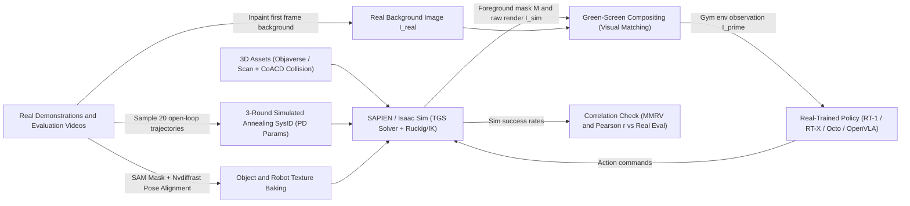

# Evaluating Real-World Robot Manipulation Policies in Simulation

**Evaluating Real-World Robot Manipulation Policies in Simulation** 收录于 [Awesome World-Action Models (RCL)](https://github.com/rcl-robotics/Awesome-World-Action-Models) **第 019/564** 篇，分组 **Benchmarks & simulators**。本页是 **清单索引**：给出它在清单中的位置与原文入口，方法细节和量化结果请看原文。

## 一句话定义

RCL Awesome WAM 清单收录（Benchmarks & simulators）；细节以原文 PDF / 项目页为准。

## 英文缩写速查

| 缩写 | 英文全称 | 简要说明 |
|------|----------|----------|
| WAM | World Action Model | 世界预测与动作生成耦合 |
| VLA | Vision-Language-Action | 视觉–语言–动作策略 |
| IDM | Inverse Dynamics Model | 先预测未来再反推动作 |
| WM | World Model | 环境前向预测模型 |

## 为什么重要

- RCL Awesome WAM 清单收录（Benchmarks & simulators）；细节以原文 PDF / 项目页为准。
- 想横向对照同一分组的其他工作，可以从 [RCL Awesome WAM 技术地图](../overview/rcl-awesome-wam-technology-map.md) 逐条展开。
- 顺着列表实体 [Awesome World-Action Models](paper-rcl-wam-robot-learning-control-survey.md) 与站内 WAM / VLA 方法页，可以接回对应的学习主线。

## 核心信息

| 字段 | 内容 |
|------|------|
| 编号 | 019/564 |
| 分组 | Benchmarks & simulators |
| 出处 | CoRL 2024（论文集出版于2025年） |
| 论文 | <https://proceedings.mlr.press/v270/li25c.html> |
| 子类 / 象限 | 机器人操作基准 · 物理仿真 · 仿真到真实评测 · 不适用 |

## 核心机制（归纳）

> 注：以下机制与评测指标基于通读开放获取原文全文核对补充。

### 问题设定与 MMRV 指标

**SIMPLER**（Simulated Manipulation Policy Evaluation for Real Robot Setups）旨在解决通用真机操作策略（如 RT-1、RT-1-X、RT-2-X、Octo、OpenVLA）真机评测成本高、难复现的问题，使**在真机数据上训练的策略可在仿真中获得高度相关且可复现的相对性能排序**：

- **平均最大排序违例（MMRV）**：针对 Pearson $r$ 只看线性相关性且易受真机小差距噪声影响的问题，提出 $\mathrm{MMRV}(R, R_S) = \frac{1}{N}\sum_{i=1}^N \max_{1 \le j \le N} |R_i - R_j| \cdot \mathbf{1}[(R_{S,i} < R_{S,j}) \neq (R_i < R_j)]$（范围 $[0, 1]$，越低越好），以真机性能差距加权衡量仿真排序失真。

### 控制与视觉 Real-to-Sim 对齐管线

- **离线系统辨识（Offline System Identification）**：从开源真机示教集（RT-1 / BridgeData V2）各取 20 条不同指令轨迹，将动作序列 $\{a_i\}$ 在仿真器（默认 SAPIEN，启用 PhysX Temporal Gauss-Seidel 求解器消除抓握穿透；Google Robot 搭配 Ruckig 轨迹规划，仿真 501 Hz / 控制 3 Hz；WidowX 仿真 500 Hz / 控制 5 Hz）中开环回放，以末端 6D 位姿误差 $L_{\mathrm{sysid}}(p, d) = \frac{1}{T}\sum_{i=1}^T \left(\|x'_i - x_i\|_2^2 + \arcsin\left(\frac{1}{2\sqrt{2}}\|R'_i - R_i\|_F\right)\right)$ 为目标，经 3 轮模拟退火优化 PD 控制器刚度与阻尼参数 $(p, d)$。
- **视觉差距对齐——Visual Matching（默认推荐）**：
  1. **背景绿幕叠加（Green-screening）**：对真机首帧图像 $I_{\mathrm{real}}$ 用图像修复移除机器人与前景物体，结合仿真前景分割掩码 $M$ 合成 $I' = M \odot I_{\mathrm{sim}} + (1 - M) \odot I_{\mathrm{real}}$。
  2. **前景资产纹理校准**：利用 SAM 分割真机物体并用可微渲染（Nvdiffrast）对齐网格位姿后反投影真实纹理（必要时用 Zero123++ 生成多视角补全）；机械臂纹理则从真机不同阶段图像拷贝颜色，Google Robot 跨越 4 组臂/夹爪配色求平均成功率。
- **视觉差距对齐——Variant Aggregation**：类似域随机化，采用 ReplicaCAD 场景与 Objaverse 资产，沿**背景、光照、干扰物、桌面纹理** 4 个轴各设 2 个变体并聚合均值（支持可变相机视角测试）。
- **资产与接口**：通过标准 Gym 接口 `simpler_env.make(...)` 调用；刚体物体经 Blender 规整尺度并用 CoACD 生成水密凸碰撞网格（建一个新环境约需 1 小时）。

### 方法流程图

## 评测与指标

- **配对实验规模**：涵盖 **2 个机器人平台、8 个任务族、超过 1,500 次真机–仿真配对评测 episode**：
  - **Google Robot（4 个任务族）**：`Pick Coke Can`（3 种摆放姿态共 75 trials）、`Move Near`（60 trials）、`Open / Close Drawer`（54 trials）、`Open Top Drawer & Place Apple`（27 trials）。
  - **WidowX + BridgeData V2（4 个任务族，每任务 24 trials）**：`Put Spoon on Towel`、`Put Carrot on Plate`、`Stack Green Block on Yellow Block`、`Put Eggplant into Yellow Basket`。
- **核心量化结果**：
  - **真机–仿真总体相关性（Visual Matching，Fig. 4）**：Google Robot 上达到 **MMRV = 0.049 ↓、Pearson r = 0.929 ↑**；WidowX + Bridge V2 上达到 **MMRV = 0.014 ↓、Pearson r = 0.890 ↑**。
  - **对比离线验证集动作 MSE（Table 1 & Table 10）**：在 Google Robot 6 个代表策略（3 个 RT-1 检查点、RT-1-X、RT-2-X、Octo-Base）上，`Validation MSE` 的平均 **MMRV = 0.375、r = 0.308**（Bridge 任务上甚至出现 $r = -0.342$ 至 $-1.000$ 负相关）；`SIMPLER-VarAgg` 平均 **MMRV = 0.143、r = 0.778**；而 `SIMPLER-VisMatch` 平均 **MMRV = 0.056、r = 0.924**（Pick Can `0.031 / 0.976`、Move Near `0.111 / 0.855`、Drawer `0.055 / 0.915`、Open & Place Apple `0.000 / 0.969`）。
  - **分布偏移敏感度与预测新偏移（Sec. 5.3, Table 4 & Table 6）**：在背景、光照、干扰物、桌面纹理、相机位姿 5 轴偏移下，RT-1（w/o Aug 与 +Aug）在 SIMPLER 与真机的成功率下降高度一致（`MMRV = 0.000, r = 0.831` 及 `MMRV = 0.016, r = 0.970`；新纯色桌面真机 -4% / 仿真 -2%，花纹桌面真机 -25% / 仿真 -24%）。仿真提前揭示 `Octo-Base` 对臂纹理变化极度敏感（`0%` vs `29.3%`），随后在真机用礼品包装纸包裹机械臂的实验验证了该预测（`Octo-Base` 从 `0.293` 跌至 `0.000`，`RT-1-X` 从 `0.760` 降至 `0.520`）。
  - **消融与仿真后端无关性（Sec. 5.4, Table 7/8/9）**：SysID 将控制误差与 MMRV 从 `0.267–0.432 / 0.070–0.100` 降至 `0.131 / 0.031`；仅当绿幕背景、抽屉纹理与机械臂纹理同时校准才得到最低 MMRV（`0.050`）与最小绝对成功率差（`0.136`）；对罐体质量（10–80 g）、夹爪摩擦（0.25–2.0）与柜门摩擦（0.0125–0.20）变化鲁棒（MMRV 保持 `0.031` 与 `0.055`，`r > 0.90`）；在 **Isaac Sim** 复现亦获 **MMRV = 0.058、r = 0.919**（对比 SAPIEN `MMRV = 0.082、r = 0.923`）。

## 与其他工作对比

- 本页 **不做** 与具体基线的逐项数值对比；同分组的横向对照请回到 [技术地图](../overview/rcl-awesome-wam-technology-map.md) 的 **Benchmarks & simulators** 分组逐条展开。
- 如果站内已经有这篇的深读页（含机构、实验表与源码运行时序图），请以那一页为准；本页只保留清单要点。
- 与清单内相邻条目孰优孰劣，本页不下结论：清单 Contribution 可能滞后于论文最新版本，差异应以各自原文的问题设定与评测口径为准。

## 结论

**SIMPLER 证明无需构建昂贵的全保真数字孪生，只需对齐控制动力学（离线 SysID）与关键视觉外观（绿幕背景 + 前景纹理反投影），即可在仿真中稳定复现真机操作策略的性能排名与分布偏移行为。**

- **比离线动作 MSE 更可靠**：验证集动作 MSE 与真机成功率相关性极差甚至呈负相关，而 SIMPLER-VisMatch 在两大真机平台上实现 $r = 0.890 \sim 0.929$ 与极低 MMRV（$0.014 \sim 0.049$）。
- **可诊断细粒度失效模式**：能提前预测策略对相机位姿、桌面花纹及机械臂材质（如 Octo-Base 对臂纹理敏感）等真实分布偏移的脆弱性。
- **跨后端可复现**：核心收益来自控制与视觉差距缩减而非特定物理引擎，SAPIEN 与 Isaac Sim 结论一致。
- **主要局限（Appendix G）**：当前主要覆盖刚体与铰接家具操作（未支持柔体）；Visual Matching 绿幕法限定固定相机视角且难以精准渲染物体投影；目前输入限定为 RGB 与本体感受，尚未涵盖触觉/力觉/激光雷达模态，且开环无接触 SysID 对高速碰撞或灵巧操作仍不充分。

## 常见误区

1. 不要把 Awesome 条目的 Contribution 当成完整方法证明——它只是策展导读。
2. 若站内已有这篇的深读页，以那一页为准——本页只是清单入口，不含实验数据。

## 关联页面

- 列表实体：[Awesome World-Action Models（RCL）](paper-rcl-wam-robot-learning-control-survey.md)
- 技术地图：[RCL Awesome WAM 技术地图](../overview/rcl-awesome-wam-technology-map.md)
- 方法/任务：[generative-world-models.md](../methods/generative-world-models.md)、[manipulation.md](../tasks/manipulation.md)

## 参考来源

- [`sources/papers/rcl_awesome_wam_ref_76e692b7c04cea08a682_evaluating-real-world-robot-manipulation.md`](../../sources/papers/rcl_awesome_wam_ref_76e692b7c04cea08a682_evaluating-real-world-robot-manipulation.md) — 本条目策展摘录
- [`sources/papers/rcl_awesome_wam_catalog.md`](../../sources/papers/rcl_awesome_wam_catalog.md) — 列表总表
- [`sources/repos/awesome-world-action-models-rcl.md`](../../sources/repos/awesome-world-action-models-rcl.md)
- [`docs/PAPERS.md`](https://github.com/RCL-Robotics/Awesome-World-Action-Models/blob/main/docs/PAPERS.md) — 上游论文目录
- 论文：<https://proceedings.mlr.press/v270/li25c.html>

## 推荐继续阅读

- [Awesome World-Action Models (RCL) 仓库](https://github.com/rcl-robotics/Awesome-World-Action-Models)
- [原文](https://proceedings.mlr.press/v270/li25c.html)
