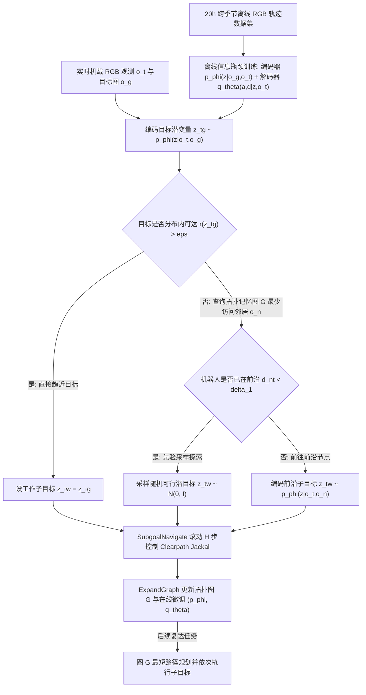

# Rapid Exploration for Open-World Navigation with Latent Goal Models

**Rapid Exploration for Open-World Navigation with Latent Goal Models** 收录于 [Awesome World-Action Models (RCL)](https://github.com/rcl-robotics/Awesome-World-Action-Models) **第 175/564** 篇，分组 **Foundational work**。本页是 **清单索引**：给出它在清单中的位置与原文入口，方法细节和量化结果请看原文。

## 一句话定义

RCL Awesome WAM 清单收录（Foundational work）；细节以原文 PDF / 项目页为准。

## 英文缩写速查

| 缩写 | 英文全称 | 简要说明 |
|------|----------|----------|
| WAM | World Action Model | 世界预测与动作生成耦合 |
| VLA | Vision-Language-Action | 视觉–语言–动作策略 |
| IDM | Inverse Dynamics Model | 先预测未来再反推动作 |
| WM | World Model | 环境前向预测模型 |

## 为什么重要

- RCL Awesome WAM 清单收录（Foundational work）；细节以原文 PDF / 项目页为准。
- 想横向对照同一分组的其他工作，可以从 [RCL Awesome WAM 技术地图](../overview/rcl-awesome-wam-technology-map.md) 逐条展开。
- 顺着列表实体 [Awesome World-Action Models](paper-rcl-wam-robot-learning-control-survey.md) 与站内 WAM / VLA 方法页，可以接回对应的学习主线。

## 核心信息

| 字段 | 内容 |
|------|------|
| 编号 | 175/564 |
| 分组 | Foundational work |
| 出处 | CoRL 2021 |
| 论文 | <https://proceedings.mlr.press/v164/shah22a.html> |
| 项目页 | <https://sites.google.com/view/recon-robot> |
| 子类 / 象限 | 动作策略基础 · 理论与规划 · 不适用 |

## 核心机制（归纳）

> 注：以下机制与评测指标基于通读开放获取原文全文核对补充。

RECON（Rapid Exploration Controllers for Outcome-driven Navigation）面向无几何地图、无全局定位、仅凭单个前向 170° RGB 相机的未知开放世界导航任务，将**变分信息瓶颈潜在目标模型**与**非参数拓扑记忆图**结合，实现在未知环境中快速探索并到达最远 80 m 视觉目标：

1. **上下文条件潜在目标模型（Latent Goal Model，Section 4.1）**：
   - **目标**：学习对无关视觉干扰（光照、季节、无关动态障碍）具备不变性的相对目标表征 $z_t^g$，最大化 $\frac{I((A_t^g, D_t^g); Z_t^g \mid o_t)}{I(Z_t^g; O_g \mid o_t)}$。
   - **编码器与解码器**：编码器 $p_\phi(z_t^g \mid o_g, o_t)$ 以当前观测 $o_t$ 为条件，将目标图 $o_g$ 压缩到以标准正态先验 $r(z_t^g)=\mathcal{N}(0,I)$ 正则化的潜在空间；解码器 $q_\theta(a_t^g, d_t^g \mid z_t^g, o_t)$ 联合预测控制动作（连续线速度/角速度）与到目标的时间步距离 $d_t^g$。
   - **离线自监督预训练**：在跨 18 个月采集的 20 小时随机游走真实轨迹四元组 $(o_t, o_g, a_t^g, d_t^g)$ 上，以信息瓶颈变分下界（动作/距离重构对数似然减去 $\beta \cdot \text{KL}(p_\phi \| r)$）训练。由于编码器以 $o_t$ 为条件，直接从先验 $r(z)$ 采样即可生成当前位置**物理可达的探索子目标**（克服常规 VAE 先验采样不可达目标的缺陷）。
2. **基于拓扑记忆的三态前沿探索与复达规划（Section 4.2，Algorithm 1 & 2）**：
   - 机器人增量维护拓扑图 $G=\{V, E\}$，节点存储第一视角图像与作为导航子目标的**访问计数**，边权由模型预测的时间距离估计。
   - **探索阶段三态决策（Algorithm 1）**：直到预测距离 $\bar{d}_t^g < \epsilon_1$ 为止，每轮检查：
     1. **目标可达（Feasible Goal）**：若目标潜变量先验概率 $r(z_t^g) > \epsilon$，说明 $(o_t, o_g)$ 处于分布内且信心充足，直接设 $z_t^w = z_t^g$ 朝目标行驶；
     2. **位于前沿（Explore at Frontier）**：否则检索距离 $\delta_2$ 阈值内访问次数最少的邻居 $o_n$；若至该节点预测距离 $\bar{d}_t^n < \delta_1$（已达前沿），则从先验采样 $z_t^w \sim r(z)$ 探索未知区域；
     3. **前往前沿（Go to Frontier）**：若尚未到达前沿，则编码 $z_t^w \sim p_\phi(z \mid o_t, o_n)$ 导航至 $o_n$。
   - 每次执行 `SubgoalNavigate` 滚动 $H$ 步后，将采集轨迹并入新环境缓冲 $D$、调用 `ExpandGraph` 更新图 $G$ 节点与访问计数，并对 $(p_\phi, q_\theta)$ 在线微调 $\kappa$ 轮。
   - **导航复达阶段（Algorithm 2）**：探索完成后，将当前观测 $o_t$ 与目标 $o_g$ 关联到拓扑图节点 $(v_t, v_g)$，求最短路径后依次将路径节点图像编码为潜变量子目标执行控制。

### 方法流程图

关于目标条件控制、拓扑记忆与世界模型，可参见站内 [World Action Models（WAM）](../concepts/world-action-models.md) 与 [generative-world-models.md](../methods/generative-world-models.md)。

## 评测与指标

- **实机平台与评测环境**：部署于搭载 NVIDIA Jetson TX2 和前向 170° RGB 相机的 **Clearpath Jackal UGV**（仅离线采集时用 GPS/2D 激光雷达做安全保护，推理完全纯视觉）；在 **8 个全新真实户外/半开放环境**（停车场、郊区住宅区、人行道、食堂等，累计超 **100 小时**实机测试，目标距起点最远达 **80 m**）对比 6 个强基线（均在同一 20 小时离线数据预训练并在线微调）。
- **核心量化对比（Table 1：探索时间↓ / 复达导航时间↓ / 动力学加权完成率 SCT↑）**：
  - `RECON (Ours)`：平均探索发现时间 **09:54**（20 分钟内即可发现最远 80 m 目标，比次优 `RECON+ECR` 14:54 快约 **50%**）、二次复达时间 **00:26**（比基线快 20%–85%，比 ECR 00:31 快约 30%）、SCT **0.92**。
  - 基线表现：`Ours + ECR`（14:54 / 00:31 / SCT 0.73）、`ViNG`（19:48 / 00:34 / SCT 0.60）、`Active Neural SLAM (ANS)`（21:00 / 00:45 / SCT 0.33，仅能发现 $\le 25\text{ m}$ 目标）、`PPO + RND`（21:18 / 00:47 / SCT 0.22）、`InfoBot`（23:36 / 00:48 / SCT 0.21）；`NTS` 在所有 8 个环境中均探索失败。
- **非平稳扰动与消融验证（Sec. 5.2–5.3 & Table 2）**：
  - **视觉干扰与新障碍物鲁棒性**：“junkyard” 场景探索完成后不作额外探索，直接面对未见过障碍（垃圾桶、交通锥、汽车）及不同天气光照（晴天、阴天、黄昏），仍能稳定导航到蓝色垃圾箱目标。
  - **组件消融（Table 2 & Fig. 6）**：无记忆 5 分钟探索覆盖实验中，先验潜在目标采样比随机动作探索快 **5×**；全任务消融中 `Ours`（**09:56 / 00:25.8 / SCT 0.92**）显著优于无信息瓶颈的 `Vanilla Sampling`（14:06 / 00:28.7 / SCT 0.83，无法发现远距离目标）、随机动作 `Random Actions`（14:54 / 00:31.4 / SCT 0.73）和无拓扑图的 `Reactive`（11:54 / 00:37.4 / SCT 0.63，复达记忆能力严重退化）。

## 与其他工作对比

- 本页 **不做** 与具体基线的逐项数值对比；同分组的横向对照请回到 [技术地图](../overview/rcl-awesome-wam-technology-map.md) 的 **Foundational work** 分组逐条展开。
- 如果站内已经有这篇的深读页（含机构、实验表与源码运行时序图），请以那一页为准；本页只保留清单要点。
- 与清单内相邻条目孰优孰劣，本页不下结论：清单 Contribution 可能滞后于论文最新版本，差异应以各自原文的问题设定与评测口径为准。

## 结论

**RECON 证明了“条件变分信息瓶颈（筛选可达子目标并对光照/障碍干扰不变）+ 非参数拓扑记忆图（前沿计数探索与最短路径复达）”能在纯单目 RGB、无几何地图条件下，让真实地面机器人在 20 分钟内完成最远 80 米开放世界的自主探索与快速复达。**

- **双组件协同不可或缺**：信息瓶颈提供物理可行的探索子目标采样（探索提速 5× 且过滤天气/光照干扰），而拓扑记忆图负责记录访问前沿并在复达阶段将长程导航转化为可靠的多跳短程规划。
- **小样本实机自适应优势**：相比需百万步仿真微调的在线 RL（如 PPO+RND）或密集建图方法（ANS），RECON 利用 20 小时离线先验与几分钟在线微调即可在未知户外环境实现 0.92 SCT。
- **局限性**：当前探索决策按固定置信度/前沿计数启发式切换，尚未显式建模信息价值（value of information）以进一步优化复杂分支环境中的探索收益。

## 常见误区

1. 不要把 Awesome 条目的 Contribution 当成完整方法证明——它只是策展导读。
2. 若站内已有这篇的深读页，以那一页为准——本页只是清单入口，不含实验数据。

## 关联页面

- 列表实体：[Awesome World-Action Models（RCL）](paper-rcl-wam-robot-learning-control-survey.md)
- 技术地图：[RCL Awesome WAM 技术地图](../overview/rcl-awesome-wam-technology-map.md)
- 方法/任务：[generative-world-models.md](../methods/generative-world-models.md)、[manipulation.md](../tasks/manipulation.md)

## 参考来源

- [`sources/papers/rcl_awesome_wam_ref_7874d48534f3bf22f87d_rapid-exploration-for-open-world-navigat.md`](../../sources/papers/rcl_awesome_wam_ref_7874d48534f3bf22f87d_rapid-exploration-for-open-world-navigat.md) — 本条目策展摘录
- [`sources/papers/rcl_awesome_wam_catalog.md`](../../sources/papers/rcl_awesome_wam_catalog.md) — 列表总表
- [`sources/repos/awesome-world-action-models-rcl.md`](../../sources/repos/awesome-world-action-models-rcl.md)
- [`docs/PAPERS.md`](https://github.com/RCL-Robotics/Awesome-World-Action-Models/blob/main/docs/PAPERS.md) — 上游论文目录
- 论文：<https://proceedings.mlr.press/v164/shah22a.html>

## 推荐继续阅读

- [Awesome World-Action Models (RCL) 仓库](https://github.com/rcl-robotics/Awesome-World-Action-Models)
- [原文](https://proceedings.mlr.press/v164/shah22a.html)
