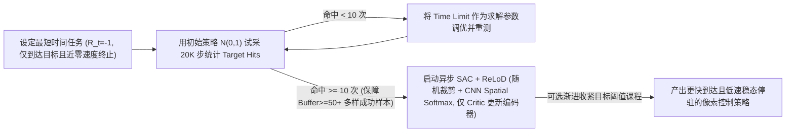

# Revisiting Sparse Rewards for Goal-Reaching Reinforcement Learning

**Revisiting Sparse Rewards for Goal-Reaching Reinforcement Learning**（Gautham Vasan, Yan Wang, Fahim Shahriar, James Bergstra, Martin Jagersand, A. Rupam Mahmood，University of Alberta / Amii / Ocado Technology，Reinforcement Learning Journal / RLC 2024 / arXiv:2407.00324v2）收录于 [Awesome World-Action Models (RCL)](https://github.com/rcl-robotics/Awesome-World-Action-Models) **第 178/564** 篇，分组 **Foundational work**。本页基于论文全文，系统总结其最短时间稀疏奖励建模、超时参数启发式与四台真机实测结果。

## 一句话定义

一篇为机器人目标到达（Goal-Reaching）强化学习重新正名「极简稀疏奖励」的实证研究：证明使用「每步 $-1$、到达目标且近零速度即终止」的 **最短时间（Minimum-Time）** 设定，无需手工设计稠密引导奖励，不仅最终策略比稠密奖励更快更稳（甚至在稠密奖励自身指标上反超），还能通过把 **回合超时（Time Limit）** 当作可调求解参数、以初始策略 20K 步内目标命中数 $\ge 10$ 次为判据，在 4 台实体机器人上仅用 1.1–4.4 小时从零学会端到端像素控制。

## 英文缩写速查

| 缩写 | 英文全称 | 简要说明 |
|------|----------|----------|
| WAM | World Action Model | 世界预测与动作生成耦合 |
| VLA | Vision-Language-Action | 视觉–语言–动作策略 |
| IDM | Inverse Dynamics Model | 先预测未来再反推动作 |
| WM | World Model | 环境前向预测模型 |
| SAC | Soft Actor-Critic | 本文在仿真与真机上统一使用的离策略最大熵强化学习算法 |
| MDP | Markov Decision Process | 离散时间马尔可夫决策过程任务建模框架 |
| ReLoD | Real-Time Reinforcement Learning utilizing Local and Remote Computers | 本文在实体机器人上实现异步高频像素训练的分布式系统 |

## 为什么重要

- **揭示手工稠密奖励塑造（Reward Shaping）的隐性偏置陷阱**：虽然距离引导奖励能让学习曲线初期爬升更快，但它把设计者的主观偏好强加给了策略，往往在收敛后阻碍机器人以最短时间到达目标并稳定停驻（如在目标处产生多余速度）。
- **将「超时截断（Timeout）」从固定问题定义转化为可调探索超参**：过去认为稀疏奖励极难在真机上从零学习，本文发现只要把超时步数当作调节初始随机探索命中率的旋钮，就能在无先验示范、无稠密塑形的情况下在 1–4.5 小时内完成真机像素策略学习。
- **顺着索引入口延伸阅读**：对照 [Awesome World-Action Models（RCL）](paper-rcl-wam-robot-learning-control-survey.md) 与 [RCL Awesome WAM 技术地图](../overview/rcl-awesome-wam-technology-map.md) 的「动作策略基础 · 训练优化与蒸馏」分支。

## 核心信息

| 字段 | 内容 |
|------|------|
| 作者与机构 | Gautham Vasan, Yan Wang, Fahim Shahriar, James Bergstra, Martin Jagersand, A. Rupam Mahmood（University of Alberta / Amii / Ocado Technology） |
| 编号 / 分组 | 178/564 · Foundational work（子类：动作策略基础 · 训练优化与蒸馏） |
| 出处 / 原文 | Reinforcement Learning Journal (RLC 2024) · <https://rlj.cs.umass.edu/2024/papers/Paper231.html> / arXiv:2407.00324v2 |
| 开源代码 | 仿真套件：<https://github.com/gauthamvasan/rl_suite>；真机系统（ReLoD）：<https://github.com/rlai-lab/relod> |
| 算法与网络 | 异步 SAC（`buffer=100K`, `batch=256`, `γ=0.99`, `lr=3e-4`）；4 层 CNN（32 通道 3×3）+ Spatial Softmax + 本体状态 + `[512, 512]` MLP |

## 核心机制（归纳）

1. **三类目标到达任务规范对比（Table 1）**：
   - **引导奖励（Guiding Reward）**：进入目标区域得 $+1$，否则得 $-\|x_{\text{goal}} - x_{\text{pos}}\|$，固定回合长度 $T=1000$。
   - **接触奖励（Contact Reward）**：进入目标得 $+1$ 否则 $0$，固定回合长度 $T=1000$。
   - **最短时间规范（Minimum-Time）**：每时间步固定给 $R_t = -1$，直到末端以**近零速度**抵达目标才终止；不定长回合。若超出超时上限仍未到达，则保留同一目标重置机器人状态并扣除真实重置时间惩罚 $-K$（如超时 3 次再 25 步到达且 $T_{\text{limit}}=100, K=20$，则总回报与等效长度为 $-385$）。
2. **超时参数启发式与初始命中率判据（Sec. 5 & Sec. 6）**：
   - 论文发现初始高斯策略 $\mathcal{N}(0, 1)$ 在前 **20K** 步内的目标命中次数（Target Hits）与最终能否收敛强相关；而超时长度决定了智能体停留在无效状态还是及时重置重新探索，且在不改变最短时间问题本质的前提下可自由调节。
   - **可操作工程阈值**：调大或调小 `Time Limit` 使初始策略在 20K 步内至少达成 **$\ge 10$ 次目标命中**（按 10–125 Hz 控制频率计算，采集 20K 步探索最多仅需 **35 分钟**）。配合 `buffer=100K` 与 `batch=256`，可保证经验池中至少积累 50+ 多样化命中样本，平均每 8 个 mini-batch 更新就有 1 个包含目标状态的转移。
3. **端到端像素-本体异步训练架构（Appendix A.2）**：
   - 视觉分支采用 4 层 CNN（32 通道、3×3 卷积核、步长 `[2, 2, 2, 1]`）接 Spatial Softmax 提取软空间坐标，并施加随机裁剪数据增强；共享编码器仅由 Critic 损失反向更新（Actor 不向共享编码器回传梯度），与本体状态和上一动作拼接后送入 `[512, 512]` ReLU MLP 输出压缩高斯策略 $a_\theta(s,\epsilon)=\tanh(\mu_\theta(s)+\sigma_\theta(s)\odot\epsilon)$。

### 方法流程图

## 评测与指标

### 1. DMControl Reacher 仿真对比（30 独立运行，500 回合 × 5K 步评估，Fig. 5）

| 任务与指标 | Guiding Reward | Contact Reward | Minimum-Time（本文推荐） |
|------------|----------------|----------------|--------------------------|
| **Reacher-Easy — 到达步数（Steps to Goal ↓）** | 56.88 | 49.64 | **18.5**（快约 **3×**） |
| **Reacher-Easy — 目标停驻步数（Steps on Goal ↑）** | 4033.12 | 4173.55 | **4491.82** |
| **Reacher-Hard — 到达步数（Steps to Goal ↓）** | 72.37 | 70.15 | **42.97**（快约 **1.7×–2×**） |
| **Reacher-Hard — 目标停驻步数（Steps on Goal ↑）** | 3824.78 | 4006.95 | **4289.21** |

- **跨规范互评结论（Fig. 6）**：最短时间策略即使放回引导奖励与接触奖励任务中评估，也取得高于或持平稠密奖励策略的累积回报（在目标内多停驻带来超 500 点额外收益）；反之，引导/接触奖励学出的策略因到达目标时难以做到近零速度，在最短时间任务上表现极差。

### 2. 四台实体机器人纯像素从零学习实测（Table 2，每任务 5 次独立运行，累计约 200 机器人小时）

| 真机平台 | 超时设置（步 / 秒） | 20K 步初始命中数 | 总训练步数 | 控制频率 (Hz) | 初始评估耗时 (min) | 净经验采集时长 (h) |
|----------|---------------------|------------------|------------|---------------|--------------------|--------------------|
| **Franka-VisualReacher**（7-DOF 机械臂） | **150 (6s)** | **13.0 ± 2.08** | 60k | 25 | 13.3 | **1.11** |
| *(对比超时过长)* Franka | 750 (30s) | 7.8 ± 0.87 | — | 25 | — | — |
| *(对比超时过短)* Franka | 75 (3s) | 12.6 ± 1.0 | — | 25 | — | — |
| **Create-Reacher**（移动底座） | 333 (15s) | 18.8 ± 3.92 | 100k | 22.22 | 15 | **1.25** |
| **UR5-VisualReacher**（工业机械臂） | 150 (6s) | 14.4 ± 2.5 | 100k | 25 | 13.3 | **1.11** |
| **Vector-ChargerDetector**（WiFi 小车） | 300 (30s) | 11 ± 1.1 | 160k | 10 | 33.33 | **4.44** |

- **真机最终行为评估（Fig. 10）**：在 `UR5-VisualReacher`（2500 回合 × 500 步）与 `Franka-VisualReacher`（1000 回合 × 1000 步）上，最短时间策略在 `Steps to Goal`（更短）与 `Steps on Goal`（更长）两项指标上均优于基于中心加权红点掩码的引导奖励策略；配合课程学习逐步缩小像素面积阈值，200K 步即可训练出高精度视觉伺服策略。

## 与其他工作对比

| 维度 | 手工引导奖励 (Guiding Reward) | HER（事后经验回放） | 最短时间规范 (Minimum-Time) |
|------|-------------------------------|---------------------|-----------------------------|
| 领域知识与调参负担 | 高：需反复试错距离权重/视野掩码，易对特定算法过拟合 | 中：需构造伪目标重标注逻辑，在纯像素非平面场景受限 | **极低**：仅需定义成功终止条件（如目标像素占比阈值） |
| 训练初期学习速度 | 快（每步提供梯度指引） | 较快 | 较慢且早期方差较大，依赖合适超时参数 |
| 最终策略质量 | 易因速度约束缺失在目标周边震荡或偏慢 | 依赖重标注目标分布 | **最优**：天然对齐最短时间与稳态停驻 |

## 常见误区或局限

1. **盲目沿用超长默认超时（如 1000 步 / 30 秒）**：在真机如 Franka 上将超时设为 750 步（30s）反而使初始 20K 步命中数跌至 `7.8 ± 0.87`（低于 10 次阈值），因为机器人陷入无效边界姿态无法及时重置。
2. **仅适合「成功判据易定义且初始策略能偶发触达」的任务**：若任务极其复杂（如长程多阶段灵巧操作）使得任意合理超时下随机探索 20K 步命中次数仍接近 0，纯靠 $-1$ 稀疏奖励与超时调优仍需结合课程学习、示范或探索机制。
3. **经验时长未计入硬件复位与充电时间**：Table 2 统计的 1.11–4.44 小时为纯交互经验时间，实际真机实验还需叠加重定位、电池充电与人工看护耗时（全论文累计约 200 小时真机使用）。

## 结论

**在目标到达任务中，用每步 $-1$ 的最短时间稀疏奖励取代手工稠密塑形并非「退而求其次的折中」，而是能以更低设计成本同时获得更快到达速度与更稳停驻质量的更优目标函数。**

1. **能定义清楚成功条件就优先用最短时间 $-1$ 奖励**：避免手工距离权重偏置最优解（Reacher-Easy 到达快 3×、Reacher-Hard 快约 2×，并在稠密指标下反超）。
2. **部署前先跑 20K 步初始策略做「可学性体检」**：把 `Time Limit` 当作算法求解参数来调节，确保 $\mathcal{N}(0, 1)$ 初始策略在 20K 步内至少命中目标 **10 次**，再启动正式训练。
3. **视觉编码器只吃 Critic 梯度 + Spatial Softmax**：配合随机裁剪增强与 ReLoD 异步系统，无需外部预训练数据即可在 1–4.5 小时内完成真机像素策略从零收敛。
4. **需要高精度收敛时叠加阈值课程**：训练中逐步收紧成功判定阈值（如缩小目标像素占比要求），即可无缝衔接高精度视觉伺服。

## 关联页面

- 列表实体：[Awesome World-Action Models（RCL）](paper-rcl-wam-robot-learning-control-survey.md)
- 技术地图：[RCL Awesome WAM 技术地图](../overview/rcl-awesome-wam-technology-map.md)
- 相关基础论文：[Deep Reinforcement Learning at the Edge of the Statistical Precipice](paper-rcl-ref-92f666cd9d15e83951cb-deep-reinforcement-learning-at-the-edge-of-the-s.md)
- 方法/任务：[generative-world-models.md](../methods/generative-world-models.md)、[manipulation.md](../tasks/manipulation.md)

## 参考来源

- [`sources/papers/rcl_awesome_wam_ref_80d04bd5d03ee6f72663_revisiting-sparse-rewards-for-goal-reach.md`](../../sources/papers/rcl_awesome_wam_ref_80d04bd5d03ee6f72663_revisiting-sparse-rewards-for-goal-reach.md) — 本条目策展摘录
- [`sources/papers/rcl_awesome_wam_catalog.md`](../../sources/papers/rcl_awesome_wam_catalog.md) — 列表总表
- [`sources/repos/awesome-world-action-models-rcl.md`](../../sources/repos/awesome-world-action-models-rcl.md)
- [`docs/PAPERS.md`](https://github.com/RCL-Robotics/Awesome-World-Action-Models/blob/main/docs/PAPERS.md) — 上游论文目录
- 论文：<https://rlj.cs.umass.edu/2024/papers/Paper231.html>

## 推荐继续阅读

- [Awesome World-Action Models (RCL) 仓库](https://github.com/rcl-robotics/Awesome-World-Action-Models)
- [原文（Reinforcement Learning Journal）](https://rlj.cs.umass.edu/2024/papers/Paper231.html)
- [仿真实验代码库（rl_suite）](https://github.com/gauthamvasan/rl_suite) 与 [真机异步 RL 系统（relod）](https://github.com/rlai-lab/relod)
