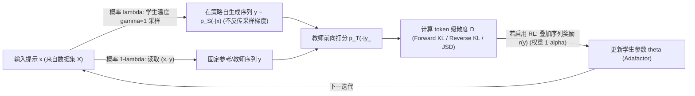

# On-Policy Distillation of Language Models

**On-Policy Distillation of Language Models: Learning from Self-Generated Mistakes**（Agarwal 等，Google DeepMind / Mila / 多伦多大学，ICLR 2024）收录于 [Awesome World-Action Models (RCL)](https://github.com/rcl-robotics/Awesome-World-Action-Models) **第 170/564** 篇，分组 **Foundational work**。本文揭示了自回归序列模型蒸馏与「交互式专家模仿学习（DAgger）」之间的等价结构，提出了 **GKD（Generalized Knowledge Distillation）**。

## 一句话定义

提出广义知识蒸馏 **GKD**，将自回归语言模型蒸馏视为交互式专家模仿学习，在学生模型**在策略（on-policy）自生成序列**上以教师 token 级概率与灵活散度（Forward KL、Reverse KL 及广义 JSD）进行监督更新，从而消除训练–推理分布失配并可与 RLHF/RLAIF 无缝联合优化。

## 英文缩写速查

| 缩写 | 英文全称 | 简要说明 |
|------|----------|----------|
| GKD | Generalized Knowledge Distillation | 广义知识蒸馏（统一离线/在策略采样与多类散度） |
| JSD | Jensen-Shannon Divergence | 广义詹森–香农散度，参数 $\beta\in(0,1)$ 插值前向与反向 KL |
| SeqKD | Sequence-Level Knowledge Distillation | 在教师生成完整序列上微调学生的经典基线 |
| RLAIF | Reinforcement Learning from AI Feedback | 基于 AI 反馈的强化学习（文中用于抑制摘要幻觉） |
| CoT | Chain-of-Thought | 思维链分步推理提示 |

## 为什么重要

- **直击自回归蒸馏的「暴露偏差（Exposure Bias）」**：传统 Supervised KD 与 SeqKD 只在固定真值或教师生成序列上训练，推理时学生一旦自回归生成出偏差前缀，便会因分布失配触发级联错误；在策略 GKD 让学生「从自己犯下的错误中即时获得教师 logit 纠偏」。
- **解决小容量学生的「模式覆盖幻觉」**：前向 KL（mean-seeking）强迫小模型覆盖教师分布全支撑集，导致高温度采样下产生低质量或幻觉词；GKD 引入反向 KL 与 $\text{JSD}(\beta)$（mode-seeking），使有限容量学生专注学好教师高概率主模式。
- **零摩擦融合 RLHF / RLAIF 以缓解「对齐税」**：当存在不可微序列奖励（如事实一致性 NLI 分数）时，在策略 GKD 可直接替代「向初始策略 KL 约束」，把策略正则化锚定到更大教师模型，在提升奖励的同时放大核心任务能力。

## 核心信息

| 字段 | 内容 |
|------|------|
| 编号 | 170/564 |
| 分组 | Foundational work |
| 出处 | ICLR 2024 |
| 作者 | Rishabh Agarwal*, Nino Vieillard*, Yongchao Zhou, Piotr Stanczyk, Sabela Ramos, Matthieu Geist, Olivier Bachem（Google DeepMind / Mila / UofT） |
| 论文 | <https://proceedings.iclr.cc/paper_files/paper/2024/hash/5be69a584901a26c521c2b51e40a4c20-Abstract-Conference.html> |
| 子类 / 象限 | 训练优化与蒸馏 · 模仿学习与策略对齐 |

## 核心机制（归纳）

### 1. GKD 统一目标与采样机制（Algorithm 1）

给定教师策略 $p_T$、可微学生策略 $p_S^\theta$（从 SFT 检查点起步，确保生成质量可供教师点评）及数据比例超参 $\lambda \in [0,1]$：每步以概率 $\lambda$ 从学生当前策略以温度 $\gamma=1$ 采样子序列 $y \sim p_S(\cdot|x)$（**不对采样过程反向传播梯度**，保持与有监督训练相当的稳定性），以概率 $1-\lambda$ 从固定数据集 $(X, Y)$ 采样，并最小化 token 级平均散度：

$$L_{\text{GKD}}(\theta) := (1-\lambda)\mathbb{E}_{(x,y)\sim(X,Y)}\!\left[D(p_T \| p_S^\theta)(y|x)\right] + \lambda\mathbb{E}_{x\sim X,\,y\sim p_S(\cdot|x)}\!\left[D(p_T \| p_S^\theta)(y|x)\right]$$

其中 $D(p_T \| p_S^\theta)(y|x) = \frac{1}{L_y}\sum_{n=1}^{L_y} D\!\left(p_T(\cdot|y_{<n},x)\,\|\,p_S^\theta(\cdot|y_{<n},x)\right)$。该式统一了多类已有方法：$\lambda=0$ + Forward KL 即 Supervised KD；$\lambda=0.5$ + Forward KL 即 ImitKD；$\lambda=0.5$ + TVD 即 f-distill；$\lambda=1$ 即纯 On-policy KD。

### 2. 散度族选择与 RL 联合目标

- **广义 JSD($\beta$)**：$D_{\text{JSD}(\beta)}(P\|Q) = \beta D_{\text{KL}}(P\|\beta P+(1-\beta)Q) + (1-\beta)D_{\text{KL}}(Q\|\beta P+(1-\beta)Q)$，即使支撑集不重合也保持有界；$\beta \to 0$ 逼近 Forward KL，$\beta \to 1$ 逼近 Reverse KL。
- **RL 微调 + 在策略 GKD（Eq. 5）**：面向标量奖励 $r(y)$，最大化：
  $$\mathbb{E}_{x\sim X}\!\left[(1-\alpha)\mathbb{E}_{y\sim p_S^\theta(\cdot|x)}[r(y)] - \alpha\,\mathbb{E}_{y\sim p_S(\cdot|x)}\!\left[D(p_T \| p_S^\theta)(y|x)\right]\right]$$
  作者建议在原有 RLHF/RLAIF 管线中接入时优先选用 **Reverse KL** 或 **JSD(0.9)**。

### 方法流程图

## 工程实践

- **模型初始化前置条件**：GKD 假定学生已通过 SFT 具备基本输出能力（作者从 LM-adapted T5v1.1 或 Flan-T5 的 SFT 检查点出发）；不可从随机权重直接运行纯在策略蒸馏。
- **解码与散度匹配经验**：
  - 在 **XSum 温度采样（$\gamma=1$）**与**跨任务指令微调（MMLU / BBH）**上，**mode-seeking 散度（Reverse KL / JSD(0.9)）**显著领先 Forward KL（Self-BLEU 分析显示其牺牲少量多样性换取大幅生成质量提升）；
  - 在 **GSM8K 贪心解码（$\gamma\to 0$）**上，不同散度差距缩小且 Forward KL 表现优异；在 **WMT14** 上 **JSD(0.1)** 最优。
- **计算开销评估（Appendix A.3）**：在 GSM8K 上，学生在线采样使训练耗时约为固定序列蒸馏的 **1.8×**（38× 小学生）、**2.0×**（12× 小学生）与 **2.2×**（3.8× 小学生）；但因为学生远小于教师，且与 RLHF/RLAIF 联用时原本就要执行学生采样，额外代价很小。
- **对具身策略与自回归动作头启示**：对于使用自回归 token 序列输出动作的 [VLA](../methods/vla.md) 或世界模型，同样存在训练–推理暴露偏差，可用教师策略在学生自rollout前缀上提供稠密动作分布纠偏（类似 DAgger）。

## 评测与指标

原文以 **T5-XL / Flan-T5-XL（~3B）** 为教师，蒸馏至 **T5-Small（77M，缩小 38×）**、**T5-Base（250M，缩小 12×）** 与 **T5-Large（800M，缩小 3.8×）**：

| 任务与基准 | 教师 / 初始学生基线 | On-policy GKD 核心量化提升（原文数据） |
|------------|---------------------|----------------------------------------|
| **XSum 新闻摘要（ROUGE-2）** | T5-XL 教师（~3B） | 跨尺寸平均相对常规 KD 方法获得 **+111%（2.1×）** 的额外增益；仅用 **7000× 小于 PaLM (540B)** 的蒸馏 T5 即超越 PaLM few-shot 表现；仅用 **5%（10K）无真值摘要**训练 T5-Small 即超越使用 **100% 真值摘要**的 Supervised KD 与 ImitKD |
| **WMT14 en→de 翻译（BLEU）** | T5-XL **28**；T5-Small **25.58**；T5-Base **26.98** | 跨尺寸平均相对常规 KD 获 **+70%（1.7×）** 增益；使用 JSD(0.1) 在 T5-Small 上 **+0.85** BLEU、T5-Base 上 **+0.71** BLEU |
| **GSM8K 算术推理（4-shot CoT + 计算器）** | Flan-T5-XL **27.9%**；Flan-T5-Base **10.16%** | 跨尺寸平均相对常规 KD 获 **+90%（1.9×）** 增益；T5-Base 上纯在策略 Forward KL 提升 **+8.8** 个百分点（vs 离线监督 Forward KL **+4.7**）；自蒸馏实验中 Flan-T5-Large 学生（**14.4%**）从 SFT 同尺寸教师（**20.5%**）蒸馏后反超教师 |
| **任务无关指令微调（FLAN2021 5.36M，62 任务）** | Flan-T5-XL（MMLU **52.4%**, BBH **41%**）→ Flan-T5-Base（**35.6%**, **31.25%**） | 在策略 GKD（Reverse KL）在未见测试集 **BBH（23 任务）** 与 **MMLU（57 任务）** 上分别带来约 **+2%** 与 **+1%** 绝对准确率提升，显著优于 Supervised KD、ImitKD 与 Forward KL |
| **RLAIF + On-policy GKD（XSum 事实一致性）** | T5-XXL NLI 蕴含奖励 + JSD(0.9) | 相对原始 T5-Base 提升 **+15% 至 +45%** 事实一致性（超越 12× 更大的 T5-XL 教师），同时获得比 `RLEF*` 更高的 ROUGE-2 提升（**+4 至 +8**） |

## 与其他工作对比

- **对比 ImitKD（Lin et al. 2020）与 f-distill（Wen et al. 2023）**：两者可分别视作 GKD 在 $\lambda=0.5$ 下取 Forward KL 或总变差距离（TVD）的特例；本文实验（Fig. 2 & 9）证实纯在策略（$\lambda=1$）与广义 JSD/Reverse KL 在多数任务上显著优于 $\lambda=0.5$ 混合策略，且本文模型规模比 ImitKD 大 **26×**。
- **对比同期工作 MiniLLM（Gu et al. 2023）**：MiniLLM 将反向 KL 序列蒸馏写成策略梯度 RL 问题，需要多种防方差、防长度偏置与防 reward hacking 稳定技巧；GKD 仅在自生成前缀上做 token 级散度优化而不对采样步骤求导，实现更简单稳定且兼容 Forward KL / JSD / Reverse KL。
- **站内对照**：可与 [Deep Reinforcement Learning from Human Preferences](paper-rcl-ref-2062ffd7f6397312bd01-deep-reinforcement-learning-from-human-preferenc.md) 的 RLHF 奖励优化范式及 [RCL Awesome WAM 技术地图](../overview/rcl-awesome-wam-technology-map.md) 对照阅读。

## 结论

**GKD 通过把交互式模仿学习（on-policy 学生自采样 + 教师 token 级概率纠偏）与可调散度族引入自回归蒸馏，在摘要、翻译、推理与指令微调上系统性超越离线 KD，并天然打通了「蒸馏 + RLHF/RLAIF」联合优化闭环。**

- **优先采用纯在策略（$\lambda=1$）或高在策略比例（$\lambda \ge 0.25$）**：一旦有足够 SFT 起点与教师 logit 访问权限，让学生在自己容易出错的生成前缀上接受教师监督，数据效率显著高于固定数据集（5% 无标注提示胜过 100% 标注集）。
- **按采样模式与任务特性选散度**：温度采样、指令微调与 RL 联用选 **Reverse KL** 或 **JSD(0.9)** 抑幻觉保质量；贪心解码推理任务可选 **Forward KL**；翻译任务可测试 **JSD(0.1)**。
- **用教师 GKD 替代 RLHF 中的旧策略 KL 惩罚**：以 Eq. (5) 在优化外部奖励的同时向更强教师对齐，可有效减缓「对齐税」并同步提升事实一致性与核心生成质量。
- **务必从 SFT 检查点启动蒸馏**：避免在随机初始化学生上开启 $\lambda=1$，否则低质量无意义前缀无法提供有效学习信号。

## 常见误区与局限

1. **误区：GKD 可以直接用于黑盒 API 教师模型（如仅返回采样文本）**。GKD 核心依赖在学生自生成前缀每一步计算教师完整词表（或对齐词表）的 token 级概率分布 $p_T(\cdot|y_{<n},x)$，需要白盒 logit 访问权限，且师生词表原则上需兼容。
2. **误区：Reverse KL 在所有任务上都优于 Forward KL**。论文明确指出最优散度依赖任务与解码温度：在 GSM8K 贪心解码上 Forward KL 表现极佳，而在 FLAN 指令微调与高温度摘要上 Reverse KL / JSD(0.9) 优势明显。
3. **训练推理代价与工程局限**：在策略训练期间必须实时运行学生自回归解码，使单步训练时间增加约 **1.8×–2.2×**；同时作者实验主要在 T5/Flan-T5（77M–3B）上验证，超大规模多模态/视频自回归模型的扩展性留作未来工作。

## 关联页面

- 列表实体：[Awesome World-Action Models（RCL）](paper-rcl-wam-robot-learning-control-survey.md)
- 技术地图：[RCL Awesome WAM 技术地图](../overview/rcl-awesome-wam-technology-map.md)
- 相关工作：[Deep Reinforcement Learning from Human Preferences](paper-rcl-ref-2062ffd7f6397312bd01-deep-reinforcement-learning-from-human-preferenc.md)
- 方法/任务：[generative-world-models.md](../methods/generative-world-models.md)、[vla.md](../methods/vla.md)、[manipulation.md](../tasks/manipulation.md)、[locomotion.md](../tasks/locomotion.md)

## 参考来源

- [`sources/papers/rcl_awesome_wam_ref_8432892bf821930fe230_on-policy-distillation-of-language-model.md`](../../sources/papers/rcl_awesome_wam_ref_8432892bf821930fe230_on-policy-distillation-of-language-model.md) — 本条目策展摘录
- [`sources/papers/rcl_awesome_wam_catalog.md`](../../sources/papers/rcl_awesome_wam_catalog.md) — 列表总表
- [`sources/repos/awesome-world-action-models-rcl.md`](../../sources/repos/awesome-world-action-models-rcl.md)
- [`docs/PAPERS.md`](https://github.com/RCL-Robotics/Awesome-World-Action-Models/blob/main/docs/PAPERS.md) — 上游论文目录
- 论文：<https://proceedings.iclr.cc/paper_files/paper/2024/hash/5be69a584901a26c521c2b51e40a4c20-Abstract-Conference.html>

## 推荐继续阅读

- [Awesome World-Action Models (RCL) 仓库](https://github.com/rcl-robotics/Awesome-World-Action-Models)
- [原文（ICLR 2024）](https://proceedings.iclr.cc/paper_files/paper/2024/hash/5be69a584901a26c521c2b51e40a4c20-Abstract-Conference.html)
