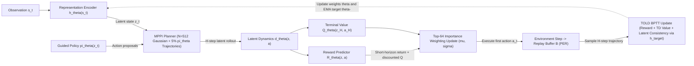

# Temporal Difference Learning for Model Predictive Control

**Temporal Difference Learning for Model Predictive Control** 收录于 [Awesome World-Action Models (RCL)](https://github.com/rcl-robotics/Awesome-World-Action-Models) **第 184/564** 篇，分组 **Foundational work**。本页是 **清单索引**：给出它在清单中的位置与原文入口，方法细节和量化结果请看原文。

## 一句话定义

RCL Awesome WAM 清单收录（Foundational work）；细节以原文 PDF / 项目页为准。

## 英文缩写速查

| 缩写 | 英文全称 | 简要说明 |
|------|----------|----------|
| WAM | World Action Model | 世界预测与动作生成耦合 |
| VLA | Vision-Language-Action | 视觉–语言–动作策略 |
| IDM | Inverse Dynamics Model | 先预测未来再反推动作 |
| WM | World Model | 环境前向预测模型 |

## 为什么重要

- RCL Awesome WAM 清单收录（Foundational work）；细节以原文 PDF / 项目页为准。
- 想横向对照同一分组的其他工作，可以从 [RCL Awesome WAM 技术地图](../overview/rcl-awesome-wam-technology-map.md) 逐条展开。
- 顺着列表实体 [Awesome World-Action Models](paper-rcl-wam-robot-learning-control-survey.md) 与站内 WAM / VLA 方法页，可以接回对应的学习主线。

## 核心信息

| 字段 | 内容 |
|------|------|
| 编号 | 184/564 |
| 分组 | Foundational work |
| 出处 | ICML 2022 |
| 论文 | <https://proceedings.mlr.press/v162/hansen22a.html> |
| 项目页 | <https://nicklashansen.github.io/td-mpc> |
| 子类 / 象限 | 经典WM与模型式RL · 理论与规划 · 不适用 |

## 核心机制（归纳）

> 注：以下机制与评测指标基于通读开放获取原文全文核对补充。

### 核心思想与 TOLD 五大模块

**TD-MPC** 将基于模型的短视野局部轨迹优化（MPC / MPPI）与基于无模型时序差分（TD）学习的终端价值函数结合，核心载体是**任务导向潜动力学模型 TOLD（Task-Oriented Latent Dynamics）**。与通过像素或全状态重构来学习世界模型的方案不同，TOLD 只编码与奖励预测相关的潜状态特征，全部组件均由确定性网络实现（状态输入下为 MLP，图像输入下 $h_\theta$ 为 4 层 CNN，Walker Run 模型总参数约 `1,507,000`）：

1. **表征编码器 $z_t = h_\theta(s_t)$**：将原始观测（状态向量、图像帧或多模态拼接特征）编码为潜状态（常规维度 50，Humanoid/Dog 为 100）。
2. **潜动力学模型 $z_{t+1} = d_\theta(z_t, a_t)$**：在潜空间递推预测下一时间步的潜状态。
3. **单步奖励预测器 $\hat{r}_t = R_\theta(z_t, a_t)$**：预测潜状态–动作对的即时奖励。
4. **双 Q 终端价值网络 $\hat{q}_t = Q_\theta(z_t, a_t)$**：估计无穷视野折扣回报（带 LayerNorm 与 Tanh，并维护动量系数 $\zeta = 0.99$ 的目标网络 $\theta^-$）。
5. **辅助策略网络 $\hat{a}_t \sim \pi_\theta(z_t)$**：确定性策略，既用于计算 TD 目标中的后继动作，也在规划阶段生成引导轨迹以加速采样收敛。

### 联合训练与在线规划流程

- **TOLD 多步潜空间联合训练（Algorithm 2, Eq. 7–11）**：使用优先经验回放（PER, $\alpha=0.6, \beta=0.4$）采样长度为 $H=5$ 的轨迹片段；**仅对首步观测执行编码** $z_t = h_\theta(s_t)$，后续通过 $d_\theta$ 在潜空间展开 $H$ 步，以时间衰减权重 $\lambda = 0.5$ 对以下三项损失联合做 BPTT 反向传播：
  - **奖励预测损失**（$c_1=0.5$）：$\|R_\theta(z_i, a_i) - r_i\|_2^2$；
  - **TD 价值损失**（$c_2=0.1$）：$\|Q_\theta(z_i, a_i) - (r_i + \gamma Q_{\theta^-}(z_{i+1}, \pi_\theta(z_{i+1})))\|_2^2$；
  - **潜状态一致性损失**（$c_3=2$）：$\|d_\theta(z_i, a_i) - h_{\theta^-}(s_{i+1})\|_2^2$，用慢速更新的目标编码器 $h_{\theta^-}$ 监督潜状态预测，无需任何状态或像素重构，天然模态无关；
  - 辅助策略 $\pi_\theta$ 独立最大化时序加权的 $Q_\theta(z_i, \pi_\theta(\mathrm{sg}(z_i)))$。
- **策略引导的 MPPI 在线规划（Algorithm 1, Eq. 3–5）**：决策时先编码 $z_t \leftarrow h_\theta(s_t)$，默认前瞻视野 $H=5$（前 25k 决策步线性从 1 增至 5），执行 $J=6$ 轮（Dog/图像为 8 轮，Humanoid 为 12 轮）迭代优化（热启动复用上一步右移均值 $\mu$）：每轮从 $\mathcal{N}(\mu^{j-1}, (\sigma^{j-1})^2 I)$ 采样 $N=512$ 条序列并混入 $5\%$ 由 $\pi_\theta$ 滚出的动作轨迹，经 $d_\theta, R_\theta, Q_\theta$ 计算累积回报 $\phi_\Gamma = \mathbb{E}_\Gamma[\gamma^H Q_\theta(z_H, a_H) + \sum_{t=0}^{H-1}\gamma^t R_\theta(z_t, a_t)]$，用温度 $\tau=0.5$ 对 top-64 轨迹做指数加权更新 $(\mu^j, \sigma^j)$（$\sigma^j$ 受线性衰减下界 $\epsilon: 0.5 \to 0.05$ 约束以保持探索），最终仅执行首步动作。

### 方法流程图

## 评测与指标

- **基准与任务规模（共 92 个连续控制任务）**：
  - **DMControl 状态基准**：15 个连续控制任务（含 6 个稀疏奖励任务，500k 步，5 种子，Fig. 3），以及 6 个高维 `Humanoid`（$\mathcal{A} \in \mathbb{R}^{21}$）与 `Dog`（$\mathcal{A} \in \mathbb{R}^{38}$）运动任务（3M–5M 步，Fig. 1）。
  - **DMControl 图像基准**：`DMControl 100k`（6 任务，10 种子，Table 1）与 `Dreamer` 12 图像任务（1M–3M 步，5 种子，84×84 堆叠 3 帧，Fig. 4）。
  - **Meta-World v2 目标条件操作**：50 个独立任务（1M 步）及 10 任务多任务 `MT10`（3M 步，Fig. 5）。
  - **多模态 3D 运动**：自建 `Quadruped Corridor` 与 `Quadruped Obstacles`（本体感受 + 第一视角相机，Fig. 5）。
- **核心量化发现**：
  - **高维状态控制突破（Fig. 1）**：TD-MPC 为文献中**首个**解决高维 `Dog`（38 维连续动作）任务的算法，在 `Humanoid` 与 `Dog` 上以约 1M 步即大幅领先 `SAC` 与真机模拟器规划 `MPC:sim`。
  - **DMControl 100k 图像基准（Table 1，均值±标准差）**：在未对图像做专用超参调优的条件下，TD-MPC 在 `Cartpole Swingup`（**770±70** vs CURL 597±170, DrQ 759±92, PlaNet 563±73, Dreamer 326±27）、`Finger Spin`（**943±59** vs DrQ 901±104）、`Cup Catch`（**933±24**）、`Reacher Easy`（**628±105**）、`Walker Walk`（**577±208**）与 `Cheetah Run`（**222±88**）上全面优于 `PlaNet`/`Dreamer`/`CURL` 并与 `DrQ` 持平或领先；相比之下 `MuZero`/`EfficientZero` 因动作离散化无法扩展至 6 维 `Walker`/`Cheetah`。在 12 项 Dreamer 图像任务上持续超越 `CURL` 与 `DrQ`，与 `DrQ-v2`、`Dreamer-v2` 相当。
  - **15 项状态 DMControl 聚合统计（Fig. 12 `rliable`）**：在 Median、IQM 与 Mean 上全面领先 `SAC` 与 `LOOP`（尤其 `Quadruped`、`Acrobot` 等复杂动力学任务）。
  - **Meta-World 与多模态（Fig. 5）**：在 50 个目标条件操作任务（如 `Bin Picking`、`Box Close`、`Hammer`）及 `MT10` 上样本效率高于 `SAC`；多模态导航中盲走基线失败而 TD-MPC 成功融合图像避障。
  - **训练与推理耗时（Table 2 & Appendix H，单张 RTX 3090）**：`Walker Walk`（达 940 分）TD-MPC 用时 **0.47 h**，比 `LOOP`（**7.72 h**）快 **16 倍**，基本追平无模型 `SAC`（**0.41 h**），每 500k 步耗时 `5.60 h`（LOOP 为 `18.5 h`，少 3.3 倍）；`Humanoid Stand`（达 800 分）用时 **9.39 h**（SAC 为 **9.31 h**）。默认规划推理延迟约 **20 ms/step（50 Hz）**，将视野缩减至 $H=1$ 可降至约 **12 ms/step**。

## 与其他工作对比

- 本页 **不做** 与具体基线的逐项数值对比；同分组的横向对照请回到 [技术地图](../overview/rcl-awesome-wam-technology-map.md) 的 **Foundational work** 分组逐条展开。
- 如果站内已经有这篇的深读页（含机构、实验表与源码运行时序图），请以那一页为准；本页只保留清单要点。
- 与清单内相邻条目孰优孰劣，本页不下结论：清单 Contribution 可能滞后于论文最新版本，差异应以各自原文的问题设定与评测口径为准。

## 结论

**TD-MPC 通过“TOLD 任务导向潜动力学模型 + TD 终端价值估计 + 策略引导 MPPI 短视野规划”，同时获得了世界模型的样本效率、高维连续控制扩展性与接近无模型方法的训练壁钟速度。**

- **放弃观测重构，改用潜空间一致性**：用目标编码器引导的潜状态一致性损失配合奖励/TD 价值反向传播，既避免了对背景光照等无关细节的建模，又天然支持状态、像素及多模态输入。
- **短视野规划 + 终端 Q 互补**：5 步规划足以应对局部精细动力学，而由辅助策略协助学得的 $Q_\theta$ 负责长远回报引导，使方法成功扩展至 38 维动作的 `Dog` 任务。
- **推理预算可在线调节**：推理时可在不重训下缩放视野与迭代步数（20 ms/step 至 12 ms/step，或直接回退至 $\pi_\theta$ 提速近 6 倍）。
- **局限与后续方向**：在强探索困难任务（如 `Finger Turn Hard`）上样本效率仍弱于 `SAC` 与 `LOOP`，说明单纯依靠高斯规划方差在稀疏探索场景下仍有提升空间。

## 常见误区

1. 不要把 Awesome 条目的 Contribution 当成完整方法证明——它只是策展导读。
2. 若站内已有这篇的深读页，以那一页为准——本页只是清单入口，不含实验数据。

## 关联页面

- 列表实体：[Awesome World-Action Models（RCL）](paper-rcl-wam-robot-learning-control-survey.md)
- 技术地图：[RCL Awesome WAM 技术地图](../overview/rcl-awesome-wam-technology-map.md)
- 方法/任务：[generative-world-models.md](../methods/generative-world-models.md)、[manipulation.md](../tasks/manipulation.md)

## 参考来源

- [`sources/papers/rcl_awesome_wam_ref_8a72842d518697e95077_temporal-difference-learning-for-model-p.md`](../../sources/papers/rcl_awesome_wam_ref_8a72842d518697e95077_temporal-difference-learning-for-model-p.md) — 本条目策展摘录
- [`sources/papers/rcl_awesome_wam_catalog.md`](../../sources/papers/rcl_awesome_wam_catalog.md) — 列表总表
- [`sources/repos/awesome-world-action-models-rcl.md`](../../sources/repos/awesome-world-action-models-rcl.md)
- [`docs/PAPERS.md`](https://github.com/RCL-Robotics/Awesome-World-Action-Models/blob/main/docs/PAPERS.md) — 上游论文目录
- 论文：<https://proceedings.mlr.press/v162/hansen22a.html>

## 推荐继续阅读

- [Awesome World-Action Models (RCL) 仓库](https://github.com/rcl-robotics/Awesome-World-Action-Models)
- [原文](https://proceedings.mlr.press/v162/hansen22a.html)
