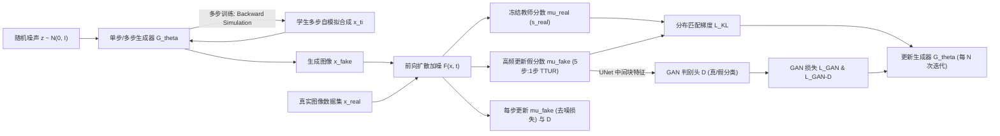

# Improved Distribution Matching Distillation for Fast Image Synthesis

**Improved Distribution Matching Distillation for Fast Image Synthesis** 收录于 [Awesome World-Action Models (RCL)](https://github.com/rcl-robotics/Awesome-World-Action-Models) **第 160/564** 篇，分组 **Foundational work**。本页是 **清单索引**：给出它在清单中的位置与原文入口，方法细节和量化结果请看原文。

## 一句话定义

RCL Awesome WAM 清单收录（Foundational work）；细节以原文 PDF / 项目页为准。

## 英文缩写速查

| 缩写 | 英文全称 | 简要说明 |
|------|----------|----------|
| WAM | World Action Model | 世界预测与动作生成耦合 |
| VLA | Vision-Language-Action | 视觉–语言–动作策略 |
| IDM | Inverse Dynamics Model | 先预测未来再反推动作 |
| WM | World Model | 环境前向预测模型 |

## 为什么重要

- RCL Awesome WAM 清单收录（Foundational work）；细节以原文 PDF / 项目页为准。
- 想横向对照同一分组的其他工作，可以从 [RCL Awesome WAM 技术地图](../overview/rcl-awesome-wam-technology-map.md) 逐条展开。
- 顺着列表实体 [Awesome World-Action Models](paper-rcl-wam-robot-learning-control-survey.md) 与站内 WAM / VLA 方法页，可以接回对应的学习主线。

## 核心信息

| 字段 | 内容 |
|------|------|
| 编号 | 160/564 |
| 分组 | Foundational work |
| 出处 | NeurIPS 2024 |
| 论文 | <https://proceedings.neurips.cc/paper_files/paper/2024/hash/54dcf25318f9de5a7a01f0a4125c541e-Abstract-Conference.html> |
| 子类 / 象限 | 训练优化与蒸馏 · 扩散与流匹配基础 · 不适用 |

## 核心机制（归纳）

> 注：以下机制与评测指标基于通读开放获取原文全文核对补充。

DMD2 针对原版 DMD 依赖昂贵离线 ODE 配对数据集（如 SDXL 在 1200 万 LAION prompt 上预生成配对需约 700 A100 天）、学生质量受限于教师采样器且仅支持单步生成的局限，提出四项协同改进：

1. **移除回归损失 + 双时间尺度更新规则（TTUR）**：
   - 作者指出直接去掉 $\mathcal{L}_{\text{reg}}$ 会导致像素亮度周期性震荡和训练崩溃，根源在于动态更新的假分数估计器 $\mu_{\text{fake}}$ 无法及时追踪非平稳生成器分布。
   - 引入 **TTUR**：每更新 1 次生成器 $G_\theta$，执行多次（默认 **5 次**；SD v1.5 阶段为 10 次）$\mu_{\text{fake}}$ 去噪更新，从而在**完全不构造配对数据集**的条件下稳定收敛并加快训练速度。
2. **接入真实数据的扩散 GAN 判别器**：
   - 由于教师真实分数 $\mu_{\text{real}}$ 本身存在逼近误差，仅靠教师蒸馏难以超越教师上限。DMD2 在 $\mu_{\text{fake}}$ UNet 的编码器/中间块（middle block）顶部附加轻量卷积判别头 $D$（4×4 stride-2 卷积 + GroupNorm + SiLU 下采样至 4×4 后池化并线性投影），利用**真实图像 $x_{\text{real}}$** 与生成图像加噪后的分布训练非饱和 GAN 损失：
     $$L_G = L_{\text{KL}} + \lambda_{\text{GAN}} L_{\text{GAN}}$$
   - 判别头与 $\mu_{\text{fake}}$ 共享编码特征，在分布层面直接吸收真实数据监督，使学生质量首次稳定超越多步教师模型。
3. **多步生成与后向模拟（Backward Simulation）**：
   - 为将 SDXL 等高容量模型蒸馏至 1024×1024 高清输出，DMD2 扩展支持固定时间步调度的少步采样（4 步调度为 $\{999, 749, 499, 249\}$），交替执行去噪 $\hat{x}_{t_i} = G_\theta(x_{t_i}, t_i)$ 与前向加噪 $x_{t_{i+1}} = \alpha_{t_{i+1}}\hat{x}_{t_i} + \sigma_{t_{i+1}}\epsilon$。
   - 针对传统多步蒸馏训练用真实图加噪、推理用生成器自身前一步输出导致的“训练–推理输入失配”，DMD2 在训练阶段直接运行当前学生生成器多步模拟得到中间含噪合成样本 $x_{t_i}$（Backward Simulation），消除域偏移。

### 方法流程图

关于快采样生成模型与世界模型加速的关联，可参见站内 [World Action Models（WAM）](../concepts/world-action-models.md) 与 [generative-world-models.md](../methods/generative-world-models.md)。

## 评测与指标

- **评测基准与指标**：ImageNet 64×64（50K 样本 FID↓）、零样本 MS-COCO 2014（30K 256×256 clean-FID↓；SDXL 10K 512×512 FID↓、299px 中心裁剪 Patch FID↓、OpenCLIP-G 分数↑、LPIPS 多样性↑），以及 ImageReward / Aesthetic Score 与 Prolific 人类偏好评估（128 条 PartiPrompts）。
- **核心量化结果**：
  - **ImageNet 64×64（单步 NFE=1，Table 1 & 3）**：DMD2 标准版（7×A100 约 2 天）FID **1.51**，延长训练版达 **1.28**；大幅超越原版 DMD（2.62）、CTM（1.92）、iCT-deep（3.25）以及 511 步教师 EDM ODE（2.22）和 EDM SDE（1.36），推理计算量降低约 500×。消融显示去掉回归损失直接训 DMD 退化至 3.48，加 TTUR 后恢复至 2.61（无需配对数据），再加 GAN 降至 1.51。
  - **COCO 2014-30k 零样本（蒸馏 SD v1.5，Appendix Table 5）**：DMD2 单步（0.09s）FID **8.35**，较 DMD（11.49）大幅提升 3.14 分，并**超越 50 步 PNDM 教师 SDv1.5（2.59s, FID 8.59）**。
  - **COCO 2014-10k 零样本（蒸馏 SDXL 1024×1024，Table 2, 6, 7）**：
    - DMD2 **4 步**取得 FID **19.32**、Patch FID **20.86**、CLIP **0.332**、Diversity **0.61**；DMD2 **1 步**取得 FID **19.01**、Patch FID **26.98**、CLIP **0.336**。
    - 全面优于 4 步竞品：LCM-SDXL（22.16 / 33.92 / 0.317）、SDXL-Turbo（23.19 / 23.27 / 0.334）、SDXL-Lightning（24.46 / 24.56 / 0.323），并优于或持平 100 NFE 教师 SDXL（cfg=6 为 19.36 / 21.38 / 0.332）。
    - ImageReward 与 Aesthetic Score 上，DMD2 达到 **1.07 / 6.30**，高于 SDXL 教师的 **0.86 / 6.16**；人类双盲评估中画质与文本对齐均显著领先所有 4 步基线及 50 步教师。
    - SDXL 消融（Table 4）：去掉 GAN 导致 FID/Patch FID 恶化至 26.90/27.66；去掉分布匹配（纯 GAN）导致 CLIP 跌至 0.307、Patch FID 27.96；去掉 Backward Simulation 使 FID/Patch FID 退化至 20.66/24.21。

## 与其他工作对比

- 本页 **不做** 与具体基线的逐项数值对比；同分组的横向对照请回到 [技术地图](../overview/rcl-awesome-wam-technology-map.md) 的 **Foundational work** 分组逐条展开。
- 如果站内已经有这篇的深读页（含机构、实验表与源码运行时序图），请以那一页为准；本页只保留清单要点。
- 与清单内相邻条目孰优孰劣，本页不下结论：清单 Contribution 可能滞后于论文最新版本，差异应以各自原文的问题设定与评测口径为准。

## 结论

**DMD2 通过 TTUR、融合真实数据的扩散 GAN 判别头以及多步后向模拟，彻底移除了 DMD 的离线配对回归瓶颈，并使少步（1–4 步）蒸馏学生在画质与偏好指标上首次稳定超越多步教师模型。**

- **数据与算力收益**：省去了生成千万级教师 ODE 配对样本的巨额预处理成本，实现端到端无配对蒸馏。
- **工程调优要点**：TTUR（通常 5 次假分数更新对应 1 次生成器更新）是稳定无回归分布匹配的关键；SDXL 单步版仍需借用 timestep shift（t=399）与极少量（10K）短预热缓解块状噪声，而 4 步版则无需该技巧。
- **适用边界**：相比原教师模型，蒸馏学生输出多样性略有下降（SDXL Diversity 0.61 vs. 0.64），且训练期引导尺度（guidance scale）固定，尚未支持推理时动态调节引导强度。

## 常见误区

1. 不要把 Awesome 条目的 Contribution 当成完整方法证明——它只是策展导读。
2. 若站内已有这篇的深读页，以那一页为准——本页只是清单入口，不含实验数据。

## 关联页面

- 列表实体：[Awesome World-Action Models（RCL）](paper-rcl-wam-robot-learning-control-survey.md)
- 技术地图：[RCL Awesome WAM 技术地图](../overview/rcl-awesome-wam-technology-map.md)
- 方法/任务：[generative-world-models.md](../methods/generative-world-models.md)、[manipulation.md](../tasks/manipulation.md)

## 参考来源

- [`sources/papers/rcl_awesome_wam_ref_8be34f0cf0d2ab79e166_improved-distribution-matching-distillat.md`](../../sources/papers/rcl_awesome_wam_ref_8be34f0cf0d2ab79e166_improved-distribution-matching-distillat.md) — 本条目策展摘录
- [`sources/papers/rcl_awesome_wam_catalog.md`](../../sources/papers/rcl_awesome_wam_catalog.md) — 列表总表
- [`sources/repos/awesome-world-action-models-rcl.md`](../../sources/repos/awesome-world-action-models-rcl.md)
- [`docs/PAPERS.md`](https://github.com/RCL-Robotics/Awesome-World-Action-Models/blob/main/docs/PAPERS.md) — 上游论文目录
- 论文：<https://proceedings.neurips.cc/paper_files/paper/2024/hash/54dcf25318f9de5a7a01f0a4125c541e-Abstract-Conference.html>

## 推荐继续阅读

- [Awesome World-Action Models (RCL) 仓库](https://github.com/rcl-robotics/Awesome-World-Action-Models)
- [原文](https://proceedings.neurips.cc/paper_files/paper/2024/hash/54dcf25318f9de5a7a01f0a4125c541e-Abstract-Conference.html)
