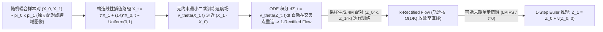

# Flow Straight and Fast

**Flow Straight and Fast: Learning to Generate and Transfer Data with Rectified Flow**（Xingchao Liu, Chengyue Gong, Qiang Liu，University of Texas at Austin，ICLR 2023 / arXiv:2209.03003v1）收录于 [Awesome World-Action Models (RCL)](https://github.com/rcl-robotics/Awesome-World-Action-Models) **第 159/564** 篇，分组 **Foundational work**。本页基于原文全文，系统归纳 **Rectified Flow（矫正流）** 的数学原理、Reflow 直线化定理、与概率流 ODE / DDIM 的统一关系及关键实验结果。

## 一句话定义

**Rectified Flow** 是一种以极简无约束最小二乘学习神经网络常微分方程（ODE）以在任意两个经验分布 $\pi_0$ 与 $\pi_1$ 之间传输的生成与迁移框架：它训练速度场 $v(z, t)$ 尽可能贴合连接样本对 $(X_0, X_1)$ 的直线方向 $X_1 - X_0$，利用 ODE 解的唯一性在交叉点「重连（rewire）」路径以降低凸传输代价，并通过递归 **Reflow** 将轨迹拉直至近乎直线，从而支持极少步乃至单步 Euler 高质量采样。

## 英文缩写速查

| 缩写 | 英文全称 | 简要说明 |
|------|----------|----------|
| WAM | World Action Model | 世界预测与动作生成耦合 |
| VLA | Vision-Language-Action | 视觉–语言–动作策略 |
| IDM | Inverse Dynamics Model | 先预测未来再反推动作 |
| WM | World Model | 环境前向预测模型 |
| ODE / SDE | Ordinary / Stochastic Differential Equation | 常微分方程（确定性流模型）/ 随机微分方程（扩散模型） |
| PF-ODE | Probability Flow ODE | 与扩散 SDE 共享边缘分布的确定性概率流常微分方程 |
| NFE | Number of Function Evaluations | 推理阶段调用主神经网络漂移函数的次数 |
| FID | Fréchet Inception Distance | 评估生成图像分布质量的指标（越低越好） |

## 为什么重要

- **奠定现代快速动作生成与大型流模型基石**：传统扩散模型（DDPM / SDE）与概率流 ODE（VP/sub-VP ODE）因遵循弯曲轨迹和非均匀速度，单步或少步数值积分误差巨大；Rectified Flow 揭示「直线轨迹 + 均匀时间推进」无需 SDE 随机微积分推导即可通过纯 ODE 回归实现，直接启发后续 SD3、Flux 以及机器人领域 Flow Matching 动作策略（如 $\pi_0$ 等）的少步高实时控制设计。
- **单算法统一「无条件生成 + 无配对图像迁移 + 域适应」**：只要把 $\pi_0$ 从标准高斯替换为源域样本分布，同一训练流程即可完成跨域迁移，且 ODE 天然时间可逆，无需 CycleGAN 的对抗训练与循环一致性正则。
- **顺着索引入口延伸阅读**：对照 [Awesome World-Action Models（RCL）](paper-rcl-wam-robot-learning-control-survey.md)、[RCL Awesome WAM 技术地图](../overview/rcl-awesome-wam-technology-map.md) 与同分支单步后继工作 [Mean Flows](paper-rcl-ref-ce6916f81594a9c4c73f-mean-flows-for-one-step-generative-modeling.md)。

## 核心信息

| 字段 | 内容 |
|------|------|
| 作者与机构 | Xingchao Liu, Chengyue Gong, Qiang Liu（University of Texas at Austin） |
| 编号 / 分组 | 159/564 · Foundational work（子类：扩散与流匹配基础） |
| 出处 / 原文 | ICLR 2023 · <https://openreview.net/forum?id=XVjTT1nw5z> / arXiv:2209.03003v1 |
| 核心基干实验设置 | 基于 DDPM++ U-Net 架构修改；CIFAR-10（Adam `lr=2e-4`, EMA `0.999999`, dropout `0.15`）；图像翻译 512×512（AdamW, `bs=4`, 1000 epochs） |
| 核心能力 | $O(1/K)$ Reflow 直线化收敛；CIFAR-10 单步蒸馏 FID **4.85**；DomainNet / OfficeHome 域适应 |

## 核心机制（归纳）

1. **直线插值与非因果路径因果化（1-Rectified Flow）**：
   - 给定任意耦合样本 $(X_0, X_1) \sim \pi_0 \times \pi_1$，构造线性插值过程 $X_t = t X_1 + (1-t) X_0$（$t \in [0, 1]$）。由于 $dX_t = (X_1 - X_0)dt$ 需要预先知道终点 $X_1$ 而非因果且路径会交叉，Rectified Flow 通过极简非线性最小二乘训练神经网络速度场 $v_\theta(z, t)$：
     $$\min_v \int_0^1 \mathbb{E}\left[\|(X_1 - X_0) - v(X_t, t)\|^2\right] dt$$
   - 精确最优解为条件期望 $v^X(z, t) = \mathbb{E}[X_1 - X_0 \mid X_t = z]$。推理时求解因果 ODE $dZ_t = v(Z_t, t)dt$（正向 $Z_0 \sim \pi_0 \to Z_1$，或反向 $d\tilde{X}_t = -v(\tilde{X}_t, t)dt$ 从 $\pi_1 \to \pi_0$）。
2. **三大理论性质（Section 3）**：
   - **边缘分布保持（Theorem 3.3）**：基于连续性方程 $\dot{\pi}_t + \nabla\cdot(v_t^X \pi_t)=0$，在任意时刻 $t \in [0, 1]$ 恒有 $\text{Law}(Z_t) = \text{Law}(X_t)$，且因 ODE 解的唯一性在交叉点「重连（rewiring）」轨迹以消除交叉。
   - **同时降低所有凸传输代价（Theorem 3.5）**：由两次 Jensen 不等式可直接证明，对任意凸代价函数 $c:\mathbb{R}^d\to\mathbb{R}$，新耦合 $(Z_0, Z_1)=\text{Rectify}((X_0, X_1))$ 满足 $\mathbb{E}[c(Z_1 - Z_0)] \le \mathbb{E}[c(X_1 - X_0)]$（Pareto 下降）。
   - **递归 Reflow 与 $O(1/K)$ 直线化收敛（Theorem 3.6–3.7）**：用第 $k$ 步流生成的确定性配对 $(Z_0^k, Z_1^k)$ 重新训练得到 $Z^{k+1}=\text{RectFlow}((Z_0^k, Z_1^k))$。定义直线度 $S(Z) = \int_0^1 \mathbb{E}[\|(Z_1-Z_0)-\dot{Z}_t\|^2]dt$，则 $\min_{k\le K}(S(Z^k) + V(Z_0^{k-1}, Z_1^{k-1})) = O(1/K)$。完全直线化的流满足无粘 Burgers 方程 $\partial_t v + (\partial_z v)v = 0$，可由单步 Euler 更新 $Z_1 = Z_0 + v(Z_0, 0)$ 精确模拟。
3. **末期单步蒸馏（Distillation）与统一非直线框架**：
   - 在获得近乎直线的 $k$-Rectified Flow 后，可用单步模型 $\hat{T}(z_0)=z_0+v(z_0,0)$ 拟合 $(Z_0^k, Z_1^k)$（图像实验用 LPIPS 感知损失）。蒸馏与 Reflow 职责不同：Reflow 改变耦合使轨迹更直，蒸馏则忠实拟合当前耦合以消除残余离散误差。
   - **非线性扩展与 PF-ODE 统一（Proposition 3.11）**：将线性插值推广为 $X_t = \alpha_t X_1 + \beta_t \xi$ 后，Song 等人的 VE / VP / sub-VP PF-ODE 及 DDIM 均可化归为其特例；且清晰解释了为何 VP ODE（$\beta_t = \sqrt{1-\alpha_t^2} \neq 1-\alpha_t$）轨迹弯曲且不可被 Reflow 拉直，以及指数调度 $\alpha_t$ 导致的前慢后快非均匀步速问题。
4. **无配对图像翻译与域适应扩展**：
   - 图像翻译引入域分类器隐层特征映射 $h(x)$ 的梯度加权损失 $\mathbb{E}[\|\nabla h(X_t)^\top(X_1 - X_0 - v(X_t, t))\|_2^2]$ 以在迁移风格的同时保持主体结构；域适应则在预训练分类器最后隐层特征空间构建 Rectified Flow 将测试域 $\pi_0$ 传回训练域 $\pi_1$。

### 方法流程图

## 评测与指标

### 1. CIFAR-10 无条件图像生成对比（DDPM++ 统一架构，Table 1a & 1b）

| 方法 | 求解器 / NFE | IS ↑ | FID ↓ | Recall ↑ |
|------|--------------|------|-------|----------|
| **1-Rectified Flow（+Distill）** | Euler `N=1`（NFE=1） | 1.13 (**9.08**) | 378 (**6.18**) | 0.0 (**0.45**) |
| **2-Rectified Flow（+Distill）** | Euler `N=1`（NFE=1） | 8.08 (**9.01**) | 12.21 (**4.85**) | 0.34 (**0.50**) |
| **3-Rectified Flow（+Distill）** | Euler `N=1`（NFE=1） | 8.47 (**8.79**) | 8.15 (**5.21**) | 0.41 (**0.51**) |
| VP ODE (+Distill) | Euler `N=1`（NFE=1） | 1.20 (8.73) | 451 (16.23) | 0.0 (0.29) |
| sub-VP ODE (+Distill) | Euler `N=1`（NFE=1） | 1.21 (8.80) | 451 (14.32) | 0.0 (0.35) |
| **1-Rectified Flow** | RK45 自适应（**NFE=127**） | **9.60** | **2.58** | **0.57** |
| 2-Rectified Flow / 3-Rectified Flow | RK45 自适应（NFE=110 / 104） | 9.24 / 9.01 | 3.36 / 3.96 | 0.54 / 0.53 |
| VP ODE / sub-VP ODE | RK45 自适应（NFE=140 / 146） | 9.37 / 9.46 | 3.93 / 3.16 | 0.51 / 0.55 |
| *(参考单步基线)* StyleGAN2+ADA / TDPM / DDIM Distill | NFE=1 | 9.40 / 8.65 / 8.36 | 2.92 / 8.91 / 9.36 | 0.49 / 0.46 / 0.51 |

### 2. 高分辨率生成、图像翻译与域适应（Sec. 5.2–5.4, Table 2）

- **高分辨率生成（256×256）**：在 LSUN Bedroom、LSUN Church、CelebA-HQ 与 AFHQ Cat 上验证 1-/2-Rectified Flow 的少步/单步生成与反演编辑能力（Fig. 1, 10, 11, 12）。
- **无配对图像翻译（512×512）**：在 AFHQ（Cat $\leftrightarrow$ Wild Animals）、MetFace $\leftrightarrow$ CelebA-HQ 上，2-Rectified Flow 仅需 `N=1` 步 Euler 即可完成高质量风格迁移并保留对象结构（Fig. 14）。
- **域适应准确率（Table 2，100 步潜特征传输）**：在 **OfficeHome** 上取得 **69.2 ± 0.5%**（优于 Deep CORAL 68.7 ± 0.3 与 ERM 66.5 ± 0.3）；在 **DomainNet**（345 类）上取得 **41.4 ± 0.1%**（持平 Deep CORAL 41.5 ± 0.2，优于 ERM 40.9 ± 0.1）。

## 与其他工作对比

- **相比 DDPM / VE / VP / sub-VP SDE & PF-ODE**：无需随机微积分、前向加噪方差表调参或 $\beta_0\xi$ 近似边界条件；$\alpha_t=t,\ \beta_t=1-t$ 兼顾直线路径与均匀步速，在 RK45（127 NFE 对比 140–146 NFE）和单步 Euler（FID 4.85 对比 14.32–16.23）上全面领先。
- **相比传统最优传输（OT）求解器**：不针对特定 $c$ 做高维极小极大/双层优化（计算昂贵且 $c$-OT 未必等价于生成指标最优），而是通过无约束回归对一切凸代价同步 Pareto 降耗；若确实需要 $L_2$-OT 不动点，只需将 $v$ 约束为梯度场 $v(x,t)=\nabla f(x,t)$ 即可消除旋转分量（Sec. 3.4）。
- **相比 GAN 与标准 Neural ODE (MLE)**：无极小极大训练崩溃、无训练期 ODE 数值积分与伴随反向传播内存爆炸，且由预先指定线性插值「铺好轨道」消除了 MLE 流模型路径欠定的问题。

## 常见误区或局限

1. **Reflow 迭代次数并非越多越好**：Table 1a 与 Fig. 8 明确显示，虽然 Reflow 显著降低了小步数（$N \lesssim 80$）下的 FID，但随着 $k$ 从 1 增至 2、3，大步数（RK45）下的 FID 从 2.58 退化到 3.36 与 3.96——因为每轮 Reflow 用前一步流生成合成训练对都会累积速度场 $v^X$ 的估计误差（实践中通常只做 1 次 Reflow 即 2-Rectified Flow）。
2. **「直线耦合」不等价于高维 $L_2$ 最优传输**：在 $d=1$ 维上直线耦合与单调 $c$-最优耦合完全重合；但在 $d\ge 2$ 高维空间，直线耦合只是任意严格凸代价最优耦合的**必要非充分条件**（Theorem 3.8），普通 1-/2-Rectified Flow 速度场可能残留旋转分量。
3. **高维 $L_2$ 相对传输代价指标失灵**：论文第 5.1 节指出，衡量离散 $L_2$ 分配差距的相对传输代价只适用于低维玩具实验，在高维空间哪怕随机神经网络也会趋近于 0（这也是前人误判 DDIM 为 $L_2$-OT 的诱因）。

## 结论

**Rectified Flow 用「线性插值最小二乘回归 + 迭代 Reflow 直线化」两条极简机制，打破了扩散/流模型生成质量与采样速度之间的长期权衡。**

1. **直线插值 + 因果 ODE 重连是通用传输基座**：$X_t=tX_1+(1-t)X_0$ 不仅比 VP/sub-VP 曲线调度省去超参包袱，还自带边缘保持与全凸代价同步下降性质。
2. **「1 次 Reflow + 末期蒸馏」是性价比最高的单步配方**：在 CIFAR-10 上先用 1 轮 Reflow 将轨迹拉直（`N=1` FID 从 378 骤降至 12.21），再蒸馏即可达成 1-NFE **4.85 FID / 0.50 Recall**；过多轮 Reflow 反而累积教师模型拟合误差。
3. **任意源域 $\pi_0 \to$ 目标域 $\pi_1$ 天然免对抗迁移**：只要将噪声替换为源域图像或特征，即可直接完成无配对风格迁移与域适应，且时间可逆性自动保证循环一致。
4. **若需免去多阶段 Reflow 的额外数据生成成本，可进一步关注后继原生单步方法**：如 [Mean Flows](paper-rcl-ref-ce6916f81594a9c4c73f-mean-flows-for-one-step-generative-modeling.md) 直接通过平均速度场在单阶段内训练 1-NFE 模型。

## 关联页面

- 列表实体：[Awesome World-Action Models（RCL）](paper-rcl-wam-robot-learning-control-survey.md)
- 技术地图：[RCL Awesome WAM 技术地图](../overview/rcl-awesome-wam-technology-map.md)
- 同领域演进工作：[Mean Flows for One-step Generative Modeling](paper-rcl-ref-ce6916f81594a9c4c73f-mean-flows-for-one-step-generative-modeling.md)
- 方法/任务：[generative-world-models.md](../methods/generative-world-models.md)、[manipulation.md](../tasks/manipulation.md)

## 参考来源

- [`sources/papers/rcl_awesome_wam_ref_8c87d43c8563d21b1a7e_flow-straight-and-fast-learning-to-gener.md`](../../sources/papers/rcl_awesome_wam_ref_8c87d43c8563d21b1a7e_flow-straight-and-fast-learning-to-gener.md) — 本条目策展摘录
- [`sources/papers/rcl_awesome_wam_catalog.md`](../../sources/papers/rcl_awesome_wam_catalog.md) — 列表总表
- [`sources/repos/awesome-world-action-models-rcl.md`](../../sources/repos/awesome-world-action-models-rcl.md)
- [`docs/PAPERS.md`](https://github.com/RCL-Robotics/Awesome-World-Action-Models/blob/main/docs/PAPERS.md) — 上游论文目录
- 论文：<https://openreview.net/forum?id=XVjTT1nw5z>

## 推荐继续阅读

- [Awesome World-Action Models (RCL) 仓库](https://github.com/rcl-robotics/Awesome-World-Action-Models)
- [原文（OpenReview / ICLR 2023）](https://openreview.net/forum?id=XVjTT1nw5z)
