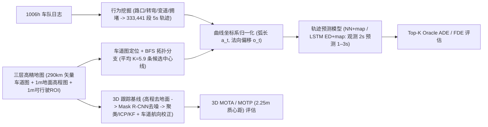

# Argoverse

**Argoverse: 3D Tracking and Forecasting With Rich Maps** 收录于 [Awesome World-Action Models (RCL)](https://github.com/rcl-robotics/Awesome-World-Action-Models) **第 098/564** 篇，分组 **Datasets**。本页是 **清单索引**：给出它在清单中的位置与原文入口，方法细节和量化结果请看原文。

## 一句话定义

Argo AI 联合 CMU 与佐治亚理工发布的首个集成**矢量车道拓扑、地面高程图与可行驶区域**的自动驾驶 3D 跟踪与运动预测数据集（Argoverse, CVPR 2019）：覆盖迈阿密与匹兹堡 **290 km** 映射车道，包含 **100 段**全向多模态 3D 跟踪日志与从 **1,006 小时**日志中挖掘的 **333,441 条** 5 秒交互轨迹，实证高精地图可大幅提升远距跟踪与多模态预测精度。

## 英文缩写速查

| 缩写 | 英文全称 | 简要说明 |
|------|----------|----------|
| HD Map | High-Definition Map | 含矢量车道中心线图与 1 m 分辨率高程/可行驶区栅格的地图 |
| ADE / FDE | Average / Final Displacement Error | 预测轨迹全程平均与终点欧氏位移误差（越低越好） |
| MOTA / MOTP | Multi-Object Tracking Accuracy / Precision | CLEAR MOT 跟踪准确度与质心定位误差指标 |
| ROI | Region of Interest | 可行驶区域外扩 5 m 的有效标注与评测边界 |
| ICP / KF | Iterative Closest Point / Kalman Filter | Argoverse 3D 基准跟踪器中用于点云配准与状态更新的算法 |

## 为什么重要

- 早期自动驾驶数据集（如 KITTI、H3D）缺乏地图信息，nuScenes 也仅提供二值栅格地图；Argoverse 首次公开带有**车道中心线折线图、前驱/后继拓扑连通性、转向/交控属性与 1 m 地面高度图**的开源 API，开启了“高精地图先验赋能 3D 感知与多模态轨迹预测”的研究范式。
- 通过启发式挖掘筛选出路口、转弯、变道与拥堵中的 **333,441 段**非平庸车辆轨迹（彻底避开匀速直行占多数的样本冗余），确立了「观测 2 s → 预测 1–3 s」与 Top-K 多模态评测（ADE/FDE）的经典标准。
- 可顺着 [Awesome World-Action Models](paper-rcl-wam-robot-learning-control-survey.md)、[RCL Awesome WAM 技术地图](../overview/rcl-awesome-wam-technology-map.md) 与站内 [World Action Models（WAM）](../concepts/world-action-models.md) 页面对照阅读。

## 核心信息

| 字段 | 内容 |
|------|------|
| 编号 | 098/564 |
| 分组 | Datasets |
| 出处 | CVPR 2019 (pp. 8748–8757) |
| 作者与机构 | Ming-Fang Chang*, John Lambert*, Patsorn Sangkloy*, Jagjeet Singh* et al. (Argo AI / CMU / Georgia Tech) |
| 论文 | <https://openaccess.thecvf.com/content_CVPR_2019/html/Chang_Argoverse_3D_Tracking_and_Forecasting_With_Rich_Maps_CVPR_2019_paper.html> |
| 数据与 API | <https://argoverse.org>（Creative Commons 许可） |
| 子类 / 象限 | 自动驾驶感知数据 · 运动预测与规划数据 · 矢量与高程地图 · 3D 跟踪与多模态预测 |

## 核心机制（归纳）

> 注：以下内容基于通读 CVPR 2019 开放获取原文全文核对补充。

### 1. 多模态传感器套件与三类高精地图

1. **双城传感采集**：在迈阿密（204 km 车道，平均车道宽 `3.84 ± 0.89 m`）与匹兹堡（86 km 车道，平均 `3.97 ± 1.04 m`）采集，覆盖 `1,074,614 m²` 可行驶区域；车顶配备 2 颗 **VLP-32 LiDAR**（重叠 40° 垂直视场、最远 `200 m`，平均每帧 **~107k 点**，约 nuScenes 的 3×）、**7 颗 30 Hz 环视相机**（`1920×1200`，360° 全向覆盖）及 **2 颗 5 Hz 前向双目相机**（`2056×2464`）+ 6-DOF 组合定位。
2. **三层地图表征与 API**：
   - **矢量车道图（Vector Map）**：用 `(x, y, z)` 折线表示单向车道中心线，标注是否位于路口、是否有交控设施、转向方向及前驱/后继拓扑连接。
   - **栅格可行驶区（1 m 分辨率）与 ROI**：将可行驶区域外扩 `5 m` 作为标注与检测的感兴趣区域（ROI），直接压制路外建筑/树木误报。
   - **栅格地面高度图（1 m 分辨率）**：利用地面高程先验替代局部平面假设，在斜坡与起伏路面上精准剔除静态地面 LiDAR 点。

### 2. 两大基准任务管线

1. **3D 目标跟踪（`Argoverse-Tracking-Beta`）**：包含 **100 段** `15–60 s` 人工标注日志（`60 train / 20 val / 20 test`），共 **10,572 个** 17 类 3D 立方体轨迹（超 70% 为车辆）。基准管线：地图高程去地面 + ROI 裁剪 → 点云聚类 + **Mask R-CNN** 滤除非车辆点 → **匈牙利匹配 + ICP 配准 + 卡尔曼滤波**，并在非路口稀疏点云场景利用地图车道方向校正车辆朝向（orientation snapping）。
2. **运动轨迹预测（`Argoverse-Forecasting`）**：从 `1,006` 小时车队日志中筛选 `320` 小时内处于（1）路口、（2）左右转、（3）变道或（4）密集车流的挑战性片段，挖掘出 **333,441 条 5 秒（10 Hz）轨迹**（`211,691 train / 41,146 val / 80,604 test`，按城市物理分区切分防泄漏）。任务为**输入前 2 s（20 帧）预测未来 1–3 s（10–30 帧）**：先在矢量车道图上局部定位并通过 **BFS 沿车道拓扑分支生成 Top-K（均值 `K = 5.9`）假设中心线**，再将轨迹映射至沿中心线弧长与法向偏移的曲线坐标系 `(a_t, o_t)`，最后由加权近邻（`NN+map`）或编解码器（`LSTM ED+map`）预测未来位置。

### 方法流程图

## 评测与指标

- **3D 车辆跟踪消融（Table 2, 20 条测试日志，质心距阈值 `2.25 m`）**：
  - **`100 m` 范围**：完整基线 `MOTA = 37.98`、`MOTP = 0.52`、`IDF1 = 0.46`、`#FP = 105.40`；去掉 Mask R-CNN 过滤后 `#FP` 暴增至 `1339.95`、`MOTA` 骤降至 **`16.42`**；改用平面拟合去地面（代替地图高程）`MOTA` 略降至 `37.36`。
  - **`50 m` 范围**：完整基线 `MOTA = 52.74`、`IDF1 = 0.58`（无 Mask R-CNN 跌至 `21.53`；平面拟合为 `52.05`）。
  - **`30 m` 范围**：完整基线 **`MOTA = 73.02`**、**`IDF1 = 0.73`**（体现 LiDAR 稀疏化导致 50 m 外跟踪难度陡增）。
- **运动轨迹预测对比（Table 3, 预测视野 `1 s` 与 `3 s` 的 `ADE / FDE ↓`）**：
  - `Constant Velocity`：`1s: 1.04 / 3.55`，`3s: 1.89 / 7.89`。
  - `NN`（无地图）：`1s: 0.75 / 2.46`，`3s: 1.28 / 5.60`。
  - `NN+map`（Top-K 中心线）：`1s: 0.72 / 2.28`，`3s: 1.33 / 4.80`（**浅层近邻配合矢量地图在 3 s FDE 上全面超越无地图深度 LSTM**）。
  - `LSTM ED`：`1s: 0.68 / 2.27`，`3s: 1.78 / 5.19`；加入社交启发式特征 `LSTM ED+social`：`3s: ADE=1.20, FDE=5.22`（对终点精度无明显增益）。
  - **`LSTM ED+map`（Top-K 矢量地图）**：`1s: 0.80 / 2.25`，`3s: ADE = 1.35, FDE = 4.67`（3 s 终点误差全场最优，且优于仅用单条真值中心线的 `LSTM ED+map(oracle)` `FDE=4.82`，证明多模态分支假设的必要性）。

## 与其他工作对比

- 相较于 **KITTI / H3D**（无地图、前视或较少跟踪序列）与 **nuScenes v1.0**（仅二值栅格地图、约 35k 点/帧 LiDAR），Argoverse 拥有 3× 点云密度（~107k）、30 Hz 全向环视+双目图像，以及独有的**矢量车道连通图与地面高程图**。
- 相较于同期轨迹预测数据 **TrafficPredict**（155 分钟观测），Argoverse 从 `1,006` 小时车队运行中精选 `320` 小时交互片段，体量大两个数量级。

## 结论

**Argoverse 首次将“矢量车道拓扑 + 地面高程栅格 + 大规模挖掘交互轨迹”系统引入公开自动驾驶基准，定量证明高精地图先验对 3D 远距跟踪与长时域多模态预测具有决定性增益。**

1. **矢量地图优于复杂模型堆叠**：在 3 s 预测终点误差上，简单 `NN+map (4.80)` 胜过无地图的 `LSTM ED (5.19)` 与 `LSTM ED+social (5.22)`，验证了车道拓扑与曲线坐标系的强几何归纳偏置。
2. **多模态（Top-K）优于单条 Oracle**：`LSTM ED+map (4.67)` 击败单中心线 `oracle (4.82)`，说明在路口或变道场景下保留多条可行车道分支更鲁棒。
3. **语义过滤抑制点云误报**：3D 跟踪中缺少 2D Mask R-CNN 前景过滤会使 100 m 误报激增 12 倍以上（`MOTA 37.98 -> 16.42`）。
4. **注意数据噪声边界**：Tracking-Beta 规模较小（100 段），Forecasting 的 333K 轨迹为自动追踪挖掘而非逐帧人工核验，建模时需容忍一定上游跟踪噪声。

## 常见误区

1. **误以为 333K 预测轨迹全是人工精标**：`Argoverse-Forecasting` 轨迹是从千小时日志中通过自动跟踪器挖掘出来的，原文明确提示其中固有存在部分噪声与误差，且预测评测仅针对非静止车辆（行人仅作上下文）。
2. **忽略 3D 跟踪的 ROI 与类别范围**：`Argoverse-Tracking-Beta` 仅标注可行驶区域外扩 5 m（ROI）内的目标，且论文第 4 节基线实验仅评估车辆类别并使用 `2.25 m` 质心距（而非 3D IoU）计算 MOTA。
3. **高估手工社交特征的收益**：实验显示仅用前后车距与邻车数的手工社交特征（`LSTM ED+social`）在 3 s FDE 上未带来收益，需用更强的交互图网络结合地图联合建模。

## 关联页面

- 列表实体：[Awesome World-Action Models（RCL）](paper-rcl-wam-robot-learning-control-survey.md)
- 技术地图：[RCL Awesome WAM 技术地图](../overview/rcl-awesome-wam-technology-map.md)
- 方法/任务：[generative-world-models.md](../methods/generative-world-models.md)、[manipulation.md](../tasks/manipulation.md)

## 参考来源

- [`sources/papers/rcl_awesome_wam_ref_901dd4e018709bd1ca32_argoverse-3d-tracking-and-forecasting-wi.md`](../../sources/papers/rcl_awesome_wam_ref_901dd4e018709bd1ca32_argoverse-3d-tracking-and-forecasting-wi.md) — 本条目策展摘录
- [`sources/papers/rcl_awesome_wam_catalog.md`](../../sources/papers/rcl_awesome_wam_catalog.md) — 列表总表
- [`sources/repos/awesome-world-action-models-rcl.md`](../../sources/repos/awesome-world-action-models-rcl.md)
- [`docs/PAPERS.md`](https://github.com/RCL-Robotics/Awesome-World-Action-Models/blob/main/docs/PAPERS.md) — 上游论文目录
- 论文：<https://openaccess.thecvf.com/content_CVPR_2019/html/Chang_Argoverse_3D_Tracking_and_Forecasting_With_Rich_Maps_CVPR_2019_paper.html>

## 推荐继续阅读

- [Awesome World-Action Models (RCL) 仓库](https://github.com/rcl-robotics/Awesome-World-Action-Models)
- [原文](https://openaccess.thecvf.com/content_CVPR_2019/html/Chang_Argoverse_3D_Tracking_and_Forecasting_With_Rich_Maps_CVPR_2019_paper.html)
