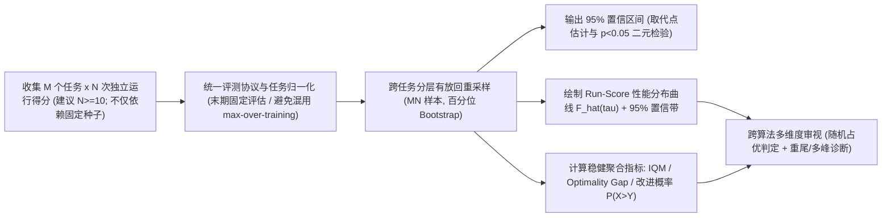

# Deep Reinforcement Learning at the Edge of the Statistical Precipice

**Deep Reinforcement Learning at the Edge of the Statistical Precipice**（Rishabh Agarwal, Max Schwarzer, Aaron Courville, Pablo Samuel Castro, Marc G. Bellemare，Google Research Brain Team / MILA，NeurIPS 2021 Outstanding Paper Award）收录于 [Awesome World-Action Models (RCL)](https://github.com/rcl-robotics/Awesome-World-Action-Models) **第 136/564** 篇，分组 **Evaluation metrics**。本页基于论文全文，系统梳理其在少运行次数（few-run regime）深度强化学习中提出的统计评测协议与核心量化发现。

## 一句话定义

一篇重塑深度强化学习与具身决策实验报告规范的方法论基石论文：揭示传统基于少量随机种子（3–10 次独立运行）报告均值或中位数点估计会产生巨大统计偏差与误判，提出以 **分层 Bootstrap 置信区间**、**全运行性能分布曲线（Performance Profiles）**、**四分位均值（IQM）**、**最优性差距（Optimality Gap）** 与 **改进概率** 为核心的严谨评测体系，并配套开源 [`rliable`](https://github.com/google-research/rliable) 工具库。

## 英文缩写速查

| 缩写 | 英文全称 | 简要说明 |
|------|----------|----------|
| WAM | World Action Model | 世界预测与动作生成耦合 |
| VLA | Vision-Language-Action | 视觉–语言–动作策略 |
| IDM | Inverse Dynamics Model | 先预测未来再反推动作 |
| WM | World Model | 环境前向预测模型 |
| IQM | Interquartile Mean | 四分位均值（25% 截尾均值）：丢弃合并运行中最低与最高各 25% 分数后计算中间 50% 的均值 |
| CI | Confidence Interval | 置信区间，本文主推基于分层百分位 Bootstrap 的 95% 区间估计 |
| ALE | Arcade Learning Environment | Atari 2600 基准测试环境（含 200M 帧与 100k 步少样本两个主流协议） |

## 为什么重要

- **刺破「少种子点估计」带来的虚假技术进步幻觉**：现代 RL / 世界模型基准计算代价高昂（如 50+ 款 Atari 游戏跑 5 个种子需超 **1,000 GPU 训练天**），绝大多数论文每任务仅跑 3–10 次独立运行。在此少样本区，依赖单一均值/中位数点估计不仅受重尾与异常值支配，还会因协议差异（如取训练全程最高分 vs 末期均值）得出完全相反的算法排序结论。
- **为具身智能与 WAM 多任务评测建立可复现统计底座**：无论是 Atari、DMControl 还是 Procgen，论文审视的诸多「声称 SOTA 改进」在加入 95% 置信区间后出现大面积重叠；`rliable` 已成为后续机器人强化学习、世界模型与决策基准的标准统计验证工具。
- **顺着索引入口延伸阅读**：对照 [Awesome World-Action Models（RCL）](paper-rcl-wam-robot-learning-control-survey.md) 与 [RCL Awesome WAM 技术地图](../overview/rcl-awesome-wam-technology-map.md) 的「统计评测协议」象限。

## 核心信息

| 字段 | 内容 |
|------|------|
| 作者与机构 | Rishabh Agarwal, Max Schwarzer, Aaron Courville, Pablo Samuel Castro, Marc G. Bellemare（Google Research Brain Team / MILA） |
| 编号 / 分组 | 136/564 · Evaluation metrics（子类：统计评测协议 · 评估指标与协议） |
| 出处 / 奖项 | NeurIPS 2021（Outstanding Paper Award）· <https://papers.neurips.cc/paper_files/paper/2021/hash/f514cec81cb148559cf475e7426eed5e-Abstract.html> |
| 开源工具与数据 | `rliable`：<https://github.com/google-research/rliable>（含 Colab 与 `gs://rl-benchmark-data` 100-run 数据集） |
| 审视基准范围 | Atari 100k（26 游戏 × 100 次运行重采样）、ALE Atari 200M（55 游戏）、DMControl（6 任务 100k/500k）、Procgen（16 任务） |

## 核心机制（归纳）

给定算法在 $M$ 个任务上各自完成 $N$ 次独立运行，得到归一化分数矩阵 $x_{1:M, 1:N}$（随机变量为 $X_m$），论文针对「不确定性量化、跨任务变异性刻画、稳健标量汇总」三类诉求给出三套工具：

1. **分层 Bootstrap 置信区间（Stratified Bootstrap CIs）**：
   - 相比仅在单任务 $N$ 次运行上做 Bootstrap（$N$ 极小时失效），分层 Bootstrap 在所有 $M$ 个任务上分别独立有放回重采样 $N$ 次，聚合成总共 $M \times N$ 个样本来计算统计量，重复数万次取 `[2.5%, 97.5%]` 百分位构造 95% 区间估计。
   - **避免二元显著性检验（$p < 0.05$）**：CI 直接展示与数据相容的效应量区间，避免「无显著差异 = 无效果」或「大样本下微小无意义差异也显著」的误读。
2. **基于全运行分数的性能分布曲线（Run-Score Performance Profiles）**：
   - 定义经验尾分布函数 $\hat{F}_X(\tau) = \frac{1}{MN}\sum_{m=1}^M\sum_{n=1}^N \mathbf{1}[x_{m,n} > \tau]$ 并叠加逐点 95% 分层 Bootstrap 置信带。
   - 相比按任务均值构建的旧版平均分分布 $\hat{F}_{\bar{X}}(\tau)$，全运行分布是真实分布的无偏估计，单个极端异常运行对其影响上限仅为 $\frac{1}{MN}$（旧版为 $\frac{1}{M}$），且曲线与 $y=0.5$ 交点即中位数、非负分数下曲线下面积即均值。
3. **稳健且高统计效率的聚合指标**：
   - **四分位均值（IQM）**：将所有 $MN$ 个运行分数排序，剔除最低与最高各 25%，仅对中间 50%（$\lfloor NM/2 \rfloor$ 次运行）求平均。兼顾中位数的抗异常值能力与接近均值的低样本方差/小偏差。
   - **最优性差距（Optimality Gap）**：在性能曲线上统计距离预设目标阈值 $\gamma$（如人类水平 $\gamma=1.0$）的缺口面积，避免均值被少数远超人类分数的游戏劫持。
   - **平均改进概率（Average Probability of Improvement）**：基于 Mann-Whitney $U$ 统计量计算算法 $X$ 在随机选取的任务上优于基线 $Y$ 的概率 $P(X > Y) = \frac{1}{M}\sum_{m=1}^M P(X_m > Y_m)$，直观衡量优势的普适性。

### 方法流程图

## 评测与指标

### 1. Atari 100k 案例研究（26 款游戏 × 5 种算法 × 100 次独立运行重采样）

- **点估计高方差与预期中位数有偏性（Fig. 2 & Fig. 3）**：样本中位数是真实中位数的**有偏估计量**（$\mathbb{E}[\text{Median}(\bar{X}_{1:M})] \neq \text{Median}(\mathbb{E}[X_{1:M}])$）。在 SPR 上，5 次运行与 100 次运行的期望样本中位数相差 **+0.03**，占其相对 `DrQ(ε)` 平均提升（**+0.08**）的约 **36%**。基于 100 次独立运行分析，文献中声称优于 `DER` 的 `OTR` 实际未必优于 `DER`。
- **中位数所需的运行次数远超常识（Fig. 2 & Fig. 4）**：若希望 Atari 100k 上的中位数 95% 置信区间足够可靠，需要 **50–100 次**独立运行；对 SPR 做人工增益检测时，中位数需要 **25 次**运行才能稳健检出 `+25%` 增益、**100 次**运行才能检出 `+10%` 增益（当真实增益为 `0%` 时，即使 100 次运行中位数仍可能出现 **20%** 偏差）。
- **IQM 的统计效率优势（Fig. 6）**：相比中位数，IQM 的 95% 置信区间宽度显著更窄；采用百分位分层 Bootstrap 时，只要 **$N=10$** 次运行即可获得接近名义 95% 覆盖率的良好区间估计（而在 $N=3$ 时，Bootstrap 会低估真实 95% 置信区间宽度）。
- **评测协议不一致引起的排序反转（Fig. 5）**：`CURL` 与 `SUNRISE` 报告了训练过程中的峰值（max evaluation score）而非末期固定评估均值；若用 `CURL` 或 `SUNRISE` 协议重评 `DER`，`DER` 的归一化分数反而大幅高于 `CURL` 报告分数，说明此前报告的性能优势很大程度源于评测协议口径差异。

### 2. 四大主流 RL 基准的再审视结论（Sec. 5）

| 基准 | 任务数 / 步数 | 原有常见做法与发现的统计偏差 | 论文建议方案 |
|------|---------------|------------------------------|--------------|
| **Atari 100k** | 26 游戏 / 100k 步 | 3–10 种子中位数波动大；末期均值与训练峰值混用导致 DER/CURL/SUNRISE 排序失真 | 固定末期评估口径；使用 IQM + 分层 Bootstrap CI + 性能分布 |
| **ALE Atari 200M** | 55 游戏 / 200M 帧（Sticky） | M-IQN 与 Dopamine Rainbow 中位数 CI 显著重叠；C51 与 DQN(Adam) 曲线大面积重叠；DreamerV2 与 M-IQN 在 James Bond 上超 50 分严重拉高均值，与 IQM/Optimality Gap 排序不一致 | 结合 IQM、Optimality Gap（$\gamma=1.0$）与运行得分分布联合对比 |
| **DMControl Suite** | 6 任务 / 100k & 500k 步 | 对比 SAC+AE、SLAC、Dreamer、CURL、RAD、DrQ、PISAC、SUNRISE、CURL-D2RL 后发现多数算法的均值 95% CI 高度重叠，秩分布（rank distribution）无法稳定支持论文宣称的单调胜出 | 报告均值（即 $1 - \text{Optimality Gap}$）的 95% CI 与秩概率分布 |
| **Procgen** | 16 游戏（Easy，10 runs） | 按 PPO 归一化呈严重重尾分布；声称优于 PLR 的 UCB-DrAC 实际改进概率 $P(X>Y)$ 仅 **40%–50%**，多项文献声称增益的概率仅 **50%–70%** | 改用任务 Min-Max 归一化，并报告改进概率 $P(X>Y)$ 与 95% CI |

## 与其他工作对比

| 维度 | 传统点估计报告 | 固定随机种子 / $p$ 值检验 | 本文 `rliable` 协议 |
|------|----------------|---------------------------|---------------------|
| 少量运行（3–10 runs）可靠性 | 易受重尾与异常任务欺骗 | 固定种子无法泛化到新种子，且 GPU 非确定性仍存在；二元检验易误导 | 通过跨任务聚合 $MN$ 样本与分层 Bootstrap 量化不确定性 |
| 跨任务汇总指标 | 均值（易被异常值主导） / 中位数（忽略近半任务且样本效率低） | 仍依赖单任务均值检验 | **IQM**（抗异常值且低方差）+ **Optimality Gap** + **改进概率** |
| 分布信息保留 | 冗长逐任务表格（常省标准差） | 仅剩显著/不显著二值标签 | **Performance Profiles**（一眼读出任意分位数与置信带） |

## 常见误区或局限

1. **误以为「固定随机种子」就能解决可复现性**：论文明确指出固定种子只能复现特定随机条件下的单点，且 GPU 算子与框架本身存在非确定性（Fig. A.13），不能回答「换一组随机条件算法是否依然有效」；更不能只用 3 个种子就宣称绝对领先（$N=3$ 时连 Bootstrap CI 都会低估真实 95% 区间）。
2. **将「改进概率 $P(X>Y)$」等同于改进幅度**：$P(X>Y)$ 只衡量算法 $X$ 胜出 $Y$ 的频率而不区分提升幅度是 1% 还是 100%，因此必须与 IQM 和 Optimality Gap 搭配使用。
3. **单一聚合指标排序互斥**：正如在 Atari 200M 上观察到的，Median、IQM 与 Optimality Gap 对算法排序可能不同（例如在低于人类水平的游戏上表现差异）；没有单一标量能完全替代性能分布曲线。

## 结论

**在计算昂贵的深度强化学习少运行次数（3–10 runs）时代，忽视统计不确定性的点估计与不一致的评估协议正在制造虚假进步；严谨的实验结论必须建立在分层 Bootstrap 置信区间、IQM 与性能分布曲线之上。**

1. **用分层百分位 Bootstrap 95% CI 取代孤立点估计**：在 10 次左右独立运行即可提供可靠覆盖率；当实验仅有 3 次运行时，应警惕区间低估并避免强结论。
2. **用 IQM（四分位均值）替代中位数与普通均值**：在 Atari 100k 等高方差基准上，中位数需 50–100 次运行才能收敛且在 5 次运行时出现显著期望偏差，而 IQM 兼具抗异常值与低方差优势。
3. **始终绘制全运行性能分布曲线（Performance Profiles）**：直观暴露重尾、多峰及随机占优区间，单个异常运行影响上限仅为 $1/(MN)$。
4. **严格对齐基线评估协议并公开全部单次运行数据**：严禁将「训练期间最高分」与「训练末期固定评估均值」混为一谈（否则会导致如 DER vs CURL/SUNRISE 般的排序逆转），建议直接通过 `rliable` 与原始运行数组发布结果。

## 关联页面

- 列表实体：[Awesome World-Action Models（RCL）](paper-rcl-wam-robot-learning-control-survey.md)
- 技术地图：[RCL Awesome WAM 技术地图](../overview/rcl-awesome-wam-technology-map.md)
- 被本文重新审视的相关工作：[Mastering Atari with Discrete World Models (DreamerV2)](paper-rcl-ref-e1815cc67e6f9fc2bb7e-mastering-atari-with-discrete-world-models.md)、[Dream to Control (DreamerV1)](paper-rcl-ref-23813a5cbed0b2b6d37e-dream-to-control-learning-behaviors-by-latent-im.md)
- 方法/任务：[generative-world-models.md](../methods/generative-world-models.md)、[manipulation.md](../tasks/manipulation.md)

## 参考来源

- [`sources/papers/rcl_awesome_wam_ref_92f666cd9d15e83951cb_deep-reinforcement-learning-at-the-edge.md`](../../sources/papers/rcl_awesome_wam_ref_92f666cd9d15e83951cb_deep-reinforcement-learning-at-the-edge.md) — 本条目策展摘录
- [`sources/papers/rcl_awesome_wam_catalog.md`](../../sources/papers/rcl_awesome_wam_catalog.md) — 列表总表
- [`sources/repos/awesome-world-action-models-rcl.md`](../../sources/repos/awesome-world-action-models-rcl.md)
- [`docs/PAPERS.md`](https://github.com/RCL-Robotics/Awesome-World-Action-Models/blob/main/docs/PAPERS.md) — 上游论文目录
- 论文：<https://papers.neurips.cc/paper_files/paper/2021/hash/f514cec81cb148559cf475e7426eed5e-Abstract.html>

## 推荐继续阅读

- [Awesome World-Action Models (RCL) 仓库](https://github.com/rcl-robotics/Awesome-World-Action-Models)
- [原文（NeurIPS 2021）](https://papers.neurips.cc/paper_files/paper/2021/hash/f514cec81cb148559cf475e7426eed5e-Abstract.html)
- [rliable 官方开源评测库](https://github.com/google-research/rliable)
