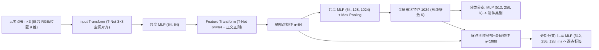

# PointNet

**PointNet: Deep Learning on Point Sets for 3D Classification and Segmentation** 收录于 [Awesome World-Action Models (RCL)](https://github.com/rcl-robotics/Awesome-World-Action-Models) **第 083/564** 篇，分组 **Components of WAMs**。本页是 **清单索引**：给出它在清单中的位置与原文入口，方法细节和量化结果请看原文。

## 一句话定义

直接消费无序 3D 点云集合的开创性统一神经网络架构（PointNet, CVPR 2017）：通过**共享权重逐点 MLP + 空间/特征对齐网络（T-Net） + 对称最大池化（Max Pooling）**严格保证点序置换不变性，以线性复杂度 $O(N)$ 统一解决 3D 形状分类、部件分割与室内场景语义分割。

## 英文缩写速查

| 缩写 | 英文全称 | 简要说明 |
|------|----------|----------|
| MLP | Multi-Layer Perceptron | 逐点独立共享权重的特征变换网络 |
| T-Net | Transformation Network | 预测 3×3 输入对齐矩阵与 64×64 特征对齐矩阵的子网络 |
| mIoU | mean Intersection over Union | 点云部件与场景语义分割的平均交并比 |
| FLOPs | Floating-Point Operations | 单样本前向推理浮点运算量（衡量模型计算复杂度） |
| MVCNN | Multi-View Convolutional Neural Network | 渲染多视角 2D 图像进行 3D 分类的对比基线架构 |

## 为什么重要

- 打破了此前 3D 深度学习必须将点云转为规则 3D 体素网格（显存立方级爆炸且存在量化误差）或多视角 2D 投影（难以直接做逐点部件/场景分割）的范式限制，奠定了**直接处理原始无序点集（Point-based Deep Learning）**的基石（如后续 PointPillars、PointNet++ 均以此为基础组件）。
- 从理论上首次证明了 `MLP + Max Pooling` 架构对 Hausdorff 连续集合函数的**通用逼近能力**与**瓶颈维数稳定性**（输出完全由不超过瓶颈维数 $K$ 的稀疏关键点骨架决定），直观解释了点云网络抗点云缺失与离群噪点的数学机理。
- 可顺着 [Awesome World-Action Models](paper-rcl-wam-robot-learning-control-survey.md)、[RCL Awesome WAM 技术地图](../overview/rcl-awesome-wam-technology-map.md) 与站内 [World Action Models（WAM）](../concepts/world-action-models.md) 对照学习。

## 核心信息

| 字段 | 内容 |
|------|------|
| 编号 | 083/564 |
| 分组 | Components of WAMs |
| 出处 | CVPR 2017 (pp. 652–660) |
| 作者与机构 | Charles R. Qi*, Hao Su*, Kaichun Mo, Leonidas J. Guibas (Stanford University) |
| 论文 | <https://openaccess.thecvf.com/content_cvpr_2017/html/Qi_PointNet_Deep_Learning_CVPR_2017_paper.html> |
| 子类 / 象限 | Spatial perception & geometry · 视觉编码器与表征 · 三维表示与状态估计 · 点云特征提取 |

## 核心机制（归纳）

> 注：以下内容基于通读 CVPR 2017 开放获取原文全文核对补充。

### 1. 置换不变对称聚合与 T-Net 联合对齐

1. **集合函数近似**：面对无序点云 $S=\{x_1,\dots,x_n\}$（$x_i\in\mathbb{R}^3$ 或附带 RGB/法向等附加通道），用共享逐点 MLP 近似逐点映射 $h(x_i)$，再用跨点对称函数 **Max Pooling** 聚合全局特征：
   $$f(\{x_1,\dots,x_n\}) \approx \gamma\!\left(\max_{i=1,\dots,n} h(x_i)\right)$$
   相比将点排序（高维空间不存在对扰动稳定的保邻近一维全序）或送入 RNN（难以扩展至上千点），`MLP + Max Pooling` 天然对 $N!$ 种点排列严格不变。
2. **输入与特征空间对齐（T-Net）**：通过结构类似微型 PointNet 的 **T-Net** 分别预测 `3×3` 输入坐标仿射变换矩阵与 `64×64` 特征变换矩阵，直接矩阵乘法对齐点云与特征；为稳定高维特征变换训练，在 Softmax 损失上附加**正交正则项**：
   $$L_{\text{reg}} = \|I - AA^T\|_F^2$$

### 2. 分类头与局部-全局拼接分割头

- **分类网络**：输入 `n×3` → `3×3` T-Net → 共享 `MLP (64, 64)` → `64×64` T-Net（输出 `n×64` 局部特征）→ 共享 `MLP (64, 128, 1024)` → `Max Pool` 得 `1024` 维全局特征 → `MLP (512, 256, k)`（含 BatchNorm + ReLU，最后一层加 Dropout）输出 `k` 类分数。
- **分割网络**：将 `1024` 维全局特征复制并拼接回每个点的 `64` 维局部特征，构成 `n × 1088` 的局部-全局联合表征，再经共享 `MLP (512, 256, 128)` 与 `(128, m)` 输出每个点在 `m` 个部件/语义类上的分类分数。

### 3. 理论分析：通用逼近与骨架关键点（Theorems 1–2）

- **Theorem 1（通用集合逼近）**：只要最大池化瓶颈维数 $K$ 足够大，PointNet 可任意精度逼近关于 Hausdorff 距离连续的任意集合函数。
- **Theorem 2（关键点集与抗扰动性）**：对于任意输入 $S$，存在大小 $|C_S| \le K$ 的稀疏**关键点集（Critical Point Set）$C_S$**（可视化对应物体轮廓骨架）与上界点集 $N_S$，凡满足 $C_S \subseteq T \subseteq N_S$ 的任意点云均输出完全一致的全局特征 $f(T)=f(S)$，从理论上解释了模型对随机丢点与插入离群点的强鲁棒性。

### 方法流程图

## 评测与指标

- **ModelNet40 3D 形状分类（Table 1, 12,311 CAD 模型：9,843 train / 2,468 test，采样 1,024 点）**：
  - **`PointNet`**（单视角原始点云）：平均类准确率 **`86.2%`**，总体准确率 **`89.2%`**；优于体素网络 `3DShapeNets (84.7%)`、`VoxNet (85.9%)` 与手工特征 MLP 基线（`77.4%`），并与 `20` 视角体素 `Subvolume (89.2%)` 持平（仅略低于 `80` 视图 2D 渲染 `MVCNN 90.1%`）。
- **ShapeNet Part 部件分割（Table 2, 16 类 16,881 形状、50 个部件）**：
  - 点均 `mIoU` 达 **`83.7%`**（超越 `Yi et al. 81.4%` 与自建 `3D CNN 79.4%`）；在 Blensor 模拟 Kinect 残缺单视角扫描下仅损失 `5.3%` mIoU。
- **Stanford 3D 室内场景语义解析与检测（Tables 3–4, 6 区域 271 房间，9 维 XYZ+RGB+房间归一化坐标，训练每 1m×1m 块采 4,096 点）**：
  - **13 类语义分割**：`mIoU = 47.71%`、总体准确率 `78.62%`（大幅领先手工几何特征 MLP 基线的 `20.12%` / `53.19%`）。
  - **基于连通分量的 3D 检测（IoU 0.5 AP）**：4 类家具均值 **`24.24%`**（超越 Armeni et al. `18.22%`，Chair `33.80% vs 16.15%`）。
- **结构消融与鲁棒性测试（Table 5 & Fig. 6, ModelNet40）**：
  - 对齐消融：无对齐 `87.1%` → 仅 `3×3` 输入对齐 `87.9%` → 仅 `64×64` 无正则 `86.9%` → `64×64` 加正交正则 `87.4%` → **双变换 + 正交正则 `89.2%`**；在对称算子对比中，Max Pooling 显著优于 Average Pooling、Attention 加权和、排序 MLP 与 RNN（Fig. 5）。
  - 破损与噪点：缺失 **`50%`** 点（最远点/随机采样）时准确率仅降 `2.4%` / `3.8%`；加入 **`20%`** 均匀离群点仍保持 **`> 80%`** 准确率。
- **时空复杂度与吞吐（Table 6）**：空间与时间复杂度随点数线性增长 **$O(N)$**；`PointNet` 仅 **`3.5M` 参数**（`vanilla 0.8M`）、**`440M` FLOPs/样本**，较 `Subvolume`（`16.6M`, `3633M`）FLOPs 低 **8×**，较 `MVCNN`（`60.0M`, `62057M`）参数少 **17×**、FLOPs 低 **141×**；GTX 1080X TensorFlow 实测每秒处理超 **100 万点**（约 `1K 物体/s` 或 `2 房间/s`）。

## 与其他工作对比

- 相较于 **Volumetric 3D CNN（3DShapeNets / VoxNet / Subvolume）**：无需立方级显存与体素量化，计算量降了一个数量级且精度持平或更高。
- 相较于 **Multi-view CNN（MVCNN）**：参数少 17×、计算省 141×，且能天然输出逐点部件与场景语义分割，但在超高视图数（80 视图）下的极精细表面轮廓识别上略逊于 MVCNN（`89.2% vs 90.1%`）。
- 作为后续 **PointNet++**、**PointPillars**（LiDAR 柱体单层 PointNet 编码）与诸多 3D 检测/机器人抓取骨干的基础组件，确立了点云局部-全局特征提取的标准范式。

## 结论

**PointNet 以“逐点共享 MLP + T-Net 对齐 + Max Pooling 对称聚合”的极简架构，在保持严格置换不变性与 $O(N)$ 线性复杂度的同时，成为直接处理无序 3D 点云的通用基础编码器。**

1. **工程首选基线**：参数仅 `3.5M`、单卡百万点/秒的吞吐使其至今仍是体素柱（如 PointPillars）与轻量级点云分支的核心组件。
2. **正交正则不可或缺**：`64×64` 高维特征对齐若不加 $\|I-AA^T\|_F^2$ 正则反而会略微伤及精度（`87.1% -> 86.9%`），加正则后双对齐可共同推升至 `89.2%`。
3. **局部几何扩展方向**：由于底层未显式构造 kNN 或球邻域层级聚合，遇到大尺度复杂场景或需细粒度局部曲率时，应升级采用分层点集网络（如 PointNet++ 或局部图卷积）。
4. **稀疏骨架特性**：全局决策依赖不超过 `1024` 个关键骨架点，天然适合存在部分遮挡与传感丢点的真实机器人/车载点云，但训练时需覆盖相应噪点分布。

## 常见误区

1. **误以为 PointNet 能直接提取多尺度局部邻域结构**：原文在 Sec 4.1 指出了点间交互的重要性，但基础版 PointNet 在全局 Max Pooling 之前各点特征完全独立计算（无 kNN 局部聚合），因此在复杂大场景精细分割上往往需要切分局部块（如 `1m×1m`）或升级为 PointNet++。
2. **忽视特征 T-Net 的正交约束**：直接启用高维特征变换矩阵容易优化失稳，必须保留正交正则项 $L_{\text{reg}}=\|I-AA^T\|_F^2$。
3. **忽略归一化与离群点训练依赖**：实验先将点云归一化到单位球内；且抗 20% 离群点的能力建立在训练阶段包含对应噪声扰动的前提上。

## 关联页面

- 列表实体：[Awesome World-Action Models（RCL）](paper-rcl-wam-robot-learning-control-survey.md)
- 技术地图：[RCL Awesome WAM 技术地图](../overview/rcl-awesome-wam-technology-map.md)
- 方法/任务：[generative-world-models.md](../methods/generative-world-models.md)、[manipulation.md](../tasks/manipulation.md)

## 参考来源

- [`sources/papers/rcl_awesome_wam_ref_a6e65f34d4c161a2ba59_pointnet-deep-learning-on-point-sets-for.md`](../../sources/papers/rcl_awesome_wam_ref_a6e65f34d4c161a2ba59_pointnet-deep-learning-on-point-sets-for.md) — 本条目策展摘录
- [`sources/papers/rcl_awesome_wam_catalog.md`](../../sources/papers/rcl_awesome_wam_catalog.md) — 列表总表
- [`sources/repos/awesome-world-action-models-rcl.md`](../../sources/repos/awesome-world-action-models-rcl.md)
- [`docs/PAPERS.md`](https://github.com/RCL-Robotics/Awesome-World-Action-Models/blob/main/docs/PAPERS.md) — 上游论文目录
- 论文：<https://openaccess.thecvf.com/content_cvpr_2017/html/Qi_PointNet_Deep_Learning_CVPR_2017_paper.html>

## 推荐继续阅读

- [Awesome World-Action Models (RCL) 仓库](https://github.com/rcl-robotics/Awesome-World-Action-Models)
- [原文](https://openaccess.thecvf.com/content_cvpr_2017/html/Qi_PointNet_Deep_Learning_CVPR_2017_paper.html)
