# DROID

**DROID: A Large-Scale In-The-Wild Robot Manipulation Dataset** 收录于 [Awesome World-Action Models (RCL)](https://github.com/rcl-robotics/Awesome-World-Action-Models) **第 103/564** 篇，分组 **Datasets**。本页是 **清单索引**：给出它在清单中的位置与原文入口，方法细节和量化结果请看原文。

## 一句话定义

RCL Awesome WAM 清单收录（Datasets）；细节以原文 PDF / 项目页为准。

## 英文缩写速查

| 缩写 | 英文全称 | 简要说明 |
|------|----------|----------|
| WAM | World Action Model | 世界预测与动作生成耦合 |
| VLA | Vision-Language-Action | 视觉–语言–动作策略 |
| IDM | Inverse Dynamics Model | 先预测未来再反推动作 |
| WM | World Model | 环境前向预测模型 |

## 为什么重要

- RCL Awesome WAM 清单收录（Datasets）；细节以原文 PDF / 项目页为准。
- 想横向对照同一分组的其他工作，可以从 [RCL Awesome WAM 技术地图](../overview/rcl-awesome-wam-technology-map.md) 逐条展开。
- 顺着列表实体 [Awesome World-Action Models](paper-rcl-wam-robot-learning-control-survey.md) 与站内 WAM / VLA 方法页，可以接回对应的学习主线。

## 核心信息

| 字段 | 内容 |
|------|------|
| 编号 | 103/564 |
| 分组 | Datasets |
| 出处 | RSS 2024 |
| 论文 | <https://www.roboticsproceedings.org/rss20/p120.pdf> |
| 子类 / 象限 | 机器人示范与操作数据 · 跨机器人与多任务数据 · 数据采集接口 · 不适用 |

## 核心机制（归纳）

> 注：以下机制与评测指标基于通读 RSS 2024 原文全文核对补充（[RSS 2024 PDF](https://www.roboticsproceedings.org/rss20/p120.pdf)）。

**DROID（Distributed Robot Interaction Dataset）** 面向解决既有机器人操作数据集“实验室场景单一、跨环境泛化不足”的瓶颈，构建了一套 **分布式标准化硬件栈 + 野外场景轮换采集协议 + 多维度策略共训管线**：

1. **跨机构标准化便携硬件平台（§III-A）**：
   - 以 **Franka Emika Panda 7-DoF** 机械臂与 **Robotiq 2F-85** 平行夹爪为核心，安装在带滚轮、单电源线供电的可升降站立桌（standing desk）上，支持在实验室、办公室与真实家庭间快速转场。
   - 传感器配置为 **3 路同步双目 RGB 相机流**：2 个可调三脚架桌面 **Zed 2** 第三人称双目相机 + 1 个腕部 **Zed Mini** 双目相机；每次切换新场景后均通过棋盘格与 OpenCV 完成外参标定（数据集含相机内外参及深度信息）。
   - 控制与遥操作栈：NUC 主机运行 **Polymetis** 控制器，以 **15 Hz** 频率同步记录关节空间与末端执行器（EE）空间动作及低层状态；通过 **Meta Quest 2** 手柄实现 6D 末端位姿与连续夹爪控制。全平台在北美、亚洲和欧洲的 **13 家机构**复制了 **18 套**。
2. **高场景多样性采集协议与标注流程（§III-B）**：
   - 50 名采集员历时 12 个月，每约 **20 分钟（最多 100 条轨迹）**即转场至新场景，禁止“固定桌面前刷量”。
   - 采集 GUI 从场景可用任务中**随机采样指令**避免偏置简单目标，并周期性提示**场景增强**（移动底座微调、重新摆放并重标定第三人称相机、改变室温光照、增减桌面物体）。
   - 采集完成后记录成功/失败标签，并通过 `tasq.ai` 众包平台为每条轨迹独立标注最多 **3 条**自然语言指令；分析阶段用 spaCy 语义解析 + GPT-4 去重动词、GPT-4V 标注 10 类场景。
3. **50/50 共训扩散策略与推理（§V-A）**：
   - 基于 Robomimic 实现 **Diffusion Policy**：两路外部相机 RGB 下采样至 **128 × 128**，经 ImageNet 预训练 **ResNet-50** 编码后，与冻结 **DistilBERT** 语言嵌入及本体感知拼接，经 MLP 输入 U-Net 扩散头；输出 **16 步**绝对末端位姿（平移+旋转）与夹爪动作，开环执行 **8 步**后重新推理。
   - 训练时剔除标注为 `"not successful"` 的轨迹，将目标任务小样本域内示教（50–150 条）与全量 DROID 成功轨迹按 **50/50 批比例**混合共训。

### 方法流程图

```mermaid
flowchart LR
  Setup["Portable Platform (Franka 7-DoF + Robotiq 2F-85 + 2x Zed2 + Zed Mini)"] --> Calib["New Scene Setup + OpenCV Checkerboard Extrinsic Calib"]
  Calib --> Collect["Meta Quest 2 Teleop (15 Hz Polymetis, ~20 min / <=100 ep per scene)"]
  Collect -->|"Random Task Prompt + Scene Augmentations"| Raw["76k Success + ~16k Fail Episodes (1,417 Viewpoints)"]
  Raw --> Label["tasq.ai Crowdsourced Language Labels (<=3 per episode)"]
  Label --> Mix["50/50 Co-Training Batch (In-Domain Demos + DROID Success Pool)"]
  Mix --> Enc["ResNet-50 (128x128 RGB) + Frozen DistilBERT + Proprio"]
  Enc --> DP["U-Net Diffusion Policy Head (16-step Action, Execute 8 steps)"]
```

## 评测与指标

- **数据集规模与多样性对比（§I, §IV, Table I）**：
  - **总规模**：**76k** 条成功轨迹（**350 小时**交互数据；另有约 **16k** 条失败轨迹随数据以 **CC-BY 4.0** 协议公开但不计入 76k），涵盖 **564 个**独立场景（10 类场景类型）、**52 栋**建筑、**86 个**去重动作动词、**1,417 个**第三人称相机视角。
  - **横向对比（Table I）**：显著高于 BridgeData V2（60.1k 轨迹 / 82 动词 / 24 场景 / 无相机标定）、RT-1（130k / 2 动词 / 2 场景）、RH20T（13k 多视角 / 33 动词 / 7 场景）；即便是聚合多数据集的 Open X-Embodiment（OXE，1.4M 轨迹 / 217 动词）总计也仅约 **311 场景**且缺少统一标定。
- **跨场景共训实机评测（§V, Fig. 7–8）**：
  - 在 **4 个地点**（实验室、办公室、真实家庭厨房）的 **6 项任务**（Closing Waffle Maker 70 demos、Place Chips on Plate 50 demos、Put Apple in Pot 60 demos、Toasting 150 demos、Clean up Desk 50 demos、Cook Lentils 50 demos，每项设定评测 **10 次 rollout**）上对比 `No Co-training`、`OXE`（50/50 共训，采用 Octo 策划子集并剔除 Language Table）与 `DROID (Ours)`：
    - 全任务平均相对基于已有大型数据集（OXE）的策略提升约 **20%**；具体在 Fig. 8 汇总中，**DROID 相比次优方法在 In-Distribution 设定绝对成功率高 +22%，在 OOD（干扰物、未见物体、相机偏移）设定绝对成功率高 +17%**。
- **场景多样性受控消融（§V-C, Fig. 10）**：
  - 固定共训规模为 **7,362** 条成功轨迹，对比仅选取轨迹最多的 20 个场景（`DROID 7k, 20 Scenes`）与全库均匀采样（`DROID 7k, Diverse Scenes`），高场景多样性子集在 OOD 任务上明显胜出，且全量 DROID 在全部评测任务上匹配或进一步超过 7k 多样化子集。

## 与其他工作对比

- 本页 **不做** 与具体基线的逐项数值对比；同分组的横向对照请回到 [技术地图](../overview/rcl-awesome-wam-technology-map.md) 的 **Datasets** 分组逐条展开。
- 与偏重单臂桌面近距离视角的工具采集集（如 [UMI](paper-rcl-ref-e064f89fc62c8df5da9f-universal-manipulation-interface-in-the-wild-rob.md) 或 Dobb-E）相比，DROID 提供带完整标定的第三人称双目视角与真实 Franka 关节/末端状态，更适合研究多视角表征学习与第三人称视觉伺服策略。
- 与聚合式异构数据集 OXE 相比，DROID 以统一本体（Franka + Robotiq + Zed）换取 564 个真实建筑场景内的高度一致性与相机外参可用性。

## 结论

**DROID 以标准化可移动 Franka 硬件栈和分布式“20 分钟一换场景”采集协议，在 564 个真实场景中积累了 76k 条带多视角标定与语言标注的操作轨迹，并将下游策略的分布内与 OOD 成功率分别推高了 22% 和 17%。**

- **场景多样性是泛化核心杠杆**：受控 7,362 条样本消融证明，564 场景均匀采样在 OOD 鲁棒性上显著优于 20 场景集中采样，工程采数应优先打散物理场景而非单点堆量。
- **失败轨迹一并开源可供筛选**：除 76k 成功轨迹外，约 16k 条失败轨迹也随 CC-BY 4.0 发布（共训实验中默认剔除失败样本，但可用于失败恢复或离线 RL / 奖励学习研究）。
- **低门槛硬件与控制栈复现**：基于 Franka Panda + Robotiq 2F-85 + 3×Zed + Quest 2 + Polymetis（15 Hz）的完整软硬件指南已开源，便于跨实验室扩展同一分布数据。
- **使用边界**：单机器人本体（Franka 7-DoF）及 128×128 下采样策略验证仍依赖 50–150 条目标任务域内示教共训，尚非纯零样本无微调通用策略。

## 常见误区或局限

1. **50/50 共训仍需少量域内示教**：文中实验验证的是“50–150 条目标任务域内示教 + DROID 共训”，论文在讨论中也明确将“无域内数据的纯零样本新场景部署”列为待解开放问题。
2. **单一机械臂本体限制**：全部 76k 轨迹均在 Franka Emika Panda + Robotiq 2F-85 上采集，跨异构本体（如双臂或灵巧手）迁移需借助动作重定向或与其他 OXE 数据集混合。
3. **16k 失败轨迹勿盲目混入 BC**：默认扩散策略行为克隆过滤了 `"not successful"` 标注轨迹，直接全量混训会拉低策略质量。

## 关联页面

- 列表实体：[Awesome World-Action Models（RCL）](paper-rcl-wam-robot-learning-control-survey.md)
- 技术地图：[RCL Awesome WAM 技术地图](../overview/rcl-awesome-wam-technology-map.md)
- 方法/任务：[generative-world-models.md](../methods/generative-world-models.md)、[manipulation.md](../tasks/manipulation.md)

## 参考来源

- [`sources/papers/rcl_awesome_wam_ref_aa9c28fbf4242ea03696_droid-a-large-scale-in-the-wild-robot-ma.md`](../../sources/papers/rcl_awesome_wam_ref_aa9c28fbf4242ea03696_droid-a-large-scale-in-the-wild-robot-ma.md) — 本条目策展摘录
- [`sources/papers/rcl_awesome_wam_catalog.md`](../../sources/papers/rcl_awesome_wam_catalog.md) — 列表总表
- [`sources/repos/awesome-world-action-models-rcl.md`](../../sources/repos/awesome-world-action-models-rcl.md)
- [`docs/PAPERS.md`](https://github.com/RCL-Robotics/Awesome-World-Action-Models/blob/main/docs/PAPERS.md) — 上游论文目录
- 论文：<https://www.roboticsproceedings.org/rss20/p120.pdf>

## 推荐继续阅读

- [Awesome World-Action Models (RCL) 仓库](https://github.com/rcl-robotics/Awesome-World-Action-Models)
- [原文](https://www.roboticsproceedings.org/rss20/p120.pdf)
