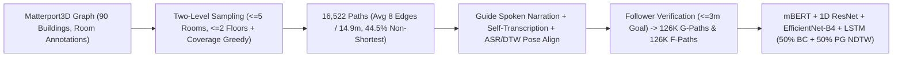

# Room-Across-Room

**Room-Across-Room: Multilingual Vision-and-Language Navigation with Dense Spatiotemporal Grounding** 收录于 [Awesome World-Action Models (RCL)](https://github.com/rcl-robotics/Awesome-World-Action-Models) **第 121/564** 篇，分组 **Datasets**。本页是 **清单索引**：给出它在清单中的位置与原文入口，方法细节和量化结果请看原文。

## 一句话定义

RCL Awesome WAM 清单收录（Datasets）；细节以原文 PDF / 项目页为准。

## 英文缩写速查

| 缩写 | 英文全称 | 简要说明 |
|------|----------|----------|
| WAM | World Action Model | 世界预测与动作生成耦合 |
| VLA | Vision-Language-Action | 视觉–语言–动作策略 |
| IDM | Inverse Dynamics Model | 先预测未来再反推动作 |
| WM | World Model | 环境前向预测模型 |

## 为什么重要

- RCL Awesome WAM 清单收录（Datasets）；细节以原文 PDF / 项目页为准。
- 想横向对照同一分组的其他工作，可以从 [RCL Awesome WAM 技术地图](../overview/rcl-awesome-wam-technology-map.md) 逐条展开。
- 顺着列表实体 [Awesome World-Action Models](paper-rcl-wam-robot-learning-control-survey.md) 与站内 WAM / VLA 方法页，可以接回对应的学习主线。

## 核心信息

| 字段 | 内容 |
|------|------|
| 编号 | 121/564 |
| 分组 | Datasets |
| 出处 | EMNLP 2020 |
| 论文 | <https://aclanthology.org/2020.emnlp-main.356/> |
| 子类 / 象限 | 视觉语言导航数据 · 多语言与时空标注 · 基准与评测协议 · 不适用 |

## 核心机制（归纳）

> 注：以下机制与评测指标基于通读 EMNLP 2020 原文全文核对补充（[ACL Anthology 原文](https://aclanthology.org/2020.emnlp-main.356/)）。

**Room-Across-Room（RxR）** 是 Google Research 与 Brown University 基于 **Matterport3D**（90 栋建筑、约 2.2 m 间距全景图导航图）构建的大规模多语言视觉语言导航（VLN）基准（仓库：<https://github.com/google-research-datasets/RxR>，CC-BY 协议），针对 R2R 的“最短路径偏置、仅限英语、缺乏词级时空对齐”三大缺陷做出系统性设计：

1. **消除最短路径偏置的两级路径采样（§3）**：
   - 基于人工房间标注构造房间无向图 $R$，先枚举经过 **至多 5 个房间且不超过 2 个楼层**的简单无环房间路径 $r_{1:n}$，在首尾房间随机选起点 $p_1$ 与终点 $p_m$ 后在诱导子图 $P[r_{1:n}]$ 内求最短全景路径（单路限长 $\le 40$ m、每栋建筑最多 500 条）。
   - 采用贪心覆盖目标 $\frac{d(p_1, p_m)}{L(p_{1:m})} + \frac{1}{m}\sum_{p_i \in p_{1:m}} O(p_i, D_k)$ 迭代选路，在拉高非最短路径占比的同时均匀覆盖冷门全景节点与地标。
2. **多语言原生口述采集与密集时空对齐（§4）**：
   - 雇佣 **247 名**母语标注员（97 名美国、其余印度）原生撰写非翻译指令，覆盖 **英语（en-IN / en-US）**、**印地语（hi）** 与 **泰卢固语（te）**。
   - **Guide 任务（均耗 458 s）**：在 640×480、75° 垂直 FoV 第一视角网页仿真器中边走边语音口述（平均 60 s），随后自行转录文字（平均 358.3 s），再用 ASR 与 **动态时间规整（DTW）**将每个词与时间戳及 6-DoF 虚拟相机位姿对齐（形成“词–视口像素–动作”密集对齐）。
   - **Follower 质检与示范路径（均耗 132 s）**：另一名标注员仅听音频导航，到达终点 **3 m 内**判为成功；失败则派第二名 Follower 复验，二次仍失败则整条路径重新采集（最多 3 轮择优），同步保留全部人类 **Follower 路径（F-paths）** 供训练使用。
3. **长指令多语言基线代理与注意力监督（§5）**：
   - 在 **VALAN** 分布式 RL 框架下改造 RCM 模型：用可并行的 **1D ResNet 卷积**编码预训练 **Multilingual BERT** 词特征（适配更长指令）；视觉特征采用 Conceptual Captions 预训练 **EfficientNet-B4**（36 个 30° 视角槽 + 角度编码）；LSTM 解码器做点积注意力；按 **50% 行为克隆 + 50% 策略梯度**（奖励为步进 NDTW 增量 + 终止 NE 线性函数）训练，并探索以标注员视锥掩码 $(b_t, m_t)$ 监督注意力权重。

### 方法流程图

## 评测与指标

- **数据集规模与语言统计（§2–§4, Table 1–3）**：
  - **总量**：**126,069** 条 Guide 指令（**9.8M** 词）、**16,522** 条采样路径（11,089 train / 1,232 val-seen / 1,517 val-unseen / 2,684 test）、**126K** 条 Follower 示教路径；单条指令均值 **78 词**（R2R 为 29 词）。
  - **三语分布**：`en` **42,002** 条（`en-IN` 28,010 / `en-US` 13,992）、`hi` **42,068** 条、`te` **41,999** 条；每语言覆盖 14K 路径（12.8K 共享 + 1.2K 独有），每路 3 条指令。
  - **路径与注意力特征**：RxR 平均 **8 边 / 14.9 m**（R2R 为 5 边 / 9.4 m），**44.5%** 非最短路径且平均比最短路长 **27.4%**；状态验证现象占 **72%–84%**（R2R 仅 8%）；标注员首步仅观察球面视野 **43%–44%**，后续仅 **27%–28%**。
- **简单偏置基线与路径贴合评测（val-unseen，Table 4）**：先给正确第一步再直走（Baseline 3）在 R2R 上 SR **27.2%**（NDTW 52.6），而在 RxR 上跌至 **13.7%**（NDTW 25.9），证实直走投机显著失效。
- **单语、多语与跨任务实验（val-unseen & test-standard，Table 5–8）**：
  - **Guide + Follower 路径联合训练（Exp 3 单语，84K 对，val-unseen）**：优于仅用 Guide（Exp 1）或仅用 Follower（Exp 2），en / hi / te 的 **SR = 26.1% / 29.6% / 29.8%**、**SDTW = 21.0 / 24.0 / 24.2**、**NDTW = 42.4 / 45.5 / 45.6**。
  - **单语 vs. 多语（val-unseen）**：统一三语模型（Exp 4，252K 对）降至 en / hi / te SR **22.2% / 23.0% / 23.1%**、NDTW **38.6 / 39.2 / 38.8**；加入机器翻译扩增（Exp 5，504K 对）进一步降至 SR **20.0% / 18.7% / 20.3%**；加入视觉注意力监督（Exp 6 `Multi*`）NDTW 略升至 **39.2 / 39.9 / 39.7** 但 SR 略波动（21.9% / 22.6% / 23.2%）。
  - **R2R + RxR 多任务共训（val-unseen，Table 6）**：共训模型（Exp 8）在 R2R 上将 SR/NDTW 从单任务 36.5%/48.1 提升至 **37.8% / 52.3**，RxR 上同步提至 SR **22.5% / 23.6% / 23.1%**（但零样本单向迁移大幅下降）。
  - **Test-Standard 排行榜基线与人类对比（Table 8，三语均值）**：`Random` SR **7.5%** / NDTW **15.4**；`Mono (Exp 3)` NE **10.6** / SR **25.9%**（en 25.3 / hi 26.1 / te 26.2）/ SDTW **21.0** / NDTW **41.5**；`Multi (Exp 4)` NE **11.9** / SR **21.3%** / SDTW **17.1** / NDTW **37.2**；`Human Follower` NE **0.9** / SR **93.9%**（en 90.2 / hi 96.7 / te 94.9）/ SDTW **76.9** / NDTW **79.5**。

## 与其他工作对比

- 本页 **不做** 与具体基线的逐项数值对比；同分组的横向对照请回到 [技术地图](../overview/rcl-awesome-wam-technology-map.md) 的 **Datasets** 分组逐条展开。
- 与 R2R（22K 英语指令、全部为 4–6 边最短路）相比，RxR 规模扩增至 126K 三语原生指令并消除最短路径与全景全视假设，主指标建议采用 **NDTW / SDTW** 而非单纯 SR/SPL。
- 与后继持续空间导航工作（如 lifting RxR into continuous simulator / VLN-CE 或 [Navigation World Models](paper-rcl-ref-2624494a0f9cbb4a61d2-navigation-world-models.md)）相比，RxR 仍构建于离散 Matterport3D 导航图之上。

## 结论

**RxR 以 126,069 条英/印地/泰卢固三语原生指令、44.5% 非最短路径采样和词–位姿–视口密集时空对齐，将 VLN 基准从“英文最短路目标检索”推向真实可验证的路径指令跟随（Test-Std 基线 SR 仅 25.9%，距人类 93.9% 仍有巨大提升空间）。**

- **Follower 示教是最稳健的增广信号**：把人类验证者的实际执行轨迹（F-paths）与 Guide 轨迹联合训练，全语言、全指标均一致获益（val-unseen 平均 SR 由 26.1% 级升至 28.5%）。
- **机器翻译扩增不宜盲目混入**：自动跨语言互译（Exp 5）因共享路径过拟合与翻译腔失真反而拉低三语指标，原生非翻译多语数据不可替代。
- **R2R + RxR 联合共训双赢但零样本迁移受限**：多任务同时改善两库表现，但单向零样本迁移因路径长度与语言风格差异显著退化。
- **评测指标重心转移**：在非最短路径占比 44.5% 的设定下，应重点报告 **NDTW** 与 **SDTW** 以防止智能体“捷径作弊”。

## 常见误区或局限

1. **离散导航图与 Matterport3D 协议依赖**：RxR 遵循 CC-BY 协议开源，但底层场景仍需受 **Matterport3D Terms of Use** 约束且运行在离散全景图节点上（连续环境需借助 VLN-CE 等衍生映射）。
2. **原始口述语音未随初版发布**：因疫情期间居家采集隐私审查原因，正文与 Datasheet 明确说明暂未释放原始音频文件（仅释放文本转录、词时间戳与 6-DoF 位姿轨迹）。
3. **多语言联合模型存在容量干扰**：单一三语模型（Multi）在三语上均劣于各自单语模型（Mono），且初步时空注意力监督（`Multi*`）对 SR/SDTW 尚未带来稳定正收益。

## 关联页面

- 列表实体：[Awesome World-Action Models（RCL）](paper-rcl-wam-robot-learning-control-survey.md)
- 技术地图：[RCL Awesome WAM 技术地图](../overview/rcl-awesome-wam-technology-map.md)
- 方法/任务：[generative-world-models.md](../methods/generative-world-models.md)、[manipulation.md](../tasks/manipulation.md)

## 参考来源

- [`sources/papers/rcl_awesome_wam_ref_ad5e94306036d2729d9f_room-across-room-multilingual-vision-and.md`](../../sources/papers/rcl_awesome_wam_ref_ad5e94306036d2729d9f_room-across-room-multilingual-vision-and.md) — 本条目策展摘录
- [`sources/papers/rcl_awesome_wam_catalog.md`](../../sources/papers/rcl_awesome_wam_catalog.md) — 列表总表
- [`sources/repos/awesome-world-action-models-rcl.md`](../../sources/repos/awesome-world-action-models-rcl.md)
- [`docs/PAPERS.md`](https://github.com/RCL-Robotics/Awesome-World-Action-Models/blob/main/docs/PAPERS.md) — 上游论文目录
- 论文：<https://aclanthology.org/2020.emnlp-main.356/>

## 推荐继续阅读

- [Awesome World-Action Models (RCL) 仓库](https://github.com/rcl-robotics/Awesome-World-Action-Models)
- [原文](https://aclanthology.org/2020.emnlp-main.356/)
