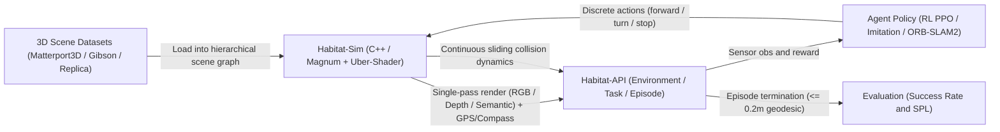

# Habitat

**Habitat: A Platform for Embodied AI Research** 收录于 [Awesome World-Action Models (RCL)](https://github.com/rcl-robotics/Awesome-World-Action-Models) **第 026/564** 篇，分组 **Benchmarks & simulators**。本页是 **清单索引**：给出它在清单中的位置与原文入口，方法细节和量化结果请看原文。

## 一句话定义

RCL Awesome WAM 清单收录（Benchmarks & simulators）；细节以原文 PDF / 项目页为准。

## 英文缩写速查

| 缩写 | 英文全称 | 简要说明 |
|------|----------|----------|
| WAM | World Action Model | 世界预测与动作生成耦合 |
| VLA | Vision-Language-Action | 视觉–语言–动作策略 |
| IDM | Inverse Dynamics Model | 先预测未来再反推动作 |
| WM | World Model | 环境前向预测模型 |

## 为什么重要

- RCL Awesome WAM 清单收录（Benchmarks & simulators）；细节以原文 PDF / 项目页为准。
- 想横向对照同一分组的其他工作，可以从 [RCL Awesome WAM 技术地图](../overview/rcl-awesome-wam-technology-map.md) 逐条展开。
- 顺着列表实体 [Awesome World-Action Models](paper-rcl-wam-robot-learning-control-survey.md) 与站内 WAM / VLA 方法页，可以接回对应的学习主线。

## 核心信息

| 字段 | 内容 |
|------|------|
| 编号 | 026/564 |
| 分组 | Benchmarks & simulators |
| 出处 | ICCV 2019 |
| 论文 | <https://openaccess.thecvf.com/content_ICCV_2019/papers/Savva_Habitat_A_Platform_for_Embodied_AI_Research_ICCV_2019_paper.pdf> |
| 子类 / 象限 | 物理仿真 · 导航基准 · 不适用 |

## 核心机制（归纳）

> 注：以下机制与评测指标基于通读开放获取原文全文核对补充。

### 平台双层架构

**Habitat** 将具身智能仿真软件栈解耦为底层高速 3D 渲染仿真器 **Habitat-Sim** 与上层任务及训练框架 **Habitat-API**，打破以往“平台–数据集–任务”强耦合带来的低帧率与难复现问题：

- **Habitat-Sim（C++ 后端 + Python API）**：
  - **统一场景图与数据集无关性**：使用层级场景图（hierarchical scene graph）加载真实扫描或合成 3D 环境（内置支持 **Matterport3D**、**Gibson**、**Replica**），支持程序化场景构建与扩展传感器插件（RGB、Depth、Semantic mask、GPS、Compass、Contact 及可扩展 LIDAR/IMU）。
  - **单 Pass 多附件渲染（Uber-shader）**：基于 **Magnum** 图形中间件构建，通过多附件 uber-shader 在单次渲染 Pass 中同时产出彩色图、深度图与语义实例分割图，并经共享内存以 Python 张量暴露给训练框架（原文亦测试了 CUDA-GL 零拷贝互操作方案，内部测试可进一步提速约 2 倍）。
  - **连续空间滑动碰撞模型**：不同于网格瞬移，智能体（直径 0.2m、高 1.5m 圆柱体）在连续空间执行 `move_forward`（0.25m）、`turn_left`/`turn_right`（10°）与 `stop` 时允许沿墙面/障碍物发生部分位移或滑动，即使无执行噪声，里程计也不再平凡。
- **Habitat-API（Python 高层库）**：
  - 通过 `Environment`、`Simulator`、`Task`（定义观测/动作扩展、终止条件与 SPL 等评测指标）与 `Episode`（记录场景 ID、起点/朝向、目标及测地线最短路径）四类抽象，统一支持 RL（如 PPO）、模仿学习及经典 SLAM 基线的训练与基准评测。

### 大规模 PointGoal 导航实验设定

- 明确界定**静态 PointGoal**（搭配理想化 GPS+Compass 传感器，区分任务设定与传感器能力），从 Gibson（572 场景中人工筛选 106 个高质量重构场景）与 Matterport3D（无重叠 train/val/test 划分）生成测地最短路径（GDSP）在 1m–30m 的 episode，并对测地/欧氏距离比处于 `[1, 1.1]` 的近直线简单样本执行拒绝采样（Gibson 近直线比例由 37% 降至 10%）。
- 学习的 PPO 智能体采用 `CNN (8×8, 4×4, 3×3, Linear) + 相对目标向量 -> GRU Actor + Linear Critic`，在 6–8 个并发线程上训练至 **7500 万（75M）env steps**（此前文献 [19, 16] 的 15 倍；累计消耗 2267 GPU-hours）。

### 方法流程图

## 评测与指标

- **仿真吞吐量（Table 1，Matterport3D 场景 `17DRP5sb8fy`，Xeon E5-2690 v4 + Titan Xp）**：
  - 单进程（128×128 / 256×256 / 512×512）：RGB 达 **4,093 / 1,987 / 848 fps**；RGB+Depth 达 **2,050 / 1,042 / 423 fps**。
  - 单 GPU 5 进程并发（128×128 / 256×256 / 512×512）：RGB 达 **10,592 / 3,574 / 2,629 fps**；RGB+Depth 达 **5,223 / 1,774 / 1,348 fps**，较先前室内仿真器（10–300 fps）提速 2–3 个数量级。
- **PointGoal 导航测试集指标（Table 2，75M steps，5 种子，500 步内距目标 ≤0.2m 触发 `stop` 判成功）**：
  - `Depth + RL (PPO)`：Gibson **SPL = 0.79 (±0.015), Succ = 0.89**；MP3D **SPL = 0.54, Succ = 0.69**（全组最优）。
  - `RGBD + RL (PPO)`：Gibson **SPL = 0.70 (±0.028), Succ = 0.80**；MP3D **SPL = 0.42, Succ = 0.53**。
  - `RGB + RL (PPO)`：Gibson **SPL = 0.46 (±0.055), Succ = 0.64**；MP3D **SPL = 0.30, Succ = 0.42**。
  - `Blind (仅 GPS+Compass) + RL (PPO)`：Gibson **SPL = 0.42 (±0.005), Succ = 0.62**；MP3D **SPL = 0.25, Succ = 0.35**。
  - `SLAM (ORB-SLAM2, RGBD)`：Gibson **SPL = 0.51, Succ = 0.62**；MP3D **SPL = 0.39, Succ = 0.47**（val 集分别为 0.59 与 0.42）。
  - 启发式与随机基线（Blind）：`Goal follower`（Gibson 0.23 / 0.23，MP3D 0.12 / 0.12），`Random`（0.02 / 0.03 与 0.01 / 0.01），`Forward only`（0.00）。
- **核心科学发现**：
  - **Learning vs. SLAM 反转**：在 5M 步以内 SLAM 占优，但训练延展至 75M 步后，`RL (PPO) Depth` 分别在约 10M（Gibson）和 30M（MP3D）帧超越 SLAM，并在测试集上领先 **0.15–0.28 SPL**。
  - **跨数据集泛化（Fig. 5，{train, test} × {Gibson, MP3D}）**：仅配备 **Depth** 的智能体实现强跨库泛化（Gibson 训练 → MP3D 测试达 **SPL = 0.68**，高于 MP3D 本地训练测试的 **0.54**，作者归因于 Gibson 空间较小、更易在早期获正奖励而类似课程学习）；相比之下 RGBD 从 Gibson→Gibson（0.70）跨至 MP3D 时跌至 0.53，RGB 则从 0.46 跌至 0.40。

## 与其他工作对比

- 本页 **不做** 与具体基线的逐项数值对比；同分组的横向对照请回到 [技术地图](../overview/rcl-awesome-wam-technology-map.md) 的 **Benchmarks & simulators** 分组逐条展开。
- 如果站内已经有这篇的深读页（含机构、实验表与源码运行时序图），请以那一页为准；本页只保留清单要点。
- 与清单内相邻条目孰优孰劣，本页不下结论：清单 Contribution 可能滞后于论文最新版本，差异应以各自原文的问题设定与评测口径为准。

## 结论

**Habitat 以超过 10,000 fps 的多进程单 GPU 渲染性能打破了具身智能仿真的算力瓶颈，并借此在 PointGoal 导航上推翻了“经典 SLAM 优于端到端学习”的旧结论，同时揭示了深度传感器在跨数据集泛化中的核心作用。**

- **工程与生态解耦**：将场景图、多通道 uber-shader 渲染与任务/评估 API 分层，使同一套 PPO 或 SLAM 代码可在 Matterport3D、Gibson、Replica 等数据集间无缝切换。
- **经验规模改变结论**：在 5M 步截断下 SLAM 领先，但扩展到 75M 步后基于 Depth 的 PPO 显著超越 ORB-SLAM2（+0.15–0.28 SPL）。
- **传感器决定泛化**：RGB 外观高熵易过拟合训练集房屋外观，Depth 直接反映自由空间几何而具备最佳跨数据集迁移性（Gibson→MP3D 达 0.68 SPL）。
- **版本边界**：本 ICCV 2019 原文聚焦静态导航与运动学碰撞模拟，尚未包含刚体/铰接物理交互（规划为后续 Habitat 2.0/物理引擎集成路线）。

## 常见误区

1. 不要把 Awesome 条目的 Contribution 当成完整方法证明——它只是策展导读。
2. 若站内已有这篇的深读页，以那一页为准——本页只是清单入口，不含实验数据。

## 关联页面

- 列表实体：[Awesome World-Action Models（RCL）](paper-rcl-wam-robot-learning-control-survey.md)
- 技术地图：[RCL Awesome WAM 技术地图](../overview/rcl-awesome-wam-technology-map.md)
- 方法/任务：[generative-world-models.md](../methods/generative-world-models.md)、[manipulation.md](../tasks/manipulation.md)

## 参考来源

- [`sources/papers/rcl_awesome_wam_ref_b06d4e2caeb9c57607b9_habitat-a-platform-for-embodied-ai-resea.md`](../../sources/papers/rcl_awesome_wam_ref_b06d4e2caeb9c57607b9_habitat-a-platform-for-embodied-ai-resea.md) — 本条目策展摘录
- [`sources/papers/rcl_awesome_wam_catalog.md`](../../sources/papers/rcl_awesome_wam_catalog.md) — 列表总表
- [`sources/repos/awesome-world-action-models-rcl.md`](../../sources/repos/awesome-world-action-models-rcl.md)
- [`docs/PAPERS.md`](https://github.com/RCL-Robotics/Awesome-World-Action-Models/blob/main/docs/PAPERS.md) — 上游论文目录
- 论文：<https://openaccess.thecvf.com/content_ICCV_2019/papers/Savva_Habitat_A_Platform_for_Embodied_AI_Research_ICCV_2019_paper.pdf>

## 推荐继续阅读

- [Awesome World-Action Models (RCL) 仓库](https://github.com/rcl-robotics/Awesome-World-Action-Models)
- [原文](https://openaccess.thecvf.com/content_ICCV_2019/papers/Savva_Habitat_A_Platform_for_Embodied_AI_Research_ICCV_2019_paper.pdf)
