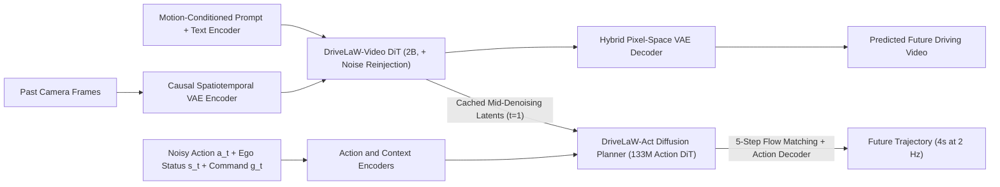

# DriveLaW

**DriveLaW: Unifying Planning and Video Generation in a Latent Driving World** 收录于 [Awesome World-Action Models (RCL)](https://github.com/rcl-robotics/Awesome-World-Action-Models) **第 322/564** 篇，分组 **WAMs**。本页是 **清单索引**：给出它在清单中的位置与原文入口，方法细节和量化结果请看原文。

## 一句话定义

RCL Awesome WAM 清单收录（WAMs）；细节以原文 PDF / 项目页为准。

## 英文缩写速查

| 缩写 | 英文全称 | 简要说明 |
|------|----------|----------|
| WAM | World Action Model | 世界预测与动作生成耦合 |
| VLA | Vision-Language-Action | 视觉–语言–动作策略 |
| IDM | Inverse Dynamics Model | 先预测未来再反推动作 |
| WM | World Model | 环境前向预测模型 |

## 为什么重要

- RCL Awesome WAM 清单收录（WAMs）；细节以原文 PDF / 项目页为准。
- 想横向对照同一分组的其他工作，可以从 [RCL Awesome WAM 技术地图](../overview/rcl-awesome-wam-technology-map.md) 逐条展开。
- 顺着列表实体 [Awesome World-Action Models](paper-rcl-wam-robot-learning-control-survey.md) 与站内 WAM / VLA 方法页，可以接回对应的学习主线。

## 核心信息

| 字段 | 内容 |
|------|------|
| 编号 | 322/564 |
| 分组 | WAMs |
| 出处 | CVPR 2026 |
| 论文 | <https://openaccess.thecvf.com/content/CVPR2026/html/Xia_DriveLaW_Unifying_Planning_and_Video_Generation_in_a_Latent_Driving_CVPR_2026_paper.html> |
| 代码/项目 | <https://github.com/xiaomi-research/drivelaw> |
| 子类 / 象限 | 自动驾驶 · 视觉规划与IDM · Q4 · Dual-system × IDM |

## 核心机制（归纳）

> 注：以下机制与评测指标基于通读 CVF 开放获取原文全文核对补充。

DriveLaW（[原文](https://openaccess.thecvf.com/content/CVPR2026/html/Xia_DriveLaW_Unifying_Planning_and_Video_Generation_in_a_Latent_Driving_CVPR_2026_paper.html)）将自动驾驶世界模型从“视频生成与轨迹规划并行双头输出”改为**共享潜空间中的串行链路（Chained Generation and Planning）**，由 2B 参数的 `DriveLaW-Video` 与 133M 参数的 `DriveLaW-Act` 组成，详见 [World Action Models（WAM）](../concepts/world-action-models.md)：

- **DriveLaW-Video（时空世界视频生成器，基于 LTX-Video 初始化）**：
  - **高压缩因果时空 VAE**：采用 3D 因果卷积编码器将视频压缩至 $32 \times 32 \times 8$ 时空潜表示（128 通道，压缩比 1:192，像素–token 比 1:8192）；在 Rectified Flow 采样后期（$t=t_1$）引入混合像素空间去噪解码器 $x_0 = D(z_{t_1}, t_1)$ 直接在像素域恢复高频路面纹理与阴影细节。
  - **Video DiT 与运动条件文本提示**：改造自 PixArt-$\alpha$ 的 3D Transformer，包含时空自注意力、条件交叉注意力、Q/K RMSNorm 与归一化分数坐标 RoPE；将自车运动学信息（前向/侧向位移、偏航角、速度）格式化为结构化自然语言技术提示，经 Text Encoder 注入，避免绑定特定数据集尺度的数值编码。
  - **高频噪声重注入（Noise Reinjection）**：在去噪步 $t$ 先预测干净潜变量 $\hat{L}_0$ 并经 VAE 解码为临时灰度帧 $G_f$，用离散拉普拉斯核计算高频响应 $H_f = |G_f * K_L|$ 与自适应阈值掩码 $M_f$（$H_f > \beta \cdot \text{std}(H_f)$），下采样到潜空间后仅向高频区域注入可控噪声 $L'_t = L_t + \sigma'_t \cdot M \odot \epsilon_t$ 再执行主 DiT 去噪，缓解高速驾驶场景下的模糊、结构失真与伪影。
- **DriveLaW-Act（基于潜特征条件的扩散规划器）**：
  - **输入与潜特征条件**：Action Encoder 编码加噪动作 $a_t$ 得到 $h_{\text{act}}$，Context Encoder 编码自车状态 $s_t$ 与高层导航指令 $g_t$ 得到 $h_{\text{ctx}}$；同时缓存 `DriveLaW-Video` 第 1 个去噪步（$t=1$，消融最优）各 DiT 块的潜特征 $\{f_1, \dots, f_B\}$ 作为规划条件信号。
  - **Flow Matching 轨迹生成**：`Action DiT` $f_\theta(a_t, t)$ 以 $h_{\text{ctx}}$ 与 $\{f_i\}_{i=1}^B$ 为条件预测速度场，训练目标为 $\mathcal{L}_{\text{FM}} = \mathbb{E}_{t, a_0, \epsilon} \| f_\theta(a_t, t) - (a_0 - \epsilon) \|_2^2$；推理时视频生成用 30 步采样，轨迹规划仅需 **5 步** 采样并由 Action Decoder 输出未来轨迹。
- **三阶段渐进式训练**：
  - **阶段 1（长时序运动预训练）**：在 nuScenes + nuPlan（8 Hz）低分辨率长视频片段（$740 \times 352 \times 121$ 帧，30k 步）上以 Flow Matching 学习长程交通演化规律。
  - **阶段 2（高分辨率空间精修）**：切换至高分辨率短片段（$1280 \times 704 \times 25$ 帧，30k 步）恢复车道线与车辆细节。
  - **阶段 3（串联规划微调）**：输入过去 4 帧相机图像，在 NAVSIM（2 Hz 未来 4s 轨迹，44k 步）上联合微调 Video DiT 与 Action DiT。

### 方法流程图

## 评测与指标

- **视频生成质量（nuScenes val，Table 1）**：单视角未来视频生成取得 **FID 4.6** 与 **FVD 81.3**，对比先前最佳方法 Vista（FID 6.9 / FVD 89.4）与 Epona（FID 7.5 / FVD 82.8），FID 降低 33.3%、FVD 降低 1.8%（详见 [原文](https://openaccess.thecvf.com/content/CVPR2026/html/Xia_DriveLaW_Unifying_Planning_and_Video_Generation_in_a_Latent_Driving_CVPR_2026_paper.html)）。
- **闭环规划（NAVSIM Navtest，Table 2）**：在**不使用 RL 后训练或外部打分器（scorers）**条件下，取得 **PDMS 89.1**（NC 99.0 / DAC 97.1 / TTC 96.7 / Comf. 100 / EP 81.3），优于融合 LiDAR 的 `DiffusionDrive`（88.1）、并行生成规划模型 `Epona`（86.2，+2.9）、`DriveVLA-W0`（87.2，+1.9）与 `PWM`（88.1，+1.0）。
- **开环规划（nuScenes val，Table 3）**：1s / 2s / 3s 轨迹 L2 误差为 **0.44m / 1.10m / 1.91m**（平均 **1.15m**），碰撞率为 **0.15% / 0.10% / 0.48%**（平均 **0.24%**），优于 `Epona`（平均 L2 1.25m，平均碰撞率 0.36%）。
- **关键消融（Table 4–7）**：视频预训练样本从 0 扩增至 7.6M 使 NAVSIM PDMS 从 85.9 提升至 89.1（+3.2）；同一扩散规划器下，视频潜特征（PDMS 89.1）显著优于 BEV 特征（84.1）与 VLM 隐状态（86.5）；视频去噪步 $t=1$（89.1）优于 $t=5$（86.9）和 $t=10$（23.2）。
- **代码仓库**：<https://github.com/xiaomi-research/drivelaw>（原文摘要明确标注开源地址）。

## 与其他工作对比

- 本页 **不做** 与具体基线的逐项数值对比；同分组的横向对照请回到 [技术地图](../overview/rcl-awesome-wam-technology-map.md) 的 **WAMs** 分组逐条展开。
- 如果站内已经有这篇的深读页（含机构、实验表与源码运行时序图），请以那一页为准；本页只保留清单要点。
- 与清单内相邻条目孰优孰劣，本页不下结论：清单 Contribution 可能滞后于论文最新版本，差异应以各自原文的问题设定与评测口径为准。

## 结论

**这一页能给你的是「DriveLaW」在策展清单里的坐标与要点：够你判断要不要去读原文，但不能替代原文。**

- 可确证的只有清单坐标：分组 **WAMs**，以及 Contribution 点出的问题设定；本页不自行推导新结论。
- 适用边界：本页不能替代原文 PDF；开源状态以项目页实际链接为准（清单可能滞后）。
- 要深读这篇，建议直接从原文入手，再回到下方关联的方法 / 任务页对照。

## 常见误区

1. 不要把 Awesome 条目的 Contribution 当成完整方法证明——它只是策展导读。
2. 若站内已有这篇的深读页，以那一页为准——本页只是清单入口，不含实验数据。

## 关联页面

- 列表实体：[Awesome World-Action Models（RCL）](paper-rcl-wam-robot-learning-control-survey.md)
- 技术地图：[RCL Awesome WAM 技术地图](../overview/rcl-awesome-wam-technology-map.md)
- 方法/任务：[generative-world-models.md](../methods/generative-world-models.md)、[manipulation.md](../tasks/manipulation.md)

## 参考来源

- [`sources/papers/rcl_awesome_wam_ref_b21a967bfc27f43d29b2_drivelaw-unifying-planning-and-video-gen.md`](../../sources/papers/rcl_awesome_wam_ref_b21a967bfc27f43d29b2_drivelaw-unifying-planning-and-video-gen.md) — 本条目策展摘录
- [`sources/papers/rcl_awesome_wam_catalog.md`](../../sources/papers/rcl_awesome_wam_catalog.md) — 列表总表
- [`sources/repos/awesome-world-action-models-rcl.md`](../../sources/repos/awesome-world-action-models-rcl.md)
- [`docs/PAPERS.md`](https://github.com/RCL-Robotics/Awesome-World-Action-Models/blob/main/docs/PAPERS.md) — 上游论文目录
- 论文：<https://openaccess.thecvf.com/content/CVPR2026/html/Xia_DriveLaW_Unifying_Planning_and_Video_Generation_in_a_Latent_Driving_CVPR_2026_paper.html>

## 推荐继续阅读

- [Awesome World-Action Models (RCL) 仓库](https://github.com/rcl-robotics/Awesome-World-Action-Models)
- [原文](https://openaccess.thecvf.com/content/CVPR2026/html/Xia_DriveLaW_Unifying_Planning_and_Video_Generation_in_a_Latent_Driving_CVPR_2026_paper.html)
