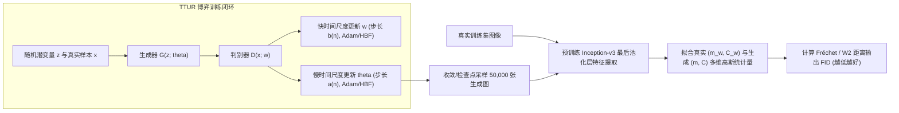

# GANs Trained by a Two Time-Scale Update Rule Converge to a Local Nash Equilib...

**GANs Trained by a Two Time-Scale Update Rule Converge to a Local Nash Equilibrium** 收录于 [Awesome World-Action Models (RCL)](https://github.com/rcl-robotics/Awesome-World-Action-Models) **第 137/564** 篇，分组 **Evaluation metrics**。本页是 **清单索引**：给出它在清单中的位置与原文入口，方法细节和量化结果请看原文。

## 一句话定义

本文提出了用于稳定训练生成对抗网络的**双时间尺度更新规则（TTUR）**——通过数学证明其（含 Adam 优化器下）几乎必然收敛到局部纳什均衡，同时提出了迄今最核心的生成图像质量评测指标 **Fréchet Inception Distance（FID）**。

## 英文缩写速查

| 缩写 | 英文全称 | 简要说明 |
|------|----------|----------|
| TTUR | Two Time-Scale Update Rule | 双时间尺度更新规则：为判别器与生成器设置独立学习率以保证博弈收敛 |
| FID | Fréchet Inception Distance | 本文提出的基于 Inception-v3 特征均值与协方差的 Fréchet 距离评测指标 |
| HBF | Heavy Ball with Friction | 带摩擦重球二阶常微分方程动力学模型，本文用来刻画 Adam 优化行为 |
| IS | Inception Score | 仅评估生成样本类别熵而未与真实样本统计对比的早期 GAN 指标 |
| WGAN-GP | Wasserstein GAN with Gradient Penalty | 带梯度惩罚的 Wasserstein GAN，本文用于图像与语言生成对比验证 |

## 为什么重要

- **解决一般 GAN 收敛性理论难题**：此前 GAN 训练收敛证明往往受限于线性判别器或全样本期望假设；本文借助双时间尺度随机逼近理论证明任意常见 GAN 损失在小批量随机梯度（及 Adam）下均能收敛到局部纳什均衡。
- **确立生成式图像评估工业标准（FID）**：Inception Score 完全不使用真实数据分布统计，而 FID 直接度量生成样本与真实样本在 Inception-v3 特征空间的多维高斯分布距离，成为图像生成与生成式世界模型（Video/Image World Models）的核心量化标准。
- 想横向对照同一分组的其他工作，可以从 [RCL Awesome WAM 技术地图](../overview/rcl-awesome-wam-technology-map.md) 逐条展开，或顺着列表实体 [Awesome World-Action Models](paper-rcl-wam-robot-learning-control-survey.md) 接回对应主线。

## 核心信息

| 字段 | 内容 |
|------|------|
| 编号 | 137/564 |
| 分组 | Evaluation metrics |
| 出处 | NeurIPS 2017 (31st NIPS) |
| 作者 / 机构 | Martin Heusel, Hubert Ramsauer, Thomas Unterthiner, Bernhard Nessler, Sepp Hochreiter（LIT AI Lab & Institute of Bioinformatics, JKU Linz） |
| 论文 | <https://proceedings.neurips.cc/paper_files/paper/2017/hash/8a1d694707eb0fefe65871369074926d-Abstract.html> |
| 子类 / 象限 | 图像质量指标 · 评估指标与协议 · 训练优化与蒸馏 · 不适用 |

## 核心机制（归纳）

> 注：以下机制与评测指标基于通读原文全文（NeurIPS 2017）核对补充。

论文在理论优化与质量评测两方面同时推进：

1. **双时间尺度更新规则（TTUR）与局部纳什均衡收敛证明**：
   - 设判别器参数 $w$（损失 $L_D$，随机梯度 $g(\theta, w) + M_n^{(w)}$）与生成器参数 $\theta$（损失 $L_G$，随机梯度 $h(\theta, w) + M_n^{(\theta)}$）分别采用独立步长序列 $b(n)$ 与 $a(n)$：
     $$w_{n+1} = w_n + b(n)\left(g(\theta_n, w_n) + M_n^{(w)}\right), \quad \theta_{n+1} = \theta_n + a(n)\left(h(\theta_n, w_n) + M_n^{(\theta)}\right)$$
   - 在满足（A1）梯度 Lipschitz 连续（如 ELU 激活而非 ReLU）、（A2）$\sum a(n)=\infty, \sum a^2(n)<\infty, \sum b(n)=\infty, \sum b^2(n)<\infty$ 且 $a(n)=o(b(n))$、（A3）鞅差梯度噪声有界方差、（A4）固定 $\theta$ 下判别器 ODE $\dot{w}=g(\theta,w)$ 存在局部渐近稳定吸引子 $\lambda(\theta)$ 且慢变量 ODE $\dot{\theta}=h(\theta,\lambda(\theta))$ 存在稳定吸引子 $\theta^*$、（A5）参数一致有界等条件下，由 Borkar (1997) 与 Karmakar–Bhatnagar (2017) 的 $(T,\delta)$-扰动 ODE 理论可得迭代几乎必然收敛至**平稳局部纳什均衡 $(\theta^*, \lambda(\theta^*))$**（满足 $g=0, h=0$）。
   - 核心直觉：慢更新模块引起的扰动必须足够小，使快更新模块先行收敛并传递有效信息；实验中即使生成器的绝对学习率数值大于判别器（如 DCGAN），只要其对判别器造成的实际参数扰动更小，仍符合 TTUR 机制。
2. **Adam 的 Heavy Ball with Friction（HBF）动力学与抗模式坍塌**：
   - 当取 $\beta_1 = 1 - a(n+1)r(n)$、$\beta_2 = 1 - \alpha a(n+1)r(n)$ 且梯度二阶矩平稳时，Adam 遵循二阶 HBF 微分方程：
     $$\ddot{\theta}_t + a(t)\dot{\theta}_t + \nabla f(\theta_t) = 0$$
     其 Lyapunov 能量函数 $E(t) = \frac{1}{2}\|\dot{\theta}(t)\|^2 + f(\theta(t))$ 满足 $\dot{E}(t) = -a\|\dot{\theta}(t)\|^2 < 0$。一阶矩动量相当于物理“速度”，帮助参数冲过对应**模式坍塌（mode collapse）**的尖锐窄局部极小点 $\theta^+$，停留在泛化更好的平坦极小点 $\theta^*$，且收敛性可推广至 TTUR + Adam。
3. **Fréchet Inception Distance（FID）指标定义**：
   - 将真实图像集与生成样本集（实验中生成 50,000 张）输入在 ImageNet 上预训练的 **Inception-v3**，提取**最后一个池化层（coding layer）**特征，分别拟合多维高斯分布均值与协方差 $(m_w, C_w)$（真实）与 $(m, C)$（生成），计算两高斯分布间的 Fréchet（Wasserstein-2）距离：
     $$d^2\big((m, C), (m_w, C_w)\big) = \|m - m_w\|_2^2 + \operatorname{Tr}\left(C + C_w - 2(C C_w)^{1/2}\right)$$

### 方法流程图

关于生成式世界模型与分布距离评测，可对照站内 [World Action Models（WAM）](../concepts/world-action-models.md) 与 [generative-world-models.md](../methods/generative-world-models.md)。

## 评测与指标

- **FID 扰动单调性验证（Fig. 3）**：对图像施加逐渐增强的 6 类退化（高斯噪声、高斯模糊、植入黑块、漩涡扭曲、椒盐噪声、用 ImageNet 污染 CelebA），FID 随扰动强度严格单调上升，比 Inception Score 与人类感知退化保持更高一致性。
- **DCGAN 图像生成对比（8 次独立运行最优 FID ↓，Table 1）**：
  - **CelebA**：TTUR（$b=10^{-5}, a=5\times 10^{-4}$，225k 步）达到 **12.5** vs. 单时间尺度 orig（$5\times 10^{-4}$，70k 步）**21.4**（所有 orig 运行最终均发散）。
  - **CIFAR-10**：TTUR（$10^{-4}, 5\times 10^{-4}$，75k 步）达到 **36.9** vs. orig（$10^{-4}$，100k 步）**37.7**。
  - **SVHN**：TTUR（$10^{-5}, 10^{-4}$，165k 步）达到 **12.5** vs. orig（$5\times 10^{-5}$，185k 步）**21.4**。
  - **LSUN Bedrooms**：TTUR（$10^{-5}, 10^{-4}$，340k 步）达到 **57.5** vs. orig（$5\times 10^{-5}$，70k 步）**70.4**（所有 orig 运行均发散）。
- **WGAN-GP 图像生成对比（按墙钟时间对齐，TTUR 每次迭代判别器仅更新 1 次 vs. orig 更新 5 次，FID ↓，Table 1）**：
  - **CIFAR-10**：TTUR（$b=3\times 10^{-4}, a=10^{-4}$，700 min）达到 **24.8** vs. orig（$10^{-4}$，800 min）**29.3**。
  - **LSUN Bedrooms**：TTUR（$3\times 10^{-4}, 10^{-4}$，1900 min）达到 **9.5** vs. orig（$10^{-4}$，2010 min）**20.5**。
- **WGAN-GP 语言生成对比（One Billion Word Benchmark，10 次运行，TTUR 判别器更新 1 次 vs. orig 10 次，归一化 JSD ↓，Table 1）**：
  - **4-gram JSD**：TTUR **0.35**（1150 min）vs. orig **0.38**（1040 min）；
  - **6-gram JSD**：TTUR **0.74**（1120 min）vs. orig **0.77**（1070 min）。

## 与其他工作对比

- **TTUR vs. 单时间尺度及多步判别器训练（WGAN-GP 5:1 / 10:1）**：单时间尺度更新在理论上仅能保证以一定频率回到邻域内震荡（大步长易发散）；TTUR 通过调大判别器相对学习率实现了判别器与生成器 **1:1 更新频率**，在相同墙钟时间内不仅省去内循环开销，还在 CIFAR-10、LSUN Bedrooms 等上取得更低 FID 与更小方差。
- **FID vs. Inception Score (IS)**：IS 仅看生成样本在 ImageNet 分类器下的条件熵与边缘熵，完全忽略真实数据分布；FID 直接比对生成特征与真实特征的一阶矩与二阶矩，能有效检测模式坍塌与分布偏移。
- 同分组其他评测指标的横向对照，请回到 [技术地图](../overview/rcl-awesome-wam-technology-map.md) 的 **Evaluation metrics** 分组逐条展开。

## 结论

**本论文同时给出了工程上极其简洁的 GAN 稳定训练策略（为判别器与生成器设置分离学习率的 TTUR + Adam）与生成模型标准评测尺度（FID），用单一 1:1 更新框架取代了繁琐的多步判别器内循环。**

1. **用学习率比值替代多步 D 更新**：在 WGAN-GP 等对抗训练中，将判别器每次迭代更新次数从 5–10 次降为 1 次并配合更大的判别器学习率（如 $3\times 10^{-4}$ vs. $10^{-4}$），可在显著更短墙钟时间内获得更低 FID（LSUN 9.5 vs. 20.5）。
2. **FID 采样规模要足够**：由于需估计 2048 维 Inception 池化特征的协方差矩阵 $C$，生成样本数过少会严重偏置迹项估计，标准评测应采用约 50,000（至少数万）张样本与完整训练集统计量比对。
3. **关注 FID 监控早停**：即便使用 TTUR，固定学习率下的实际训练仍可能在后期出现 FID 上升或发散（如论文按 FID/JSD 停止不再下降的节点做模型选择）。
4. **理论假设与工程调参边界**：定理要求梯度 Lipschitz 光滑（ELU 满足而 ReLU 严格不满足）与衰减步长；实际工程中仍需根据架构（如 DCGAN 中 $a > b$ 而 WGAN-GP 中 $b > a$）实测校准双端学习率。

## 常见误区

1. **误以为 TTUR 必然要求 $b > a$（判别器学习率数值必须大于生成器）**：论文明确指出学习率数值本身不能直接等同于扰动大小，在 DCGAN 实验中生成器学习率（如 $5\times 10^{-4}$）反而高于判别器（$10^{-5}\text{–}10^{-4}$），关键是慢更新一方对快更新一方造成的参数扰动足够小。
2. **用少量样本（如几百张图）直接比较 FID 绝对值**：高维协方差估计在小样本下存在严重正偏（finite-sample bias），不同样本数或不同 Inception 权重/预处理实现的 FID 不可直接横向对比。
3. **忽视 FID 的高斯与 ImageNet 特征局限**：FID 只捕捉 Inception-v3 最后池化层的前两阶矩（均值与协方差）且特征提取器偏置在 ImageNet 自然图像域；对于文本（如 One Billion Word 需改用 JSD）、非自然域渲染或高频物理接触细节，FID 可能失灵。

## 关联页面

- 列表实体：[Awesome World-Action Models（RCL）](paper-rcl-wam-robot-learning-control-survey.md)
- 技术地图：[RCL Awesome WAM 技术地图](../overview/rcl-awesome-wam-technology-map.md)
- 方法/任务：[generative-world-models.md](../methods/generative-world-models.md)、[manipulation.md](../tasks/manipulation.md)

## 参考来源

- [`sources/papers/rcl_awesome_wam_ref_b3c87355da574d40991f_gans-trained-by-a-two-time-scale-update.md`](../../sources/papers/rcl_awesome_wam_ref_b3c87355da574d40991f_gans-trained-by-a-two-time-scale-update.md) — 本条目策展摘录
- [`sources/papers/rcl_awesome_wam_catalog.md`](../../sources/papers/rcl_awesome_wam_catalog.md) — 列表总表
- [`sources/repos/awesome-world-action-models-rcl.md`](../../sources/repos/awesome-world-action-models-rcl.md)
- [`docs/PAPERS.md`](https://github.com/RCL-Robotics/Awesome-World-Action-Models/blob/main/docs/PAPERS.md) — 上游论文目录
- 论文：<https://proceedings.neurips.cc/paper_files/paper/2017/hash/8a1d694707eb0fefe65871369074926d-Abstract.html>

## 推荐继续阅读

- [Awesome World-Action Models (RCL) 仓库](https://github.com/rcl-robotics/Awesome-World-Action-Models)
- [原文](https://proceedings.neurips.cc/paper_files/paper/2017/hash/8a1d694707eb0fefe65871369074926d-Abstract.html)
