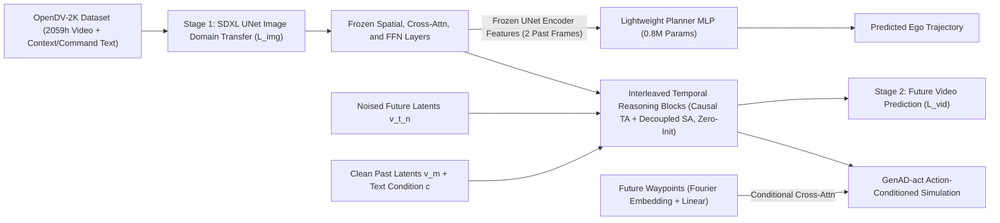

# Generalized Predictive Model for Autonomous Driving

**Generalized Predictive Model for Autonomous Driving** 收录于 [Awesome World-Action Models (RCL)](https://github.com/rcl-robotics/Awesome-World-Action-Models) **第 368/564** 篇，分组 **WAMs**。本页是 **清单索引**：给出它在清单中的位置与原文入口，方法细节和量化结果请看原文。

## 一句话定义

RCL Awesome WAM 清单收录（WAMs）；细节以原文 PDF / 项目页为准。

## 英文缩写速查

| 缩写 | 英文全称 | 简要说明 |
|------|----------|----------|
| WAM | World Action Model | 世界预测与动作生成耦合 |
| VLA | Vision-Language-Action | 视觉–语言–动作策略 |
| IDM | Inverse Dynamics Model | 先预测未来再反推动作 |
| WM | World Model | 环境前向预测模型 |

## 为什么重要

- RCL Awesome WAM 清单收录（WAMs）；细节以原文 PDF / 项目页为准。
- 想横向对照同一分组的其他工作，可以从 [RCL Awesome WAM 技术地图](../overview/rcl-awesome-wam-technology-map.md) 逐条展开。
- 顺着列表实体 [Awesome World-Action Models](paper-rcl-wam-robot-learning-control-survey.md) 与站内 WAM / VLA 方法页，可以接回对应的学习主线。

## 核心信息

| 字段 | 内容 |
|------|------|
| 编号 | 368/564 |
| 分组 | WAMs |
| 出处 | CVPR 2024 |
| 论文 | <https://openaccess.thecvf.com/content/CVPR2024/html/Yang_Generalized_Predictive_Model_for_Autonomous_Driving_CVPR_2024_paper.html> |
| 子类 / 象限 | 神经世界模拟器 · 不适用 |

## 核心机制（归纳）

> 注：以下机制与评测指标基于通读 CVF 开放获取原文全文核对补充。

本文（[原文](https://openaccess.thecvf.com/content/CVPR2024/html/Yang_Generalized_Predictive_Model_for_Autonomous_Driving_CVPR_2024_paper.html)）提出大规模多模态驾驶视频数据集 **OpenDV-2K** 与通用驾驶视频预测模型 **GenAD**（Generalized Predictive Model for Autonomous Driving），通过两阶段潜在扩散预训练学习强泛化的时空驾驶表征并迁移至动作条件仿真与规划，详见 [World Action Models（WAM）](../concepts/world-action-models.md)：

- **OpenDV-2K 多模态数据集构建**：
  - 汇总 **2,059 小时**（约 6,510 万帧）前视角驾驶视频与文本标注，覆盖全球 40+ 个国家、244+ 座城市，包含 1,747 小时筛选自 43 位 YouTube 创作者的开放域驾驶视频（3 位创作者划入验证集）及 312 小时整合自 nuScenes、nuPlan、ONCE、Talk2Car、Honda-HAD/HDD 等 7 个公开数据集的片段。
  - 为视频配对两类文本条件：由 Honda-HDD-Action 训练的 14 类视频分类器生成 4s 片段高层自车驾驶指令 `command`，以及由 BLIP-2（公开数据集辅以 GPT 增强）生成的场景上下文描述 `context`。
- **GenAD 两阶段潜在扩散架构与训练**：
  - **阶段 1（图像域迁移，Image Domain Transfer）**：基于预训练 `SDXL` 潜在扩散模型初始化，冻结自编码器与 CLIP 文本编码器，在 OpenDV-2K 图文对（256x448，300k 步，batch 256）上全量微调 UNet $f_\theta$，以文本拼接条件 $c$（10% 概率丢弃以支持 Classifier-Free Guidance）优化噪声预测损失 $\mathcal{L}_{\text{img}} = \mathbb{E}[\|\epsilon - f_\theta(x_t; c, t)\|_2^2]$。
  - **阶段 2（视频预测预训练，Video Prediction Pre-training）**：冻结阶段 1 空间参数 $\theta$，在 SDXL 的每个冻结空间自注意力、条件交叉注意力与 FFN 层之前交错插入（Deep Interaction）**时序推理模块（Temporal Reasoning Block, $\phi$）**，并对每个新增模块末尾做**零初始化（Zero Initialization）**以稳定训练。每个时序推理模块包含：
    1. **因果时序注意力（Causal TA）**：在时间轴上施加因果注意力掩码与相对时间位置偏置，强制未来帧预测仅依赖历史观测帧，避免因果混淆。
    2. **解耦空间注意力（Decoupled SA）**：依次沿水平与垂直轴执行两次线性复杂度的 1D 空间自注意力，在剧烈视角变化下实现跨位置特征传播。
  - **视频预测损失**：将 $T$ 帧片段编码为清洁历史潜变量 $v^m$ 与待预测未来潜变量 $v^n$（$n=T-m$），仅对加噪的未来潜变量 $v_t^n$ 计算去噪损失 $\mathcal{L}_{\text{vid}} = \mathbb{E}[\|\epsilon - f_{\theta,\phi}(v_t^n; v^m, c, t)\|_2^2]$（4s 片段 2 Hz，112.5k 步，batch 64）。
- **下游仿真与规划扩展（Extensions）**：
  - **动作条件仿真（`GenAD-act`）**：将 6 个未来自车航路点经 Fourier 嵌入与线性投影后加入条件 $c$，通过条件交叉注意力注入网络，在 nuScenes 上微调以响应不同驾驶轨迹意图。
  - **轻量级规划器**：冻结 `GenAD` UNet 编码器提取 2 帧历史图像时空特征，仅接一个 **0.8M 参数 MLP** 预测未来自车航路点（单张 V100 上 10 分钟即可完成训练，比 UniAD 训练提速 3400 倍）。

### 方法流程图

## 评测与指标

- **nuScenes 视频预测（Table 2）**：在无需 3D 未来布局输入的纯视觉设定下，`GenAD`（OpenDV-2K 预训练）取得 **FID 15.4 / FVD 184**，显著优于 `DriveGAN`（73.4 / 502）、`DriveDreamer`（52.6 / 452）、`DrivingDiffusion`（15.8 / 332，FVD 降低 44.5%）及仅用 nuScenes 训练的变体 `GenAD-nus`（15.4 / 244），详见 [原文](https://openaccess.thecvf.com/content/CVPR2024/html/Yang_Generalized_Predictive_Model_for_Autonomous_Driving_CVPR_2024_paper.html)。
- **零样本跨域与模块消融（Fig. 4 & Table 3）**：在未参与训练的 OpenDV-YouTube 测试集、Waymo、KITTI 与 Cityscapes 上具备零样本视频预测能力；在 OpenDV-YouTube 子集消融中，从基础时序注意力基线（FID 18.32 / FVD 244.44 / CLIPSIM 0.8405）逐步加入 Deep Interaction、Temporal Causality 与 Decoupled Spatial Attention 后，达到 **FID 17.67 / FVD 189.54 / CLIPSIM 0.8652**。
- **动作条件仿真（nuScenes，Table 4）**：使用在 nuScenes 上构建的逆动力学模型（IDM）将生成视频反推为轨迹 $\hat{w}$ 并计算与输入轨迹 $w$ 的 L2 误差（Action Prediction Error）：`GenAD-act`（文本+轨迹条件）将误差从纯文本 `GenAD` 的 **2.54** 降至 **2.02**（下降 20.4%）。
- **开环轨迹规划（nuScenes，Table 5）**：仅用前视单目图像与 **0.8M** 可训练参数，取得 **ADE 1.23m / FDE 2.31m**（对比多视角 `ST-P3` 10.9M 参数 2.65m / 3.73m 与 `UniAD` 58.8M 参数 1.03m / 1.65m）。
- **已知局限与公开链接**：模型体量较大导致训练成本高且实时部署存在挑战（Sec. 5）；数据集与项目代码入口见原文标注的 <https://github.com/OpenDriveLab/DriveAGI>。

## 与其他工作对比

- 本页 **不做** 与具体基线的逐项数值对比；同分组的横向对照请回到 [技术地图](../overview/rcl-awesome-wam-technology-map.md) 的 **WAMs** 分组逐条展开。
- 如果站内已经有这篇的深读页（含机构、实验表与源码运行时序图），请以那一页为准；本页只保留清单要点。
- 与清单内相邻条目孰优孰劣，本页不下结论：清单 Contribution 可能滞后于论文最新版本，差异应以各自原文的问题设定与评测口径为准。

## 结论

**这一页能给你的是「Generalized Predictive Model for Autonomous Driving」在策展清单里的坐标与要点：够你判断要不要去读原文，但不能替代原文。**

- 可确证的只有清单坐标：分组 **WAMs**，以及 Contribution 点出的问题设定；本页不自行推导新结论。
- 适用边界：本页不能替代原文 PDF；开源状态以项目页实际链接为准（清单可能滞后）。
- 要深读这篇，建议直接从原文入手，再回到下方关联的方法 / 任务页对照。

## 常见误区

1. 不要把 Awesome 条目的 Contribution 当成完整方法证明——它只是策展导读。
2. 若站内已有这篇的深读页，以那一页为准——本页只是清单入口，不含实验数据。

## 关联页面

- 列表实体：[Awesome World-Action Models（RCL）](paper-rcl-wam-robot-learning-control-survey.md)
- 技术地图：[RCL Awesome WAM 技术地图](../overview/rcl-awesome-wam-technology-map.md)
- 方法/任务：[generative-world-models.md](../methods/generative-world-models.md)、[manipulation.md](../tasks/manipulation.md)

## 参考来源

- [`sources/papers/rcl_awesome_wam_ref_baf06f1a599804c753fb_generalized-predictive-model-for-autonom.md`](../../sources/papers/rcl_awesome_wam_ref_baf06f1a599804c753fb_generalized-predictive-model-for-autonom.md) — 本条目策展摘录
- [`sources/papers/rcl_awesome_wam_catalog.md`](../../sources/papers/rcl_awesome_wam_catalog.md) — 列表总表
- [`sources/repos/awesome-world-action-models-rcl.md`](../../sources/repos/awesome-world-action-models-rcl.md)
- [`docs/PAPERS.md`](https://github.com/RCL-Robotics/Awesome-World-Action-Models/blob/main/docs/PAPERS.md) — 上游论文目录
- 论文：<https://openaccess.thecvf.com/content/CVPR2024/html/Yang_Generalized_Predictive_Model_for_Autonomous_Driving_CVPR_2024_paper.html>

## 推荐继续阅读

- [Awesome World-Action Models (RCL) 仓库](https://github.com/rcl-robotics/Awesome-World-Action-Models)
- [原文](https://openaccess.thecvf.com/content/CVPR2024/html/Yang_Generalized_Predictive_Model_for_Autonomous_Driving_CVPR_2024_paper.html)
