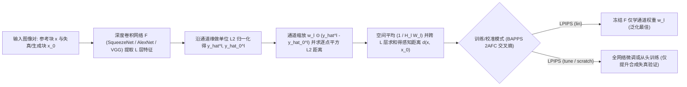

# The Unreasonable Effectiveness of Deep Features as a Perceptual Metric

**The Unreasonable Effectiveness of Deep Features as a Perceptual Metric** 收录于 [Awesome World-Action Models (RCL)](https://github.com/rcl-robotics/Awesome-World-Action-Models) **第 145/564** 篇，分组 **Evaluation metrics**。本页是 **清单索引**：给出它在清单中的位置与原文入口，方法细节和量化结果请看原文。

## 一句话定义

本文构建了包含 **48.4 万次**人工感知判断的 **BAPPS** 数据集，证明跨越不同架构（SqueezeNet/AlexNet/VGG）与监督信号（有监督/自监督/无监督）的深度卷积特征空间均“出奇有效地”涌现出与人类视觉感知高度一致的度量能力，并据此提出了线性校准感知距离指标 **LPIPS**。

## 英文缩写速查

| 缩写 | 英文全称 | 简要说明 |
|------|----------|----------|
| LPIPS | Learned Perceptual Image Patch Similarity | 本文提出的基于通道归一化深度特征加权 $\ell_2$ 距离的感知相似度指标 |
| BAPPS | Berkeley-Adobe Perceptual Patch Similarity | 本文发布的大规模图像块感知相似度数据集（含传统+CNN 失真与真实算法输出） |
| 2AFC | Two-Alternative Forced Choice | 二选一强迫选择测试（给定参考块 $x$，判断 $x_0$ 与 $x_1$ 哪个更接近） |
| JND | Just Noticeable Difference | 恰可察觉差异测试（判断两块图像“相同/不同”），用于交叉验证 2AFC 客观性 |
| SSIM | Structural Similarity Index | 经典底层结构相似性指标，对模糊和空间几何偏移不敏感 |
| PSNR | Peak Signal-to-Noise Ratio | 峰值信噪比，与逐像素 $\ell_2$ 误差直接相关，难以反映人类感知质量 |

## 为什么重要

- **揭示“感知相似度”是深度表征的涌现性质**：经典像素级 $\ell_2$/PSNR 与浅层结构指标 SSIM/FSIM 均假设像素独立或对几何形变脆弱；本文首次在大规模心理物理学实验上证实，只要经过有效的视觉表征学习（包括无监督 k-means 与自监督 BiGAN/Puzzle/SplitBrain），深度隐藏层特征间的余弦/$\ell_2$ 距离即可大幅超越传统指标。
- **奠定生成式视觉与世界模型评测/损失基础**：LPIPS 现已成为图像重建、扩散模型、一致模型蒸馏（如 Consistency Models 消融证实 LPIPS 为最优距离度量）以及视频/机器人视觉世界模型预测误差评估的核心指标。
- 想横向对照同一分组的其他工作，可以从 [RCL Awesome WAM 技术地图](../overview/rcl-awesome-wam-technology-map.md) 逐条展开，或顺着列表实体 [Awesome World-Action Models](paper-rcl-wam-robot-learning-control-survey.md) 接回对应主线。

## 核心信息

| 字段 | 内容 |
|------|------|
| 编号 | 145/564 |
| 分组 | Evaluation metrics |
| 出处 | CVPR 2018 (pp. 586–595) |
| 作者 / 机构 | Richard Zhang, Phillip Isola, Alexei A. Efros, Eli Shechtman, Oliver Wang（UC Berkeley, OpenAI, Adobe Research） |
| 论文 | <https://openaccess.thecvf.com/content_cvpr_2018/html/Zhang_The_Unreasonable_Effectiveness_CVPR_2018_paper.html> |
| 代码 / 数据 | <https://github.com/richzhang/PerceptualSimilarity> |
| 子类 / 象限 | 图像质量指标 · 评估指标与协议 · 视觉编码器与表征 · 不适用 |

## 核心机制（归纳）

> 注：以下机制与评测指标基于通读原文全文（CVPR 2018）核对补充。

论文由大规模心理物理学数据集 **BAPPS** 与基于通道归一化深度激活的 **LPIPS** 距离计算两部分构成：

1. **BAPPS 数据集设计（64×64 图像块，聚焦低层感知避免高层语义歧义）**：
   - **合成失真集（2AFC–Distort）**：基于 MIT-Adobe 5k（训练集 151.4k 三元组，每例 2 次标注）与 RAISE1k（验证集 9.4k 三元组，每例 5 次标注），包含 20 种传统原子失真（光度、噪声、模糊、空间仿射/单应/形变、JPEG 压缩）及其 308 种序贯组合（共 425 种配置），以及 **96 个随机架构与损失的 CNN 去噪自编码器**（在 ImageNet 训练 1 epoch）生成的典型神经网络伪影。
   - **真实算法输出验证集（2AFC–Real Alg）**：共 26.9k 三元组（每例 5 次标注），覆盖 **超分辨率（10.9k）、视频插帧（1.9k）、视频去模糊（9.4k）、自动上色（4.7k）** 4 类真实视觉任务输出。
   - **JND 恰可察觉差异验证集**：9.6k 对图像块（传统与 CNN 各 4.8k，每对 3 次判断，展示 1 秒间隔 250 ms），验证“相同/不同”判别力。
2. **LPIPS 特征距离公式**：
   - 给定网络 $\mathcal{F}$（如 SqueezeNet、AlexNet conv1–conv5、VGG 5 个卷积层），提取参考块 $x$ 与失真块 $x_0$ 在第 $l$ 层的激活特征，先沿**通道维做单位 $\ell_2$ 归一化**得 $\hat{y}^l, \hat{y}_0^l \in \mathbb{R}^{H_l \times W_l \times C_l}$，再用通道权重向量 $w_l \in \mathbb{R}^{C_l}$ 缩放并计算平方 $\ell_2$ 距离，最后空间平均并跨层累加：
     $$d(x, x_0) = \sum_{l} \frac{1}{H_l W_l} \sum_{h,w} \left\| w_l \odot \left(\hat{y}_{hw}^l - \hat{y}_{0hw}^l\right) \right\|_2^2$$
   - 注：当 $w_l = \mathbf{1}$ 时，上式等价于逐空间位置的通道余弦距离平均。
3. **三种校准/训练配置（通过小网络 $\mathcal{G}$ 由距离对 $(d_0, d_1)$ 预测人类偏好 $\hat{h}$ 的交叉熵损失）**：
   - **`lin`（线性校准，推荐）**：冻结预训练骨干 $\mathcal{F}$，仅学习通道权重 $w$（如 VGG 仅 1,472 个参数）。
   - **`tune`**：从预训练权重初始化并端到端微调整个骨干网络 $\mathcal{F}$ 与 $w$。
   - **`scratch`**：随机高斯初始化整个网络并从头在 2AFC 上训练。

### 方法流程图

关于感知损失在生成模型蒸馏与世界模型预测中的运用，可对照站内 [Consistency Models](paper-rcl-ref-041a05059886890708fc-consistency-models.md) 与 [generative-world-models.md](../methods/generative-world-models.md)。

## 评测与指标

- **综合 2AFC 一致率（传统+CNN 失真与 4 项真实算法共 6 个测试集均值，Sec 4.1）**：
  - **人类一致性上限**：**73.9%**（按 $p^2 + (1-p)^2$ 期望一致性计算）。
  - **无校准 ImageNet 有监督网络**：**SqueezeNet (2.8 MB) 68.6%、AlexNet (9.1 MB) 68.9%、VGG (58.9 MB) 67.0%**，显著超越传统底层指标 **$\ell_2$（63.2%）、SSIM（63.1%）、FSIMc（63.8%）**。
  - **自监督与无监督网络**：BiGAN、Puzzle、SplitBrain、Watching 等自监督表征与 ImageNet 监督网络表现持平；甚至简单的无监督堆叠 k-means 也优于经典底层指标；而随机高斯初始化网络（RandNet）性能大幅落后，证明**有意义的视觉表征训练信号至关重要**。
- **跨任务相关性（Table 4，基于 AlexNet 类架构跨方法计算）**：
  - **2AFC 与 JND（mAP）相关系数高达 $\rho = \mathbf{0.928}$**，证明 2AFC 捕获了客观一致的低层感知边界。
  - **2AFC 与高层语义任务相关**：与 PASCAL 图像分类相关性为 **0.640**、与目标检测相关性为 **0.363**（与分类–检测之间 0.429 的相关性量级相当），支持“做好语义任务的特征同样做好低层感知判断”。
- **向真实算法输出（超分/插帧/去模糊/上色）迁移（Fig. 4b & Sec 4.1）**：
  - 预训练 SqueezeNet / AlexNet / VGG 初始 2AFC 得分分别为 **64.0% / 65.0% / 62.6%**。
  - 采用 **`LPIPS (lin)`** 仅微调线性通道权重后，在 3 个网络 × 4 项任务的 **12 项得分中有 11 项提升**（3 架构平均分别提升 **+1.1%、+0.3%、+1.5%**）。
  - **关键负结果（`tune` 过拟合）**：全网端到端微调 `tune` 虽在合成失真验证集上得分最高，但在**真实算法输出上的迁移性能反而下降**，不及直接冻结高层预训练骨干做线性校准 `lin`。
- **与 SSIM 的定性分歧（Fig. 6）**：深度嵌入（如 BiGAN）对**模糊（blur）**比 SSIM 敏感得多，而对部分相关噪声模式的容忍度高于 SSIM。

## 与其他工作对比

- **LPIPS vs. 传统指标（$\ell_2$ / PSNR / SSIM / FSIMc / HDR-VDP）**：传统像素/局部结构指标在空间微小位移、几何形变与模糊下与人类判断严重背离；深度特征借助多层感受野与语义表征显著拉近与人类一致性（~68.9% vs. ~63.1%）。
- **LPIPS (`lin`) vs. 早期无校准 VGG 感知损失**：在多任务真实输出上，学习少量通道权重（如 VGG 的 1,472 个参数）进行“感知校准”可稳定提升一致性，且避免全网微调带来的合成失真过拟合风险。
- 同分组其他评测指标的横向对照，请回到 [技术地图](../overview/rcl-awesome-wam-technology-map.md) 的 **Evaluation metrics** 分组逐条展开。

## 结论

**“深度特征作为感知度量出奇有效”并非 ImageNet 监督分类或 VGG 架构的特例，而是视觉表征学习的普遍涌现性质；冻结预训练骨干并仅做线性通道校准的 `LPIPS (lin)` 在真实视觉任务上具备最优泛化性。**

1. **优先选用 `LPIPS (lin)` 而非全网微调 `tune`**：直接使用在分类或自监督任务上预训练好的骨干（如 AlexNet/VGG/SqueezeNet）加线性校准权重 $w_l$，既参数极少又能稳定泛化到超分、去模糊、上色等真实下游算法。
2. **模型大小与感知能力非强绑定**：2.8 MB 的 SqueezeNet（68.6%）与 9.1 MB 的 AlexNet（68.9%）在无校准下甚至略高于 58.9 MB 的 VGG（67.0%），对推理速度或显存敏感时（如训练损失函数或视频批量评测）优先选用 `AlexNet` 或 `SqueezeNet` 版 LPIPS。
3. **随机权重无效，表征训练信号不可少**：随机初始化网络仅靠卷积结构无法获得可靠感知度量，必须依赖从自然图像统计/语义/自监督任务学到的滤波器方向。
4. **注意指标适用前提**：LPIPS 针对空间对齐图像的低层感知相似度设计（BAPPS 为 64×64 图像块），不直接替代分布级多样性和真实感指标（如 FID）或大尺度几何/语义推理评估。

## 常见误区

1. **误以为只有 ImageNet 监督预训练 VGG 才能做感知损失**：原文实证表明 SqueezeNet、AlexNet 以及 BiGAN/Puzzle/SplitBrain 等自监督、甚至堆叠 k-means 无监督特征同样具备优异的感知一致性。
2. **误以为用人工感知标注端到端微调整个网络（`tune`）一定更好**：原文明确给出负结果——全网微调会过拟合合成失真分布，在真实算法输出上反而降低准确率。
3. **误将 LPIPS 当作严格数学度量或全局语义对齐指标**：人类视觉感知本身受上下文影响且不一定满足三角不等式等严格度量公理；当两张图像发生大幅物体位移或视角变化时，逐像素对齐的感受野特征距离依然会失效。

## 关联页面

- 列表实体：[Awesome World-Action Models（RCL）](paper-rcl-wam-robot-learning-control-survey.md)
- 技术地图：[RCL Awesome WAM 技术地图](../overview/rcl-awesome-wam-technology-map.md)
- 方法/任务：[generative-world-models.md](../methods/generative-world-models.md)、[manipulation.md](../tasks/manipulation.md)

## 参考来源

- [`sources/papers/rcl_awesome_wam_ref_beec1282930b73cf1272_the-unreasonable-effectiveness-of-deep-f.md`](../../sources/papers/rcl_awesome_wam_ref_beec1282930b73cf1272_the-unreasonable-effectiveness-of-deep-f.md) — 本条目策展摘录
- [`sources/papers/rcl_awesome_wam_catalog.md`](../../sources/papers/rcl_awesome_wam_catalog.md) — 列表总表
- [`sources/repos/awesome-world-action-models-rcl.md`](../../sources/repos/awesome-world-action-models-rcl.md)
- [`docs/PAPERS.md`](https://github.com/RCL-Robotics/Awesome-World-Action-Models/blob/main/docs/PAPERS.md) — 上游论文目录
- 论文：<https://openaccess.thecvf.com/content_cvpr_2018/html/Zhang_The_Unreasonable_Effectiveness_CVPR_2018_paper.html>

## 推荐继续阅读

- [Awesome World-Action Models (RCL) 仓库](https://github.com/rcl-robotics/Awesome-World-Action-Models)
- [原文](https://openaccess.thecvf.com/content_cvpr_2018/html/Zhang_The_Unreasonable_Effectiveness_CVPR_2018_paper.html)
